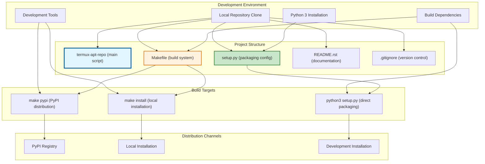
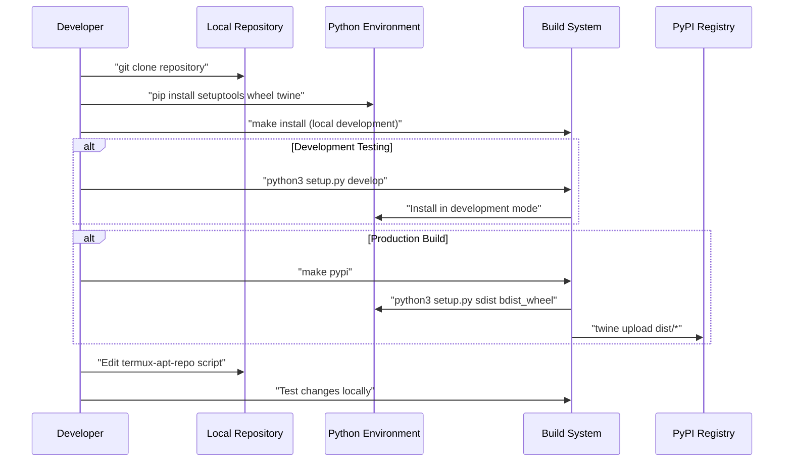
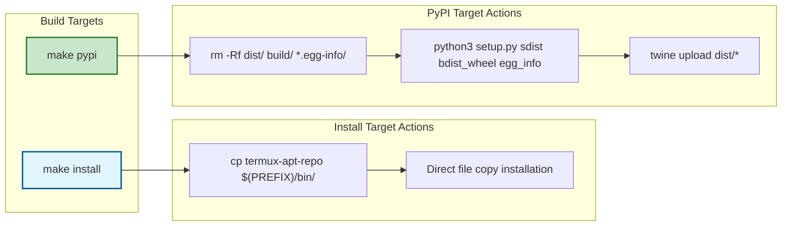
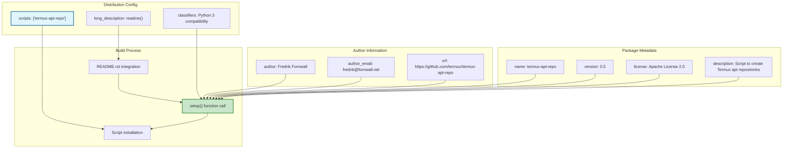
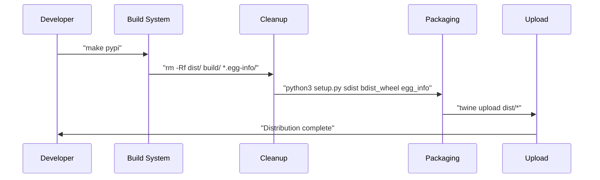

<!-- source: DeepWiki mcp.deepwiki.com · repo termux/termux-apt-repo · page 4.1 Development Environment Setup · fetched 2026-10-26 -->

# Development Environment Setup

<details>
<summary>Relevant source files</summary>

The following files were used as context for generating this wiki page:

- [.gitignore](.gitignore)
- [Makefile](Makefile)
- [setup.py](setup.py)

</details>


## Purpose and Scope

This document covers the setup and configuration of a development environment for contributing to the termux-apt-repo project. It includes understanding the project structure, setting up dependencies, using the build system, and establishing a development workflow.

For information about installing the tool for end-user purposes, see [Installation Methods](#3.1). For details about the packaging and distribution process, see [Packaging and Distribution](#4.2).

## Project Structure Overview

The termux-apt-repo project follows a simple Python packaging structure designed for ease of development and distribution. The project is organized as a single-script Python utility with standard packaging infrastructure.

### Development Environment Architecture



**Sources:** [setup.py:1-24](), [Makefile:1-10](), [.gitignore:1-4]()

## Development Environment Setup

### Prerequisites

The development environment requires the following components:

| Component | Purpose | Version Requirements |
|-----------|---------|---------------------|
| Python 3 | Core runtime and development | 3.x (as specified in setup.py classifiers) |
| setuptools | Python packaging framework | Latest stable |
| wheel | Python wheel packaging | Latest stable |
| twine | PyPI upload utility | Latest stable |
| make | Build automation | Standard Unix make |
| git | Version control | Latest stable |

### Environment Configuration



**Sources:** [setup.py:21](), [Makefile:1-9]()

### Setup Steps

1. **Clone the Repository**
   ```bash
   git clone https://github.com/termux/termux-apt-repo.git
   cd termux-apt-repo
   ```

2. **Verify Python Environment**
   - Ensure Python 3 is available as specified in [setup.py:21]()
   - Install required packaging tools: `pip install setuptools wheel twine`

3. **Install Development Dependencies**
   - The project has minimal dependencies as shown in [setup.py:1-24]()
   - No additional runtime dependencies are required beyond Python standard library

4. **Set Up Development Installation**
   ```bash
   # For local development testing
   python3 setup.py develop
   
   # Or use the Makefile target
   make install PREFIX=/usr/local
   ```

## Build System Understanding

### Makefile Targets

The build system is defined in [Makefile:1-10]() and provides two primary targets:



**Sources:** [Makefile:1-10]()

### Build Target Details

| Target | Command | Purpose | Dependencies |
|--------|---------|---------|-------------|
| `install` | `cp termux-apt-repo $(PREFIX)/bin/` | Local installation | `PREFIX` environment variable |
| `pypi` | Multi-step PyPI upload | Distribution to PyPI | `python3`, `setuptools`, `twine` |

### Setup.py Configuration

The [setup.py:1-24]() file defines the package configuration:



**Sources:** [setup.py:8-23]()

## Development Workflow

### Code Development Process

1. **File Structure Navigation**
   - Main script: `termux-apt-repo` (Python executable)
   - Package configuration: [setup.py:1-24]()
   - Build automation: [Makefile:1-10]()
   - Documentation: `README.rst` (referenced in [setup.py:6]())

2. **Development Testing**
   ```bash
   # Test local changes
   python3 termux-apt-repo [arguments]
   
   # Install development version
   python3 setup.py develop
   ```

3. **Build Validation**
   ```bash
   # Clean previous builds
   rm -Rf dist/ build/ *.egg-info/
   
   # Create distribution packages
   python3 setup.py sdist bdist_wheel
   
   # Verify package contents
   ls -la dist/
   ```

### Version Control Integration

The [.gitignore:1-4]() file excludes build artifacts:

| Pattern | Purpose |
|---------|---------|
| `build/` | Temporary build directory |
| `dist/` | Distribution packages |
| `*.egg-info` | Package metadata |

### Release Process

The release workflow follows the `make pypi` target sequence:



**Sources:** [Makefile:4-8]()

## Testing and Validation

### Development Testing Approach

1. **Script Functionality Testing**
   - Test the main `termux-apt-repo` script with various input scenarios
   - Verify repository generation with different package sets
   - Validate output APT repository structure

2. **Packaging Validation**
   - Verify [setup.py:1-24]() configuration produces correct packages
   - Test installation from built distributions
   - Validate metadata and script installation

3. **Build System Testing**
   - Test `make install` with different `PREFIX` values
   - Verify `make pypi` produces correct distribution files
   - Validate cleanup of build artifacts per [.gitignore:1-4]()

### Environment Validation

Before beginning development, ensure:

- Python 3 is available and matches [setup.py:21]() requirements
- All build dependencies are installed
- Local repository clone has correct permissions
- `PREFIX` environment variable is set for local installation

**Sources:** [setup.py:1-24](), [Makefile:1-10](), [.gitignore:1-4]()

---

