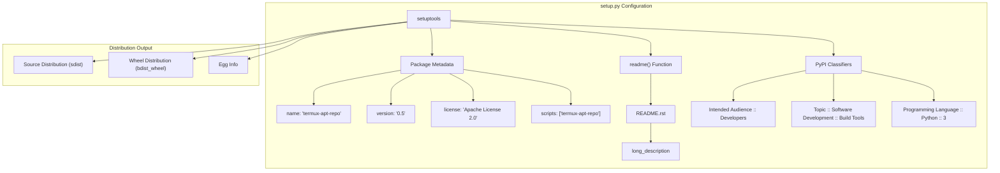
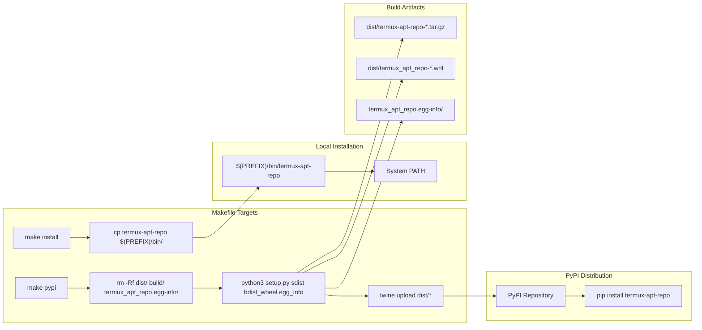
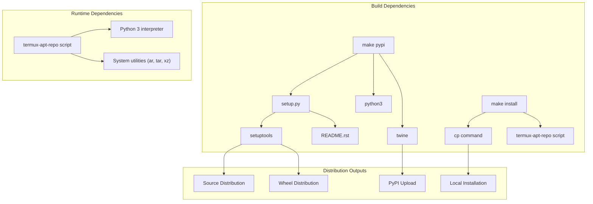

<!-- source: DeepWiki mcp.deepwiki.com · repo termux/termux-apt-repo · page 4.2 Packaging and Distribution · fetched 2026-10-26 -->

# Packaging and Distribution

<details>
<summary>Relevant source files</summary>

The following files were used as context for generating this wiki page:

- [Makefile](Makefile)
- [setup.py](setup.py)

</details>


This document covers the technical implementation of how termux-apt-repo is packaged for distribution and the mechanisms used to publish it to PyPI and enable local installation. This includes the Python packaging configuration, build system, and distribution workflows.

For information about installing termux-apt-repo from a user perspective, see [Installation Methods](#3.1). For setting up a development environment, see [Development Environment Setup](#4.1).

## Python Package Configuration

The project uses `setuptools` for Python packaging, configured through the `setup.py` file. This configuration defines the package metadata, dependencies, and distribution settings.

### Package Metadata

The package is configured with the following core metadata:

| Property | Value | Purpose |
|----------|-------|---------|
| name | `termux-apt-repo` | PyPI package identifier |
| version | `0.5` | Current release version |
| license | `Apache License 2.0` | Open source license |
| description | `Script to create Termux apt repositories` | Brief package description |
| author | `Fredrik Fornwall` | Package maintainer |
| url | `https://github.com/termux/termux-apt-repo` | Project homepage |

The package uses the `readme()` function to read the `README.rst` file and include it as the long description for PyPI display [setup.py:5-7]().

### Script Installation

The package is configured to install the main script as an executable command:

```python
scripts = ['termux-apt-repo']
```

This configuration tells setuptools to install the `termux-apt-repo` script file as an executable in the system PATH [setup.py:17]().

### Package Classifiers

The package includes PyPI classifiers that help users discover and understand the package:

- `Intended Audience :: Developers` - Targets software developers
- `Topic :: Software Development :: Build Tools` - Categorizes as build tooling
- `Programming Language :: Python :: 3` - Specifies Python 3 requirement

These classifiers are used by PyPI for search and categorization [setup.py:18-22]().

**Python Package Structure Diagram**



Sources: [setup.py:1-23]()

## Build System

The project uses a `Makefile` to provide convenient build targets for common development and distribution tasks. The Makefile defines two primary targets: `install` for local installation and `pypi` for PyPI distribution.

### Local Installation Target

The `install` target provides a simple mechanism for installing the script locally:

```make
install:
	cp termux-apt-repo $(PREFIX)/bin/termux-apt-repo
```

This target copies the main script to the `$(PREFIX)/bin/` directory, making it available as a system command [Makefile:1-2](). The `PREFIX` variable allows customization of the installation path.

### PyPI Distribution Target

The `pypi` target automates the process of building and uploading the package to PyPI:

```make
pypi:
	rm -Rf dist/ build/ termux_apt_repo.egg-info/
	python3 setup.py sdist bdist_wheel egg_info
	twine upload dist/*
```

This target performs the following operations:
1. Cleans up previous build artifacts [Makefile:5]()
2. Builds source distribution, wheel, and egg info using `setup.py` [Makefile:6]()
3. Uploads the built distributions to PyPI using `twine` [Makefile:7]()

**Build System Workflow Diagram**



Sources: [Makefile:1-9]()

## Distribution Workflows

The project supports two primary distribution workflows: direct PyPI publishing and local installation from source.

### PyPI Publishing Workflow

The PyPI publishing workflow is designed for maintainers to release new versions:

1. **Cleanup**: Remove previous build artifacts to ensure a clean build
2. **Build**: Generate source distribution, wheel, and egg info
3. **Upload**: Use `twine` to upload distributions to PyPI

The `setup.py` script generates multiple distribution formats:
- **Source Distribution (sdist)**: Contains the source code in a tar.gz archive
- **Wheel Distribution (bdist_wheel)**: Contains a pre-built binary distribution
- **Egg Info**: Contains package metadata for setuptools

### Local Installation Workflow

The local installation workflow is designed for developers and users who want to install from source:

1. **Direct Copy**: The `install` target directly copies the script to the system PATH
2. **No Build Required**: Since the script is pure Python, no compilation is needed
3. **Prefix Customization**: Users can specify custom installation paths via the `PREFIX` variable

**Distribution Methods Comparison**

| Method | Command | Target Audience | Artifacts | Dependencies |
|--------|---------|----------------|-----------|-------------|
| PyPI | `make pypi` | End users | sdist, wheel, egg-info | `twine`, `setuptools` |
| Local | `make install` | Developers | Direct copy | None |

Sources: [Makefile:4-7](), [setup.py:6]()

## Package Dependencies and Tools

The packaging system relies on several external tools and Python packages:

### Required Tools

- **setuptools**: Python packaging library used in `setup.py`
- **twine**: Tool for uploading packages to PyPI securely
- **python3**: Python interpreter for running build scripts

### Build Dependencies

The `setup.py` script has minimal dependencies, requiring only:
- `setuptools` for package building
- File system access to read `README.rst`

The `pypi` target additionally requires:
- `twine` for secure PyPI uploads
- `wheel` package for building wheel distributions

**Package Dependency Graph**



Sources: [setup.py:1](), [Makefile:6-7]()

---

