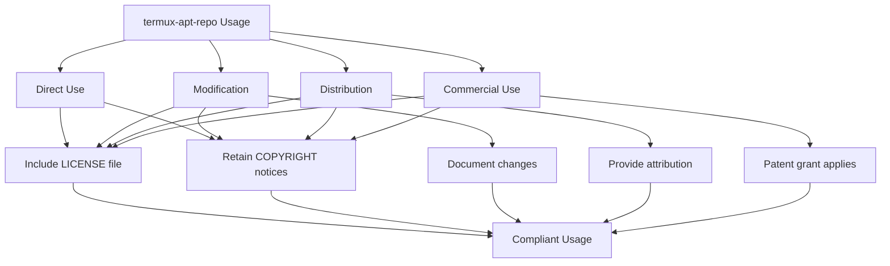
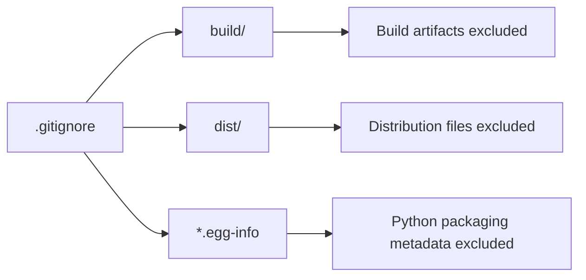
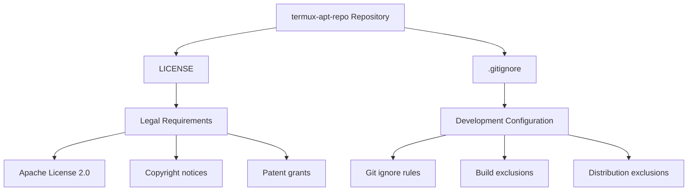
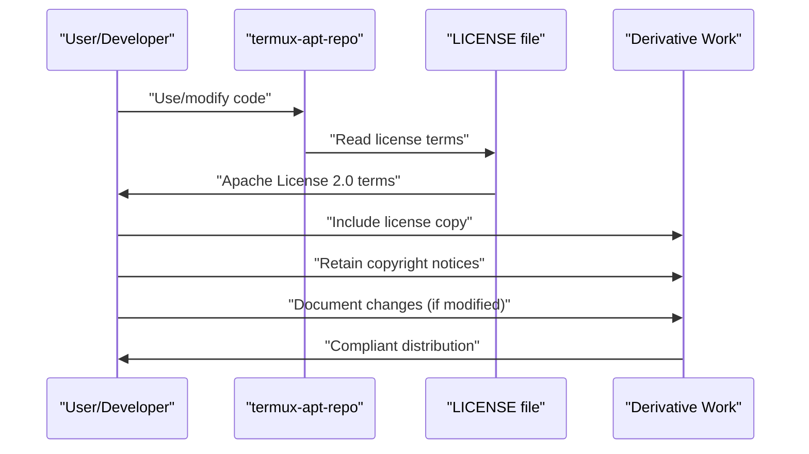

<!-- source: DeepWiki mcp.deepwiki.com · repo termux/termux-apt-repo · page 5 Reference · fetched 2026-10-26 -->

# Reference

<details>
<summary>Relevant source files</summary>

The following files were used as context for generating this wiki page:

- [.gitignore](.gitignore)
- [LICENSE](LICENSE)

</details>


This page provides legal information, licensing terms, and configuration details for the termux-apt-repo project. It covers the Apache License 2.0 under which the project is distributed, legal compliance requirements, and project configuration files.

For information about installation methods and usage, see [Installation and Usage](#3). For development setup and contribution guidelines, see [Development Guide](#4).

## License Information

The termux-apt-repo project is distributed under the Apache License 2.0, a permissive open-source license that allows for both commercial and non-commercial use, modification, and distribution of the software.

### License Terms

The complete license text is contained in the [LICENSE:1-202]() file. The Apache License 2.0 grants the following permissions:

| Permission | Description |
|------------|-------------|
| **Commercial Use** | Software may be used for commercial purposes |
| **Modification** | Software may be modified |
| **Distribution** | Software may be distributed |
| **Patent Use** | Provides express grant of patent rights from contributors |
| **Private Use** | Software may be used and modified in private |

### License Obligations

Users of termux-apt-repo must comply with the following requirements:

| Requirement | Description |
|-------------|-------------|
| **License Notice** | Must include a copy of the license with the software |
| **State Changes** | Must document significant changes made to the software |
| **Copyright Notice** | Must retain copyright notices in distributed copies |
| **Attribution** | Must provide attribution to original authors |

## Legal Compliance Workflow

The following diagram illustrates the legal compliance requirements for different usage scenarios:



Sources: [LICENSE:1-202]()

## Project Configuration Files

The repository contains minimal configuration files for development and distribution:

### Git Configuration

The project uses Git for version control with a simple `.gitignore` configuration:



**Ignored File Patterns:**
- `build/` - Build artifacts from setup.py
- `dist/` - Distribution packages 
- `*.egg-info` - Python package metadata

Sources: [.gitignore:1-4]()

### File Structure for Legal and Configuration



Sources: [LICENSE:1-202](), [.gitignore:1-4]()

## Attribution Requirements

When using, modifying, or distributing termux-apt-repo, the following attribution elements must be preserved:

### Required Elements

| Element | Location | Purpose |
|---------|----------|---------|
| **License Text** | [LICENSE:1-202]() | Full Apache License 2.0 text |
| **Copyright Notice** | [LICENSE:189-191]() | Placeholder for copyright holder |
| **License URL** | [LICENSE:195]() | Reference to official license |
| **Disclaimer** | [LICENSE:143-151]() | Warranty disclaimer |

### Attribution Workflow



Sources: [LICENSE:89-128]()

## License Compliance Checklist

For proper compliance with the Apache License 2.0, ensure the following:

### For Direct Usage
- [ ] Retain the [LICENSE:1-202]() file
- [ ] Maintain any existing copyright notices
- [ ] No additional requirements for private use

### For Modification
- [ ] Include the original [LICENSE:1-202]() file
- [ ] Document changes made per [LICENSE:97-98]()
- [ ] Retain all copyright and attribution notices per [LICENSE:100-103]()
- [ ] Add your own copyright statement if desired per [LICENSE:123]()

### For Distribution
- [ ] Include a copy of the Apache License 2.0
- [ ] Provide proper attribution to original authors
- [ ] Include any NOTICE file if present (not applicable to this project)
- [ ] Ensure modifications are clearly documented

### For Commercial Use
- [ ] All distribution requirements apply
- [ ] Patent license provisions apply per [LICENSE:73-87]()
- [ ] No royalty or license fees required
- [ ] Full commercial usage rights granted

Sources: [LICENSE:66-87](), [LICENSE:89-128]()

## Developer Configuration

The minimal configuration reflects the project's focused scope:

### Git Ignore Patterns

The [.gitignore:1-4]() file excludes standard Python packaging artifacts:

```
build/          # setuptools build directory
dist/           # distribution packages
*.egg-info      # package metadata
```

This configuration ensures that only source files and essential project files are tracked in version control, while build artifacts and distribution packages are excluded.

Sources: [.gitignore:1-4]()