# Page: Overview

# Overview

<details>
<summary>Relevant source files</summary>

The following files were used as context for generating this wiki page:

- [README.rst](README.rst)
- [termux-apt-repo](termux-apt-repo)

</details>


This document provides a comprehensive technical overview of the `termux-apt-repo` system, which is a Python-based tool for creating APT (Advanced Package Tool) repositories from `.deb` package files specifically designed for the Termux Android terminal environment.

For detailed information about the core script implementation, see [Core System: The termux-apt-repo Script](#2). For installation and usage instructions, see [Installation and Usage](#3). For development information, see [Development Guide](#4).

## Purpose and Scope

The `termux-apt-repo` system serves as a bridge between package creation and distribution in the Termux ecosystem. It transforms collections of `.deb` files into properly structured APT repositories that can be consumed by standard Debian package management tools.

**Primary Functions:**
- Process `.deb` files and extract package metadata
- Generate APT repository directory structures
- Create repository index files (`Packages`, `Contents`, `Release`)
- Support GPG signing for repository authentication
- Handle multiple CPU architectures (ARM, x86_64, i686, AArch64)

**Target Use Cases:**
- Publishing cross-compiled packages from the Termux build system
- Distributing packages created with `termux-create-package`
- Creating custom package repositories for Termux users
- Maintaining private or specialized package collections

Sources: [termux-apt-repo:1-230](), [README.rst:1-76]()

## System Architecture

The `termux-apt-repo` system follows a single-script architecture with clear separation between input processing, repository generation, and output formatting.

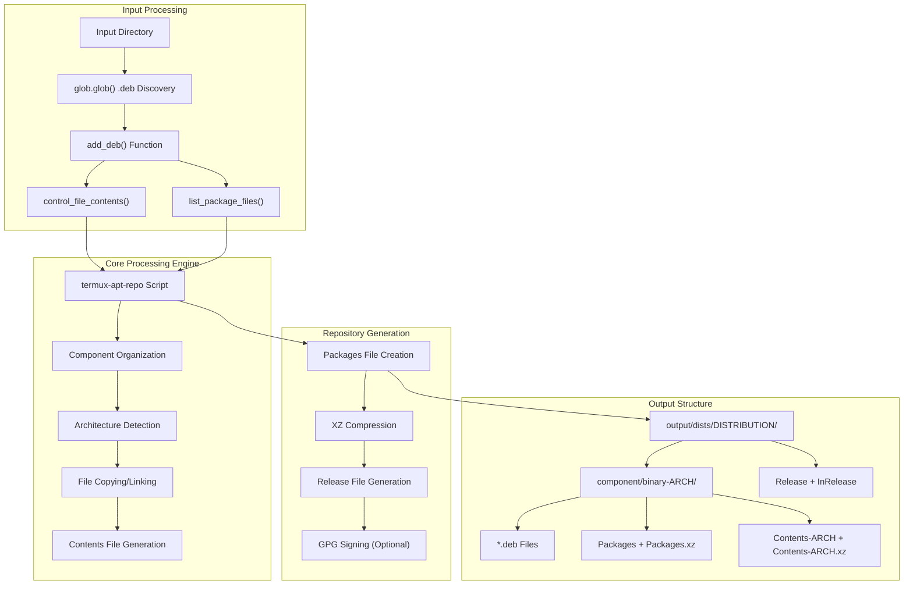

Sources: [termux-apt-repo:73-145](), [termux-apt-repo:157-186](), [termux-apt-repo:188-218]()

## Core Components and Code Entities

The system consists of several key components that map directly to functions and data structures in the codebase:

| Component | Code Entity | Purpose | File Reference |
|-----------|-------------|---------|----------------|
| Package Discovery | `glob.glob()` calls | Locate `.deb` files in input directory | [termux-apt-repo:130-132]() |
| Package Processing | `add_deb()` function | Extract metadata and organize files | [termux-apt-repo:73-102]() |
| Metadata Extraction | `control_file_contents()` | Parse control file from `.deb` | [termux-apt-repo:22-44]() |
| File Listing | `list_package_files()` | Extract file lists for Contents | [termux-apt-repo:46-71]() |
| Architecture Management | `supported_arches`, `encountered_arches` | Handle multi-arch support | [termux-apt-repo:6-7]() |
| Component Organization | `COMPONENTS` list | Manage repository components | [termux-apt-repo:5](), [termux-apt-repo:139-140]() |
| Repository Structure | `distribution_path` | Define output directory layout | [termux-apt-repo:125]() |
| Index Generation | Packages file creation loop | Generate APT index files | [termux-apt-repo:158-183]() |
| Compression | `subprocess.check_call()` with `xz` | Compress repository files | [termux-apt-repo:183](), [termux-apt-repo:185]() |
| GPG Signing | `gpg` subprocess call | Sign repository for authenticity | [termux-apt-repo:214-217]() |

Sources: [termux-apt-repo:1-230]()

## Processing Workflow

The system follows a deterministic processing pipeline that transforms input `.deb` files into a complete APT repository:

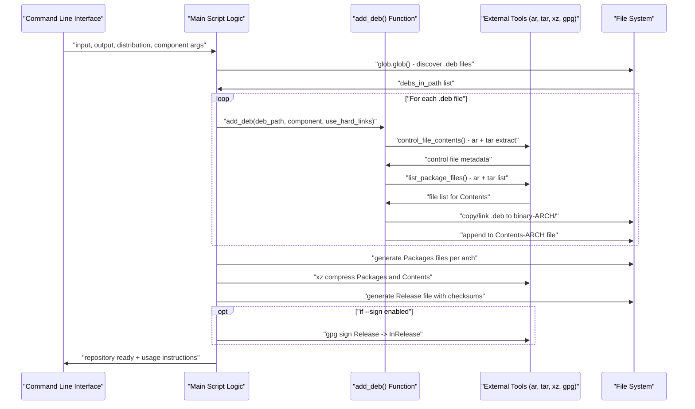

Sources: [termux-apt-repo:118-145](), [termux-apt-repo:157-186](), [termux-apt-repo:212-218]()

## Architecture and Multi-Platform Support

The system handles multiple CPU architectures through the `supported_arches` list and `encountered_arches` set:

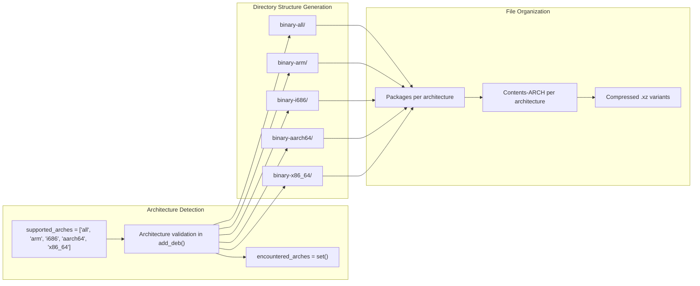

Sources: [termux-apt-repo:6-7](), [termux-apt-repo:77-81](), [termux-apt-repo:84-87]()

## Integration with Termux Ecosystem

The system integrates with the broader Termux ecosystem through several key interfaces:

| Integration Point | Implementation | Code Reference |
|------------------|----------------|----------------|
| Package Input | Accepts `.deb` files from `termux-packages` build system | [termux-apt-repo:130-132]() |
| Package Input | Accepts `.deb` files from `termux-create-package` | [README.rst:8-9]() |
| Installation | Available via `pkg install termux-apt-repo` | [README.rst:14]() |
| Installation | Available via `pip3 install termux-apt-repo` | [README.rst:36]() |
| Client Configuration | Generates `sources.list.d` entries | [termux-apt-repo:223-228]() |
| Repository Structure | Standard Debian APT format | [termux-apt-repo:125]() |
| GPG Integration | Uses system GPG for signing | [termux-apt-repo:214-217]() |
| Compression | Uses `xz` for efficient compression | [termux-apt-repo:183](), [termux-apt-repo:185]() |

The generated repository structure follows the standard Debian format:
```
output/
└── dists/
    └── DISTRIBUTION/
        ├── Release
        ├── InRelease (if signed)
        └── COMPONENT/
            ├── binary-ARCH/
            │   ├── Packages
            │   ├── Packages.xz
            │   └── *.deb
            ├── Contents-ARCH
            └── Contents-ARCH.xz
```

Sources: [termux-apt-repo:125](), [termux-apt-repo:84-87](), [termux-apt-repo:148-155](), [README.rst:1-76]()

## External Dependencies

The system relies on several external tools that must be available in the system PATH:

| Tool | Purpose | Usage in Code |
|------|---------|---------------|
| `ar` | Extract files from `.deb` archives | [termux-apt-repo:23](), [termux-apt-repo:47]() |
| `tar` | Extract control and data files | [termux-apt-repo:38-39](), [termux-apt-repo:62-63]() |
| `xz` | Compress repository index files | [termux-apt-repo:183](), [termux-apt-repo:185]() |
| `gpg` | Sign repository Release files | [termux-apt-repo:214-217]() |

These dependencies are typically available in most Linux distributions and are included in the Termux environment.

Sources: [termux-apt-repo:14-20](), [termux-apt-repo:22-44](), [termux-apt-repo:46-71](), [termux-apt-repo:183](), [termux-apt-repo:185](), [termux-apt-repo:214-217]()

---

# Page: Core System: The termux-apt-repo Script

# Core System: The termux-apt-repo Script

<details>
<summary>Relevant source files</summary>

The following files were used as context for generating this wiki page:

- [termux-apt-repo](termux-apt-repo)

</details>


## Purpose and Scope

This document provides comprehensive technical documentation for the core `termux-apt-repo` Python script, which serves as the primary executable component of the termux-apt-repo system. The script processes Debian package files (.deb) and generates APT repository structures compliant with the Debian repository format.

For installation methods and usage examples, see [Installation and Usage](#3). For development environment setup and contributing guidelines, see [Development Guide](#4).

## Script Architecture and Key Components

The `termux-apt-repo` script is implemented as a single Python file with a modular function-based architecture. The script operates through a sequence of distinct processing stages, each handled by specialized functions.

### Core Function Architecture

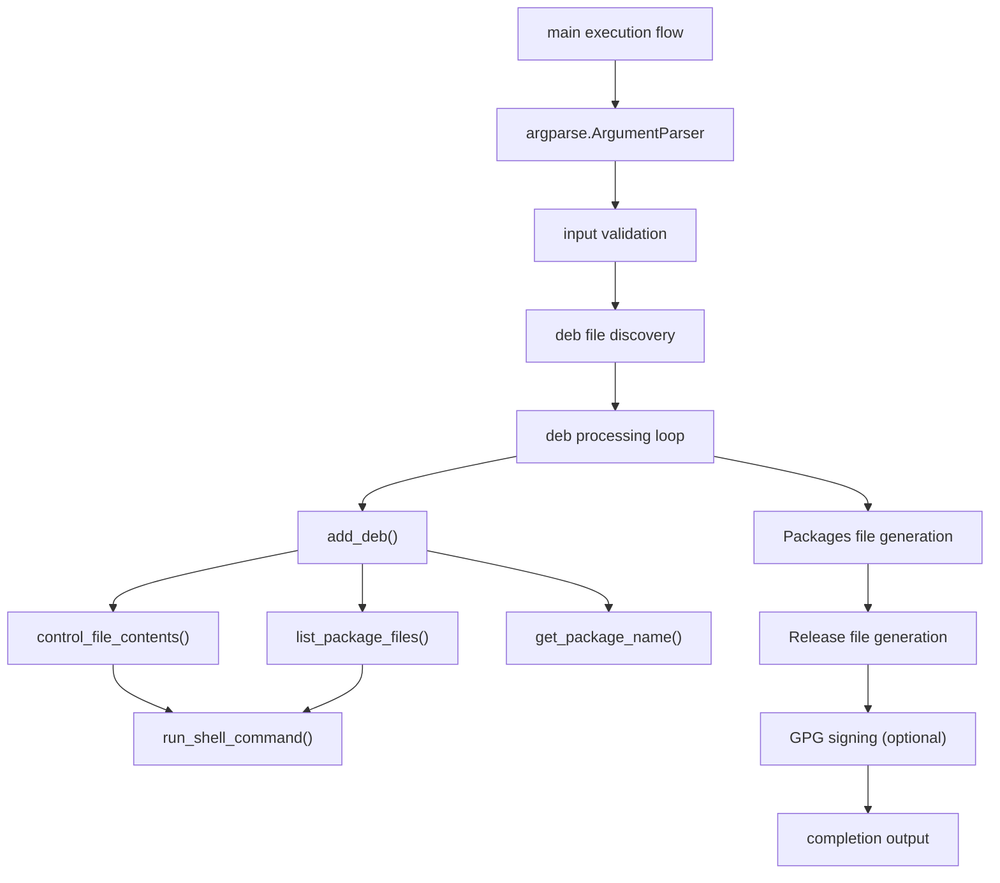

Sources: [termux-apt-repo:1-230]()

### Global Variables and Constants

The script maintains several global variables that control processing behavior:

| Variable | Type | Purpose |
|----------|------|---------|
| `COMPONENTS` | list | Component directories found during processing |
| `supported_arches` | list | Supported architecture strings: all, arm, i686, aarch64, x86_64 |
| `encountered_arches` | set | Architectures discovered in processed .deb files |
| `hashes` | list | Hash algorithms used for integrity checking: md5, sha1, sha256, sha512 |

Sources: [termux-apt-repo:5-8]()

### Core Processing Functions

#### Package Metadata Extraction

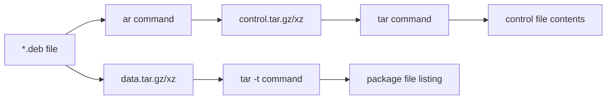

The `control_file_contents()` function extracts package metadata using a two-stage process:
1. **Archive listing**: Uses `ar t` to list archive contents
2. **Control extraction**: Uses `ar p` piped to `tar -O` to extract the control file

The `list_package_files()` function generates file listings for Contents files using `tar -t` on the data archive.

Sources: [termux-apt-repo:22-71]()

#### Package Processing Pipeline

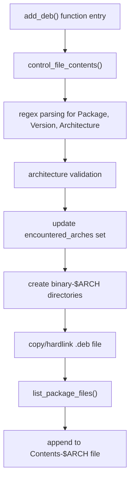

The `add_deb()` function coordinates the processing of individual .deb files through these stages:
1. **Metadata extraction**: Retrieves Package, Version, and Architecture fields
2. **Architecture validation**: Ensures architecture is in `supported_arches`
3. **Directory creation**: Creates `binary-$ARCH` subdirectories as needed
4. **File placement**: Either copies or hard-links the .deb file to the destination
5. **Contents update**: Appends file listings to Contents files

Sources: [termux-apt-repo:73-103]()

## Processing Pipeline and External Dependencies

### Command Execution Framework

The script relies heavily on external Unix tools through the `run_shell_command()` function, which provides centralized subprocess management with error handling.

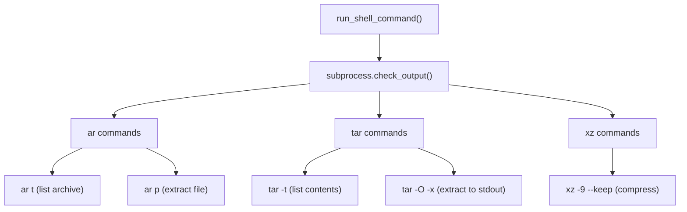

Sources: [termux-apt-repo:14-20]()

### Repository Generation Workflow

The main processing loop implements a multi-stage workflow:

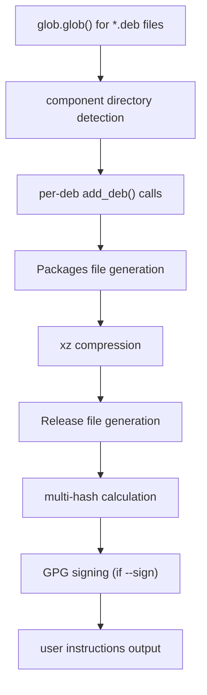

The script processes files in this sequence:
1. **Discovery**: Scans input directory for .deb files using `glob.glob()`
2. **Component organization**: Determines component names from directory structure
3. **Processing**: Calls `add_deb()` for each discovered .deb file
4. **Metadata generation**: Creates Packages files with complete package metadata
5. **Compression**: Compresses Packages and Contents files using `xz -9`
6. **Release generation**: Creates Release file with repository metadata and file hashes
7. **Signing**: Optionally signs Release file with GPG to create InRelease file

Sources: [termux-apt-repo:130-218]()

## Repository Structure and File Generation

### Generated Directory Structure

The script creates a standard Debian repository structure under the output directory:

```
output/
└── dists/
    └── $DISTRIBUTION/
        ├── Release
        ├── InRelease (if signed)
        └── $COMPONENT/
            ├── Contents-$ARCH
            ├── Contents-$ARCH.xz
            └── binary-$ARCH/
                ├── Packages
                ├── Packages.xz
                └── *.deb files
```

### Metadata File Generation

#### Packages File Creation


The Packages file generation process:
1. **Control parsing**: Extracts existing control file contents
2. **Field augmentation**: Adds Filename, Size, and hash fields (MD5Sum, SHA1, SHA256, SHA512)
3. **File writing**: Writes complete package records to Packages file
4. **Compression**: Creates compressed Packages.xz file

Sources: [termux-apt-repo:157-183]()

#### Release File Generation

The Release file contains repository metadata and file integrity information:

| Field | Source | Description |
|-------|--------|-------------|
| `Codename` | Hard-coded "termux" | Repository codename |
| `Version` | Hard-coded "1" | Repository version |
| `Architectures` | `encountered_arches` | Space-separated architecture list |
| `Description` | `$DISTRIBUTION + " repository"` | Repository description |
| `Suite` | `$DISTRIBUTION` | Repository suite name |
| `Date` | `datetime.datetime.utcnow()` | UTC timestamp |
| `Components` | `COMPONENTS` | Space-separated component list |

The Release file includes hash sections for each supported algorithm, containing hash, size, and path information for all Packages and Contents files.

Sources: [termux-apt-repo:147-210]()

### GPG Signing Integration

When the `--sign` flag is specified, the script invokes GPG to create a signed InRelease file:

```bash
gpg --yes --pinentry-mode loopback --digest-algo SHA256 --clearsign -o $DISTRIBUTION/InRelease $DISTRIBUTION/Release
```

This enables repository authentication without requiring the `[trusted=yes]` directive in APT sources configuration.

Sources: [termux-apt-repo:212-217]()

## Command-Line Interface

The script uses `argparse` for command-line processing with these arguments:

| Argument | Type | Default | Description |
|----------|------|---------|-------------|
| `input` | Required | - | Directory containing .deb files |
| `output` | Required | - | Output directory for repository |
| `distribution` | Optional | "termux" | Distribution name for repository |
| `component` | Optional | "extras" | Default component name |
| `--use-hard-links` | Flag | False | Use hard links instead of copying |
| `--sign` | Flag | False | Sign repository with GPG |

The script supports component auto-detection: .deb files in subdirectories use the subdirectory name as the component, while files in the root use the default component.

Sources: [termux-apt-repo:104-124]()

---

# Page: Architecture and Internal Design

# Architecture and Internal Design

<details>
<summary>Relevant source files</summary>

The following files were used as context for generating this wiki page:

- [termux-apt-repo](termux-apt-repo)

</details>


This document provides a comprehensive technical analysis of the internal architecture, data structures, and design patterns used in the core `termux-apt-repo` script. It covers the system's modular design, function relationships, data flow patterns, and external dependencies.

For information about the command-line interface and usage patterns, see [Command-Line Interface and Arguments](#2.2). For details about the processing algorithms and workflows, see [Processing Pipeline and Algorithms](#2.3).

## System Architecture Overview

The `termux-apt-repo` script follows a functional programming paradigm with a single-threaded, sequential processing model. The architecture is built around five core functional modules that operate on shared global state.

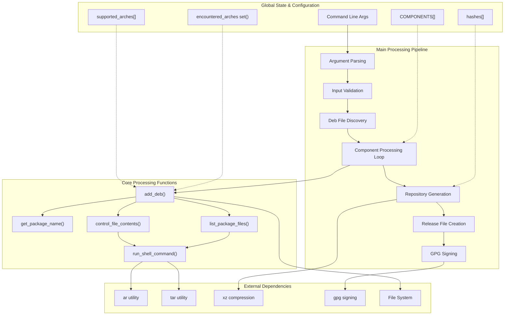

Sources: [termux-apt-repo:1-230]()

## Data Structures and Global State

The system maintains several global data structures that serve as the primary state management mechanism throughout the processing pipeline.

### Global Variables

| Variable | Type | Purpose | Scope |
|----------|------|---------|-------|
| `COMPONENTS` | `list` | Tracks repository components discovered during processing | Global, modified during processing |
| `supported_arches` | `list` | Defines valid package architectures | Global, read-only |
| `encountered_arches` | `set` | Accumulates architectures found in processed packages | Global, modified during processing |
| `hashes` | `list` | Defines hash algorithms for repository metadata | Global, read-only |

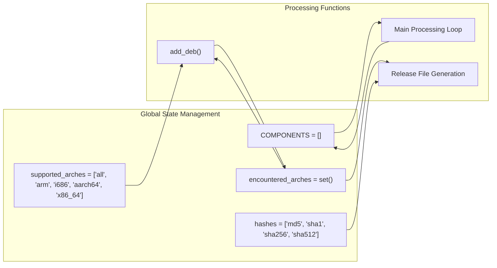

Sources: [termux-apt-repo:5-8]()

### Architecture Validation

The system enforces strict architecture validation through the `supported_arches` list. Any package with an unsupported architecture causes immediate termination.

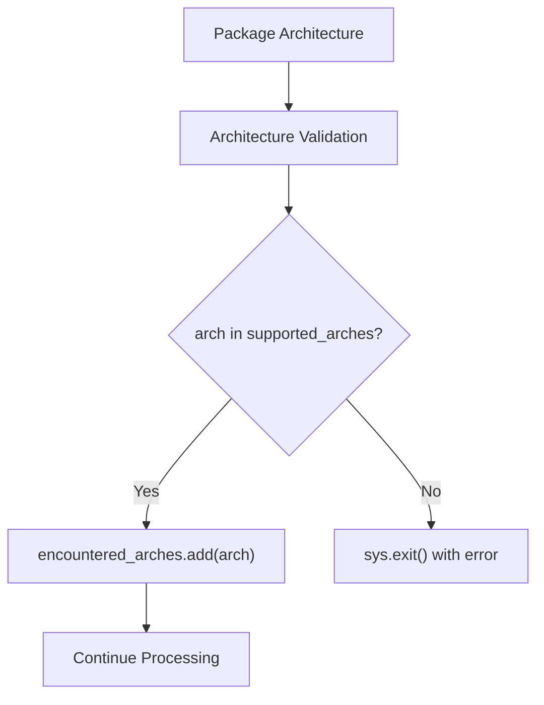

Sources: [termux-apt-repo:79-81]()

## Function Architecture and Dependencies

The core processing functions form a dependency hierarchy where higher-level functions orchestrate lower-level operations.

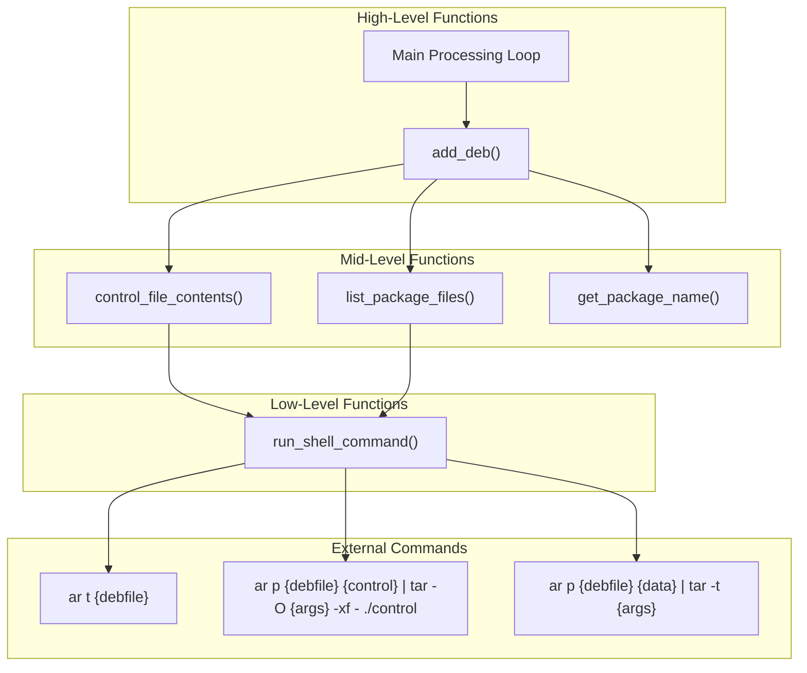

Sources: [termux-apt-repo:10-103]()

### Function Responsibilities

#### `get_package_name(filename)`
- **Purpose**: Extract package name from .deb filename
- **Input**: Filename string following `name_version_arch.deb` pattern
- **Output**: Package name (first underscore-separated component)
- **Pattern**: Pure function with no side effects

#### `run_shell_command(cmd)`
- **Purpose**: Execute shell commands with error handling
- **Input**: Shell command string
- **Output**: Command output or `None` on failure
- **Error Handling**: Catches `CalledProcessError`, suppresses stderr

#### `control_file_contents(debfile)`
- **Purpose**: Extract control file metadata from .deb package
- **Dependencies**: `run_shell_command()`, `ar`, `tar`
- **Processing**: Detects compression format, extracts control file
- **Error Handling**: Terminates on extraction failure

#### `list_package_files(debfile)`
- **Purpose**: List all files contained in .deb package
- **Dependencies**: `run_shell_command()`, `ar`, `tar`
- **Processing**: Extracts data archive, lists contents
- **Output**: List of file paths with directory indicators removed

#### `add_deb(deb_to_add_path, component, use_hard_links)`
- **Purpose**: Process individual .deb package into repository structure
- **Dependencies**: `control_file_contents()`, `list_package_files()`, `get_package_name()`
- **Side Effects**: Creates directories, copies/links files, updates Contents files
- **Architecture Validation**: Enforces supported architecture constraints

Sources: [termux-apt-repo:10-103]()

## Processing Architecture Patterns

### Command Execution Pattern

The system uses a consistent pattern for executing external commands through the `run_shell_command()` function:

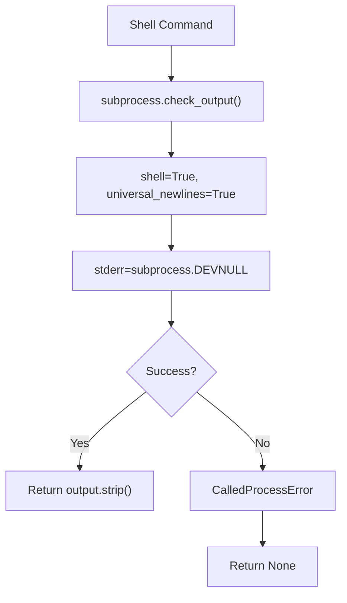

Sources: [termux-apt-repo:14-20]()

### Archive Processing Pattern

Both `control_file_contents()` and `list_package_files()` follow the same archive processing pattern:

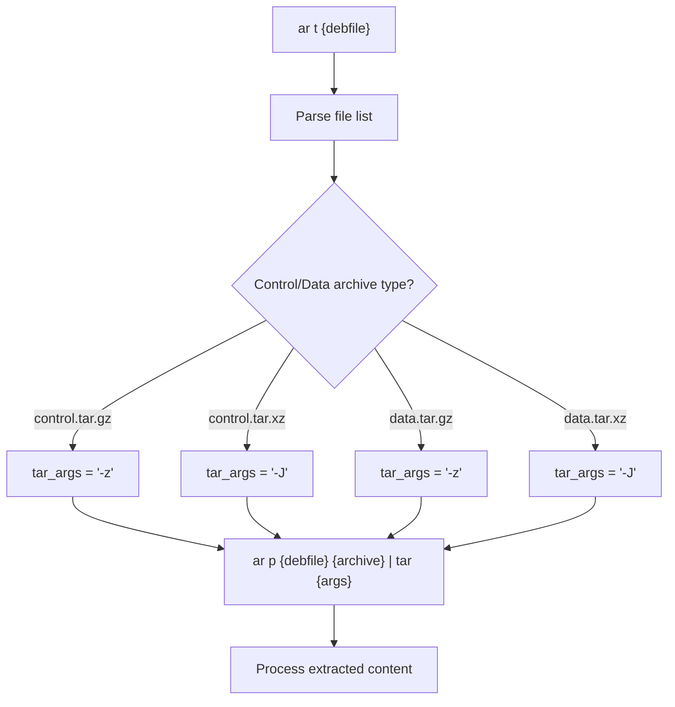

Sources: [termux-apt-repo:22-71]()

### Repository Structure Generation

The system creates a hierarchical directory structure following Debian repository conventions:

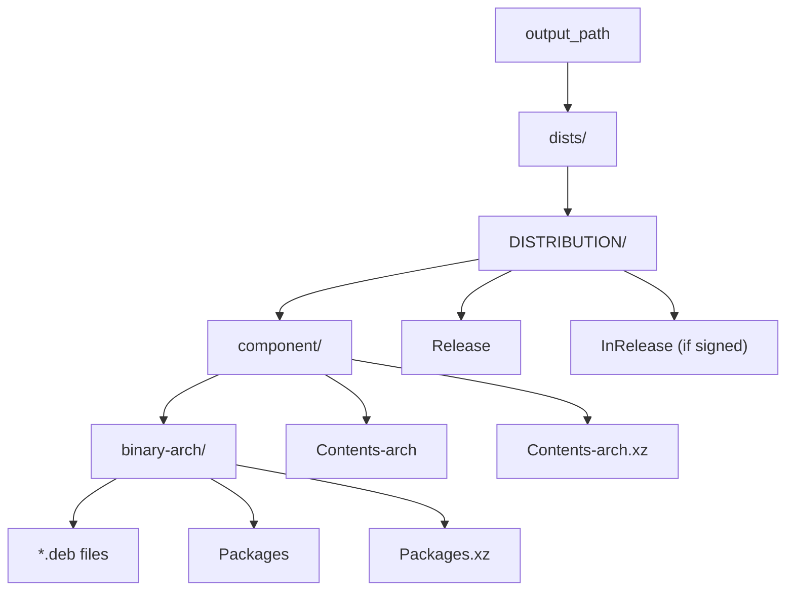

Sources: [termux-apt-repo:84-94](), [termux-apt-repo:125]()

## External Dependencies Architecture

The system has carefully orchestrated dependencies on external Unix utilities:

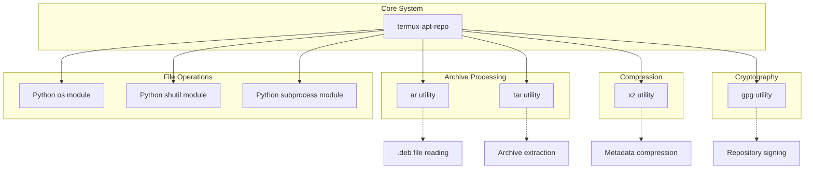

Sources: [termux-apt-repo:3](), [termux-apt-repo:16-18](), [termux-apt-repo:183](), [termux-apt-repo:214-217]()

## Error Handling Architecture

The system implements a fail-fast error handling strategy with immediate termination on critical errors:

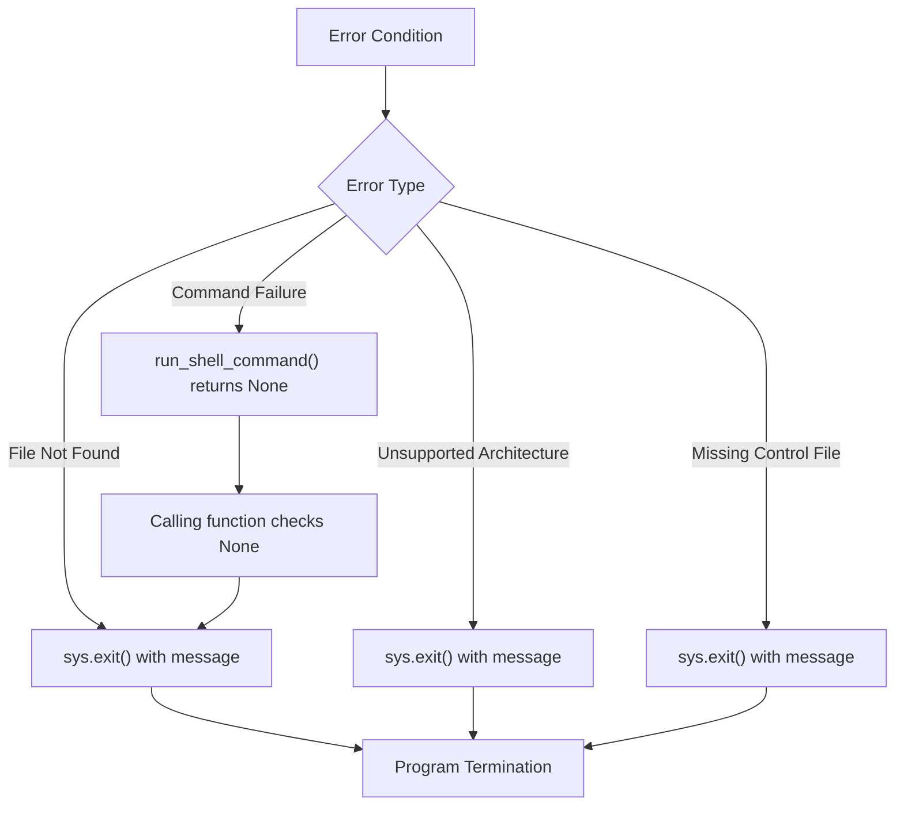

Sources: [termux-apt-repo:19-20](), [termux-apt-repo:25](), [termux-apt-repo:36](), [termux-apt-repo:42](), [termux-apt-repo:49](), [termux-apt-repo:60](), [termux-apt-repo:80](), [termux-apt-repo:128](), [termux-apt-repo:133]()

## Memory and Performance Architecture

The system follows a streaming architecture pattern that minimizes memory usage:

- **File Processing**: Files are processed one at a time without loading entire datasets into memory
- **Contents Generation**: Contents files are written incrementally using append mode
- **Shell Command Execution**: External commands handle heavy lifting (compression, archive extraction)
- **Global State**: Minimal global state with efficient data structures (`set` for architecture tracking)

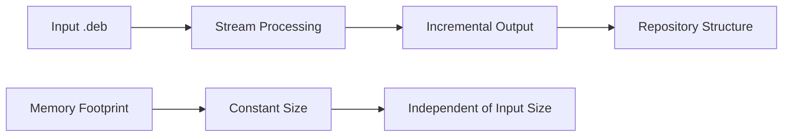

Sources: [termux-apt-repo:100-102](), [termux-apt-repo:165-181]()

---

# Page: Command-Line Interface and Arguments

# Command-Line Interface and Arguments

<details>
<summary>Relevant source files</summary>

The following files were used as context for generating this wiki page:

- [README.rst](README.rst)
- [termux-apt-repo](termux-apt-repo)

</details>


This document provides comprehensive documentation of the command-line interface for the `termux-apt-repo` script. It covers all command-line arguments, their validation, processing, and usage patterns within the system.

For information about the internal processing pipeline that uses these arguments, see [Processing Pipeline and Algorithms](#2.3). For details about the repository structure created based on these arguments, see [Repository Structure and File Formats](#2.4).

## Argument Parser Configuration

The `termux-apt-repo` script uses Python's `argparse` module to define and process command-line arguments. The parser configuration establishes the interface contract between users and the repository generation system.

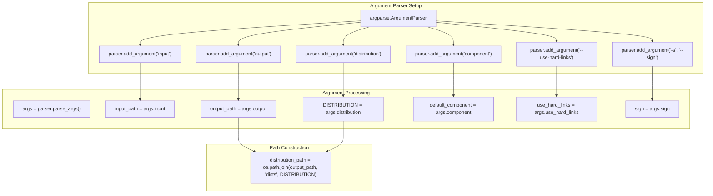

Sources: [termux-apt-repo:104-125]()

## Positional Arguments

### Input Directory (`input`)

| Property | Value |
|----------|--------|
| **Type** | `str` |
| **Required** | Yes |
| **Position** | 1 |
| **Description** | Folder where .deb files are located |
| **Validation** | Must be an existing directory |

The `input` argument specifies the source directory containing `.deb` files to be processed. The script performs recursive scanning to locate all `.deb` files in the specified directory and its subdirectories.

```mermaid
graph LR
    A["input argument"] --> B["input_path variable"]
    B --> C["Directory existence check"]
    C --> D["os.path.isdir(input_path)"]
    D --> E["Glob pattern matching"]
    E --> F["debs_in_path = glob.glob(os.path.join(input_path, '*.deb'))"]
    E --> G["debs_in_path += glob.glob(os.path.join(input_path, '*/*.deb'))"]
```

Sources: [termux-apt-repo:105-106](), [termux-apt-repo:119](), [termux-apt-repo:127-133]()

### Output Directory (`output`)

| Property | Value |
|----------|--------|
| **Type** | `str` |
| **Required** | Yes |
| **Position** | 2 |
| **Description** | Folder with repository tree |
| **Structure** | `output/dists/distribution/component/binary-$ARCH/` |

The `output` argument defines the root directory where the APT repository structure will be created. The script constructs the full repository hierarchy under this path.

```mermaid
graph TD
    A["output argument"] --> B["output_path variable"]
    B --> C["distribution_path construction"]
    C --> D["os.path.join(output_path, 'dists', DISTRIBUTION)"]
    D --> E["Component directories"]
    E --> F["os.path.join(distribution_path, component)"]
    F --> G["Architecture directories"]
    G --> H["os.path.join(distribution_path, component, 'binary-' + deb_arch)"]
```

Sources: [termux-apt-repo:107-108](), [termux-apt-repo:120](), [termux-apt-repo:125]()

### Distribution Name (`dist`)

| Property | Value |
|----------|--------|
| **Type** | `str` |
| **Required** | No |
| **Position** | 3 |
| **Default** | `'termux'` |
| **Description** | Name of distribution folder |

The optional `distribution` argument specifies the distribution name used in the repository structure. This becomes part of the path `output/dists/distribution/component/binary-$ARCH/`.

### Component Name (`comp`)

| Property | Value |
|----------|--------|
| **Type** | `str` |
| **Required** | No |
| **Position** | 4 |
| **Default** | `'extras'` |
| **Description** | Name of component folder |

The optional `component` argument provides the default component name. Individual packages can override this based on their subdirectory structure within the input directory.

```mermaid
graph LR
    A["Package file path"] --> B["os.path.dirname(os.path.relpath(deb_path, input_path))"]
    B --> C{"Component from path?"}
    C -->|Yes| D["Use subdirectory name"]
    C -->|No| E["Use default_component"]
    D --> F["COMPONENTS.append(component)"]
    E --> F
```

Sources: [termux-apt-repo:109-112](), [termux-apt-repo:121-122](), [termux-apt-repo:136-140]()

## Optional Arguments

### Hard Links (`--use-hard-links`)

| Property | Value |
|----------|--------|
| **Type** | `bool` |
| **Default** | `False` |
| **Action** | `store_true` |
| **Description** | Use hard links instead of copying deb files |
| **Limitation** | Will not work on Android devices |

This flag controls the file copying behavior during repository creation. When enabled, the script creates hard links to the original `.deb` files instead of copying them, which saves disk space but requires the source and destination to be on the same filesystem.

```mermaid
graph LR
    A["use_hard_links flag"] --> B{"Hard links enabled?"}
    B -->|Yes| C["os.link(deb_to_add_path, destination_deb_file)"]
    B -->|No| D["shutil.copy2(deb_to_add_path, destination_deb_file)"]
```

Sources: [termux-apt-repo:113-114](), [termux-apt-repo:123](), [termux-apt-repo:95-98]()

### GPG Signing (`-s`, `--sign`)

| Property | Value |
|----------|--------|
| **Type** | `bool` |
| **Default** | `False` |
| **Action** | `store_true` |
| **Short Form** | `-s` |
| **Long Form** | `--sign` |
| **Description** | Sign repository with GPG key |

The signing flag enables GPG signing of the repository Release file, creating an `InRelease` file for enhanced security and trust validation.

```mermaid
graph LR
    A["sign flag"] --> B{"Signing enabled?"}
    B -->|Yes| C["GPG signing process"]
    C --> D["gpg --yes --pinentry-mode loopback --digest-algo SHA256 --clearsign"]
    D --> E["Create InRelease file"]
    B -->|No| F["Skip signing"]
```

Sources: [termux-apt-repo:115-116](), [termux-apt-repo:124](), [termux-apt-repo:212-217]()

## Argument Processing Flow

The argument processing follows a systematic flow from parsing to validation to usage throughout the script execution.

```mermaid
sequenceDiagram
    participant CLI as "Command Line"
    participant Parser as "argparse.ArgumentParser"
    participant Validator as "Input Validation"
    participant Processor as "Main Processing"
    
    CLI->>Parser: "python termux-apt-repo input output dist comp --sign"
    Parser->>Parser: "parse_args()"
    Parser->>Validator: "Parsed arguments"
    Validator->>Validator: "os.path.isdir(input_path)"
    Validator->>Validator: "glob.glob() for .deb files"
    Validator->>Processor: "Validated arguments"
    Processor->>Processor: "distribution_path construction"
    Processor->>Processor: "Repository generation"
```

Sources: [termux-apt-repo:118-125](), [termux-apt-repo:127-133]()

## Usage Patterns

### Basic Usage

```bash
termux-apt-repo /path/to/debs /path/to/repo
```

This creates a repository with default distribution name `termux` and component name `extras`.

### Custom Distribution and Component

```bash
termux-apt-repo /path/to/debs /path/to/repo stable main
```

### With Hard Links

```bash
termux-apt-repo /path/to/debs /path/to/repo --use-hard-links
```

### With GPG Signing

```bash
termux-apt-repo /path/to/debs /path/to/repo -s
```

Sources: [README.rst:19-34]()

## Validation and Error Handling

The script performs several validation checks on the provided arguments:

| Validation | Error Message | Exit Condition |
|------------|---------------|----------------|
| Input directory exists | `'input' does not exist` | Directory not found |
| .deb files present | `No .deb file found in input` | No packages to process |
| Architecture support | `Unsupported arch "arch" in filename` | Unsupported architecture |

```mermaid
graph TD
    A["Argument Validation"] --> B["Input Directory Check"]
    B --> C["os.path.isdir(input_path)"]
    C --> D{Directory exists?}
    D -->|No| E["sys.exit('input does not exist')"]
    D -->|Yes| F["Scan for .deb files"]
    F --> G["glob.glob patterns"]
    G --> H{".deb files found?"}
    H -->|No| I["sys.exit('No .deb file found')"]
    H -->|Yes| J["Process packages"]
    J --> K["Architecture validation"]
    K --> L{Architecture supported?}
    L -->|No| M["sys.exit('Unsupported arch')"]
    L -->|Yes| N["Continue processing"]
```

Sources: [termux-apt-repo:127-133](), [termux-apt-repo:79-81]()

## Global Variables and Constants

The argument processing initializes several global variables and constants used throughout the script:

| Variable | Source | Description |
|----------|--------|-------------|
| `input_path` | `args.input` | Source directory path |
| `output_path` | `args.output` | Repository root path |
| `DISTRIBUTION` | `args.distribution` | Distribution name |
| `default_component` | `args.component` | Default component name |
| `use_hard_links` | `args.use_hard_links` | File copying method |
| `sign` | `args.sign` | GPG signing flag |
| `distribution_path` | Constructed | Full distribution path |
| `supported_arches` | Constant | `['all', 'arm', 'i686', 'aarch64', 'x86_64']` |

Sources: [termux-apt-repo:6](), [termux-apt-repo:118-125]()

---

# Page: Processing Pipeline and Algorithms

# Processing Pipeline and Algorithms

<details>
<summary>Relevant source files</summary>

The following files were used as context for generating this wiki page:

- [termux-apt-repo](termux-apt-repo)

</details>


This document provides a detailed technical explanation of the processing pipeline and algorithms used by the `termux-apt-repo` script to transform .deb files into a complete APT repository structure. The content covers the step-by-step workflow from initial file discovery through final repository generation, including metadata extraction, file organization, and cryptographic operations.

For information about the command-line interface and argument handling, see [2.2](#2.2). For details about the generated repository structure and file formats, see [2.4](#2.4).

## Overview of the Processing Pipeline

The `termux-apt-repo` script follows a sequential processing pipeline that transforms input .deb files into a structured APT repository. The pipeline consists of several distinct phases, each handling specific aspects of repository generation.

```mermaid
flowchart TD
    A[ArgumentParsing] --> B[InputValidation]
    B --> C[DebFileDiscovery]
    C --> D[ComponentClassification]
    D --> E[DebFileProcessing]
    E --> F[ReleaseFileCreation]
    F --> G[PackagesFileGeneration]
    G --> H[CompressionOperations]
    H --> I[HashCalculation]
    I --> J[OptionalSigning]
    J --> K[CompletedRepository]
    
    E --> L[add_deb]
    L --> M[control_file_contents]
    L --> N[list_package_files]
    L --> O[FileOperations]
```

**Main Processing Pipeline Overview**

Sources: [termux-apt-repo:104-230]()

## Input Discovery and Validation Phase

The processing begins with discovering and validating input .deb files. The script supports both flat directory structures and component-based subdirectories.

```mermaid
flowchart TD
    A[args.input] --> B[InputPathValidation]
    B --> C[GlobPatternMatching]
    C --> D[FlatStructureSearch]
    C --> E[SubdirectorySearch]
    D --> F[DebFilesList]
    E --> F
    F --> G[ComponentDetermination]
    G --> H[SortedProcessing]
    
    C --> I["glob.glob('*.deb')"]
    C --> J["glob.glob('*/*.deb')"]
    I --> F
    J --> F
```

**Input File Discovery Algorithm**

The algorithm uses Python's `glob` module to discover .deb files in two patterns:
- Direct files: `*.deb` in the input directory
- Subdirectory files: `*/*.deb` for component-based organization

```python
debs_in_path = glob.glob(os.path.join(input_path, "*.deb"))
debs_in_path += glob.glob(os.path.join(input_path, "*/*.deb"))
```

Sources: [termux-apt-repo:127-133]()

## Component Classification Algorithm

The script determines which repository component each .deb file belongs to based on its directory structure within the input path.

```mermaid
flowchart TD
    A[DebFilePath] --> B[RelativePathCalculation]
    B --> C[DirectoryExtraction]
    C --> D{DirectoryExists}
    D -->|Yes| E[UseDirectoryAsComponent]
    D -->|No| F[UseDefaultComponent]
    E --> G[ComponentList]
    F --> G
    G --> H[CreateComponentDirectory]
    H --> I[CleanExistingComponent]
    
    B --> J["os.path.relpath(deb_path, input_path)"]
    C --> K["os.path.dirname(relative_path)"]
```

**Component Classification Logic**

Sources: [termux-apt-repo:135-145]()

## .deb File Processing Algorithm

The core processing algorithm for individual .deb files involves metadata extraction, file copying, and content indexing through the `add_deb` function.

```mermaid
flowchart TD
    A[add_deb] --> B[control_file_contents]
    A --> C[MetadataExtraction]
    A --> D[ArchitectureValidation]
    A --> E[DirectoryCreation]
    A --> F[FileOperations]
    A --> G[ContentsFileUpdate]
    
    B --> H[ArCommand]
    B --> I[TarExtraction]
    H --> J["ar t debfile"]
    I --> K["ar p debfile control.tar.* | tar -O -xf - ./control"]
    
    C --> L[PackageRegex]
    C --> M[VersionRegex]
    C --> N[ArchitectureRegex]
    L --> O["re.search('Package: (.*)', control)"]
    M --> P["re.search('Version: (.*)', control)"]
    N --> Q["re.search('Architecture: (.*)', control)"]
    
    F --> R{use_hard_links}
    R -->|True| S["os.link()"]
    R -->|False| T["shutil.copy2()"]
    
    G --> U[list_package_files]
    U --> V[ContentsFileWriting]
```

**Individual .deb File Processing Workflow**

Sources: [termux-apt-repo:73-103]()

## Control File Extraction Algorithm

The `control_file_contents` function implements a sophisticated algorithm to extract control information from .deb files, handling different compression formats.

```mermaid
flowchart TD
    A[control_file_contents] --> B[ArListContents]
    B --> C{ControlFileType}
    C -->|"control.tar.gz"| D[GzipExtraction]
    C -->|"control.tar.xz"| E[XzExtraction]
    C -->|Neither| F[ErrorExit]
    
    D --> G[TarArgs_z]
    E --> H[TarArgs_J]
    G --> I[ArPipelineTar]
    H --> I
    I --> J[ControlFileContent]
    
    B --> K["ar t debfile"]
    I --> L["ar p debfile control_filename | tar -O tar_args -xf - ./control"]
```

**Control File Extraction Algorithm**

The algorithm handles two compression formats:
- `control.tar.gz`: Uses `-z` flag for gzip decompression
- `control.tar.xz`: Uses `-J` flag for xz decompression

Sources: [termux-apt-repo:22-44]()

## Package File Listing Algorithm

The `list_package_files` function extracts the complete file listing from .deb packages for Contents file generation.

```mermaid
flowchart TD
    A[list_package_files] --> B[ArListContents]
    B --> C{DataArchiveType}
    C -->|"data.tar.gz"| D[GzipListing]
    C -->|"data.tar.xz"| E[XzListing]
    C -->|Neither| F[ErrorExit]
    
    D --> G[TarArgs_z]
    E --> H[TarArgs_J]
    G --> I[ArPipelineTarList]
    H --> I
    I --> J[RawFileList]
    J --> K[PathNormalization]
    K --> L[DirectoryFiltering]
    L --> M[CleanFileList]
    
    I --> N["ar p debfile data_filename | tar -t tar_args"]
    K --> O["files.strip('./')"]
    L --> P["not files[-1] == '/'"]
```

**Package File Listing Process**

Sources: [termux-apt-repo:46-72]()

## Repository Metadata Generation

The script generates comprehensive repository metadata including Packages files, Contents files, and Release files with cryptographic hashes.

```mermaid
flowchart TD
    A[MetadataGeneration] --> B[PackagesFileCreation]
    A --> C[ContentsFileProcessing]
    A --> D[ReleaseFileGeneration]
    
    B --> E[PerArchitectureProcessing]
    E --> F[DebFileIteration]
    F --> G[ControlFileExtraction]
    G --> H[MetadataFieldsAddition]
    H --> I[HashCalculation]
    
    C --> J[ContentsFileCompression]
    J --> K["xz -9 --keep"]
    
    D --> L[ComponentListing]
    D --> M[ArchitectureListing]
    D --> N[TimestampGeneration]
    D --> O[HashSectionCreation]
    
    I --> P[MultipleHashAlgorithms]
    P --> Q[MD5Sum]
    P --> R[SHA1]
    P --> S[SHA256]
    P --> T[SHA512]
    
    H --> U[FilenameField]
    H --> V[SizeField]
    H --> W[HashFields]
```

**Repository Metadata Generation Pipeline**

Sources: [termux-apt-repo:157-186]()

## Hash Calculation Algorithm

The script calculates multiple cryptographic hashes for all repository files to ensure integrity and compatibility with various APT clients.

```mermaid
flowchart TD
    A[HashCalculation] --> B[SupportedAlgorithms]
    B --> C[MD5]
    B --> D[SHA1]
    B --> E[SHA256]
    B --> F[SHA512]
    
    A --> G[FileProcessing]
    G --> H[BinaryFileReading]
    H --> I[HashlibGeneration]
    I --> J[HexdigestOutput]
    
    C --> K[MD5Sum]
    D --> L[SHA1]
    E --> M[SHA256]
    F --> N[SHA512]
    
    G --> O[PackagesFiles]
    G --> P[ContentsFiles]
    G --> Q[DebFiles]
    
    J --> R[ReleaseFileEntries]
    R --> S[HashSizePathTuple]
```

**Multi-Algorithm Hash Calculation**

The hash calculation supports four algorithms defined in the `hashes` array and processes files using Python's `hashlib` module.

Sources: [termux-apt-repo:8](), [termux-apt-repo:174-179](), [termux-apt-repo:190-209]()

## GPG Signing Pipeline

When the `--sign` option is enabled, the script performs GPG signing of the Release file to create an InRelease file.

```mermaid
flowchart TD
    A[GPGSigning] --> B[SignOptionCheck]
    B --> C[GPGCommand]
    C --> D[ClearSignOperation]
    D --> E[InReleaseGeneration]
    
    C --> F[GPGParameters]
    F --> G["--yes"]
    F --> H["--pinentry-mode loopback"]
    F --> I["--digest-algo SHA256"]
    F --> J["--clearsign"]
    
    D --> K[InputReleaseFile]
    D --> L[OutputInReleaseFile]
    K --> M[distribution_path/Release]
    L --> N[distribution_path/InRelease]
```

**GPG Signing Process**

Sources: [termux-apt-repo:212-217]()

## Error Handling and Validation

The processing pipeline includes comprehensive error handling for various failure scenarios.

| Error Scenario | Detection Method | Action |
|---|---|---|
| Missing input directory | `os.path.isdir()` check | System exit with error message |
| No .deb files found | Empty `debs_in_path` list | System exit with error message |
| Unsupported architecture | Architecture validation against `supported_arches` | System exit with error message |
| Archive extraction failure | `subprocess.CalledProcessError` | System exit with error message |
| Control file missing | Archive content listing | System exit with error message |

**Error Handling Matrix**

Sources: [termux-apt-repo:127-128](), [termux-apt-repo:132-133](), [termux-apt-repo:79-80](), [termux-apt-repo:19-20]()

## Performance Considerations

The script includes several performance optimizations:

- **Hard link support**: Optional hard linking instead of file copying for faster processing
- **Streaming operations**: Uses shell pipelines for efficient archive processing
- **Compression**: Applies maximum compression (`-9`) for space efficiency
- **Sorted processing**: Processes files in sorted order for deterministic output

Sources: [termux-apt-repo:95-98](), [termux-apt-repo:183](), [termux-apt-repo:135]()

---

# Page: Repository Structure and File Formats

# Repository Structure and File Formats

<details>
<summary>Relevant source files</summary>

The following files were used as context for generating this wiki page:

- [README.rst](README.rst)
- [termux-apt-repo](termux-apt-repo)

</details>


This page documents the APT repository structure and file formats generated by the termux-apt-repo tool. It covers the directory layout, metadata file formats, and the relationships between different components of the generated repository.

For information about the processing pipeline that creates these files, see [Processing Pipeline and Algorithms](#2.3). For details about command-line arguments that control repository generation, see [Command-Line Interface and Arguments](#2.2).

## Repository Directory Structure

The termux-apt-repo tool generates a standard Debian APT repository structure with the following layout:

```mermaid
graph TB
    subgraph "Repository Root"
        A["output/"]
        A --> B["dists/"]
        B --> C["DISTRIBUTION/"]
        C --> D["COMPONENT/"]
        D --> E["binary-ARCH/"]
        E --> F["*.deb files"]
        E --> G["Packages"]
        E --> H["Packages.xz"]
        D --> I["Contents-ARCH"]
        D --> J["Contents-ARCH.xz"]
        C --> K["Release"]
        C --> L["InRelease"]
    end
    
    subgraph "File Types"
        M["Package Archives"]
        N["Package Metadata"]
        O["File Listings"]
        P["Repository Metadata"]
        Q["Signed Metadata"]
    end
    
    F -.-> M
    G -.-> N
    H -.-> N
    I -.-> O
    J -.-> O
    K -.-> P
    L -.-> Q
```

**Repository Directory Structure**

The directory structure follows the standard Debian repository format where `DISTRIBUTION` defaults to the distribution name (e.g., "termux"), `COMPONENT` defaults to the component name (e.g., "extras"), and `ARCH` represents the package architecture (e.g., "all", "arm", "aarch64", "i686", "x86_64").

Sources: [termux-apt-repo:109-112](), [termux-apt-repo:125](), [termux-apt-repo:84-87]()

## Package Archive Organization

The tool organizes .deb files into architecture-specific directories based on the package metadata:

```mermaid
graph TD
    subgraph "Input Processing"
        A["input/*.deb"]
        B["input/component/*.deb"]
    end
    
    subgraph "Architecture Detection"
        C["control_file_contents()"]
        D["Architecture Field"]
        E["supported_arches"]
    end
    
    subgraph "Output Organization"
        F["binary-all/"]
        G["binary-arm/"]
        H["binary-aarch64/"]
        I["binary-i686/"]
        J["binary-x86_64/"]
    end
    
    A --> C
    B --> C
    C --> D
    D --> E
    E --> F
    E --> G
    E --> H
    E --> I
    E --> J
    
    F --> K["*.deb files"]
    G --> L["*.deb files"]
    H --> M["*.deb files"]
    I --> N["*.deb files"]
    J --> O["*.deb files"]
```

**Package File Placement**

Architecture validation ensures only supported architectures are processed, and packages are placed in the appropriate `binary-ARCH` directory.

Sources: [termux-apt-repo:6](), [termux-apt-repo:77-81](), [termux-apt-repo:84-87]()

## Package Metadata Files

### Packages File Format

The `Packages` file contains metadata for all packages in a component/architecture combination:

| Field | Description | Source |
|-------|-------------|--------|
| Package | Package name | Control file |
| Version | Package version | Control file |
| Architecture | Target architecture | Control file |
| Filename | Relative path to .deb file | Generated |
| Size | File size in bytes | Generated |
| MD5Sum | MD5 checksum | Generated |
| SHA1 | SHA1 checksum | Generated |
| SHA256 | SHA256 checksum | Generated |
| SHA512 | SHA512 checksum | Generated |

```mermaid
graph LR
    subgraph "Package Processing"
        A["control_file_contents()"]
        B["Package Control Data"]
        C["Additional Fields"]
        D["Hash Calculations"]
    end
    
    subgraph "Packages File Generation"
        E["Packages"]
        F["Packages.xz"]
    end
    
    A --> B
    B --> C
    C --> D
    D --> E
    E --> F
    
    B --> G["Package Name"]
    B --> H["Version"]
    B --> I["Architecture"]
    C --> J["Filename"]
    C --> K["Size"]
    D --> L["MD5Sum/SHA1/SHA256/SHA512"]
```

**Package Metadata Generation**

The tool extracts control file contents from each .deb file and augments it with additional fields required by APT.

Sources: [termux-apt-repo:165-181](), [termux-apt-repo:172-179](), [termux-apt-repo:8]()

### Contents File Format

The `Contents-ARCH` files list all files contained in packages for a specific architecture:

```
FILE_PATH                                                                PACKAGE_NAME
usr/bin/example                                                          example-package
usr/share/doc/example/README                                             example-package
```

```mermaid
graph TD
    subgraph "File Listing Process"
        A["list_package_files()"]
        B["ar t debfile"]
        C["data.tar.gz/xz"]
        D["tar -t extraction"]
    end
    
    subgraph "Contents Generation"
        E["Contents-ARCH"]
        F["Contents-ARCH.xz"]
    end
    
    A --> B
    B --> C
    C --> D
    D --> G["File List"]
    G --> H["Format: file_path package_name"]
    H --> E
    E --> F
```

**Contents File Generation**

Each line in the Contents file associates a file path with the package that contains it.

Sources: [termux-apt-repo:46-71](), [termux-apt-repo:100-102]()

## Repository Metadata Files

### Release File Format

The `Release` file contains repository-wide metadata and checksums:

| Field | Description | Example |
|-------|-------------|---------|
| Codename | Repository codename | termux |
| Version | Repository version | 1 |
| Architectures | Space-separated architectures | all arm aarch64 |
| Description | Repository description | termux repository |
| Suite | Repository suite name | termux |
| Date | UTC timestamp | Wed, 01 Jan 2025 12:00:00 UTC |
| Components | Space-separated components | extras main |

```mermaid
graph TB
    subgraph "Release File Structure"
        A["Header Fields"]
        B["Hash Sections"]
        C["File Checksums"]
    end
    
    subgraph "Header Content"
        D["Codename: termux"]
        E["Version: 1"]
        F["Architectures: ..."]
        G["Description: ..."]
        H["Suite: ..."]
        I["Date: UTC timestamp"]
        J["Components: ..."]
    end
    
    subgraph "Hash Sections"
        K["MD5Sum:"]
        L["SHA1:"]
        M["SHA256:"]
        N["SHA512:"]
    end
    
    A --> D
    A --> E
    A --> F
    A --> G
    A --> H
    A --> I
    A --> J
    
    B --> K
    B --> L
    B --> M
    B --> N
    
    C --> O["checksum size relative_path"]
```

**Release File Structure**

The Release file serves as the authoritative index of all repository metadata files with their checksums.

Sources: [termux-apt-repo:147-155](), [termux-apt-repo:190-210]()

### Hash Calculation and Verification

The tool generates multiple hash types for integrity verification:

```mermaid
graph LR
    subgraph "Hash Types"
        A["md5"]
        B["sha1"]
        C["sha256"]
        D["sha512"]
    end
    
    subgraph "Hash Processing"
        E["hashlib.hash()"]
        F["File Content"]
        G["Hexdigest"]
    end
    
    subgraph "Release File Format"
        H["MD5Sum: checksum size path"]
        I["SHA1: checksum size path"]
        J["SHA256: checksum size path"]
        K["SHA512: checksum size path"]
    end
    
    A --> E
    B --> E
    C --> E
    D --> E
    
    E --> F
    F --> G
    
    G --> H
    G --> I
    G --> J
    G --> K
```

**Hash Generation Process**

All metadata files are hashed using multiple algorithms to ensure integrity across different verification requirements.

Sources: [termux-apt-repo:8](), [termux-apt-repo:174-179](), [termux-apt-repo:190-210]()

## File Compression and Signing

### Compression Strategy

The tool compresses metadata files using xz compression for bandwidth efficiency:

```mermaid
graph TD
    subgraph "Compression Process"
        A["Packages"]
        B["Contents-ARCH"]
        C["xz -9 --keep"]
        D["Packages.xz"]
        E["Contents-ARCH.xz"]
    end
    
    A --> C
    B --> C
    C --> D
    C --> E
    
    subgraph "Compression Details"
        F["Maximum compression (-9)"]
        G["Keep original (--keep)"]
        H["Both versions available"]
    end
    
    C --> F
    C --> G
    F --> H
    G --> H
```

**Metadata Compression**

Both original and compressed versions of metadata files are maintained to support different APT client preferences.

Sources: [termux-apt-repo:183](), [termux-apt-repo:185]()

### GPG Signing Process

When the `--sign` option is used, the tool creates a signed repository:

```mermaid
graph LR
    subgraph "Signing Process"
        A["Release"]
        B["gpg --clearsign"]
        C["InRelease"]
    end
    
    subgraph "GPG Parameters"
        D["--digest-algo SHA256"]
        E["--pinentry-mode loopback"]
        F["--yes"]
    end
    
    A --> B
    B --> C
    B --> D
    B --> E
    B --> F
    
    subgraph "Repository Trust"
        G["Signed Repository"]
        H["No [trusted=yes] needed"]
    end
    
    C --> G
    G --> H
```

**Digital Signature Generation**

The InRelease file contains the GPG-signed Release file, enabling cryptographic verification of repository authenticity.

Sources: [termux-apt-repo:212-217]()

## APT Client Configuration

The generated repository structure integrates with APT clients through sources.list configuration:

```mermaid
graph TB
    subgraph "Repository URL Structure"
        A["$REPO_URL/dists/DISTRIBUTION/COMPONENT/binary-ARCH/"]
        B["Package Files"]
        C["Metadata Files"]
    end
    
    subgraph "APT Configuration"
        D["sources.list.d/repo.list"]
        E["deb [trusted=yes] $REPO_URL DISTRIBUTION COMPONENT"]
        F["APT Update Process"]
    end
    
    A --> B
    A --> C
    D --> E
    E --> F
    F --> G["Package Installation"]
    
    subgraph "Trust Model"
        H["Unsigned: [trusted=yes] required"]
        I["Signed: GPG key import needed"]
    end
    
    E --> H
    E --> I
```

**APT Integration**

The repository structure enables standard APT workflows for package discovery, download, and installation.

Sources: [termux-apt-repo:221-229]()

---

# Page: Installation and Usage

# Installation and Usage

<details>
<summary>Relevant source files</summary>

The following files were used as context for generating this wiki page:

- [Makefile](Makefile)
- [README.rst](README.rst)
- [setup.py](setup.py)

</details>


This page provides a comprehensive overview of installing and using `termux-apt-repo`, covering the available installation methods, basic usage patterns, and repository publishing workflows. It serves as the entry point for understanding how to integrate this tool into your development and distribution processes.

For detailed installation procedures, see [Installation Methods](#3.1). For step-by-step usage examples, see [Basic Usage and Examples](#3.2). For advanced configuration options and features, see [Advanced Features and Options](#3.3).

## Installation Overview

The `termux-apt-repo` tool can be installed through multiple methods depending on your environment and requirements. The installation process varies between Termux environments and standard Linux distributions.

### Installation Methods Diagram

```mermaid
flowchart TB
    subgraph "Installation Sources"
        A["`GitHub Repository
        termux/termux-apt-repo`"]
        B["`PyPI Package
        termux-apt-repo`"]
        C["`Termux Package
        pkg install termux-apt-repo`"]
    end
    
    subgraph "Installation Methods"
        D["`Local Installation
        make install`"]
        E["`PyPI Installation
        pip3 install termux-apt-repo`"]
        F["`Termux Package Manager
        pkg install termux-apt-repo`"]
    end
    
    subgraph "Target Environments"
        G["`Termux Environment
        Android/Linux`"]
        H["`Standard Linux
        Distributions`"]
        I["`Development Environment
        Local builds`"]
    end
    
    A --> D
    B --> E
    C --> F
    
    D --> I
    E --> H
    F --> G
    E --> G
    
    D -.-> G
    E -.-> I
```

**Sources:** [README.rst:14-16](), [README.rst:35-36](), [setup.py:8-17](), [Makefile:1-2]()

### Package Distribution Details

The tool is distributed as a Python package with the following characteristics:

| Property | Value | Source |
|----------|-------|---------|
| Package Name | `termux-apt-repo` | [setup.py:9]() |
| Version | `0.5` | [setup.py:10]() |
| Script Name | `termux-apt-repo` | [setup.py:17]() |
| License | Apache License 2.0 | [setup.py:11]() |
| Target Python | Python 3 | [setup.py:21]() |

**Sources:** [setup.py:8-23]()

## Basic Usage Workflow

The core functionality revolves around processing `.deb` files and generating APT repository structures. The tool follows a straightforward input-processing-output workflow.

### Usage Command Structure

```mermaid
flowchart LR
    subgraph "Command Structure"
        A["`termux-apt-repo`"]
        B["`Optional Arguments
        --use-hard-links
        --sign`"]
        C["`Input Directory
        .deb files location`"]
        D["`Output Directory
        repository tree`"]
        E["`Distribution Name
        dist (optional)`"]
        F["`Component Name
        comp (optional)`"]
    end
    
    subgraph "Processing Pipeline"
        G["`Scan Input Directory
        for .deb files`"]
        H["`Extract Package Metadata
        control files`"]
        I["`Generate Repository Structure
        dists/dist/comp/binary-arch/`"]
        J["`Create Metadata Files
        Packages, Contents, Release`"]
    end
    
    subgraph "Output Structure"
        K["`APT Repository Tree
        standard Debian format`"]
        L["`Package Files
        copied or hard-linked`"]
        M["`Repository Metadata
        compressed and signed`"]
    end
    
    A --> B
    B --> C
    C --> D
    D --> E
    E --> F
    
    C --> G
    G --> H
    H --> I
    I --> J
    
    J --> K
    I --> L
    J --> M
```

**Sources:** [README.rst:19-34]()

### Command-Line Interface

The basic command syntax follows this pattern:

```bash
termux-apt-repo [options] input output [dist] [comp]
```

| Argument | Type | Description | Default |
|----------|------|-------------|---------|
| `input` | Required | Folder containing `.deb` files | - |
| `output` | Required | Output folder for repository tree | - |
| `dist` | Optional | Distribution folder name | - |
| `comp` | Optional | Component folder name | - |
| `--use-hard-links` | Flag | Use hard links instead of copying | Copy files |
| `--sign` | Flag | Sign repository with GPG key | Unsigned |

**Sources:** [README.rst:21-34]()

## Publishing and Distribution

After generating the repository structure, the output directory must be made accessible to APT clients. The tool supports multiple publishing methods to accommodate different deployment scenarios.

### Publishing Methods

```mermaid
flowchart TB
    subgraph "Generated Repository"
        A["`APT Repository Directory
        output from termux-apt-repo`"]
    end
    
    subgraph "Publishing Methods"
        B["`Direct Web Server
        run on server directly`"]
        C["`rsync Transfer
        rsync --delete -r`"]
        D["`Archive Distribution
        zip or tar files`"]
        E["`GitHub Pages
        static site hosting`"]
    end
    
    subgraph "Access Points"
        F["`Public URL
        $REPO_URL`"]
    end
    
    subgraph "Client Configuration"
        G["`sources.list.d
        APT configuration`"]
        H["`Repository Access
        deb [trusted=yes] $REPO_URL`"]
    end
    
    A --> B
    A --> C
    A --> D
    A --> E
    
    B --> F
    C --> F
    D --> F
    E --> F
    
    F --> G
    G --> H
```

**Sources:** [README.rst:42-55](), [README.rst:57-76]()

### Repository Access Configuration

Users access the published repository by configuring their APT sources:

1. **Configuration File Location:** `$PREFIX/etc/apt/sources.list.d/`
2. **Repository Entry Format:** `deb [trusted=yes] $REPO_URL $dist $comp`
3. **Trust Settings:** `[trusted=yes]` required for unsigned repositories

**Sources:** [README.rst:60-76]()

## Core Script Integration

The `termux-apt-repo` script serves as the central processing engine, integrating with system utilities and following standard APT repository conventions.

### System Dependencies and Integration

```mermaid
flowchart TB
    subgraph "Core Script"
        A["`termux-apt-repo
        Python script`"]
    end
    
    subgraph "System Utilities"
        B["`ar utility
        .deb extraction`"]
        C["`tar utility
        archive processing`"]
        D["`xz compression
        metadata compression`"]
        E["`gpg signing
        repository signing`"]
    end
    
    subgraph "Input Processing"
        F["`Debian Package Files
        .deb format`"]
        G["`Control Information
        package metadata`"]
        H["`Binary Content
        package files`"]
    end
    
    subgraph "Output Generation"
        I["`Repository Structure
        dists/dist/comp/binary-arch/`"]
        J["`Packages Files
        package indexes`"]
        K["`Contents Files
        file listings`"]
        L["`Release Files
        repository metadata`"]
    end
    
    A --> B
    A --> C
    A --> D
    A --> E
    
    F --> A
    A --> G
    A --> H
    
    A --> I
    A --> J
    A --> K
    A --> L
```

**Sources:** [README.rst:4-9](), [README.rst:19-34]()

This overview establishes the foundation for understanding `termux-apt-repo` installation and usage. The subsequent sections provide detailed implementations of each aspect covered here, with specific examples and advanced configuration options.

---

# Page: Installation Methods

# Installation Methods

<details>
<summary>Relevant source files</summary>

The following files were used as context for generating this wiki page:

- [Makefile](Makefile)
- [README.rst](README.rst)
- [setup.py](setup.py)

</details>


This page documents the various methods for installing `termux-apt-repo`, covering both end-user installations and development setups. The installation methods range from package manager installations to building from source code.

For information about using the installed tool, see [Basic Usage and Examples](#3.2). For development workflow and contributing, see [Development Environment Setup](#4.1).

## Installation Methods Overview

The `termux-apt-repo` tool can be installed through several methods, each suited for different use cases and environments.

### Installation Methods Summary

| Method | Environment | Command | Use Case |
|--------|-------------|---------|----------|
| Termux Package Manager | Termux only | `pkg install termux-apt-repo` | End users in Termux |
| PyPI Installation | Any Linux/Unix | `pip3 install termux-apt-repo` | End users outside Termux |
| Local Source Installation | Any Linux/Unix | `make install` | Custom builds, system packages |
| Development Installation | Any Linux/Unix | `pip3 install -e .` | Development and testing |

### Installation Flow Architecture

```mermaid
flowchart TD
    subgraph "Source Distribution"
        A["GitHub Repository"]
        B["setup.py"]
        C["Makefile"]
        D["termux-apt-repo script"]
    end
    
    subgraph "Distribution Channels"
        E["PyPI Package Registry"]
        F["Termux Package Repository"]
        G["Local File System"]
    end
    
    subgraph "Installation Methods"
        H["pip3 install termux-apt-repo"]
        I["pkg install termux-apt-repo"]
        J["make install"]
        K["pip3 install -e ."]
    end
    
    subgraph "Target Environments"
        L["System bin directory"]
        M["Python site-packages"]
        N["PREFIX/bin"]
        O["Development environment"]
    end
    
    B --> E
    A --> F
    C --> G
    A --> O
    
    E --> H
    F --> I
    G --> J
    A --> K
    
    H --> M
    I --> N
    J --> L
    K --> O
    
    D --> L
    D --> M
    D --> N
    D --> O
```

Sources: [README.rst:14-36](), [setup.py:1-23](), [Makefile:1-9]()

## PyPI Installation

PyPI installation is the standard method for installing `termux-apt-repo` outside of the Termux environment.

### Installation Command

```bash
pip3 install termux-apt-repo
```

### Package Configuration

The PyPI package is configured through `setup.py` with the following key parameters:

- **Package Name**: `termux-apt-repo`
- **Version**: `0.5`
- **License**: Apache License 2.0
- **Script Entry Point**: `termux-apt-repo`

### PyPI Distribution Process

```mermaid
sequenceDiagram
    participant Dev as "Developer"
    participant Make as "Makefile"
    participant Setup as "setup.py"
    participant PyPI as "PyPI Registry"
    participant User as "End User"
    participant Pip as "pip3"
    
    Dev->>Make: "make pypi"
    Make->>Make: "rm -Rf dist/ build/ termux_apt_repo.egg-info/"
    Make->>Setup: "python3 setup.py sdist bdist_wheel egg_info"
    Setup->>Setup: "Read README.rst"
    Setup->>PyPI: "twine upload dist/*"
    
    User->>Pip: "pip3 install termux-apt-repo"
    Pip->>PyPI: "Download package"
    PyPI->>Pip: "Return package files"
    Pip->>User: "Install to site-packages"
```

Sources: [setup.py:5-23](), [Makefile:4-7]()

## Local Installation from Source

Local installation allows for custom builds and system-wide installation from source code.

### Installation Process

```bash
# Clone the repository
git clone https://github.com/termux/termux-apt-repo.git
cd termux-apt-repo

# Install using Makefile
make install
```

### Makefile Installation Target

The `install` target in the Makefile performs a simple file copy operation:

```bash
cp termux-apt-repo $(PREFIX)/bin/termux-apt-repo
```

### Local Installation Flow

```mermaid
flowchart LR
    subgraph "Source Files"
        A["termux-apt-repo script"]
        B["Makefile"]
    end
    
    subgraph "Installation Process"
        C["make install"]
        D["cp termux-apt-repo $(PREFIX)/bin/termux-apt-repo"]
    end
    
    subgraph "Target Location"
        E["$(PREFIX)/bin/termux-apt-repo"]
        F["System executable"]
    end
    
    A --> C
    B --> C
    C --> D
    D --> E
    E --> F
```

Sources: [Makefile:1-2]()

## Development Installation

Development installation enables in-place editing and testing of the codebase.

### Development Setup Commands

```bash
# Clone the repository
git clone https://github.com/termux/termux-apt-repo.git
cd termux-apt-repo

# Install in development mode
pip3 install -e .
```

### Development Installation Benefits

- **Editable Installation**: Changes to source code are immediately reflected
- **Development Dependencies**: Includes testing and development tools
- **Debugging Support**: Easier to debug and profile the application

### Development Environment Structure

```mermaid
graph TD
    subgraph "Development Directory"
        A["termux-apt-repo/"]
        B["├── termux-apt-repo"]
        C["├── setup.py"]
        D["├── Makefile"]
        E["├── README.rst"]
        F["└── .git/"]
    end
    
    subgraph "Python Environment"
        G["site-packages/"]
        H["├── termux-apt-repo.egg-link"]
        I["└── easy-install.pth"]
    end
    
    subgraph "Execution Path"
        J["termux-apt-repo command"]
        K["Python interpreter"]
        L["Source script"]
    end
    
    B --> H
    H --> J
    J --> K
    K --> L
    L --> B
```

Sources: [setup.py:8-23]()

## Termux Package Manager Installation

In the Termux environment, the preferred installation method is through the Termux package manager.

### Termux Installation Command

```bash
pkg install termux-apt-repo
```

### Termux Package Integration

The Termux package provides:
- **Native Integration**: Optimized for Termux environment
- **Dependency Management**: Automatic handling of required packages
- **Update Management**: Seamless updates through `pkg upgrade`

### Termux vs External Installation

| Aspect | Termux Installation | External Installation |
|--------|-------------------|----------------------|
| Environment | Termux only | Linux/Unix systems |
| Package Manager | `pkg` | `pip3` |
| Integration | Native Termux | Standard Python |
| Updates | `pkg upgrade` | `pip3 install --upgrade` |
| Dependencies | Automatic | Manual |

Sources: [README.rst:14-15]()

## Installation Verification

After installation, verify that `termux-apt-repo` is properly installed and accessible.

### Verification Commands

```bash
# Check if command is available
which termux-apt-repo

# Display help information
termux-apt-repo --help

# Check version (if available)
termux-apt-repo --version
```

### Expected Command Line Interface

The installed tool should provide the following command structure:

```
termux-apt-repo [-h] [--use-hard-links] [-s] input output [dist] [comp]
```

### Verification Flow

```mermaid
sequenceDiagram
    participant User as "User"
    participant Shell as "Shell"
    participant Script as "termux-apt-repo"
    participant Python as "Python Interpreter"
    
    User->>Shell: "which termux-apt-repo"
    Shell->>User: "/path/to/termux-apt-repo"
    
    User->>Shell: "termux-apt-repo --help"
    Shell->>Script: "Execute script"
    Script->>Python: "Parse arguments"
    Python->>Script: "Generate help text"
    Script->>User: "Display usage information"
```

Sources: [README.rst:19-33]()

## Installation Troubleshooting

### Common Installation Issues

| Issue | Cause | Solution |
|-------|-------|----------|
| `pip3: command not found` | Python 3 not installed | Install Python 3 and pip |
| `Permission denied` | Insufficient privileges | Use `sudo` or virtual environment |
| `pkg: command not found` | Not in Termux environment | Use PyPI installation instead |
| `make: command not found` | Build tools not installed | Install build-essential package |

### Environment-Specific Considerations

- **Termux**: Requires access to Termux package repositories
- **Linux Systems**: May require `sudo` for system-wide installation
- **Virtual Environments**: Recommended for development work
- **Android Devices**: Hard links may not work (`--use-hard-links` limitation)

Sources: [README.rst:31-32](), [README.rst:35-36]()

---

# Page: Basic Usage and Examples

# Basic Usage and Examples

<details>
<summary>Relevant source files</summary>

The following files were used as context for generating this wiki page:

- [README.rst](README.rst)
- [termux-apt-repo](termux-apt-repo)

</details>


This page provides practical examples of using `termux-apt-repo` to create APT repositories from `.deb` files. It covers the fundamental workflow from having `.deb` packages to generating a complete repository structure ready for publication.

For installation methods, see [Installation Methods](#3.1). For advanced features like GPG signing and repository publishing, see [Advanced Features and Options](#3.3).

## Command Syntax and Arguments

The `termux-apt-repo` script follows a straightforward command-line interface defined in [termux-apt-repo:104-117]():

```bash
termux-apt-repo input output [dist] [comp] [--use-hard-links] [-s|--sign]
```

### Argument Overview

| Argument | Type | Default | Description |
|----------|------|---------|-------------|
| `input` | Required | - | Directory containing `.deb` files |
| `output` | Required | - | Target directory for repository tree |
| `dist` | Optional | `termux` | Distribution name (goes in `dists/` path) |
| `comp` | Optional | `extras` | Component name (organizing category) |
| `--use-hard-links` | Flag | False | Use hard links instead of copying files |
| `-s, --sign` | Flag | False | Sign repository with GPG key |

**Basic Workflow Diagram**
```mermaid
flowchart TD
    A["input directory"] --> B["termux-apt-repo"]
    B --> C["output directory"]
    D[".deb files"] --> A
    E["Repository structure"] --> C
    F["Packages files"] --> E
    G["Contents files"] --> E
    H["Release file"] --> E
    
    B --> I["add_deb()"]
    B --> J["Create Packages files"]
    B --> K["Generate Release file"]
    
    I --> L["control_file_contents()"]
    I --> M["list_package_files()"]
```

Sources: [termux-apt-repo:104-117](), [termux-apt-repo:73-103](), [termux-apt-repo:157-183]()

## Simple Repository Creation Example

### Basic Single-Component Repository

Create a repository with `.deb` files in a single component:

```bash
# Create directory structure
mkdir -p /tmp/my-debs
mkdir -p /tmp/my-repo

# Add some .deb files to input directory
cp package1_1.0_arm.deb /tmp/my-debs/
cp package2_2.0_aarch64.deb /tmp/my-debs/

# Generate repository
termux-apt-repo /tmp/my-debs /tmp/my-repo
```

This creates the following structure as handled by [termux-apt-repo:125-145]():

```
/tmp/my-repo/
└── dists/
    └── termux/           # Default distribution name
        └── extras/       # Default component name
            ├── binary-arm/
            │   ├── package1_1.0_arm.deb
            │   ├── Packages
            │   └── Packages.xz
            ├── binary-aarch64/
            │   ├── package2_2.0_aarch64.deb
            │   ├── Packages
            │   └── Packages.xz
            ├── Contents-arm
            ├── Contents-arm.xz
            ├── Contents-aarch64
            └── Contents-aarch64.xz
        └── Release
```

**Repository Structure Generation**
```mermaid
flowchart LR
    A[".deb files"] --> B["add_deb()"]
    B --> C["Architecture detection"]
    C --> D["binary-ARCH directories"]
    D --> E["Copy/link .deb files"]
    E --> F["Generate Contents files"]
    F --> G["Generate Packages files"]
    G --> H["XZ compression"]
    H --> I["Release file creation"]
    
    J["encountered_arches"] --> C
    K["COMPONENTS"] --> I
    L["distribution_path"] --> D
```

Sources: [termux-apt-repo:73-103](), [termux-apt-repo:125-145](), [termux-apt-repo:157-183]()

### Custom Distribution and Component Names

```bash
# Create repository with custom names
termux-apt-repo /tmp/my-debs /tmp/my-repo myproject main
```

This creates:
```
/tmp/my-repo/
└── dists/
    └── myproject/        # Custom distribution name
        └── main/         # Custom component name
            └── binary-*/
```

Sources: [termux-apt-repo:109-112](), [termux-apt-repo:121-122]()

## Multi-Component Repository Organization

### Directory-Based Component Organization

The script supports automatic component detection based on subdirectory structure in [termux-apt-repo:135-144]():

```bash
# Organize input files by component
mkdir -p /tmp/organized-debs/main
mkdir -p /tmp/organized-debs/contrib
mkdir -p /tmp/organized-debs/testing

# Place files in component directories
cp core-package_1.0_arm.deb /tmp/organized-debs/main/
cp optional-package_1.0_arm.deb /tmp/organized-debs/contrib/
cp experimental-package_1.0_arm.deb /tmp/organized-debs/testing/

# Generate multi-component repository
termux-apt-repo /tmp/organized-debs /tmp/multi-repo
```

**Multi-Component Processing Flow**
```mermaid
flowchart TD
    A["Input directory scan"] --> B["glob.glob()"]
    B --> C["*.deb files"]
    B --> D["*/*.deb files"]
    
    C --> E["Default component"]
    D --> F["Directory-based component"]
    
    E --> G["component = default_component"]
    F --> H["component = os.path.dirname()"]
    
    G --> I["COMPONENTS.append()"]
    H --> I
    
    I --> J["Create component directories"]
    J --> K["add_deb() for each file"]
```

Sources: [termux-apt-repo:130-145](), [termux-apt-repo:135-144]()

### Resulting Multi-Component Structure

```
/tmp/multi-repo/
└── dists/
    └── termux/
        ├── main/
        │   └── binary-arm/
        │       ├── core-package_1.0_arm.deb
        │       ├── Packages
        │       └── Packages.xz
        ├── contrib/
        │   └── binary-arm/
        │       ├── optional-package_1.0_arm.deb
        │       ├── Packages
        │       └── Packages.xz
        ├── testing/
        │   └── binary-arm/
        │       ├── experimental-package_1.0_arm.deb
        │       ├── Packages
        │       └── Packages.xz
        └── Release
```

Sources: [termux-apt-repo:187-189](), [termux-apt-repo:197-204]()

## Architecture Support and Package Processing

### Supported Architecture Detection

The script processes packages for multiple architectures as defined in [termux-apt-repo:6]():

```bash
# Mix of different architectures
cp package-all_1.0_all.deb /tmp/mixed-debs/
cp package-arm_1.0_arm.deb /tmp/mixed-debs/
cp package-arm64_1.0_aarch64.deb /tmp/mixed-debs/
cp package-x86_1.0_i686.deb /tmp/mixed-debs/
cp package-x64_1.0_x86_64.deb /tmp/mixed-debs/

termux-apt-repo /tmp/mixed-debs /tmp/mixed-repo
```

**Architecture Processing Pipeline**
```mermaid
flowchart TD
    A[".deb file"] --> B["control_file_contents()"]
    B --> C["Extract Architecture field"]
    C --> D["supported_arches check"]
    D --> E["encountered_arches.add()"]
    E --> F["Create binary-ARCH directory"]
    F --> G["Copy/link file to binary-ARCH"]
    
    H["supported_arches = ['all', 'arm', 'i686', 'aarch64', 'x86_64']"] --> D
    I["encountered_arches = set()"] --> E
    J["arch_dir_path creation"] --> F
```

Sources: [termux-apt-repo:6](), [termux-apt-repo:77-81](), [termux-apt-repo:84-87]()

### Package Metadata Extraction

Each `.deb` file is processed to extract control information using [termux-apt-repo:22-44]():

```bash
# The script extracts these fields automatically:
# - Package name
# - Version
# - Architecture
# - Dependencies
# - Description
# - File listings for Contents files
```

**Package Processing Details**
```mermaid
flowchart LR
    A[".deb file"] --> B["ar t command"]
    B --> C["Find control.tar.gz/xz"]
    C --> D["ar p | tar -O -xf"]
    D --> E["Extract ./control"]
    E --> F["Parse control fields"]
    
    G[".deb file"] --> H["Find data.tar.gz/xz"]
    H --> I["ar p | tar -t"]
    I --> J["List package files"]
    J --> K["Generate Contents entries"]
    
    F --> L["Add to Packages file"]
    K --> M["Add to Contents-ARCH file"]
```

Sources: [termux-apt-repo:22-44](), [termux-apt-repo:46-71](), [termux-apt-repo:100-102]()

## Hard Links vs. File Copying

### Using Hard Links for Efficiency

```bash
# Use hard links instead of copying (Linux/Unix only)
termux-apt-repo --use-hard-links /tmp/my-debs /tmp/my-repo
```

The hard link functionality is implemented in [termux-apt-repo:95-98]():

| Method | Pros | Cons |
|--------|------|------|
| Copy (`shutil.copy2`) | Works on all filesystems | Uses more disk space |
| Hard link (`os.link`) | Saves disk space | Requires same filesystem |

**File Operations Comparison**
```mermaid
flowchart TD
    A["use_hard_links flag"] --> B{Hard links enabled?}
    B -->|Yes| C["os.link()"]
    B -->|No| D["shutil.copy2()"]
    
    C --> E["Same inode, shared storage"]
    D --> F["Separate file copy"]
    
    G["destination_deb_file path"] --> C
    G --> D
    H["deb_to_add_path"] --> C
    H --> D
```

Sources: [termux-apt-repo:95-98](), [termux-apt-repo:113-114]()

## Common Usage Patterns

### Development Workflow

```bash
# 1. Build packages (using termux-create-package or cross-compilation)
# 2. Collect .deb files
# 3. Generate repository
termux-apt-repo /path/to/built/packages /var/www/html/repo

# 4. Update repository after adding new packages
termux-apt-repo /path/to/built/packages /var/www/html/repo
```

### Testing and Staging

```bash
# Create testing repository
termux-apt-repo /tmp/test-packages /tmp/test-repo myproject testing

# Create production repository  
termux-apt-repo /tmp/prod-packages /var/www/html/repo myproject main
```

### Repository Output Structure

The final repository structure follows standard APT repository format as generated by [termux-apt-repo:148-230]():

```
output/
└── dists/
    └── DISTRIBUTION/
        ├── COMPONENT1/
        │   ├── binary-ARCH1/
        │   │   ├── *.deb
        │   │   ├── Packages
        │   │   └── Packages.xz
        │   ├── binary-ARCH2/
        │   ├── Contents-ARCH1
        │   └── Contents-ARCH1.xz
        ├── COMPONENT2/
        └── Release
```

**Repository Client Configuration**
```mermaid
flowchart LR
    A["Generated repository"] --> B["Web server deployment"]
    B --> C["$REPO_URL accessible"]
    C --> D["sources.list.d configuration"]
    D --> E["APT client access"]
    
    F["deb [trusted=yes] $REPO_URL DIST COMP"] --> D
    G["Release file"] --> H["Repository metadata"]
    I["InRelease file"] --> H
    H --> E
```

Sources: [termux-apt-repo:148-230](), [termux-apt-repo:221-229]()

---

# Page: Advanced Features and Options

# Advanced Features and Options

<details>
<summary>Relevant source files</summary>

The following files were used as context for generating this wiki page:

- [README.rst](README.rst)
- [termux-apt-repo](termux-apt-repo)

</details>


This page covers advanced usage scenarios and configuration options for `termux-apt-repo` beyond basic repository creation. It includes GPG signing, hard link optimization, component organization, multi-architecture support, and repository publishing strategies.

For basic usage examples and installation methods, see [Basic Usage and Examples](#3.2) and [Installation Methods](#3.1).

## GPG Repository Signing

The `termux-apt-repo` script supports GPG signing to create trusted repositories that don't require the `[trusted=yes]` flag in APT sources configuration.

### Enabling GPG Signing

GPG signing is controlled by the `--sign` or `-s` command-line flag:

```bash
termux-apt-repo input_dir output_dir --sign
```

When enabled, the script generates a signed `InRelease` file alongside the standard `Release` file using GPG clear-signing.

### GPG Signing Implementation

The signing process creates an `InRelease` file containing the signed repository metadata:

```mermaid
flowchart TB
    subgraph "GPG Signing Process"
        A[Release_file] --> B[gpg_clearsign]
        B --> C[InRelease_file]
        D[GPG_key] --> B
    end
    
    subgraph "APT Client Verification"
        C --> E[apt_verify]
        F[imported_key] --> E
        E --> G[trusted_repo]
    end
    
    A --> H[unsigned_Release]
    H --> I[untrusted_repo]
    
    style B fill:#f9f,stroke:#333,stroke-width:2px
    style E fill:#9f9,stroke:#333,stroke-width:2px
```

**GPG Signing Process Flow**

The signing implementation uses specific GPG options for compatibility:

- `--pinentry-mode loopback`: Allows non-interactive signing
- `--digest-algo SHA256`: Uses SHA256 for signature hashing
- `--clearsign`: Creates a clear-signed document
- `--yes`: Automatically confirms operations

*Sources: [termux-apt-repo:212-217]()*

### Client-Side GPG Configuration

For GPG-signed repositories, users must import the signing key:

```bash
# Import the public key
gpg --import public_key.gpg

# Trust the key (optional but recommended)
gpg --edit-key KEY_ID trust
```

The APT sources configuration becomes:

```
deb $REPO_URL termux extras
```

*Sources: [termux-apt-repo:223-229](), [README.rst:67-75]()*

## Hard Link Optimization

The `--use-hard-links` option provides significant performance and storage benefits when creating repositories on the same filesystem as the source `.deb` files.

### Hard Link Benefits

| Feature | Copy Mode | Hard Link Mode |
|---------|-----------|----------------|
| Storage Usage | 2x (source + repo) | 1x (shared inodes) |
| Performance | Full file copy | Instant linking |
| Disk I/O | High | Minimal |
| Android Compatibility | ✓ | ✗ |

### Hard Link Implementation

The hard link logic is implemented in the `add_deb()` function:

```mermaid
flowchart LR
    subgraph "File Addition Logic"
        A[use_hard_links] --> B{Hard_Links_Enabled}
        B -->|True| C[os.link]
        B -->|False| D[shutil.copy2]
        C --> E[destination_deb_file]
        D --> E
    end
    
    subgraph "File System Requirements"
        F[same_filesystem] --> C
        G[different_filesystem] --> D
    end
    
    style C fill:#9f9,stroke:#333,stroke-width:2px
    style D fill:#f99,stroke:#333,stroke-width:2px
```

**Hard Link vs Copy Decision Flow**

The implementation switches between hard links and file copying based on the command-line flag:

```python
if use_hard_links:
    os.link(deb_to_add_path, destination_deb_file)
else:
    shutil.copy2(deb_to_add_path, destination_deb_file)
```

*Sources: [termux-apt-repo:95-98](), [termux-apt-repo:113-114]()*

### Hard Link Limitations

Hard links have specific filesystem requirements:
- Source and destination must be on the same filesystem
- Not supported on Android devices (as noted in the help text)
- Links share the same inode, so modifying one affects all

*Sources: [termux-apt-repo:113-114]()*

## Component Organization

The script supports automatic component detection and organization based on input directory structure, allowing for complex repository layouts.

### Component Detection Logic

Components are automatically detected from subdirectory structure:

```mermaid
flowchart TB
    subgraph "Input Directory Structure"
        A[input_dir] --> B[package1.deb]
        A --> C[extras/package2.deb]
        A --> D[main/package3.deb]
        A --> E[testing/package4.deb]
    end
    
    subgraph "Component Assignment"
        B --> F[default_component]
        C --> G[extras_component]
        D --> H[main_component]
        E --> I[testing_component]
    end
    
    subgraph "Output Structure"
        F --> J[dists/termux/extras/]
        G --> K[dists/termux/extras/]
        H --> L[dists/termux/main/]
        I --> M[dists/termux/testing/]
    end
    
    style F fill:#f9f,stroke:#333,stroke-width:2px
    style G fill:#9f9,stroke:#333,stroke-width:2px
    style H fill:#99f,stroke:#333,stroke-width:2px
    style I fill:#ff9,stroke:#333,stroke-width:2px
```

**Component Detection and Assignment**

The component detection algorithm:

1. Extracts relative path from input directory
2. Uses directory name as component name
3. Falls back to default component for root-level files
4. Maintains component list in `COMPONENTS` global variable

*Sources: [termux-apt-repo:136-144]()*

### Component Processing

Each component gets its own directory structure and metadata files:

```
output/
└── dists/
    └── termux/
        ├── extras/
        │   ├── binary-aarch64/
        │   ├── binary-arm/
        │   └── Contents-*
        ├── main/
        │   ├── binary-aarch64/
        │   └── Contents-*
        └── Release
```

*Sources: [termux-apt-repo:84-87](), [termux-apt-repo:158-159]()*

## Multi-Architecture Support

The script supports multiple CPU architectures commonly used in the Termux ecosystem and validates architecture compatibility.

### Supported Architectures

The script defines supported architectures in a global list:

```python
supported_arches = ['all', 'arm', 'i686', 'aarch64', 'x86_64']
```

### Architecture Validation and Tracking

```mermaid
flowchart LR
    subgraph "Architecture Processing"
        A[deb_package] --> B[extract_control]
        B --> C[Architecture_field]
        C --> D{supported_arches}
        D -->|Valid| E[encountered_arches.add]
        D -->|Invalid| F[sys.exit]
        E --> G[binary_arch_dir]
    end
    
    subgraph "Repository Structure"
        G --> H[binary-aarch64/]
        G --> I[binary-arm/]
        G --> J[binary-i686/]
        G --> K[binary-x86_64/]
        G --> L[binary-all/]
    end
    
    style D fill:#f9f,stroke:#333,stroke-width:2px
    style E fill:#9f9,stroke:#333,stroke-width:2px
    style F fill:#f99,stroke:#333,stroke-width:2px
```

**Architecture Validation and Directory Creation**

The architecture processing includes:

1. **Extraction**: Architecture field parsed from package control file
2. **Validation**: Checked against `supported_arches` list
3. **Tracking**: Added to `encountered_arches` set
4. **Directory Creation**: `binary-$ARCH` directories created as needed

*Sources: [termux-apt-repo:6](), [termux-apt-repo:77-81](), [termux-apt-repo:152]()*

### Architecture-Specific Output

Each architecture gets dedicated metadata files:
- `binary-$ARCH/Packages` and `binary-$ARCH/Packages.xz`
- `Contents-$ARCH` and `Contents-$ARCH.xz`
- Architecture list in `Release` file

*Sources: [termux-apt-repo:84-87](), [termux-apt-repo:100-102]()*

## Repository Publishing Strategies

The script provides guidance and examples for various repository publishing methods after generation.

### Publishing Methods

```mermaid
flowchart TB
    subgraph "Repository Distribution"
        A[output_directory] --> B[web_server]
        A --> C[rsync_upload]
        A --> D[archive_distribution]
        A --> E[github_pages]
    end
    
    subgraph "Access Methods"
        B --> F[HTTP_URL]
        C --> G[Remote_HTTP_URL]
        D --> H[Unpacked_HTTP_URL]
        E --> I[GitHub_Pages_URL]
    end
    
    subgraph "Client Configuration"
        F --> J[sources.list.d]
        G --> J
        H --> J
        I --> J
    end
    
    style A fill:#f9f,stroke:#333,stroke-width:2px
    style J fill:#9f9,stroke:#333,stroke-width:2px
```

**Repository Publishing and Access Flow**

### Publishing Options

The script suggests four main publishing approaches:

1. **Direct Web Server**: Running on a web server directly
2. **rsync Synchronization**: Using rsync for remote deployment
3. **Archive Distribution**: Creating zip/tar files for manual deployment
4. **GitHub Pages**: Using GitHub's static hosting service

*Sources: [README.rst:42-55]()*

### rsync Example

```bash
rsync --delete -r <apt-repository-directory> your.host:path/to/folder
```

The `--delete` flag ensures old packages are removed from the remote repository.

*Sources: [README.rst:49-50]()*

## Client Configuration

The script automatically generates usage instructions for end users to configure their APT sources.

### Sources List Generation

```mermaid
flowchart LR
    subgraph "Script Output"
        A[COMPONENTS] --> B[generate_instructions]
        C[DISTRIBUTION] --> B
        B --> D[sources.list.d_lines]
    end
    
    subgraph "Client Configuration"
        D --> E[PREFIX/etc/apt/sources.list.d]
        E --> F[apt_update]
        F --> G[package_installation]
    end
    
    style B fill:#f9f,stroke:#333,stroke-width:2px
    style E fill:#9f9,stroke:#333,stroke-width:2px
```

**Client Configuration Generation**

The script generates component-specific APT source lines:

```
deb [trusted=yes] $REPO_URL termux extras
deb [trusted=yes] $REPO_URL termux main
deb [trusted=yes] $REPO_URL termux testing
```

*Sources: [termux-apt-repo:223-229]()*

### Trust Configuration

The `[trusted=yes]` flag behavior depends on GPG signing:

| Repository State | APT Configuration | Security Level |
|------------------|-------------------|----------------|
| Unsigned | `deb [trusted=yes] $URL` | Low (bypasses verification) |
| GPG Signed | `deb $URL` | High (requires key import) |

*Sources: [termux-apt-repo:229](), [README.rst:73-75]()*

### Multiple Component Support

When multiple components are detected, the script generates separate source lines for each component, allowing users to selectively enable repository sections.

*Sources: [termux-apt-repo:226-227]()*

---

# Page: Development Guide

# Development Guide

<details>
<summary>Relevant source files</summary>

The following files were used as context for generating this wiki page:

- [.gitignore](.gitignore)
- [Makefile](Makefile)
- [setup.py](setup.py)

</details>


This document provides comprehensive guidance for developers who want to contribute to or extend the termux-apt-repo project. It covers project structure, development environment setup, build processes, and contribution workflows.

For information about installation and usage of termux-apt-repo, see [Installation and Usage](#3). For technical details about the core script implementation, see [Core System: The termux-apt-repo Script](#2).

## Project Structure and Components

The termux-apt-repo project follows a minimal Python package structure focused on delivering a single command-line utility. The project consists of core distribution files and development infrastructure.

### Development Component Architecture

```mermaid
graph TB
    subgraph "Source Files"
        A[termux-apt-repo] --> B["Main Python Script"]
        C[README.rst] --> D["Documentation"]
    end
    
    subgraph "Distribution Configuration"
        E[setup.py] --> F["PyPI Package Config"]
        G[Makefile] --> H["Build System"]
        I[.gitignore] --> J["Git Configuration"]
    end
    
    subgraph "Build Artifacts"
        K[dist/] --> L["Distribution Files"]
        M[build/] --> N["Build Cache"]
        O[*.egg-info] --> P["Package Metadata"]
    end
    
    subgraph "Distribution Targets"
        Q[PyPI] --> R["pip install termux-apt-repo"]
        S[Local Install] --> T["make install"]
    end
    
    F --> Q
    F --> K
    H --> S
    H --> Q
    
    B --> F
    D --> F
    K --> Q
    K --> S
```

Sources: [setup.py:1-24](), [Makefile:1-10](), [.gitignore:1-4]()

### Package Configuration Structure

The project uses standard Python packaging conventions defined in `setup.py`:

| Component | Value | Purpose |
|-----------|-------|---------|
| `name` | `'termux-apt-repo'` | Package identifier for PyPI |
| `version` | `'0.5'` | Current release version |
| `scripts` | `['termux-apt-repo']` | Command-line entry point |
| `license` | `'Apache License 2.0'` | Open source license |
| `author` | `'Fredrik Fornwall'` | Project maintainer |
| `url` | `'https://github.com/termux/termux-apt-repo'` | Source repository |

Sources: [setup.py:8-23]()

## Development Environment Setup

### Prerequisites

The development environment requires Python 3 and several distribution tools:

- Python 3.x (for script execution and packaging)
- `setuptools` (for package building)
- `twine` (for PyPI uploads)
- `wheel` (for binary distribution)
- Standard Unix tools (`make`, `cp`)

### Local Development Setup

1. **Clone the repository**
   ```bash
   git clone https://github.com/termux/termux-apt-repo.git
   cd termux-apt-repo
   ```

2. **Test the script directly**
   ```bash
   ./termux-apt-repo --help
   ```

3. **Install for local testing**
   ```bash
   make install PREFIX=/usr/local
   ```

### Development Workflow

```mermaid
flowchart TD
    A[Clone_Repository] --> B[Edit_termux-apt-repo]
    A --> C[Edit_setup.py]
    A --> D[Edit_README.rst]
    
    B --> E[Test_Script_Directly]
    C --> F[Test_Package_Build]
    D --> G[Test_Documentation]
    
    E --> H[make_install]
    F --> I[python3_setup.py_sdist]
    G --> J[Verify_README_Formatting]
    
    H --> K[Integration_Testing]
    I --> L[Distribution_Testing]
    J --> M[Documentation_Review]
    
    K --> N[Commit_Changes]
    L --> N
    M --> N
    
    N --> O[Push_to_Repository]
    O --> P[Release_Process]
```

Sources: [Makefile:1-3](), [setup.py:5-7]()

## Build System

### Makefile Targets

The project uses a simple `Makefile` with two primary targets:

#### `install` Target
```bash
make install PREFIX=/usr/local
```
- Copies the `termux-apt-repo` script to `$(PREFIX)/bin/`
- Default installation method for local development
- Requires `PREFIX` environment variable or parameter

#### `pypi` Target  
```bash
make pypi
```
- Cleans previous build artifacts
- Builds source distribution (`sdist`)
- Builds wheel distribution (`bdist_wheel`)
- Generates package metadata (`egg_info`)
- Uploads to PyPI using `twine`

Sources: [Makefile:1-10]()

### Build Artifact Management

The build system generates artifacts that are excluded from version control:

| Directory/Pattern | Purpose | Cleanup |
|-------------------|---------|---------|
| `build/` | Temporary build files | `rm -Rf build/` |
| `dist/` | Distribution packages | `rm -Rf dist/` |
| `*.egg-info/` | Package metadata | `rm -Rf *egg-info/` |

Sources: [.gitignore:1-4](), [Makefile:5]()

## Package Distribution Process

### PyPI Distribution Workflow

```mermaid
sequenceDiagram
    participant Dev as Developer
    participant Make as Makefile
    participant Setup as setup.py
    participant Twine as twine
    participant PyPI as PyPI_Repository
    
    Dev->>Make: make pypi
    Make->>Make: Clean artifacts (rm -Rf dist/ build/ *.egg-info/)
    Make->>Setup: python3 setup.py sdist bdist_wheel egg_info
    Setup->>Setup: Read README.rst content
    Setup->>Setup: Generate package metadata
    Setup->>Make: Create dist/ artifacts
    Make->>Twine: twine upload dist/*
    Twine->>PyPI: Upload package files
    PyPI->>PyPI: Process and publish package
```

Sources: [Makefile:4-7](), [setup.py:5-7]()

### Package Metadata Generation

The `setup.py` script dynamically reads documentation and generates metadata:

- **Long Description**: Reads content from `README.rst` using the `readme()` function
- **Classifiers**: Defines target audience and programming language
- **Entry Points**: Registers the `termux-apt-repo` script as a command-line utility

Sources: [setup.py:5-23]()

## Development Best Practices

### Code Modification Guidelines

1. **Script Changes**: Modify the `termux-apt-repo` script directly for functionality changes
2. **Documentation**: Update `README.rst` for user-facing documentation changes  
3. **Version Management**: Update version number in `setup.py` for releases
4. **Testing**: Test both direct script execution and installed package behavior

### Version Control Workflow

1. **Ignore Build Artifacts**: The `.gitignore` file excludes all build-related files
2. **Commit Source Only**: Only commit source files, not generated artifacts
3. **Clean Builds**: Use `make pypi` which automatically cleans previous builds

Sources: [.gitignore:1-4](), [Makefile:5]()

### Testing and Validation

#### Local Testing
```bash
# Test script directly
./termux-apt-repo --help

# Test local installation
make install PREFIX=/tmp/test
/tmp/test/bin/termux-apt-repo --help
```

#### Distribution Testing
```bash
# Test package building
python3 setup.py sdist bdist_wheel
pip install dist/*.whl

# Test installed package
termux-apt-repo --help
```

### Release Process

1. **Update Version**: Modify version string in `setup.py`
2. **Update Documentation**: Ensure `README.rst` is current
3. **Test Build**: Run `python3 setup.py sdist bdist_wheel`
4. **Publish**: Run `make pypi` to upload to PyPI
5. **Tag Release**: Create git tag for version tracking

Sources: [setup.py:10](), [Makefile:4-7]()

---

# Page: Development Environment Setup

# Development Environment Setup

<details>
<summary>Relevant source files</summary>

The following files were used as context for generating this wiki page:

- [.gitignore](.gitignore)
- [Makefile](Makefile)
- [setup.py](setup.py)

</details>


## Purpose and Scope

This document covers the setup and configuration of a development environment for contributing to the termux-apt-repo project. It includes understanding the project structure, setting up dependencies, using the build system, and establishing a development workflow.

For information about installing the tool for end-user purposes, see [Installation Methods](#3.1). For details about the packaging and distribution process, see [Packaging and Distribution](#4.2).

## Project Structure Overview

The termux-apt-repo project follows a simple Python packaging structure designed for ease of development and distribution. The project is organized as a single-script Python utility with standard packaging infrastructure.

### Development Environment Architecture

```mermaid
graph TB
    subgraph "Development Environment"
        A[Local Repository Clone]
        B[Python 3 Installation]
        C[Build Dependencies]
        D[Development Tools]
    end
    
    subgraph "Project Structure"
        E["termux-apt-repo (main script)"]
        F["setup.py (packaging config)"]
        G["Makefile (build system)"]
        H["README.rst (documentation)"]
        I[".gitignore (version control)"]
    end
    
    subgraph "Build Targets"
        J["make install (local installation)"]
        K["make pypi (PyPI distribution)"]
        L["python3 setup.py (direct packaging)"]
    end
    
    subgraph "Distribution Channels"
        M["PyPI Registry"]
        N["Local Installation"]
        O["Development Installation"]
    end
    
    A --> E
    A --> F
    A --> G
    A --> H
    A --> I
    
    B --> F
    C --> G
    C --> L
    D --> J
    D --> K
    
    G --> J
    G --> K
    F --> L
    
    J --> N
    K --> M
    L --> O
    
    style E fill:#e1f5fe,stroke:#01579b,stroke-width:3px
    style F fill:#c8e6c9,stroke:#2e7d32,stroke-width:2px
    style G fill:#fff3e0,stroke:#ef6c00,stroke-width:2px
```

**Sources:** [setup.py:1-24](), [Makefile:1-10](), [.gitignore:1-4]()

## Development Environment Setup

### Prerequisites

The development environment requires the following components:

| Component | Purpose | Version Requirements |
|-----------|---------|---------------------|
| Python 3 | Core runtime and development | 3.x (as specified in setup.py classifiers) |
| setuptools | Python packaging framework | Latest stable |
| wheel | Python wheel packaging | Latest stable |
| twine | PyPI upload utility | Latest stable |
| make | Build automation | Standard Unix make |
| git | Version control | Latest stable |

### Environment Configuration

```mermaid
sequenceDiagram
    participant Dev as Developer
    participant Repo as Local Repository
    participant Python as Python Environment
    participant Build as Build System
    participant PyPI as PyPI Registry
    
    Dev->>Repo: "git clone repository"
    Dev->>Python: "pip install setuptools wheel twine"
    Dev->>Build: "make install (local development)"
    
    alt Development Testing
        Dev->>Build: "python3 setup.py develop"
        Build->>Python: "Install in development mode"
    end
    
    alt Production Build
        Dev->>Build: "make pypi"
        Build->>Python: "python3 setup.py sdist bdist_wheel"
        Build->>PyPI: "twine upload dist/*"
    end
    
    Dev->>Repo: "Edit termux-apt-repo script"
    Dev->>Build: "Test changes locally"
```

**Sources:** [setup.py:21](), [Makefile:1-9]()

### Setup Steps

1. **Clone the Repository**
   ```bash
   git clone https://github.com/termux/termux-apt-repo.git
   cd termux-apt-repo
   ```

2. **Verify Python Environment**
   - Ensure Python 3 is available as specified in [setup.py:21]()
   - Install required packaging tools: `pip install setuptools wheel twine`

3. **Install Development Dependencies**
   - The project has minimal dependencies as shown in [setup.py:1-24]()
   - No additional runtime dependencies are required beyond Python standard library

4. **Set Up Development Installation**
   ```bash
   # For local development testing
   python3 setup.py develop
   
   # Or use the Makefile target
   make install PREFIX=/usr/local
   ```

## Build System Understanding

### Makefile Targets

The build system is defined in [Makefile:1-10]() and provides two primary targets:

```mermaid
graph LR
    subgraph "Build Targets"
        A["make install"]
        B["make pypi"]
    end
    
    subgraph "Install Target Actions"
        C["cp termux-apt-repo $(PREFIX)/bin/"]
        D["Direct file copy installation"]
    end
    
    subgraph "PyPI Target Actions"
        E["rm -Rf dist/ build/ *.egg-info/"]
        F["python3 setup.py sdist bdist_wheel egg_info"]
        G["twine upload dist/*"]
    end
    
    A --> C
    C --> D
    
    B --> E
    E --> F
    F --> G
    
    style A fill:#e1f5fe,stroke:#01579b,stroke-width:2px
    style B fill:#c8e6c9,stroke:#2e7d32,stroke-width:2px
```

**Sources:** [Makefile:1-10]()

### Build Target Details

| Target | Command | Purpose | Dependencies |
|--------|---------|---------|-------------|
| `install` | `cp termux-apt-repo $(PREFIX)/bin/` | Local installation | `PREFIX` environment variable |
| `pypi` | Multi-step PyPI upload | Distribution to PyPI | `python3`, `setuptools`, `twine` |

### Setup.py Configuration

The [setup.py:1-24]() file defines the package configuration:

```mermaid
graph TB
    subgraph "Package Metadata"
        A["name: termux-apt-repo"]
        B["version: 0.5"]
        C["license: Apache License 2.0"]
        D["description: Script to create Termux apt repositories"]
    end
    
    subgraph "Author Information"
        E["author: Fredrik Fornwall"]
        F["author_email: fredrik@fornwall.net"]
        G["url: https://github.com/termux/termux-apt-repo"]
    end
    
    subgraph "Distribution Config"
        H["scripts: ['termux-apt-repo']"]
        I["long_description: readme()"]
        J["classifiers: Python 3 compatibility"]
    end
    
    subgraph "Build Process"
        K["setup() function call"]
        L["README.rst integration"]
        M["Script installation"]
    end
    
    A --> K
    B --> K
    C --> K
    D --> K
    E --> K
    F --> K
    G --> K
    H --> M
    I --> L
    J --> K
    
    K --> M
    L --> K
    
    style H fill:#e1f5fe,stroke:#01579b,stroke-width:2px
    style K fill:#c8e6c9,stroke:#2e7d32,stroke-width:2px
```

**Sources:** [setup.py:8-23]()

## Development Workflow

### Code Development Process

1. **File Structure Navigation**
   - Main script: `termux-apt-repo` (Python executable)
   - Package configuration: [setup.py:1-24]()
   - Build automation: [Makefile:1-10]()
   - Documentation: `README.rst` (referenced in [setup.py:6]())

2. **Development Testing**
   ```bash
   # Test local changes
   python3 termux-apt-repo [arguments]
   
   # Install development version
   python3 setup.py develop
   ```

3. **Build Validation**
   ```bash
   # Clean previous builds
   rm -Rf dist/ build/ *.egg-info/
   
   # Create distribution packages
   python3 setup.py sdist bdist_wheel
   
   # Verify package contents
   ls -la dist/
   ```

### Version Control Integration

The [.gitignore:1-4]() file excludes build artifacts:

| Pattern | Purpose |
|---------|---------|
| `build/` | Temporary build directory |
| `dist/` | Distribution packages |
| `*.egg-info` | Package metadata |

### Release Process

The release workflow follows the `make pypi` target sequence:

```mermaid
sequenceDiagram
    participant Dev as Developer
    participant Build as Build System
    participant Clean as Cleanup
    participant Package as Packaging
    participant Upload as Upload
    
    Dev->>Build: "make pypi"
    Build->>Clean: "rm -Rf dist/ build/ *.egg-info/"
    Clean->>Package: "python3 setup.py sdist bdist_wheel egg_info"
    Package->>Upload: "twine upload dist/*"
    Upload->>Dev: "Distribution complete"
```

**Sources:** [Makefile:4-8]()

## Testing and Validation

### Development Testing Approach

1. **Script Functionality Testing**
   - Test the main `termux-apt-repo` script with various input scenarios
   - Verify repository generation with different package sets
   - Validate output APT repository structure

2. **Packaging Validation**
   - Verify [setup.py:1-24]() configuration produces correct packages
   - Test installation from built distributions
   - Validate metadata and script installation

3. **Build System Testing**
   - Test `make install` with different `PREFIX` values
   - Verify `make pypi` produces correct distribution files
   - Validate cleanup of build artifacts per [.gitignore:1-4]()

### Environment Validation

Before beginning development, ensure:

- Python 3 is available and matches [setup.py:21]() requirements
- All build dependencies are installed
- Local repository clone has correct permissions
- `PREFIX` environment variable is set for local installation

**Sources:** [setup.py:1-24](), [Makefile:1-10](), [.gitignore:1-4]()

---

# Page: Packaging and Distribution

# Packaging and Distribution

<details>
<summary>Relevant source files</summary>

The following files were used as context for generating this wiki page:

- [Makefile](Makefile)
- [setup.py](setup.py)

</details>


This document covers the technical implementation of how termux-apt-repo is packaged for distribution and the mechanisms used to publish it to PyPI and enable local installation. This includes the Python packaging configuration, build system, and distribution workflows.

For information about installing termux-apt-repo from a user perspective, see [Installation Methods](#3.1). For setting up a development environment, see [Development Environment Setup](#4.1).

## Python Package Configuration

The project uses `setuptools` for Python packaging, configured through the `setup.py` file. This configuration defines the package metadata, dependencies, and distribution settings.

### Package Metadata

The package is configured with the following core metadata:

| Property | Value | Purpose |
|----------|-------|---------|
| name | `termux-apt-repo` | PyPI package identifier |
| version | `0.5` | Current release version |
| license | `Apache License 2.0` | Open source license |
| description | `Script to create Termux apt repositories` | Brief package description |
| author | `Fredrik Fornwall` | Package maintainer |
| url | `https://github.com/termux/termux-apt-repo` | Project homepage |

The package uses the `readme()` function to read the `README.rst` file and include it as the long description for PyPI display [setup.py:5-7]().

### Script Installation

The package is configured to install the main script as an executable command:

```python
scripts = ['termux-apt-repo']
```

This configuration tells setuptools to install the `termux-apt-repo` script file as an executable in the system PATH [setup.py:17]().

### Package Classifiers

The package includes PyPI classifiers that help users discover and understand the package:

- `Intended Audience :: Developers` - Targets software developers
- `Topic :: Software Development :: Build Tools` - Categorizes as build tooling
- `Programming Language :: Python :: 3` - Specifies Python 3 requirement

These classifiers are used by PyPI for search and categorization [setup.py:18-22]().

**Python Package Structure Diagram**

```mermaid
graph TD
    subgraph "setup.py Configuration"
        A[setuptools] --> B["Package Metadata"]
        B --> C["name: 'termux-apt-repo'"]
        B --> D["version: '0.5'"]
        B --> E["license: 'Apache License 2.0'"]
        B --> F["scripts: ['termux-apt-repo']"]
        
        A --> G["readme() Function"]
        G --> H["README.rst"]
        H --> I["long_description"]
        
        A --> J["PyPI Classifiers"]
        J --> K["Intended Audience :: Developers"]
        J --> L["Topic :: Software Development :: Build Tools"]
        J --> M["Programming Language :: Python :: 3"]
    end
    
    subgraph "Distribution Output"
        N["Source Distribution (sdist)"]
        O["Wheel Distribution (bdist_wheel)"]
        P["Egg Info"]
    end
    
    A --> N
    A --> O
    A --> P
```

Sources: [setup.py:1-23]()

## Build System

The project uses a `Makefile` to provide convenient build targets for common development and distribution tasks. The Makefile defines two primary targets: `install` for local installation and `pypi` for PyPI distribution.

### Local Installation Target

The `install` target provides a simple mechanism for installing the script locally:

```make
install:
	cp termux-apt-repo $(PREFIX)/bin/termux-apt-repo
```

This target copies the main script to the `$(PREFIX)/bin/` directory, making it available as a system command [Makefile:1-2](). The `PREFIX` variable allows customization of the installation path.

### PyPI Distribution Target

The `pypi` target automates the process of building and uploading the package to PyPI:

```make
pypi:
	rm -Rf dist/ build/ termux_apt_repo.egg-info/
	python3 setup.py sdist bdist_wheel egg_info
	twine upload dist/*
```

This target performs the following operations:
1. Cleans up previous build artifacts [Makefile:5]()
2. Builds source distribution, wheel, and egg info using `setup.py` [Makefile:6]()
3. Uploads the built distributions to PyPI using `twine` [Makefile:7]()

**Build System Workflow Diagram**

```mermaid
flowchart LR
    subgraph "Makefile Targets"
        A["make install"] --> B["cp termux-apt-repo $(PREFIX)/bin/"]
        C["make pypi"] --> D["rm -Rf dist/ build/ termux_apt_repo.egg-info/"]
        D --> E["python3 setup.py sdist bdist_wheel egg_info"]
        E --> F["twine upload dist/*"]
    end
    
    subgraph "Local Installation"
        B --> G["$(PREFIX)/bin/termux-apt-repo"]
        G --> H["System PATH"]
    end
    
    subgraph "PyPI Distribution"
        F --> I["PyPI Repository"]
        I --> J["pip install termux-apt-repo"]
    end
    
    subgraph "Build Artifacts"
        E --> K["dist/termux-apt-repo-*.tar.gz"]
        E --> L["dist/termux_apt_repo-*.whl"]
        E --> M["termux_apt_repo.egg-info/"]
    end
```

Sources: [Makefile:1-9]()

## Distribution Workflows

The project supports two primary distribution workflows: direct PyPI publishing and local installation from source.

### PyPI Publishing Workflow

The PyPI publishing workflow is designed for maintainers to release new versions:

1. **Cleanup**: Remove previous build artifacts to ensure a clean build
2. **Build**: Generate source distribution, wheel, and egg info
3. **Upload**: Use `twine` to upload distributions to PyPI

The `setup.py` script generates multiple distribution formats:
- **Source Distribution (sdist)**: Contains the source code in a tar.gz archive
- **Wheel Distribution (bdist_wheel)**: Contains a pre-built binary distribution
- **Egg Info**: Contains package metadata for setuptools

### Local Installation Workflow

The local installation workflow is designed for developers and users who want to install from source:

1. **Direct Copy**: The `install` target directly copies the script to the system PATH
2. **No Build Required**: Since the script is pure Python, no compilation is needed
3. **Prefix Customization**: Users can specify custom installation paths via the `PREFIX` variable

**Distribution Methods Comparison**

| Method | Command | Target Audience | Artifacts | Dependencies |
|--------|---------|----------------|-----------|-------------|
| PyPI | `make pypi` | End users | sdist, wheel, egg-info | `twine`, `setuptools` |
| Local | `make install` | Developers | Direct copy | None |

Sources: [Makefile:4-7](), [setup.py:6]()

## Package Dependencies and Tools

The packaging system relies on several external tools and Python packages:

### Required Tools

- **setuptools**: Python packaging library used in `setup.py`
- **twine**: Tool for uploading packages to PyPI securely
- **python3**: Python interpreter for running build scripts

### Build Dependencies

The `setup.py` script has minimal dependencies, requiring only:
- `setuptools` for package building
- File system access to read `README.rst`

The `pypi` target additionally requires:
- `twine` for secure PyPI uploads
- `wheel` package for building wheel distributions

**Package Dependency Graph**

```mermaid
graph TD
    subgraph "Build Dependencies"
        A["setup.py"] --> B["setuptools"]
        A --> C["README.rst"]
        
        D["make pypi"] --> A
        D --> E["twine"]
        D --> F["python3"]
        
        G["make install"] --> H["cp command"]
        G --> I["termux-apt-repo script"]
    end
    
    subgraph "Runtime Dependencies"
        J["termux-apt-repo script"] --> K["Python 3 interpreter"]
        J --> L["System utilities (ar, tar, xz)"]
    end
    
    subgraph "Distribution Outputs"
        B --> M["Source Distribution"]
        B --> N["Wheel Distribution"]
        E --> O["PyPI Upload"]
        H --> P["Local Installation"]
    end
```

Sources: [setup.py:1](), [Makefile:6-7]()

---

# Page: Reference

# Reference

<details>
<summary>Relevant source files</summary>

The following files were used as context for generating this wiki page:

- [.gitignore](.gitignore)
- [LICENSE](LICENSE)

</details>


This page provides legal information, licensing terms, and configuration details for the termux-apt-repo project. It covers the Apache License 2.0 under which the project is distributed, legal compliance requirements, and project configuration files.

For information about installation methods and usage, see [Installation and Usage](#3). For development setup and contribution guidelines, see [Development Guide](#4).

## License Information

The termux-apt-repo project is distributed under the Apache License 2.0, a permissive open-source license that allows for both commercial and non-commercial use, modification, and distribution of the software.

### License Terms

The complete license text is contained in the [LICENSE:1-202]() file. The Apache License 2.0 grants the following permissions:

| Permission | Description |
|------------|-------------|
| **Commercial Use** | Software may be used for commercial purposes |
| **Modification** | Software may be modified |
| **Distribution** | Software may be distributed |
| **Patent Use** | Provides express grant of patent rights from contributors |
| **Private Use** | Software may be used and modified in private |

### License Obligations

Users of termux-apt-repo must comply with the following requirements:

| Requirement | Description |
|-------------|-------------|
| **License Notice** | Must include a copy of the license with the software |
| **State Changes** | Must document significant changes made to the software |
| **Copyright Notice** | Must retain copyright notices in distributed copies |
| **Attribution** | Must provide attribution to original authors |

## Legal Compliance Workflow

The following diagram illustrates the legal compliance requirements for different usage scenarios:

```mermaid
flowchart TB
    A["termux-apt-repo Usage"]
    B["Direct Use"]
    C["Modification"]
    D["Distribution"]
    E["Commercial Use"]
    
    F["Include LICENSE file"]
    G["Retain COPYRIGHT notices"]
    H["Document changes"]
    I["Provide attribution"]
    J["Patent grant applies"]
    
    A --> B
    A --> C
    A --> D
    A --> E
    
    B --> F
    B --> G
    
    C --> F
    C --> G
    C --> H
    
    D --> F
    D --> G
    D --> I
    
    E --> F
    E --> G
    E --> J
    
    F --> K["Compliant Usage"]
    G --> K
    H --> K
    I --> K
    J --> K
```

Sources: [LICENSE:1-202]()

## Project Configuration Files

The repository contains minimal configuration files for development and distribution:

### Git Configuration

The project uses Git for version control with a simple `.gitignore` configuration:

```mermaid
graph LR
    A[".gitignore"] --> B["build/"]
    A --> C["dist/"]
    A --> D["*.egg-info"]
    
    B --> E["Build artifacts excluded"]
    C --> F["Distribution files excluded"]
    D --> G["Python packaging metadata excluded"]
```

**Ignored File Patterns:**
- `build/` - Build artifacts from setup.py
- `dist/` - Distribution packages 
- `*.egg-info` - Python package metadata

Sources: [.gitignore:1-4]()

### File Structure for Legal and Configuration

```mermaid
graph TB
    A["termux-apt-repo Repository"]
    B["LICENSE"]
    C[".gitignore"]
    D["Legal Requirements"]
    E["Development Configuration"]
    
    A --> B
    A --> C
    
    B --> D
    C --> E
    
    D --> F["Apache License 2.0"]
    D --> G["Copyright notices"]
    D --> H["Patent grants"]
    
    E --> I["Git ignore rules"]
    E --> J["Build exclusions"]
    E --> K["Distribution exclusions"]
```

Sources: [LICENSE:1-202](), [.gitignore:1-4]()

## Attribution Requirements

When using, modifying, or distributing termux-apt-repo, the following attribution elements must be preserved:

### Required Elements

| Element | Location | Purpose |
|---------|----------|---------|
| **License Text** | [LICENSE:1-202]() | Full Apache License 2.0 text |
| **Copyright Notice** | [LICENSE:189-191]() | Placeholder for copyright holder |
| **License URL** | [LICENSE:195]() | Reference to official license |
| **Disclaimer** | [LICENSE:143-151]() | Warranty disclaimer |

### Attribution Workflow

```mermaid
sequenceDiagram
    participant User as "User/Developer"
    participant Repo as "termux-apt-repo"
    participant License as "LICENSE file"
    participant Derivative as "Derivative Work"
    
    User->>Repo: "Use/modify code"
    Repo->>License: "Read license terms"
    License->>User: "Apache License 2.0 terms"
    User->>Derivative: "Include license copy"
    User->>Derivative: "Retain copyright notices"
    User->>Derivative: "Document changes (if modified)"
    Derivative->>User: "Compliant distribution"
```

Sources: [LICENSE:89-128]()

## License Compliance Checklist

For proper compliance with the Apache License 2.0, ensure the following:

### For Direct Usage
- [ ] Retain the [LICENSE:1-202]() file
- [ ] Maintain any existing copyright notices
- [ ] No additional requirements for private use

### For Modification
- [ ] Include the original [LICENSE:1-202]() file
- [ ] Document changes made per [LICENSE:97-98]()
- [ ] Retain all copyright and attribution notices per [LICENSE:100-103]()
- [ ] Add your own copyright statement if desired per [LICENSE:123]()

### For Distribution
- [ ] Include a copy of the Apache License 2.0
- [ ] Provide proper attribution to original authors
- [ ] Include any NOTICE file if present (not applicable to this project)
- [ ] Ensure modifications are clearly documented

### For Commercial Use
- [ ] All distribution requirements apply
- [ ] Patent license provisions apply per [LICENSE:73-87]()
- [ ] No royalty or license fees required
- [ ] Full commercial usage rights granted

Sources: [LICENSE:66-87](), [LICENSE:89-128]()

## Developer Configuration

The minimal configuration reflects the project's focused scope:

### Git Ignore Patterns

The [.gitignore:1-4]() file excludes standard Python packaging artifacts:

```
build/          # setuptools build directory
dist/           # distribution packages
*.egg-info      # package metadata
```

This configuration ensures that only source files and essential project files are tracked in version control, while build artifacts and distribution packages are excluded.

Sources: [.gitignore:1-4]()