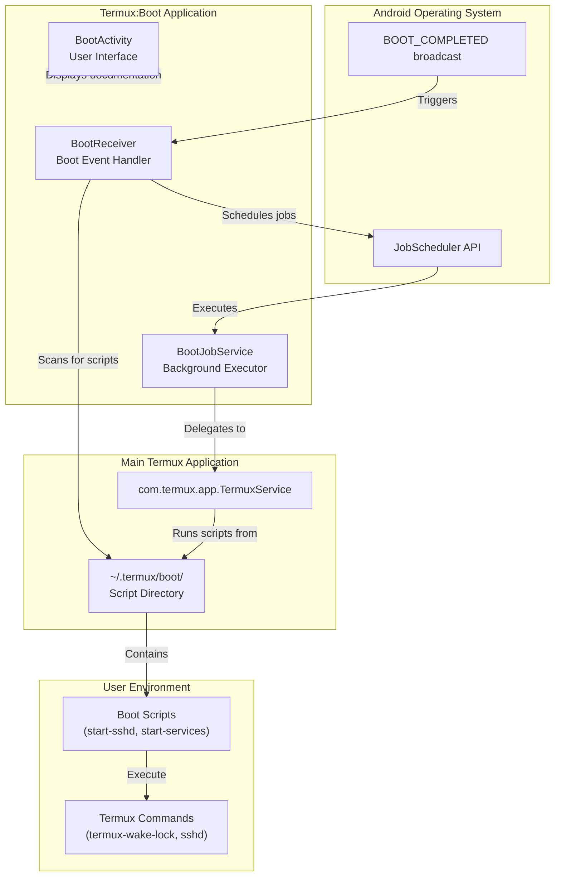
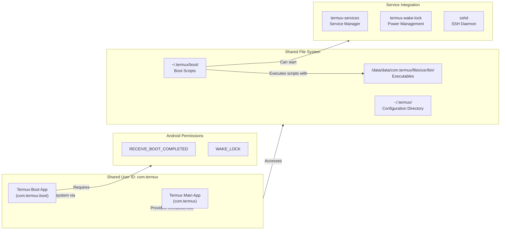

<!-- source: DeepWiki mcp.deepwiki.com · repo termux/termux-boot · page 1 Overview · fetched 2026-10-26 -->

# Overview

Relevant source files

The following files were used as context for generating this wiki page:

- [README.md](README.md)
- [app/src/main/AndroidManifest.xml](app/src/main/AndroidManifest.xml)

## Purpose and Scope

This document provides a high-level introduction to Termux:Boot, an Android add-on application that enables automatic execution of scripts when an Android device boots up. This overview covers the application's core purpose, system architecture, and integration with the main Termux application ecosystem.

For detailed installation instructions, see [Installation and Requirements](#1.2). For step-by-step usage instructions, see [Setup and Configuration](#2.1). For technical implementation details, see [Architecture and Core Components](#3).

## What is Termux:Boot

Termux:Boot is an Android application that serves as a bridge between the Android operating system's boot process and the Termux terminal emulator environment. The application monitors for the `BOOT_COMPLETED` system broadcast and automatically executes user-defined scripts located in the `~/.termux/boot/` directory.

The application operates as a minimal launcher that delegates script execution to the main Termux application via the `TermuxService` component. This design ensures that boot scripts run within the proper Termux environment with access to all installed packages and configurations.

**Key Features:**
- Automatic script execution at device boot
- Integration with Android's JobScheduler for reliable background execution  
- Shared user ID with main Termux app for seamless file system access
- Alphabetical execution order for multiple scripts
- Wake lock support to prevent device sleep during script execution

Sources: [README.md:1-57](), [app/src/main/AndroidManifest.xml:1-34]()

## System Architecture

The Termux:Boot application consists of three primary Android components that work together to handle the boot-to-execution workflow:

Sources: [app/src/main/AndroidManifest.xml:15-30](), [README.md:24-31]()

## Integration with Termux Ecosystem

Termux:Boot integrates tightly with the broader Termux ecosystem through several mechanisms:

**Integration Points:**
- **Shared User ID**: Both applications use `android:sharedUserId="com.termux"` enabling file system sharing
- **Service Delegation**: Script execution delegated to `com.termux.app.TermuxService` 
- **Common File Paths**: Scripts use standard Termux paths like `/data/data/com.termux/files/usr/bin/sh`
- **Package Ecosystem**: Boot scripts can utilize any installed Termux packages and utilities

Sources: [app/src/main/AndroidManifest.xml:4](), [README.md:37-52]()

## Key Technical Characteristics

| Characteristic | Details |
|----------------|---------|
| **Android Components** | Activity (`BootActivity`), BroadcastReceiver (`BootReceiver`), JobService (`BootJobService`) |
| **Required Permissions** | `RECEIVE_BOOT_COMPLETED`, `WAKE_LOCK` |
| **Script Location** | `~/.termux/boot/` directory in user home |
| **Execution Order** | Alphabetical sorting of filenames |
| **Background Processing** | Android JobScheduler with job IDs starting at 1000 |
| **Script Interpreter** | `/data/data/com.termux/files/usr/bin/sh` (Termux shell) |
| **Service Integration** | Delegates to `com.termux.app.TermuxService` via Intent |

**Common Use Cases:**
- Starting SSH daemons for remote access
- Initializing termux-services for background services
- Acquiring wake locks to prevent device sleep
- Setting up network services and automation

Sources: [app/src/main/AndroidManifest.xml:6-7](), [app/src/main/AndroidManifest.xml:21-30](), [README.md:34-52]()

## Application Lifecycle

The application follows a simple but robust lifecycle designed for reliability across Android reboots:

1. **Initial Setup**: User installs app and launches it once to register with Android
2. **Boot Detection**: `BootReceiver` responds to `BOOT_COMPLETED` system broadcast
3. **Script Discovery**: Application scans `~/.termux/boot/` for executable files
4. **Job Scheduling**: Each script scheduled as separate JobScheduler job with 3-second deadline
5. **Background Execution**: `BootJobService` processes jobs and delegates to `TermuxService`
6. **Script Execution**: Scripts run in full Termux environment with package access

This design ensures scripts execute reliably even if the device is under memory pressure or the user hasn't actively opened the Termux application recently.

Sources: [README.md:26-30]()

---

