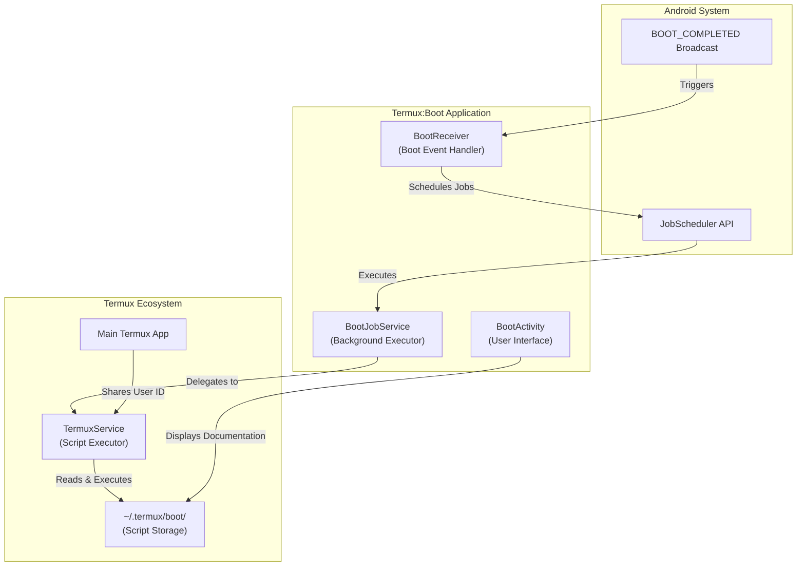
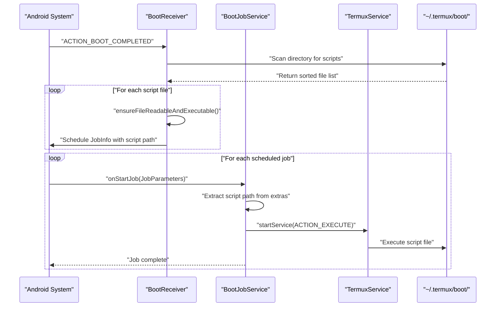

<!-- source: DeepWiki mcp.deepwiki.com · repo termux/termux-boot · page 1.1 What is Termux:Boot · fetched 2026-10-26 -->

# What is Termux:Boot

<details>
<summary>Relevant source files</summary>

The following files were used as context for generating this wiki page:

- [README.md](README.md)

</details>


This document provides a detailed explanation of Termux:Boot's functionality, architecture, and relationship to the main Termux application. It covers the app's core purpose as a boot script executor and its technical implementation as an Android add-on.

For installation instructions and setup procedures, see [Installation and Requirements](#1.2). For user configuration details, see [Setup and Configuration](#2.1).

## Overview

Termux:Boot is an Android add-on application designed to automatically execute user-defined scripts when an Android device boots up. It acts as a bridge between the Android system's boot process and the Termux terminal environment, enabling users to run background services, start SSH servers, acquire wake locks, or perform other initialization tasks without manual intervention.

**Core Architecture Diagram**



Sources: [README.md:1-57]()

## Primary Functions

Termux:Boot performs three primary functions within the Android ecosystem:

### Boot Event Detection
The application registers a `BootReceiver` component that listens for the `ACTION_BOOT_COMPLETED` broadcast intent. When the Android system finishes booting, this receiver automatically activates to begin the script execution process.

### Script Discovery and Scheduling
Upon receiving the boot signal, the system scans the `~/.termux/boot/` directory for executable scripts. Files are processed in alphabetical order, with each script scheduled as a separate background job through Android's `JobScheduler` API to ensure reliable execution even under system resource constraints.

### Background Execution Coordination
The `BootJobService` manages the actual script execution by delegating to the main Termux application's `TermuxService`. This architecture ensures that scripts run within the proper Termux environment with access to all installed packages and utilities.

**Runtime Execution Flow**



Sources: [README.md:6](), [README.md:26-30]()

## System Requirements and Dependencies

### Android Integration Requirements
Termux:Boot requires specific Android permissions and system integration to function properly:

| Requirement | Purpose | Implementation |
|-------------|---------|----------------|
| `RECEIVE_BOOT_COMPLETED` | Detect device boot events | Declared in AndroidManifest.xml |
| `WAKE_LOCK` | Prevent device sleep during execution | Enables `termux-wake-lock` functionality |
| Shared User ID | Access Termux file system | Must be signed with same key as Termux |
| JobScheduler API | Reliable background execution | Ensures scripts run even under resource pressure |

### Termux Application Dependency
The application has a hard dependency on the main Termux application being installed and properly configured. This dependency exists because:

- Scripts execute within the Termux environment using `TermuxService`
- The `~/.termux/boot/` directory resides within Termux's private file system
- Script execution requires access to Termux's installed packages and utilities
- Both applications must share the same Android user ID for file system access

### Signature Key Requirements
A critical requirement is that Termux:Boot must be signed with the same cryptographic key as the main Termux application. This security constraint ensures:

- Proper Android user ID sharing between applications
- File system access permissions to the Termux directory structure
- Ability to communicate with and control the `TermuxService` component

Sources: [README.md:8-9](), [README.md:20-22]()

## Key Characteristics

### Execution Model
Termux:Boot implements a fire-and-forget execution model where scripts run once at boot time without ongoing monitoring or restart capabilities. The system processes all scripts in the `~/.termux/boot/` directory sequentially, executing them in alphabetical filename order.

### Resource Management
The application uses Android's `JobScheduler` API rather than direct execution to ensure reliable operation under various system conditions. This approach provides:

- Automatic retry mechanisms if initial execution fails
- Proper handling of device resource constraints
- Integration with Android's battery optimization systems
- Compliance with modern Android background execution policies

### Common Usage Patterns
Based on the provided examples, typical use cases include:

```bash
# Acquire wake lock to prevent device sleep
termux-wake-lock

# Start SSH daemon for remote access
sshd

# Initialize termux-services framework
source /data/data/com.termux/files/usr/etc/profile.d/start-services.sh
```

These patterns demonstrate the application's role in establishing persistent background services and maintaining device accessibility after boot.

Sources: [README.md:29-30](), [README.md:34-52]()

---

