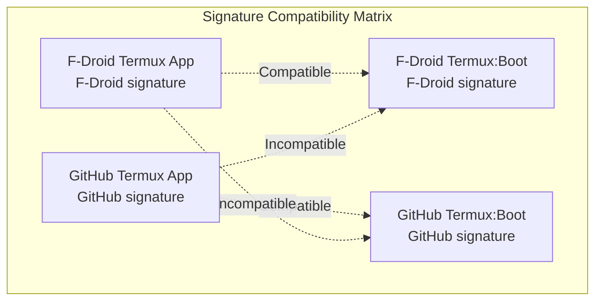
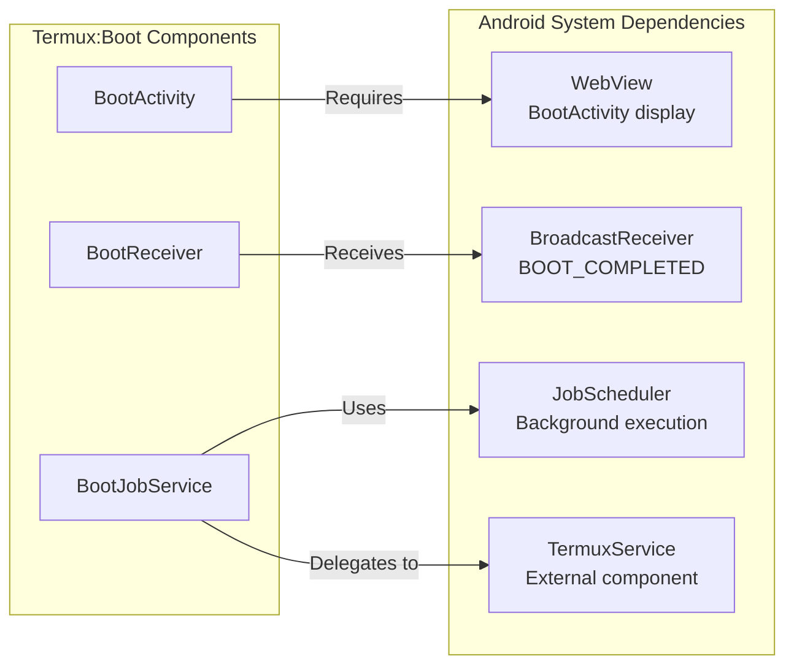
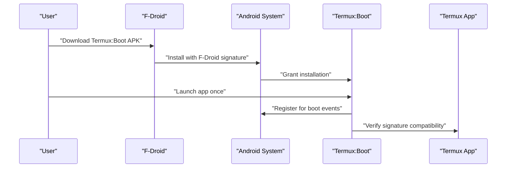

<!-- source: DeepWiki mcp.deepwiki.com · repo termux/termux-boot · page 1.2 Installation and Requirements · fetched 2026-10-26 -->

# Installation and Requirements

Relevant source files

The following files were used as context for generating this wiki page:

- [README.md](README.md)
- [app/src/main/assets/overview.html](app/src/main/assets/overview.html)
- [app/src/main/java/com/termux/boot/BootActivity.java](app/src/main/java/com/termux/boot/BootActivity.java)

This document covers the installation process for Termux:Boot, including available distribution channels, signature key requirements, and system prerequisites. For information about configuring and using Termux:Boot after installation, see [Setup and Configuration](#2.1).

## Installation Sources

Termux:Boot can be obtained from two primary sources, each with different signature keys and update mechanisms.

### F-Droid Distribution

The stable release of Termux:Boot is distributed through F-Droid's official repository. This version uses F-Droid's signature keys and receives updates through the F-Droid update mechanism.

**Installation URL:** `https://f-droid.org/en/packages/com.termux.boot/`

### GitHub Actions Debug Builds

Development builds are available from GitHub Actions workflows for testing latest features and pull requests. These builds use different signature keys than the F-Droid release.

**Build Location:** GitHub Actions workflow runs for `github_action_build.yml` on the master branch

Sources: [README.md:13-18]()

## Signature Key Requirements

### Same-Key Requirement with Termux

Termux:Boot must be signed with the same cryptographic key as the main Termux application to function properly. This requirement exists because Termux:Boot needs permission to execute scripts within the Termux environment.

Sources: [README.md:8-9](), [README.md:20-22]()

### Installation Source Migration

When switching between F-Droid and GitHub builds, complete uninstallation of all Termux components is required due to signature key differences.

**Migration Process:**
1. Uninstall main Termux application
2. Uninstall all Termux add-on applications (including Termux:Boot)
3. Install new versions from target source

Sources: [README.md:20-22]()

## System Requirements

### Android Version Compatibility

Termux:Boot targets Android API levels that align with the main Termux application requirements. The application uses standard Android components that require specific system capabilities.

### Required Android Components

Sources: [app/src/main/java/com/termux/boot/BootActivity.java:14-15]()

## Prerequisites

### Main Termux Application

Termux:Boot is an add-on application that requires the main Termux application to be installed and functional. The main application provides:

- `TermuxService` component for script execution
- Termux file system structure (`~/.termux/boot/` directory)
- Shell environment and utilities

### Required Permissions

The application requires specific Android permissions to function:

| Permission | Purpose |
|------------|---------|
| `RECEIVE_BOOT_COMPLETED` | Receive system boot events |
| `WAKE_LOCK` | Prevent device sleep during execution |

Sources: [README.md:6]()

## Installation Process

### Standard Installation

### Post-Installation Verification

After installation, the application must be launched once to activate boot event registration. The `BootActivity` displays setup instructions through the embedded `overview.html` file.

**Verification Steps:**
1. Launch Termux:Boot from application launcher
2. Verify `WebView` displays overview content
3. Confirm no signature mismatch errors
4. Test boot script directory creation capability

Sources: [README.md:26-27](), [app/src/main/assets/overview.html:5]()

## Troubleshooting Installation Issues

### Signature Mismatch Resolution

If signature compatibility issues occur:

1. Verify both Termux and Termux:Boot are from the same source
2. Check installation source consistency in package manager
3. Perform clean uninstall/reinstall if necessary

### Build Variant Considerations

Development builds from GitHub Actions may have different behavior than F-Droid releases due to:
- Different build configurations
- Latest code changes not yet in stable release
- Debug-specific features or logging

Sources: [README.md:15-18](), [README.md:20-22]()

---

