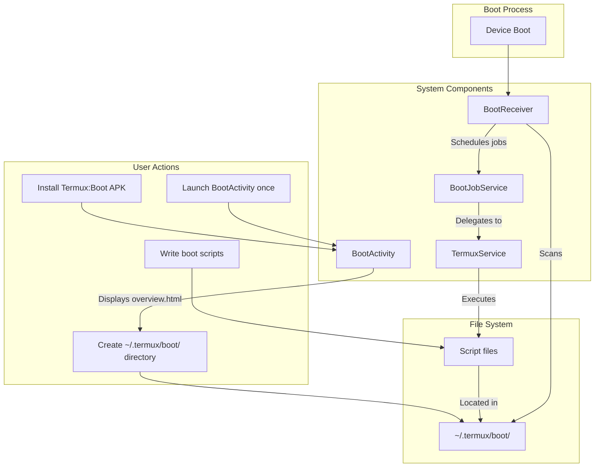
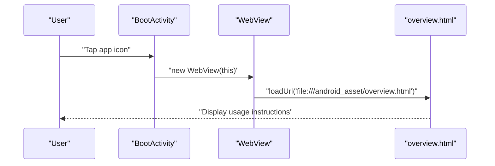
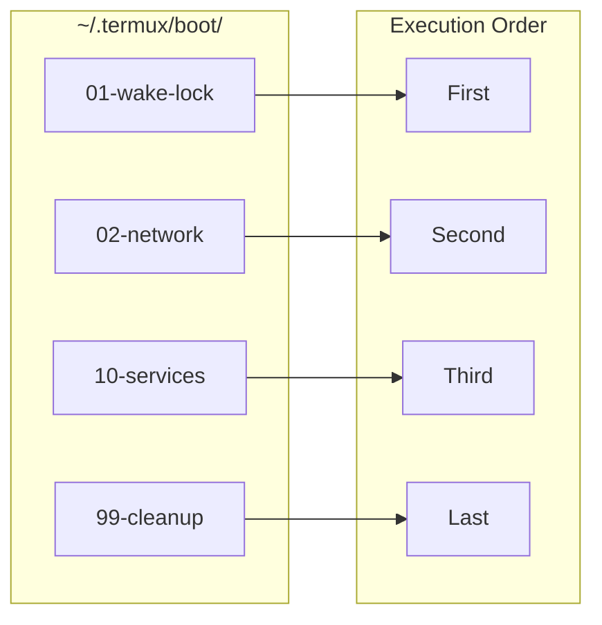
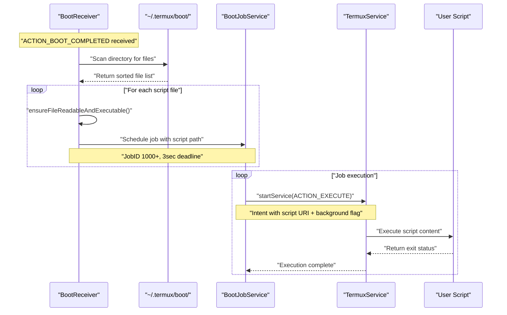

<!-- source: DeepWiki mcp.deepwiki.com · repo termux/termux-boot · page 2 User Guide · fetched 2026-10-26 -->

# User Guide

<details>
<summary>Relevant source files</summary>

The following files were used as context for generating this wiki page:

- [README.md](README.md)
- [app/src/main/assets/overview.html](app/src/main/assets/overview.html)
- [app/src/main/java/com/termux/boot/BootActivity.java](app/src/main/java/com/termux/boot/BootActivity.java)

</details>


This document provides comprehensive instructions for installing, configuring, and using Termux:Boot to automatically run scripts when your Android device boots up. It covers the complete user workflow from initial setup through creating and managing boot scripts.

For technical details about the underlying Android application architecture, see [Architecture and Core Components](#3). For information about building and modifying the application, see [Build System](#4).

## Purpose and Scope

Termux:Boot is an add-on application that extends the main Termux terminal emulator by providing the ability to execute scripts automatically at device boot time. This user guide covers all aspects of end-user interaction with the system, from installation through script management.

## Quick Start Overview

The basic workflow for using Termux:Boot involves four main steps that interact with specific system components:



**Quick Start Overview**
*Sources: [README.md:24-31](), [app/src/main/assets/overview.html:3-10]()*

## Installation and Initial Setup

### Installing the Application

Termux:Boot can be obtained from two primary sources:

| Source | Description | Signature | Use Case |
|--------|-------------|-----------|----------|
| F-Droid | Stable releases | F-Droid key | Production use |
| GitHub Actions | Debug builds | Development key | Testing/development |

**Important:** The Termux:Boot application must be signed with the same key as your main Termux installation. Switching between different signature sources requires uninstalling and reinstalling both Termux and all add-on applications.

*Sources: [README.md:11-22]()*

### First Launch Requirement

After installation, you must launch the `BootActivity` at least once by tapping the application icon. This step is required to register the application with Android's boot system and enable the `BootReceiver` to respond to `ACTION_BOOT_COMPLETED` broadcasts.



**First Launch Process**
*Sources: [README.md:26-27](), [app/src/main/java/com/termux/boot/BootActivity.java:12-17](), [app/src/main/assets/overview.html:1-10]()*

## Directory Structure and Script Placement

### Creating the Boot Directory

All boot scripts must be placed in the `~/.termux/boot/` directory within the Termux file system. This directory must be created manually:

```bash
mkdir -p ~/.termux/boot/
```

The directory path resolves to `/data/data/com.termux/files/home/.termux/boot/` in the Android file system.

### Script Execution Order

When multiple scripts exist in the boot directory, they are executed in lexicographically sorted order by filename. The `BootReceiver` scans the directory and processes files according to this ordering.



**Script Execution Order**
*Sources: [README.md:29](), [app/src/main/assets/overview.html:8]()*

## Writing Boot Scripts

### Script Structure

Boot scripts must be executable files with proper shebang lines. The recommended shebang for Termux scripts is:

```bash
#!/data/data/com.termux/files/usr/bin/sh
```

### Essential Commands

#### Wake Lock Management

The `termux-wake-lock` command prevents the device from entering sleep mode, which is typically required for network services and background processes:

```bash
#!/data/data/com.termux/files/usr/bin/sh
termux-wake-lock
# Additional commands follow
```

This command should generally be placed at the beginning of your boot scripts to ensure consistent execution of subsequent commands.

### Common Use Cases

#### SSH Server Example

To start an SSH daemon at boot with wake lock:

**File:** `~/.termux/boot/start-sshd`
```bash
#!/data/data/com.termux/files/usr/bin/sh
termux-wake-lock
sshd
```

#### Termux Services Integration

To start the termux-services system which manages enabled services:

**File:** `~/.termux/boot/start-services`
```bash
#!/data/data/com.termux/files/usr/bin/sh
termux-wake-lock
source /data/data/com.termux/files/usr/etc/profile.d/start-services.sh
```

*Sources: [README.md:32-52](), [app/src/main/assets/overview.html:12-19]()*

## Script Execution Flow

The following diagram shows how boot scripts are processed by the system components:



**Boot Script Execution Flow**
*Sources: [README.md:29](), [app/src/main/assets/overview.html:8]()*

## Best Practices

### File Permissions

Ensure boot scripts have executable permissions:
```bash
chmod +x ~/.termux/boot/your-script
```

### Error Handling

Include error handling in scripts to prevent boot process interruption:
```bash
#!/data/data/com.termux/files/usr/bin/sh
termux-wake-lock || echo "Wake lock failed"
sshd 2>/dev/null || echo "SSH daemon start failed"
```

### Logging

Consider adding logging to track script execution:
```bash
#!/data/data/com.termux/files/usr/bin/sh
echo "$(date): Starting boot script" >> ~/.termux/boot.log
termux-wake-lock
sshd
echo "$(date): Boot script completed" >> ~/.termux/boot.log
```

## Community and Support

For additional help and community support:
- Visit the Termux community channels at https://termux.org/community
- Report issues at the GitHub repository: https://github.com/termux/termux-boot/issues

*Sources: [app/src/main/assets/overview.html:21-25]()*

---

