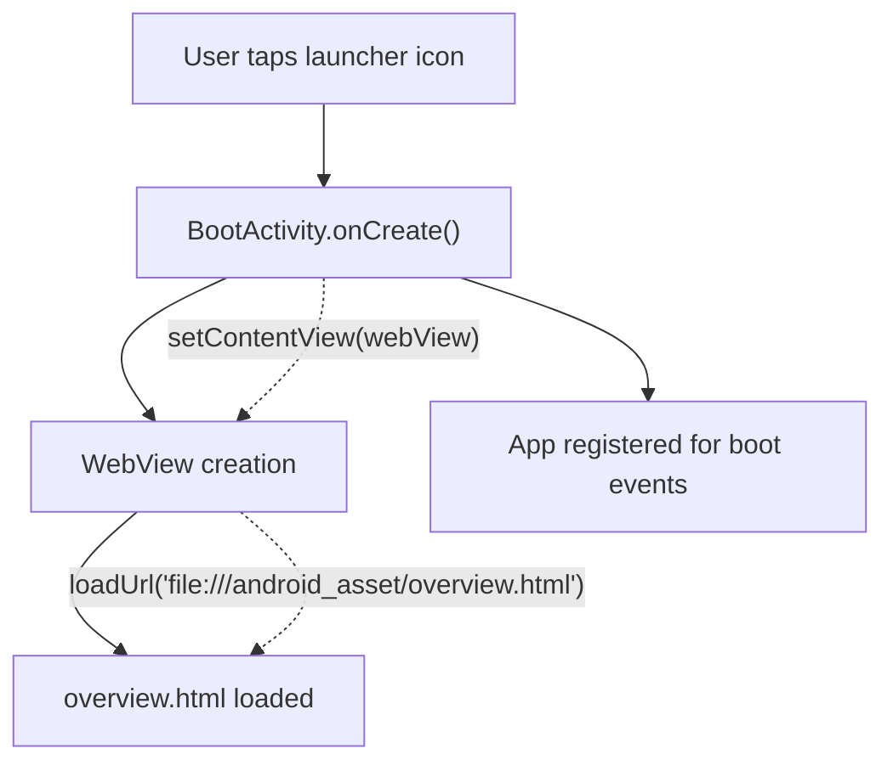
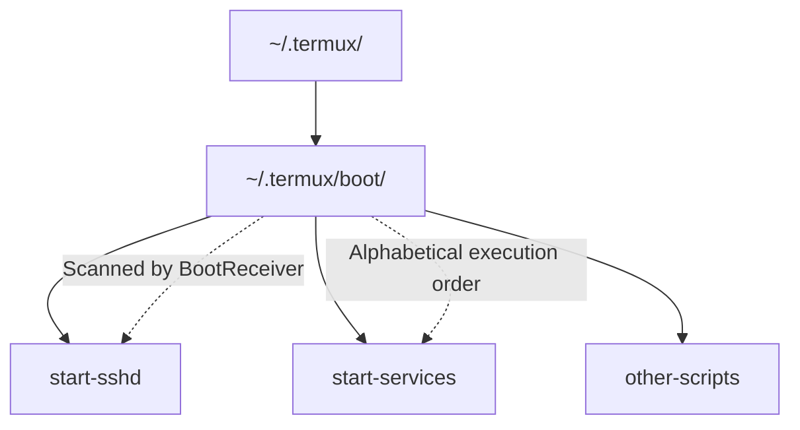
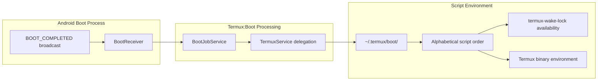
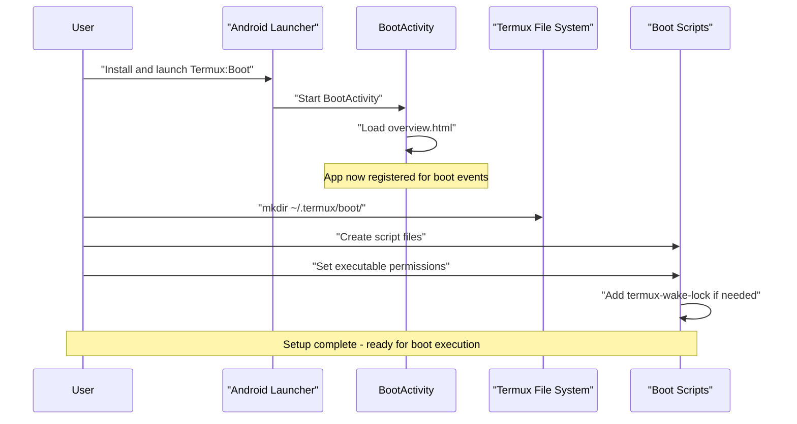

<!-- source: DeepWiki mcp.deepwiki.com · repo termux/termux-boot · page 2.1 Setup and Configuration · fetched 2026-10-26 -->

# Setup and Configuration

<details>
<summary>Relevant source files</summary>

The following files were used as context for generating this wiki page:

- [README.md](README.md)
- [app/src/main/assets/overview.html](app/src/main/assets/overview.html)
- [app/src/main/java/com/termux/boot/BootActivity.java](app/src/main/java/com/termux/boot/BootActivity.java)

</details>


This page covers the initial setup and configuration process for Termux:Boot, focusing on the steps users must complete to enable boot script execution. The process involves app registration, directory creation, and script preparation. For information about writing effective boot scripts and execution behavior, see [Writing Boot Scripts](#2.2). For technical details about the underlying Android components and execution system, see [Architecture and Core Components](#3).

## Initial App Launch and Registration

The first critical step after installing Termux:Boot is launching the application at least once through the Android launcher. This step is mandatory because Android restricts background execution of apps that have never been manually started by the user.

When launched, the app displays the `BootActivity` which loads an embedded documentation view:

**App Launch Flow**


The `BootActivity` serves as both a user interface and a registration mechanism. The Android system tracks that the app has been launched, which enables the `BootReceiver` to respond to `BOOT_COMPLETED` broadcasts in the future.

Sources: [app/src/main/java/com/termux/boot/BootActivity.java:12-17](), [app/src/main/assets/overview.html:1-26]()

## Boot Directory Structure

Termux:Boot requires a specific directory structure within the Termux environment. Users must create the boot script directory manually, as the app does not automatically generate it.

**Required Directory Structure**


| Component | Path | Purpose |
|-----------|------|---------|
| Termux config directory | `~/.termux/` | Parent directory for Termux configuration |
| Boot scripts directory | `~/.termux/boot/` | Contains executable boot scripts |
| Individual scripts | `~/.termux/boot/*` | Executable files run at boot time |

The directory path `~/.termux/boot/` expands to the absolute path `/data/data/com.termux/files/home/.termux/boot/` within the Android application sandbox.

Sources: [README.md:28-29](), [app/src/main/assets/overview.html:6-7]()

## Script Execution Environment

Boot scripts execute within the Termux environment with specific characteristics that affect their behavior and capabilities.

**Execution Environment Configuration**


### Script Requirements

Scripts placed in the boot directory must meet specific requirements:

| Requirement | Details |
|-------------|---------|
| Executable permissions | Files must have execute permissions set |
| Proper shebang | Should begin with `#!/data/data/com.termux/files/usr/bin/sh` |
| Termux environment | Can access Termux binaries and utilities |
| Alphabetical execution | Multiple scripts execute in sorted filename order |

### Common Configuration Commands

The most frequently used configuration command is `termux-wake-lock`, which prevents the Android device from entering sleep mode:

```bash
#!/data/data/com.termux/files/usr/bin/sh
termux-wake-lock
# Additional commands follow
```

This command is critical for scripts that start long-running services, as Android may suspend background processes when the device sleeps.

Sources: [README.md:30-31](), [README.md:37-41](), [app/src/main/assets/overview.html:9-10](), [app/src/main/assets/overview.html:15-19]()

## Configuration Workflow

The complete setup process involves coordinated steps across the Android system, Termux:Boot app, and Termux environment.

**Complete Setup Workflow**


### Setup Verification

Users can verify their setup by checking:

1. **App Registration**: The app icon appears in the launcher and can be opened
2. **Directory Creation**: `ls ~/.termux/boot/` shows the directory exists
3. **Script Permissions**: `ls -la ~/.termux/boot/` shows executable permissions
4. **Script Content**: Scripts contain proper shebang and commands

### Common Setup Issues

| Issue | Symptom | Solution |
|-------|---------|----------|
| App never launched | Scripts don't run at boot | Launch app once from launcher |
| Missing directory | No script execution | Create `~/.termux/boot/` directory |
| Non-executable scripts | Scripts found but not executed | Set executable permissions with `chmod +x` |
| Incorrect shebang | Scripts fail to execute | Use `#!/data/data/com.termux/files/usr/bin/sh` |

Sources: [README.md:24-31](), [app/src/main/assets/overview.html:3-10](), [app/src/main/java/com/termux/boot/BootActivity.java:9-18]()

---

