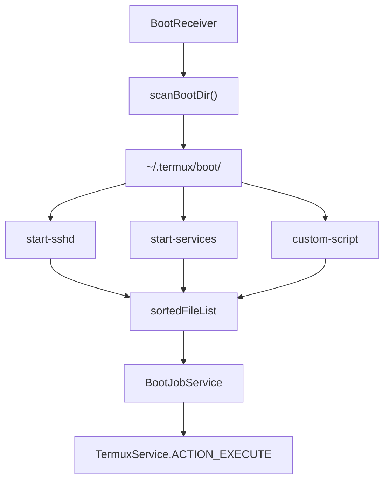
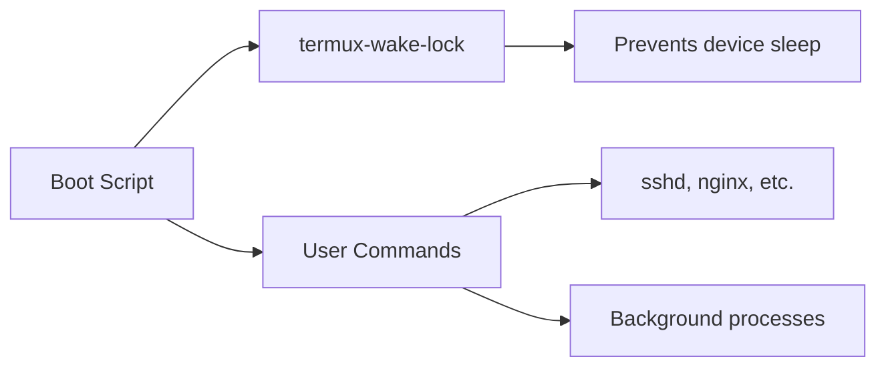
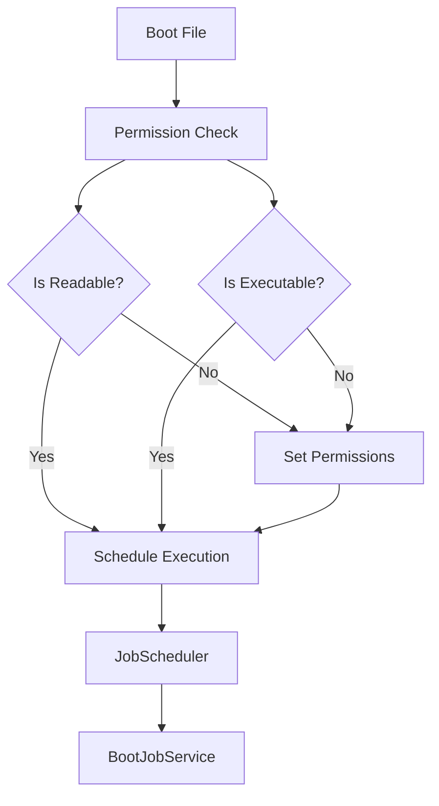

<!-- source: DeepWiki mcp.deepwiki.com · repo termux/termux-boot · page 2.2 Writing Boot Scripts · fetched 2026-10-26 -->

# Writing Boot Scripts

<details>
<summary>Relevant source files</summary>

The following files were used as context for generating this wiki page:

- [README.md](README.md)
- [app/src/main/assets/overview.html](app/src/main/assets/overview.html)
- [app/src/main/java/com/termux/boot/BootActivity.java](app/src/main/java/com/termux/boot/BootActivity.java)

</details>


This document covers how to create and configure boot scripts that will be executed when your Android device starts up. It focuses on the user-facing aspects of script creation, placement, and common patterns. For information about setting up the Termux:Boot environment, see [Setup and Configuration](#2.1). For technical details about how the boot execution system works internally, see [Boot Execution System](#3.2).

## Script Location and Discovery

Boot scripts must be placed in the `~/.termux/boot/` directory within the Termux file system. The system automatically discovers and executes all files in this directory during the boot process.



**Script Discovery and Execution Flow**

The boot system scans the boot directory and creates a sorted list of executable files. Each script is then scheduled for execution through Android's JobScheduler system.

Sources: [README.md:28-29](), [app/src/main/assets/overview.html:6-8]()

## Execution Order and Timing

Scripts are executed in **alphabetical order** based on their filename. This allows you to control the execution sequence by choosing appropriate filenames.

| Execution Order | Example Filename | Purpose |
|---|---|---|
| 1st | `01-wake-lock` | Prevent device sleep |
| 2nd | `02-network-setup` | Configure networking |
| 3rd | `10-start-services` | Start background services |
| 4th | `99-cleanup` | Final cleanup tasks |

Each script runs as a separate job with a 3-second deadline for completion. Scripts that take longer may be terminated by the Android system.

Sources: [README.md:29](), [app/src/main/assets/overview.html:8]()

## Script Structure and Requirements

### Basic Script Template

All boot scripts should follow this basic structure:

```bash
#!/data/data/com.termux/files/usr/bin/sh
# Your commands here
```

The shebang line is crucial as it specifies the correct shell interpreter within the Termux environment.

### Essential Commands



**Common Boot Script Pattern**

Most scripts begin with `termux-wake-lock` to prevent the device from entering sleep mode, which would terminate running processes.

Sources: [README.md:30](), [app/src/main/assets/overview.html:9]()

## Common Patterns and Commands

### Wake Lock Management

The `termux-wake-lock` command should typically be the first command in your boot scripts:

```bash
#!/data/data/com.termux/files/usr/bin/sh
termux-wake-lock
# Additional commands follow
```

This prevents Android from putting the device into deep sleep mode, which would kill background processes started by your scripts.

### Service Startup

For starting system services, use the termux-services infrastructure:

```bash
#!/data/data/com.termux/files/usr/bin/sh
termux-wake-lock
source /data/data/com.termux/files/usr/etc/profile.d/start-services.sh
```

Sources: [README.md:48-52](), [app/src/main/assets/overview.html:9]()

## Practical Examples

### SSH Server Startup

To start an SSH daemon at boot, create `~/.termux/boot/start-sshd`:

```bash
#!/data/data/com.termux/files/usr/bin/sh
termux-wake-lock
sshd
```

This example demonstrates the basic pattern: wake lock first, then the service command.

### Termux Services Integration

To start all enabled termux-services at boot, create `~/.termux/boot/start-services`:

```bash
#!/data/data/com.termux/files/usr/bin/sh
termux-wake-lock
source /data/data/com.termux/files/usr/etc/profile.d/start-services.sh
```

This approach leverages the existing termux-services infrastructure for managing multiple services.

Sources: [README.md:34-41](), [README.md:43-52](), [app/src/main/assets/overview.html:13-19]()

## File Permissions and Execution

### Script Permissions

Boot scripts must be readable and executable by the Termux application. The system automatically ensures proper permissions during the boot process through the `ensureFileReadableAndExecutable()` method.

### Security Considerations

- Scripts run with the same permissions as the main Termux application
- All scripts in the boot directory will be executed - avoid placing non-executable files there
- Use descriptive filenames to make the execution order clear



**File Permission and Execution Validation**

The system validates and corrects file permissions before scheduling scripts for execution.

Sources: [README.md:29](), [app/src/main/assets/overview.html:8]()

---

