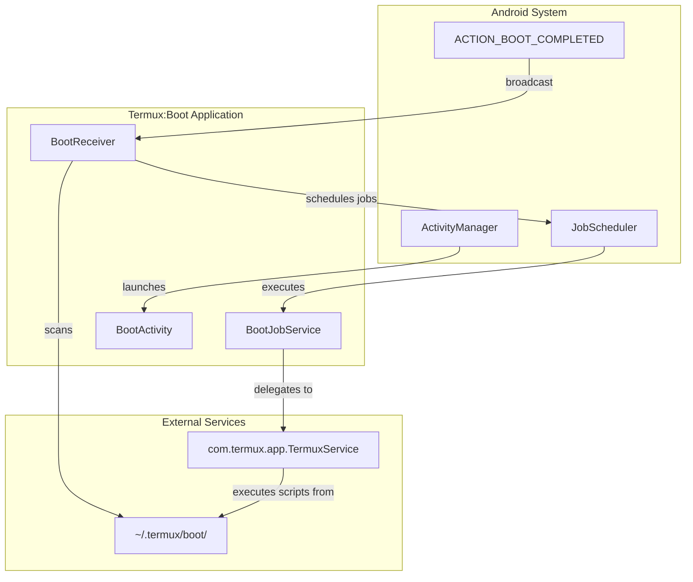
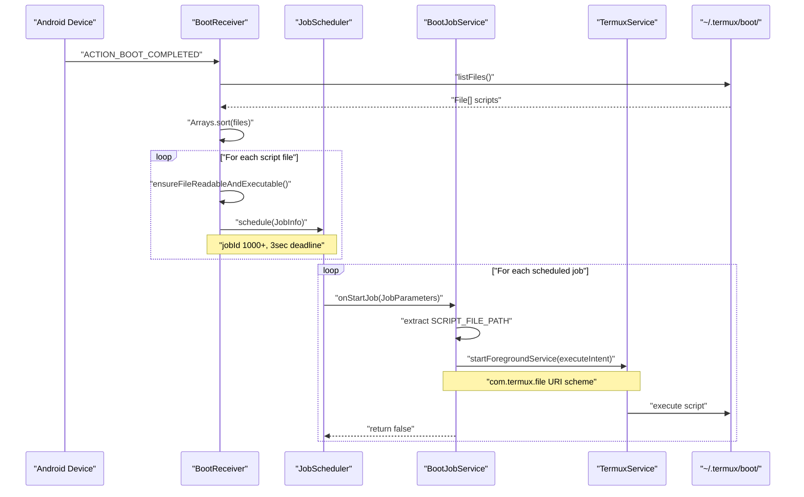

<!-- source: DeepWiki mcp.deepwiki.com · repo termux/termux-boot · page 3 Architecture and Core Components · fetched 2026-10-26 -->

# Architecture and Core Components

Relevant source files

The following files were used as context for generating this wiki page:

- [app/src/main/AndroidManifest.xml](app/src/main/AndroidManifest.xml)
- [app/src/main/java/com/termux/boot/BootJobService.java](app/src/main/java/com/termux/boot/BootJobService.java)
- [app/src/main/java/com/termux/boot/BootReceiver.java](app/src/main/java/com/termux/boot/BootReceiver.java)

This document provides a technical overview of the Termux:Boot Android application architecture, focusing on the core components that handle boot event processing and script execution delegation. It covers the application's Android-specific structure, component interactions, and the execution flow from device boot to script invocation.

For user-facing setup instructions, see [Setup and Configuration](#2.1). For build system details, see [Build System](#4).

## Application Architecture Overview

Termux:Boot is structured as a lightweight Android application that acts as a bridge between the Android boot process and the main Termux application. The architecture follows Android's component-based design with three primary components that handle distinct responsibilities in the boot script execution pipeline.

The application operates with a shared user ID (`com.termux`) to access Termux's file system and delegates actual script execution to `TermuxService` rather than implementing execution directly. This design maintains separation of concerns while enabling seamless integration with the Termux environment.

**Core Android Components**

Sources: [app/src/main/AndroidManifest.xml:1-33](), [app/src/main/java/com/termux/boot/BootReceiver.java:1-68](), [app/src/main/java/com/termux/boot/BootJobService.java:1-51]()

## Component Declaration and Permissions

The application manifest defines three core components with specific Android permissions and intent filters. The `sharedUserId` attribute enables file system access to Termux directories, while `RECEIVE_BOOT_COMPLETED` and `WAKE_LOCK` permissions support boot event handling and system wake state management.

| Component | Type | Purpose | Key Attributes |
|-----------|------|---------|----------------|
| `BootActivity` | Activity | User interface and documentation display | Launcher intent filter |
| `BootReceiver` | BroadcastReceiver | Boot event handling | `BOOT_COMPLETED` intent filter, `exported="false"` |
| `BootJobService` | JobService | Background script execution coordination | `BIND_JOB_SERVICE` permission |

The `BootReceiver` component uses `android:exported="false"` for security, ensuring only the system can trigger boot events. The `BootJobService` requires `BIND_JOB_SERVICE` permission to integrate with Android's background job scheduling system.

Sources: [app/src/main/AndroidManifest.xml:4-30]()

## Boot Event Processing Flow

The boot execution system operates through a multi-stage process that transforms Android boot events into individual script execution jobs. This design ensures reliable script execution while respecting Android's background processing constraints.

**Boot Event to Script Execution Flow**

Sources: [app/src/main/java/com/termux/boot/BootReceiver.java:22-60](), [app/src/main/java/com/termux/boot/BootJobService.java:24-44]()

## BootReceiver Implementation

The `BootReceiver` class extends `BroadcastReceiver` and implements the primary boot event handling logic. The `onReceive` method filters for `ACTION_BOOT_COMPLETED` events and processes scripts from the hardcoded path `/data/data/com.termux/files/home/.termux/boot`.

Key implementation details:

- **Script Discovery**: Uses `File.listFiles()` to enumerate boot scripts and handles null return values
- **Execution Order**: Applies `Arrays.sort()` with `String.compareTo()` for deterministic alphabetical ordering  
- **Permission Management**: Calls `ensureFileReadableAndExecutable()` to automatically fix file permissions
- **Job Scheduling**: Creates `JobInfo` objects with unique job IDs starting from `TERMUX_BOOT_JOB_ID_BASE` (1000)
- **Deadline Enforcement**: Sets `setOverrideDeadline(3 * 1000)` for 3-second maximum job delay

The `PersistableBundle` extras mechanism passes the `SCRIPT_FILE_PATH` to the `BootJobService` for execution.

Sources: [app/src/main/java/com/termux/boot/BootReceiver.java:18-53](), [app/src/main/java/com/termux/boot/BootReceiver.java:64-67]()

## BootJobService Implementation  

The `BootJobService` class extends Android's `JobService` and handles background execution coordination. Rather than executing scripts directly, it constructs intents to delegate execution to the main Termux application's `TermuxService`.

**Service Delegation Pattern**

The `onStartJob` method:

1. Extracts the script file path from `JobParameters.getExtras()`
2. Constructs a URI using the `com.termux.file` scheme
3. Creates an `ACTION_EXECUTE` intent targeting `com.termux.app.TermuxService`
4. Sets `EXTRA_EXECUTE_IN_BACKGROUND` to `true` for background execution
5. Uses `startForegroundService()` on Android O+ to comply with background service restrictions

The method returns `false` to indicate immediate job completion since execution is offloaded to `TermuxService`.

Sources: [app/src/main/java/com/termux/boot/BootJobService.java:14-44]()

## Inter-Application Communication

The application communicates with the main Termux app through Android's Intent system using predefined action constants and URI schemes. This loose coupling allows Termux:Boot to remain lightweight while leveraging Termux's full execution environment.

**Communication Constants**:
- `TERMUX_SERVICE`: `"com.termux.app.TermuxService"`
- `ACTION_EXECUTE`: `"com.termux.service_execute"`  
- `EXTRA_EXECUTE_IN_BACKGROUND`: `"com.termux.execute.background"`

The URI scheme `com.termux.file` with the script's absolute path enables `TermuxService` to locate and execute the boot scripts within the shared Termux file system context.

Sources: [app/src/main/java/com/termux/boot/BootJobService.java:18-21](), [app/src/main/java/com/termux/boot/BootJobService.java:30-33]()

---

