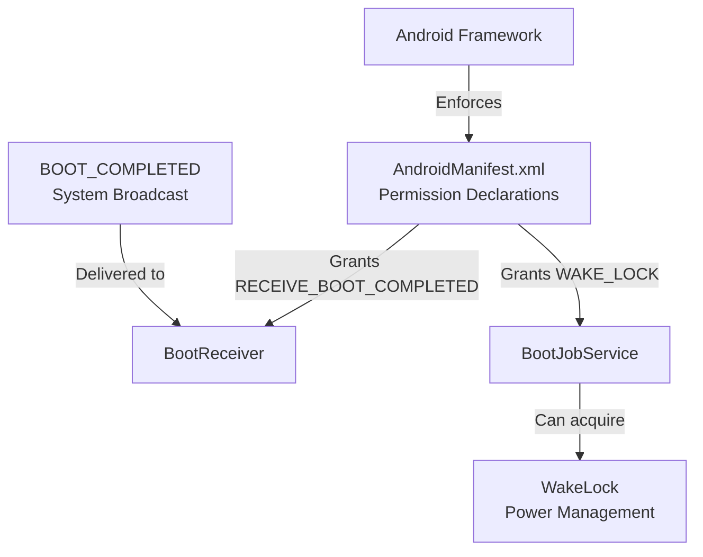
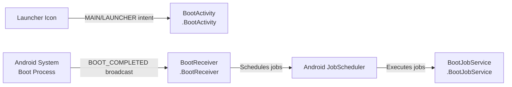
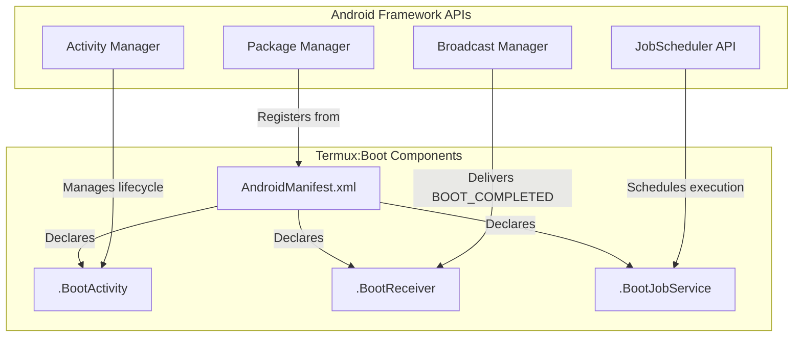

<!-- source: DeepWiki mcp.deepwiki.com · repo termux/termux-boot · page 3.1 Android Application Structure · fetched 2026-10-26 -->

# Android Application Structure

<details>
<summary>Relevant source files</summary>

The following files were used as context for generating this wiki page:

- [app/src/main/AndroidManifest.xml](app/src/main/AndroidManifest.xml)

</details>


This document covers the Android application structure of Termux:Boot, including the application manifest, permissions model, and core Android components. It explains how the app integrates with the Android framework through Activities, BroadcastReceivers, and JobServices. For details about the boot execution flow and runtime behavior, see [Boot Execution System](#3.2). For user interface implementation details, see [User Interface](#3.3).

## Application Manifest Overview

The Termux:Boot application is defined through its Android manifest, which declares the app's integration points with the Android system. The manifest establishes three core architectural elements: shared user identity with Termux, required system permissions, and component declarations.

### Shared User Identity

Termux:Boot operates under a shared user ID with the main Termux application, enabling file system access and inter-process communication:

```xml
android:sharedUserId="com.termux"
```

This shared identity allows Termux:Boot to access the Termux application's private directories and execute scripts within the Termux environment.

### Application Configuration

The application element defines basic properties and behavior:

| Property | Value | Purpose |
|----------|-------|---------|
| `android:allowBackup` | `false` | Prevents automatic backup of app data |
| `android:icon` | `@drawable/ic_launcher` | Specifies the launcher icon resource |
| `android:label` | `@string/app_name` | Sets the application display name |
| `android:supportsRtl` | `true` | Enables right-to-left layout support |

Sources: [app/src/main/AndroidManifest.xml:9-14]()

## Permissions and Security Model

The application declares two essential system permissions that enable its boot automation functionality:

### Boot Event Permission

```xml
<uses-permission android:name="android.permission.RECEIVE_BOOT_COMPLETED" />
```

This permission allows the `BootReceiver` component to receive the `ACTION_BOOT_COMPLETED` broadcast when the device finishes booting.

### Wake Lock Permission

```xml
<uses-permission android:name="android.permission.WAKE_LOCK" />
```

This permission enables the application and subsequently launched scripts to prevent the device from entering sleep mode during critical operations.

**Android Security Integration**


Sources: [app/src/main/AndroidManifest.xml:6-7]()

## Component Architecture

The application consists of three primary Android components, each serving a distinct role in the boot automation system:

### Activity Component

```xml
<activity android:name=".BootActivity">
```

The `BootActivity` serves as the main entry point and user interface. It is configured as a launcher activity through its intent filter, making it accessible from the device's application launcher.

**Intent Filter Configuration:**
- Action: `android.intent.action.MAIN`
- Category: `android.intent.category.LAUNCHER`

### BroadcastReceiver Component

```xml
<receiver android:name=".BootReceiver" android:exported="false">
```

The `BootReceiver` handles system boot events and initiates the script execution process. The `android:exported="false"` attribute restricts access to system broadcasts only.

**Intent Filter Configuration:**
- Action: `android.intent.action.BOOT_COMPLETED`

### JobService Component

```xml
<service android:name=".BootJobService" android:permission="android.permission.BIND_JOB_SERVICE" />
```

The `BootJobService` manages background execution of boot scripts using Android's JobScheduler framework. The `BIND_JOB_SERVICE` permission ensures only the system can bind to this service.

**Component Integration Flow**


Sources: [app/src/main/AndroidManifest.xml:15-30]()

## Integration with Android Framework

The application integrates with several Android framework systems to achieve its boot automation functionality:

### Activity Lifecycle Integration

The `BootActivity` follows standard Android Activity lifecycle patterns, registering with the application launcher through the `MAIN`/`LAUNCHER` intent filter combination.

### Broadcast System Integration

The `BootReceiver` integrates with Android's broadcast system to receive boot completion notifications. The receiver is declared with `exported="false"` to ensure it only receives system broadcasts.

### JobScheduler Integration

The `BootJobService` leverages Android's JobScheduler API for reliable background execution. This ensures script execution can occur even under system resource constraints and background execution limitations.

**Framework Integration Points**


Sources: [app/src/main/AndroidManifest.xml:1-33]()

## Component Security Model

Each component implements specific security measures aligned with Android's security framework:

| Component | Security Measure | Purpose |
|-----------|------------------|---------|
| `BootActivity` | Standard activity security | Prevents unauthorized access through launcher |
| `BootReceiver` | `exported="false"` | Restricts to system broadcasts only |
| `BootJobService` | `BIND_JOB_SERVICE` permission | Ensures only JobScheduler can bind |

The shared user ID (`com.termux`) provides the necessary file system access while maintaining security boundaries between the boot automation system and other applications.

Sources: [app/src/main/AndroidManifest.xml:4,23,30]()

---

