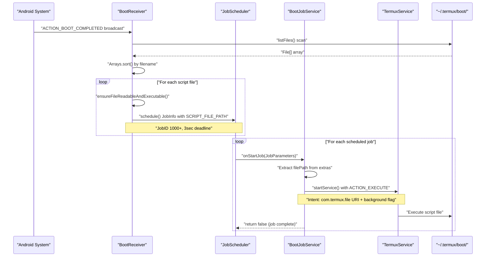
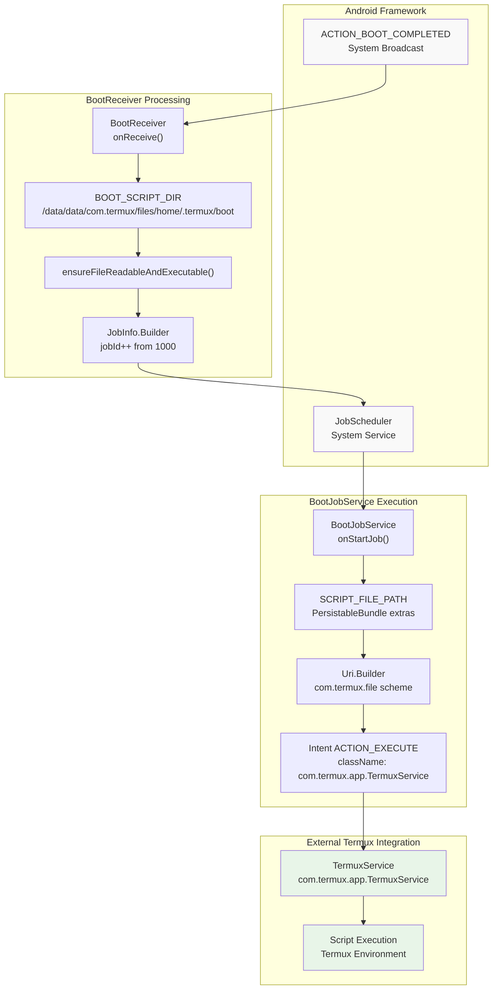

<!-- source: DeepWiki mcp.deepwiki.com · repo termux/termux-boot · page 3.2 Boot Execution System · fetched 2026-10-26 -->

# Boot Execution System

<details>
<summary>Relevant source files</summary>

The following files were used as context for generating this wiki page:

- [app/src/main/java/com/termux/boot/BootJobService.java](app/src/main/java/com/termux/boot/BootJobService.java)
- [app/src/main/java/com/termux/boot/BootReceiver.java](app/src/main/java/com/termux/boot/BootReceiver.java)

</details>


This document covers the core runtime system that handles boot event detection, script discovery, job scheduling, and execution delegation in Termux:Boot. The system consists of two primary Android components that work together to automatically execute user scripts when the device boots.

For information about the Android application structure and manifest configuration, see [Android Application Structure](#3.1). For details about the user interface components, see [User Interface](#3.3).

## System Overview

The boot execution system operates through a two-stage process implemented by `BootReceiver` and `BootJobService`. When the Android device completes its boot sequence, the system detects this event, discovers executable scripts in the user's boot directory, and delegates their execution to the main Termux application.

The system is designed as a lightweight bridge that handles event detection and job scheduling, while delegating the actual script execution to `TermuxService` in the main Termux application. This separation ensures that Termux:Boot remains focused on boot event handling while leveraging the full execution environment provided by Termux.

## Boot Event Detection

The `BootReceiver` class serves as the entry point for the boot execution system. It extends Android's `BroadcastReceiver` to listen for the `ACTION_BOOT_COMPLETED` broadcast that the Android system sends when the device finishes booting.

### Event Filtering and Validation

The receiver performs initial event validation to ensure it only processes genuine boot completion events:

```java
if (!Intent.ACTION_BOOT_COMPLETED.equals(intent.getAction())) return;
```

This check prevents the receiver from responding to other broadcast intents that might be delivered to the component.

**Sources:** [app/src/main/java/com/termux/boot/BootReceiver.java:23]()

## Script Discovery and Scheduling

Upon receiving a valid boot completion event, `BootReceiver` scans the designated boot script directory and schedules execution jobs for each discovered script file.

### Boot Directory Scanning

The system scans a hardcoded path that corresponds to the user's Termux boot directory:

```java
final String BOOT_SCRIPT_PATH = "/data/data/com.termux/files/home/.termux/boot";
```

The receiver creates a `File` object for this directory and retrieves all contained files using `listFiles()`. If the directory doesn't exist or is empty, the system handles this gracefully by creating an empty file array.

**Sources:** [app/src/main/java/com/termux/boot/BootReceiver.java:25-28]()

### File Sorting and Processing

To ensure consistent execution order across device reboots, the system sorts discovered files alphabetically by filename:

```java
Arrays.sort(files, (f1, f2) -> f1.getName().compareTo(f2.getName()));
```

For each file, the system performs several processing steps:

1. **File Type Validation**: Verifies that the entry is a regular file using `file.isFile()`
2. **Permission Correction**: Calls `ensureFileReadableAndExecutable()` to set appropriate permissions
3. **Job Scheduling**: Creates and schedules a `JobInfo` object for deferred execution

**Sources:** [app/src/main/java/com/termux/boot/BootReceiver.java:31-53]()

### Permission Management

The `ensureFileReadableAndExecutable()` method automatically corrects file permissions to ensure scripts can be executed:

```java
private static void ensureFileReadableAndExecutable(File file) {
    if (!file.canRead()) file.setReadable(true);
    if (!file.canExecute()) file.setExecutable(true);
}
```

This automatic permission correction prevents execution failures due to incorrect file permissions that users might have inadvertently set.

**Sources:** [app/src/main/java/com/termux/boot/BootReceiver.java:64-67]()

### Job Scheduling Configuration

Each script file gets scheduled as a separate job using Android's `JobScheduler` system. The `JobInfo` configuration includes:

- **Unique Job ID**: Sequential IDs starting from `TERMUX_BOOT_JOB_ID_BASE` (1000)
- **Target Component**: `BootJobService` class
- **Script Path**: Stored in `PersistableBundle` extras using the `SCRIPT_FILE_PATH` key
- **Execution Deadline**: 3-second override deadline to ensure prompt execution

```java
JobInfo job = new JobInfo.Builder(jobId++, serviceComponent)
        .setExtras(extras)
        .setOverrideDeadline(3 * 1000)
        .build();
```

**Sources:** [app/src/main/java/com/termux/boot/BootReceiver.java:18-19,42-49]()

## Job Execution Service

The `BootJobService` class handles the actual execution of scheduled script jobs. It extends Android's `JobService` to receive jobs from the system `JobScheduler` and delegates script execution to the Termux application.

### Job Parameter Processing

When `onStartJob()` is called, the service extracts the script file path from the job's `PersistableBundle` extras:

```java
PersistableBundle extras = params.getExtras();
String filePath = extras.getString(SCRIPT_FILE_PATH);
```

This file path was originally set by `BootReceiver` during the job scheduling phase.

**Sources:** [app/src/main/java/com/termux/boot/BootJobService.java:27-28]()

### Intent Construction for Termux Delegation

The service constructs an `Intent` to delegate script execution to `TermuxService` in the main Termux application:

```java
Uri scriptUri = new Uri.Builder().scheme("com.termux.file").path(filePath).build();
Intent executeIntent = new Intent(ACTION_EXECUTE, scriptUri);
executeIntent.setClassName("com.termux", TERMUX_SERVICE);
executeIntent.putExtra(EXTRA_EXECUTE_IN_BACKGROUND, true);
```

Key components of this delegation:
- **URI Scheme**: Uses `com.termux.file` to identify the script file
- **Action**: `ACTION_EXECUTE` constant that `TermuxService` recognizes
- **Target**: Explicitly targets the `com.termux.app.TermuxService` class
- **Background Flag**: Indicates the script should run in background mode

**Sources:** [app/src/main/java/com/termux/boot/BootJobService.java:19-21,30-33]()

### Service Startup Handling

The service handles Android version differences for starting the Termux service:

```java
if (Build.VERSION.SDK_INT >= Build.VERSION_CODES.O) {
    context.startForegroundService(executeIntent);
} else {
    context.startService(executeIntent);
}
```

Android 8.0 (API level 26) and later require foreground services for background operations, so the service uses the appropriate startup method based on the Android version.

**Sources:** [app/src/main/java/com/termux/boot/BootJobService.java:36-41]()

### Job Completion

The service returns `false` from `onStartJob()` to indicate immediate job completion:

```java
return false; // offloaded to Termux; job is done
```

This return value tells the `JobScheduler` that the job has been completed and doesn't need to be kept alive or rescheduled.

**Sources:** [app/src/main/java/com/termux/boot/BootJobService.java:43]()

## Execution Flow

#### Boot Execution Sequence Diagram


**Sources:** [app/src/main/java/com/termux/boot/BootReceiver.java:22-60](), [app/src/main/java/com/termux/boot/BootJobService.java:24-44]()

## Component Integration

#### Boot System Component Interaction


**Sources:** [app/src/main/java/com/termux/boot/BootReceiver.java:22-60](), [app/src/main/java/com/termux/boot/BootJobService.java:14-44]()

## Error Handling and Logging

The system includes logging for monitoring boot script execution. The `BootReceiver` builds a log message containing the names of all executed files and outputs either a success message or a notification that no files were found:

```java
if (logMessage.length() > 0) {
    Log.i("termux", "Executed files at boot: " + logMessage);
} else {
    Log.i("termux", "No files to execute at boot");
}
```

The `BootJobService` logs job execution and cancellation events for debugging purposes.

**Sources:** [app/src/main/java/com/termux/boot/BootReceiver.java:33-59](), [app/src/main/java/com/termux/boot/BootJobService.java:25,48]()

## Constants and Configuration

The system uses several important constants that define its behavior:

| Constant | Value | Purpose |
|----------|-------|---------|
| `TERMUX_BOOT_JOB_ID_BASE` | 1000 | Starting job ID for script execution jobs |
| `SCRIPT_FILE_PATH` | "com.termux.boot.script_path" | Key for storing script paths in job extras |
| `TERMUX_SERVICE` | "com.termux.app.TermuxService" | Target service class for script execution |
| `ACTION_EXECUTE` | "com.termux.service_execute" | Intent action for script execution requests |
| `EXTRA_EXECUTE_IN_BACKGROUND` | "com.termux.execute.background" | Flag to indicate background execution mode |

**Sources:** [app/src/main/java/com/termux/boot/BootReceiver.java:18](), [app/src/main/java/com/termux/boot/BootJobService.java:14,19-21]()

---

