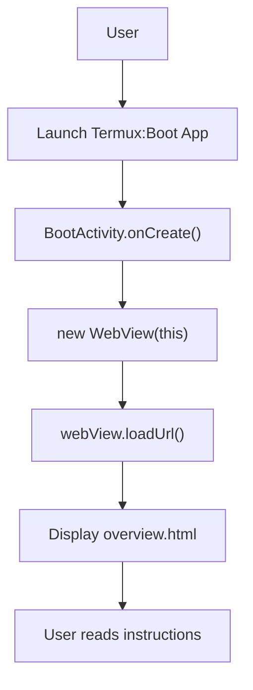
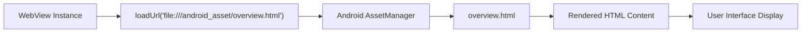
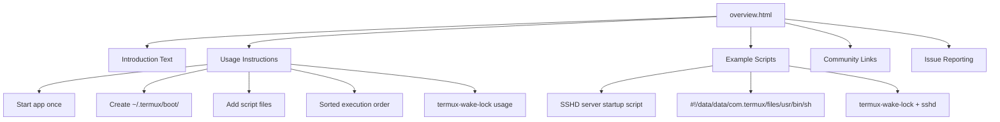
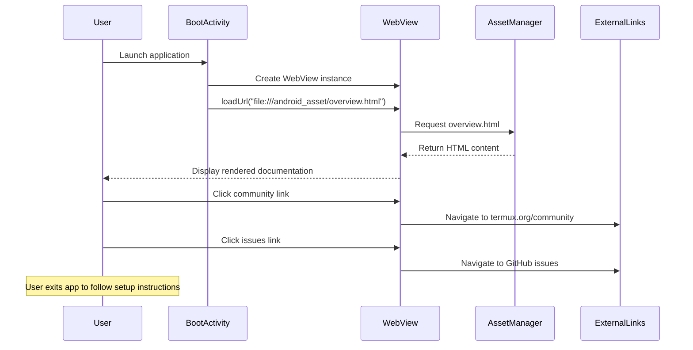

<!-- source: DeepWiki mcp.deepwiki.com · repo termux/termux-boot · page 3.3 User Interface · fetched 2026-10-26 -->

# User Interface

Relevant source files

The following files were used as context for generating this wiki page:

- [app/src/main/assets/overview.html](app/src/main/assets/overview.html)
- [app/src/main/java/com/termux/boot/BootActivity.java](app/src/main/java/com/termux/boot/BootActivity.java)

This section documents the user interface components of the Termux:Boot application, specifically the `BootActivity` class and the HTML-based documentation display system. The UI serves as an informational interface that guides users through the setup and configuration process for boot scripts.

For information about the boot execution system that runs in the background, see [Boot Execution System](#3.2). For the overall Android application structure and components, see [Android Application Structure](#3.1).

## BootActivity Implementation

The primary user interface component is the `BootActivity` class, which provides a simple WebView-based display for user documentation. The activity follows a minimal implementation pattern focused solely on content presentation.

The `BootActivity` class extends Android's base `Activity` class and implements the following core functionality:

| Method | Purpose | Implementation |
|--------|---------|---------------|
| `onCreate()` | Initialize the activity and display content | Creates WebView, loads HTML asset, sets as content view |

The activity implementation is intentionally minimal, with the entire user interface logic contained within the `onCreate()` method at [app/src/main/java/com/termux/boot/BootActivity.java:12-17](). The class creates a `WebView` instance, loads the HTML documentation from the app's assets, and sets it as the activity's content view.

Sources: [app/src/main/java/com/termux/boot/BootActivity.java:1-18]()

## WebView Display System

The user interface utilizes Android's `WebView` component to render HTML content directly within the application. This approach provides several advantages for displaying formatted documentation with hyperlinks and structured content.

The WebView configuration follows these specifications:

- **Content Source**: Loads from `file:///android_asset/overview.html` URL scheme
- **Asset Location**: HTML file stored in `app/src/main/assets/` directory
- **Rendering**: Native Android WebView rendering engine
- **Navigation**: Supports HTML hyperlinks to external resources

The WebView is set as the activity's content view through `setContentView(webView)`, making it the primary and only UI element visible to users.

Sources: [app/src/main/java/com/termux/boot/BootActivity.java:14-16]()

## Documentation Content Structure

The `overview.html` file contains the structured documentation displayed to users. The content is organized into distinct sections that guide users through the setup and usage process.

The HTML document structure includes:

| Section | Content | Purpose |
|---------|---------|---------|
| Introduction | Explanation of Termux:Boot functionality | Context setting |
| Usage | Step-by-step setup instructions | User guidance |
| Example | Complete SSHD script example | Practical demonstration |
| Learn More | Community resources link | Support channels |
| Report Issues | GitHub issues link | Bug reporting |

The content emphasizes the critical setup steps, particularly the requirement to launch the app once to enable boot-time execution and the creation of the `~/.termux/boot/` directory structure.

Sources: [app/src/main/assets/overview.html:1-26]()

## User Interaction Flow

The user interface supports a linear interaction flow designed to provide information and guide setup actions outside the application.

The interface interaction pattern includes:

- **Single-screen display**: No navigation between multiple app screens
- **External link support**: Hyperlinks navigate to external websites
- **Read-only content**: No form inputs or interactive elements within the app
- **Self-contained instructions**: All necessary information provided in one view

Users typically interact with the application briefly to read the documentation, then exit to perform the actual setup tasks (creating directories, writing scripts) in the Termux terminal environment.

Sources: [app/src/main/assets/overview.html:22-25](), [app/src/main/java/com/termux/boot/BootActivity.java:14-16]()

---

