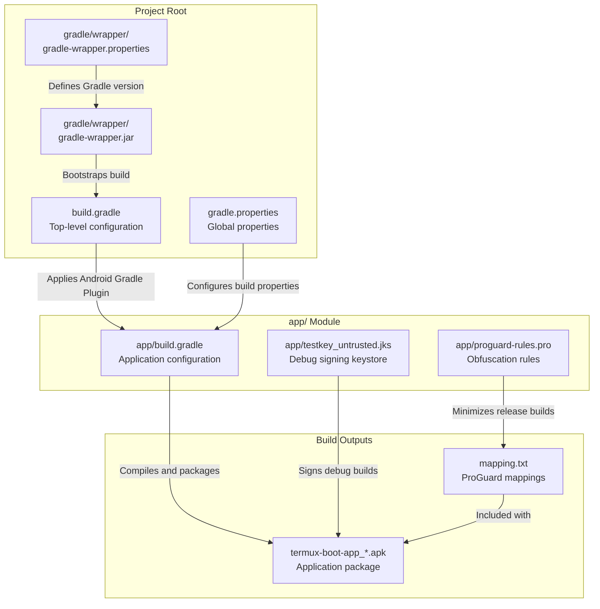
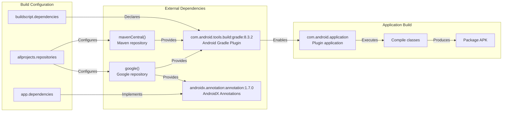
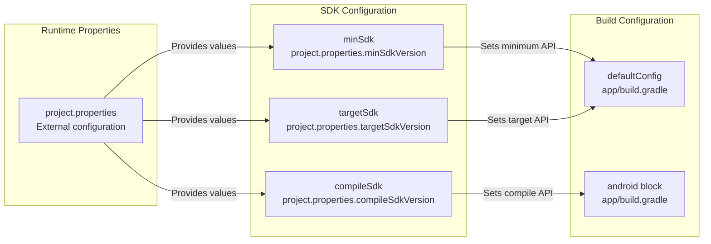
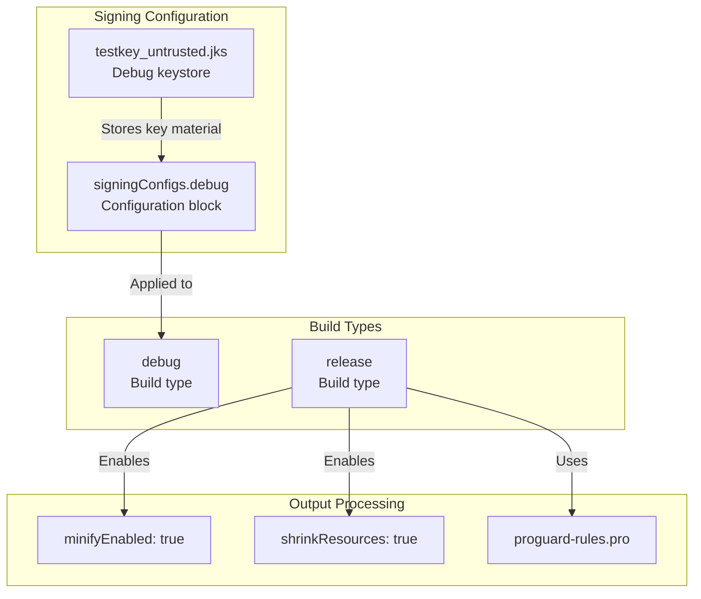
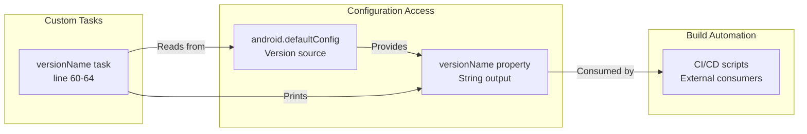

<!-- source: DeepWiki mcp.deepwiki.com · repo termux/termux-boot · page 4 Build System · fetched 2026-10-26 -->

# Build System

<details>
<summary>Relevant source files</summary>

The following files were used as context for generating this wiki page:

- [app/build.gradle](app/build.gradle)
- [app/testkey_untrusted.jks](app/testkey_untrusted.jks)
- [build.gradle](build.gradle)

</details>


This document covers the Android build configuration, Gradle setup, and compilation process for the Termux:Boot application. It explains how the project is structured for building APK files using the Android Gradle Plugin and Gradle wrapper system.

For information about the continuous integration workflows that automate this build system, see [Continuous Integration](#5.1). For details about the Android application components that are built by this system, see [Android Application Structure](#3.1).

## Build System Architecture

The Termux:Boot build system follows the standard Android Gradle Plugin architecture with a two-level configuration approach: a top-level project configuration and an application-specific module configuration.

### Build Configuration Structure



Sources: [build.gradle:1-18](), [app/build.gradle:1-72]()

### Build Dependencies and Plugin Configuration

The build system is anchored by the Android Gradle Plugin version `8.3.2` declared in the top-level `build.gradle`. This plugin provides the Android-specific build tasks and configurations needed to compile Java source code into Android APK packages.



Sources: [build.gradle:1-18](), [app/build.gradle:56-58]()

## Application Build Configuration

The core build logic resides in [app/build.gradle:1-72](), which configures the Android application module with specific settings for the Termux:Boot app.

### Application Identity and Versioning

The application is configured with a fixed identity and semantic versioning system:

| Configuration | Value | Source |
|---------------|-------|---------|
| `applicationId` | `"com.termux.boot"` | [app/build.gradle:12]() |
| `namespace` | `"com.termux.boot"` | [app/build.gradle:4]() |
| `versionCode` | `1000` | [app/build.gradle:15]() |
| `versionName` | `"0.8.1"` (default) | [app/build.gradle:16]() |

The version name can be overridden by the environment variable `TERMUX_BOOT_APP_BUILD__APP_VERSION_NAME` for CI/CD builds, and the system includes semantic version validation via the `validateVersionName()` function at [app/build.gradle:66-71]().

### SDK Version Configuration

The build targets a wide range of Android devices through dynamic SDK version configuration:



Sources: [app/build.gradle:6](), [app/build.gradle:13-14]()

### Build Types and Signing Configuration

The application defines two build types with distinct configurations:

#### Debug Build Type
- Uses custom signing configuration with `testkey_untrusted.jks`
- Keystore password: `xrj45yWGLbsO7W0v`
- Key alias: `alias`
- No code obfuscation

#### Release Build Type  
- Enables ProGuard minification (`minifyEnabled true`)
- Enables resource shrinking (`shrinkResources true`)
- Uses default ProGuard configuration plus custom rules from `proguard-rules.pro`



Sources: [app/build.gradle:22-41]()

### APK Output Naming

The build system generates APK files with descriptive names using the `applicationVariants.all` configuration block. The naming pattern follows:

```
termux-boot-app_[VERSION_TAG].apk
```

Where `VERSION_TAG` is either:
- Environment variable `TERMUX_BOOT_APP_BUILD__APK_VERSION_TAG` (for CI builds)
- `v[versionName]+[buildType]` (for local builds)

This configuration is implemented in [app/build.gradle:48-53]().

### Custom Gradle Tasks

The build includes a custom `versionName` task that outputs the current version name for use in automation scripts:



Sources: [app/build.gradle:60-64]()

## Project-Level Configuration

The top-level [build.gradle:1-18]() provides the foundation for the entire build system by configuring the Android Gradle Plugin and repository access.

### Plugin Management
The `buildscript` block declares the Android Gradle Plugin dependency (`com.android.tools.build:gradle:8.3.2`) and configures the repositories needed to resolve build dependencies.

### Repository Configuration
Both `buildscript` and `allprojects` blocks configure identical repository access:
- `mavenCentral()` for general Java/Kotlin dependencies
- `google()` for Android-specific artifacts and Google Play services

This dual configuration ensures that both build plugins and application dependencies can be resolved during the build process.

Sources: [build.gradle:1-18]()

---

