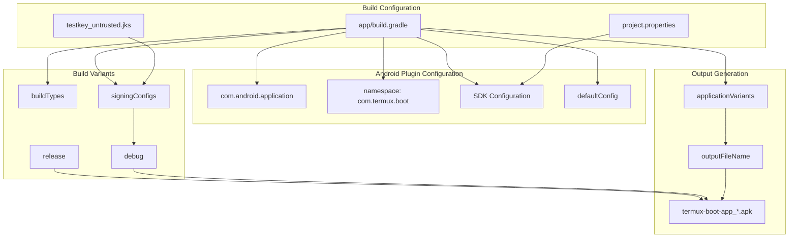
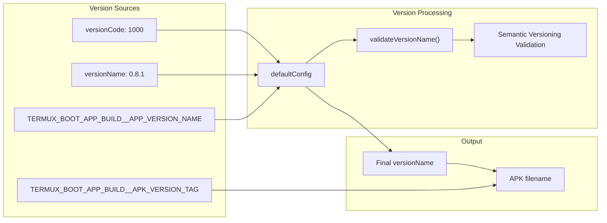
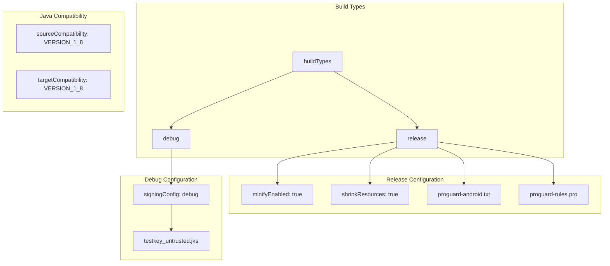
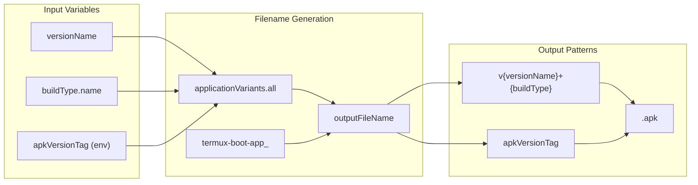

<!-- source: DeepWiki mcp.deepwiki.com · repo termux/termux-boot · page 4.1 Android Application Build · fetched 2026-10-26 -->

# Android Application Build

<details>
<summary>Relevant source files</summary>

The following files were used as context for generating this wiki page:

- [app/build.gradle](app/build.gradle)
- [app/testkey_untrusted.jks](app/testkey_untrusted.jks)

</details>


This page documents the Android application build configuration for Termux:Boot, covering the Gradle build script, Android Gradle Plugin settings, signing configuration, versioning, and APK generation. For broader project build configuration including top-level Gradle files, see [Project Configuration](#4.2). For CI/CD automation of builds, see [Continuous Integration](#5.1).

## Build Configuration Overview

The Termux:Boot Android application build is configured through a single Gradle build script that defines all aspects of compilation, packaging, and signing. The build system uses the Android Gradle Plugin to transform Java source code and Android resources into distributable APK files.

### Build Configuration Structure



**Sources:** [app/build.gradle:1-72]()

## Android Gradle Plugin Configuration

The build applies the Android Application Plugin and configures the namespace for the application. The compilation settings reference values from the project-level properties file to maintain consistency across the build system.

| Configuration | Value | Source |
|---------------|-------|---------|
| Plugin | `com.android.application` | [app/build.gradle:1]() |
| Namespace | `com.termux.boot` | [app/build.gradle:4]() |
| Compile SDK | `project.properties.compileSdkVersion` | [app/build.gradle:6]() |
| Min SDK | `project.properties.minSdkVersion` | [app/build.gradle:13]() |
| Target SDK | `project.properties.targetSdkVersion` | [app/build.gradle:14]() |

**Sources:** [app/build.gradle:1-6](), [app/build.gradle:13-14]()

## Application Configuration

The `defaultConfig` block defines the core application metadata including package identification, version information, and SDK compatibility ranges.

### Version Management



The build system supports environment variable overrides for version information, enabling CI/CD systems to inject dynamic version names during automated builds. Version names must conform to semantic versioning 2.0.0 specification.

**Sources:** [app/build.gradle:8-20](), [app/build.gradle:66-71]()

## Signing Configuration

Debug builds use a custom signing configuration with an untrusted test keystore. This enables installation on development devices while maintaining a consistent signature for the debug variant.

| Setting | Value |
|---------|-------|
| Keystore File | `testkey_untrusted.jks` |
| Key Alias | `alias` |
| Store Password | `xrj45yWGLbsO7W0v` |
| Key Password | `xrj45yWGLbsO7W0v` |

**Sources:** [app/build.gradle:22-29](), [app/testkey_untrusted.jks:1-10]()

## Build Types and Optimization

The build configuration defines two build types with different optimization and signing settings:

### Build Type Configuration



The release build type enables ProGuard minification and resource shrinking to reduce APK size, while the debug build type uses the custom signing configuration for development workflows.

**Sources:** [app/build.gradle:31-46]()

## APK Output Generation

The build system customizes APK filenames to include version and build type information. The output naming strategy supports both standard version tags and environment variable overrides for CI/CD integration.

### APK Naming Strategy



Example output filenames:
- Standard: `termux-boot-app_v0.8.1+debug.apk`
- With environment tag: `termux-boot-app_ci-build-123.apk`

**Sources:** [app/build.gradle:48-53]()

## Dependencies

The application has minimal external dependencies, requiring only AndroidX annotations for code quality and documentation purposes.

| Dependency | Version | Purpose |
|------------|---------|---------|
| `androidx.annotation:annotation` | `1.7.0` | Nullability and lifecycle annotations |

**Sources:** [app/build.gradle:56-58]()

## Build Tasks

The build script defines a custom `versionName` task for extracting version information during build processes, enabling integration with external tooling and CI/CD systems.

```gradle
task versionName {
    doLast {
        print android.defaultConfig.versionName
    }
}
```

**Sources:** [app/build.gradle:60-64]()

---

