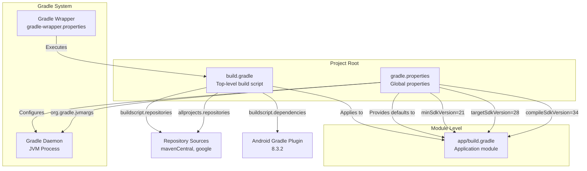
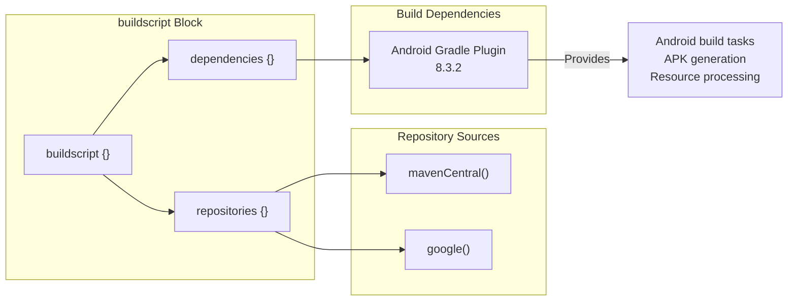
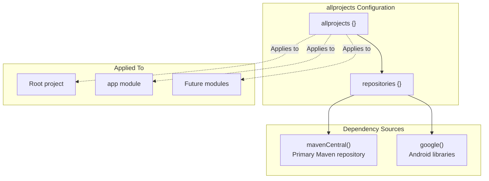
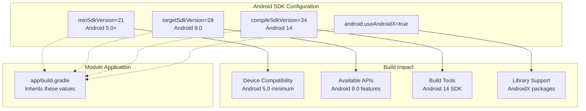
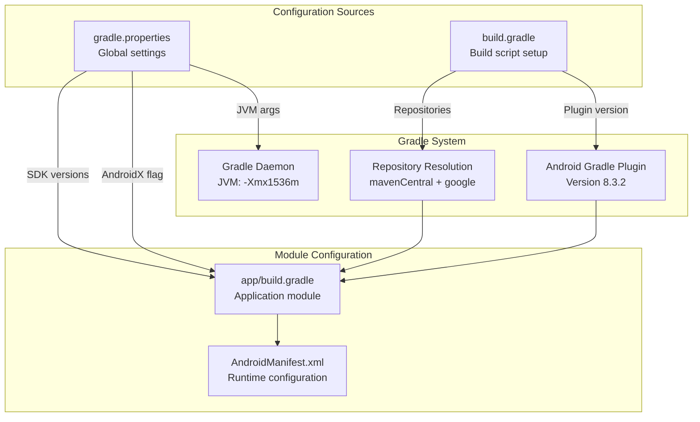

<!-- source: DeepWiki mcp.deepwiki.com · repo termux/termux-boot · page 4.2 Project Configuration · fetched 2026-10-26 -->

# Project Configuration

<details>
<summary>Relevant source files</summary>

The following files were used as context for generating this wiki page:

- [build.gradle](build.gradle)
- [gradle.properties](gradle.properties)

</details>


This document covers the project-wide Gradle configuration for the Termux:Boot Android application. It focuses on the top-level build.gradle file and gradle.properties file that establish global build settings, repository configuration, and Android SDK parameters that apply to all modules in the project.

For application-specific build configuration including APK generation and module dependencies, see [Android Application Build](#4.1). For Gradle wrapper configuration, see [Gradle Wrapper](#4.3).

## Configuration File Structure

The project configuration consists of two primary files that establish the foundation for the entire build system:



**Configuration Hierarchy**
Sources: [build.gradle:1-18](), [gradle.properties:1-24]()

## Top-Level Build Script

The top-level `build.gradle` file establishes the build environment for the entire project through two main configuration blocks:

### Buildscript Configuration

The `buildscript` block configures the build system itself, specifying where to find build tools and which versions to use:

| Configuration | Value | Purpose |
|---------------|-------|---------|
| repositories | `mavenCentral()`, `google()` | Sources for build plugins |
| dependencies | `com.android.tools.build:gradle:8.3.2` | Android Gradle Plugin version |



**Build System Dependencies**
Sources: [build.gradle:1-10]()

### Project Repository Configuration

The `allprojects` block applies repository configuration to all modules in the project, ensuring consistent dependency resolution:



**Repository Inheritance**
Sources: [build.gradle:12-17]()

## Global Gradle Properties

The `gradle.properties` file defines project-wide settings that affect build behavior, performance, and Android configuration:

### JVM Configuration

The Gradle daemon JVM is configured for optimal build performance:

```
org.gradle.jvmargs=-Xmx1536m
```

This setting allocates 1536MB of heap memory to the Gradle daemon process, providing sufficient memory for Android builds while avoiding excessive resource consumption.

### Android Configuration

Global Android SDK settings are centralized in gradle.properties:

| Property | Value | Description |
|----------|-------|-------------|
| `minSdkVersion` | 21 | Minimum Android API level (Android 5.0) |
| `targetSdkVersion` | 28 | Target Android API level (Android 9.0) |
| `compileSdkVersion` | 34 | Compile-time Android API level (Android 14) |
| `android.useAndroidX` | true | Enable AndroidX library support |



**Android SDK Version Strategy**
Sources: [gradle.properties:19-24]()

### Build Performance Settings

Additional Gradle configuration controls build behavior:

- **Parallel builds**: Currently disabled (`# org.gradle.parallel=true`) to ensure build stability
- **AndroidX migration**: Enabled (`android.useAndroidX=true`) for modern Android library support

Sources: [gradle.properties:1-18]()

## Configuration Inheritance Flow

The project configuration establishes a hierarchy where global settings flow down to individual modules:



**Configuration Flow**
Sources: [build.gradle:1-18](), [gradle.properties:1-24]()

This configuration strategy ensures consistent build behavior across all modules while maintaining flexibility for module-specific customization in the application build configuration.

---

