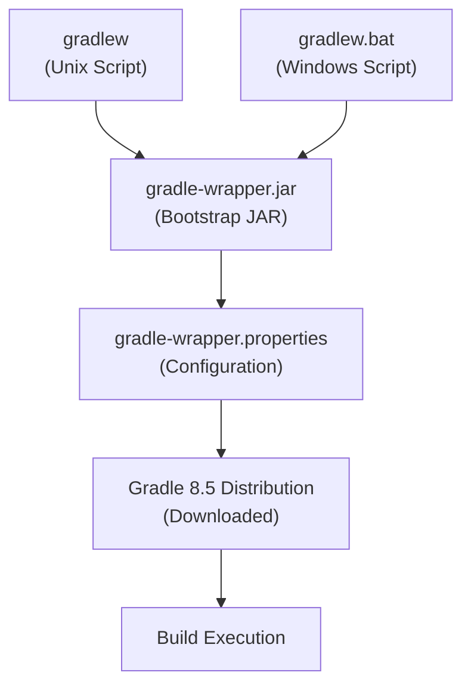
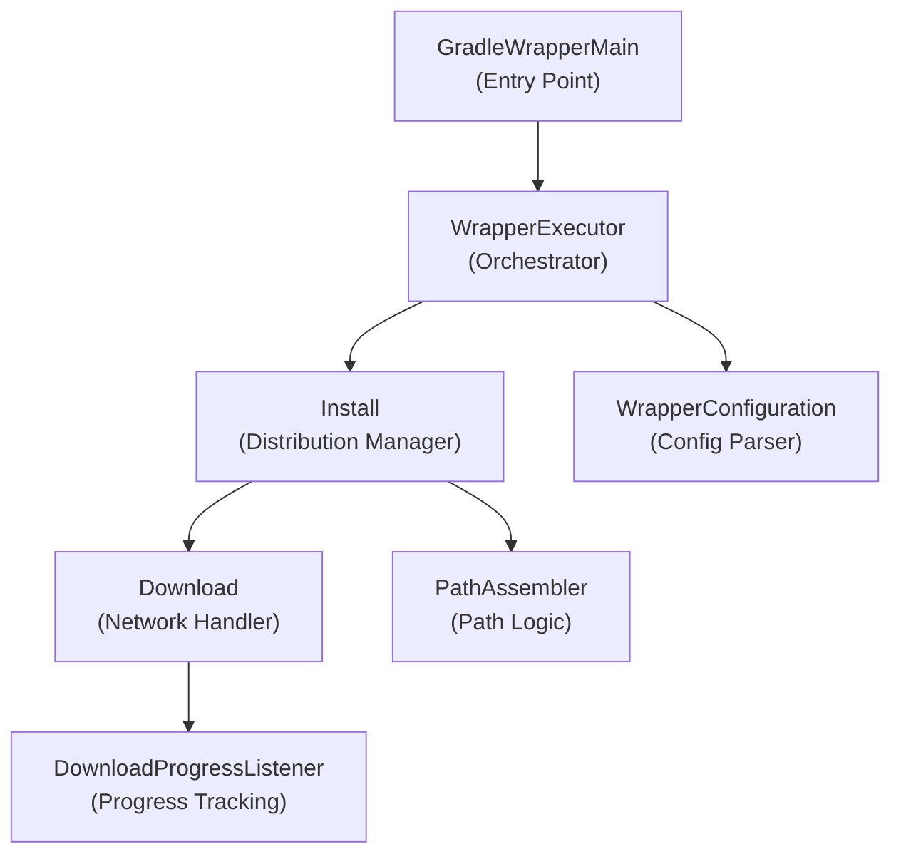
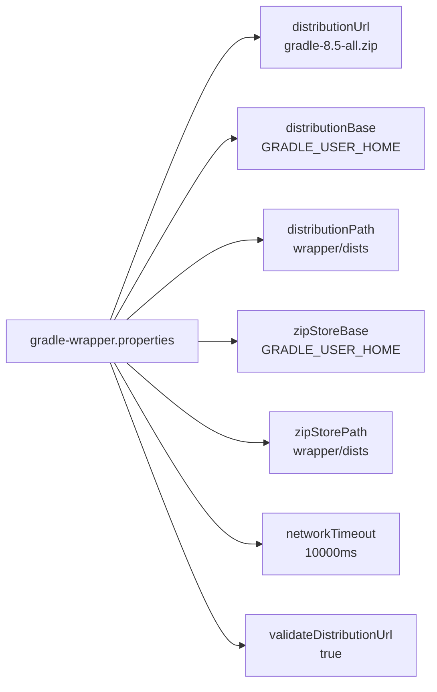
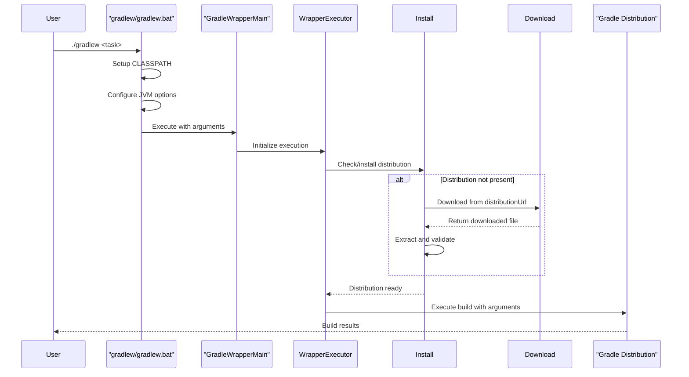

<!-- source: DeepWiki mcp.deepwiki.com · repo termux/termux-boot · page 4.3 Gradle Wrapper · fetched 2026-10-26 -->

# Gradle Wrapper

<details>
<summary>Relevant source files</summary>

The following files were used as context for generating this wiki page:

- [gradle/wrapper/gradle-wrapper.jar](gradle/wrapper/gradle-wrapper.jar)
- [gradle/wrapper/gradle-wrapper.properties](gradle/wrapper/gradle-wrapper.properties)
- [gradlew](gradlew)
- [gradlew.bat](gradlew.bat)

</details>


This document covers the Gradle wrapper system in the termux-boot project, which provides a standardized way to execute Gradle builds without requiring users to manually install Gradle. The wrapper ensures consistent Gradle versions across different development environments and automates the download and setup of the required Gradle distribution.

For information about the Android application build configuration, see [Android Application Build](#4.1). For details about project-wide build settings, see [Project Configuration](#4.2).

## Overview

The Gradle wrapper consists of executable scripts, a bootstrap JAR file, and configuration properties that work together to download and execute a specific version of Gradle. This system eliminates the need for developers to manually install Gradle and ensures build reproducibility across different environments.



**Gradle Wrapper Component Architecture**

Sources: [gradle/wrapper/gradle-wrapper.properties:1-8](), [gradlew:115](), [gradlew.bat:71]()

## Wrapper Scripts

### Unix Script (gradlew)

The `gradlew` script serves as the main entry point for Unix-like systems. It performs several key functions:

- **Java Detection**: Locates the Java executable either from `JAVA_HOME` or system PATH
- **Classpath Setup**: Configures the classpath to include the wrapper JAR file
- **JVM Configuration**: Sets default JVM options and processes environment variables
- **Main Class Execution**: Launches `org.gradle.wrapper.GradleWrapperMain`

Key configuration elements:

| Setting | Value | Line Reference |
|---------|-------|----------------|
| Classpath | `$APP_HOME/gradle/wrapper/gradle-wrapper.jar` | [gradlew:115]() |
| Main Class | `org.gradle.wrapper.GradleWrapperMain` | [gradlew:214]() |
| Default JVM Options | `-Xmx64m -Xms64m` | [gradlew:203]() |

Sources: [gradlew:115-249]()

### Windows Script (gradlew.bat)

The `gradlew.bat` script provides equivalent functionality for Windows environments:

- **Java Resolution**: Finds `java.exe` using similar logic to the Unix script
- **Path Handling**: Uses Windows-specific path separators and commands
- **Error Handling**: Implements Windows batch-specific error reporting

Sources: [gradlew.bat:69-75]()

## Wrapper JAR Components

The `gradle-wrapper.jar` contains the core wrapper implementation with several key classes:



**Wrapper JAR Class Hierarchy**

Sources: [gradle/wrapper/gradle-wrapper.jar]()

### Core Classes

- **`GradleWrapperMain`**: The main entry point class that initializes the wrapper execution
- **`WrapperExecutor`**: Coordinates the overall wrapper execution process
- **`Install`**: Manages Gradle distribution installation and verification
- **`Download`**: Handles downloading of Gradle distributions from remote URLs
- **`PathAssembler`**: Constructs file paths for local Gradle installations
- **`WrapperConfiguration`**: Parses and manages wrapper configuration properties

Sources: [gradle/wrapper/gradle-wrapper.jar]()

## Configuration Properties

The wrapper configuration is defined in `gradle-wrapper.properties`:



**Wrapper Configuration Properties**

### Property Definitions

| Property | Value | Purpose |
|----------|-------|---------|
| `distributionUrl` | `gradle-8.5-all.zip` | Specifies the Gradle version and distribution type |
| `distributionBase` | `GRADLE_USER_HOME` | Base directory for Gradle installations |
| `distributionPath` | `wrapper/dists` | Subdirectory path for distributions |
| `zipStoreBase` | `GRADLE_USER_HOME` | Base directory for downloaded ZIP files |
| `zipStorePath` | `wrapper/dists` | Subdirectory path for ZIP storage |
| `networkTimeout` | `10000` | Network timeout in milliseconds |
| `validateDistributionUrl` | `true` | Enables URL validation for security |

Sources: [gradle/wrapper/gradle-wrapper.properties:1-8]()

## Execution Flow

The wrapper execution follows a specific sequence from script invocation to Gradle execution:



**Wrapper Execution Sequence**

### Key Execution Steps

1. **Script Initialization**: The wrapper script sets up environment variables and classpath
2. **Main Class Launch**: `GradleWrapperMain` is executed with the original arguments
3. **Configuration Loading**: Properties are read from `gradle-wrapper.properties`
4. **Distribution Check**: The system verifies if the required Gradle version is installed
5. **Download/Install**: If needed, downloads and extracts the Gradle distribution
6. **Gradle Execution**: Delegates to the actual Gradle installation to run the build

Sources: [gradlew:211-215](), [gradlew.bat:75]()

## File Structure

The wrapper maintains a specific directory structure within the project:

```
gradle/
├── wrapper/
│   ├── gradle-wrapper.jar      # Bootstrap JAR (binary)
│   └── gradle-wrapper.properties # Configuration file
├── gradlew                     # Unix executable script
└── gradlew.bat                # Windows executable script
```

### File Responsibilities

- **`gradle-wrapper.jar`**: Contains the wrapper implementation classes and bootstrap logic
- **`gradle-wrapper.properties`**: Defines the Gradle version and download configuration
- **`gradlew`**: Unix/Linux/macOS executable script for wrapper invocation
- **`gradlew.bat`**: Windows executable script for wrapper invocation

The wrapper stores downloaded Gradle distributions in the user's home directory under `~/.gradle/wrapper/dists/` by default.

Sources: [gradle/wrapper/gradle-wrapper.properties:1-8](), [gradlew:115](), [gradlew.bat:71]()

---

