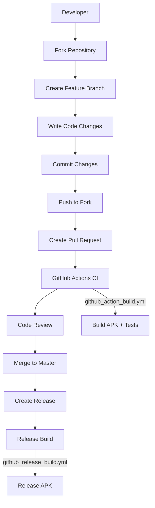
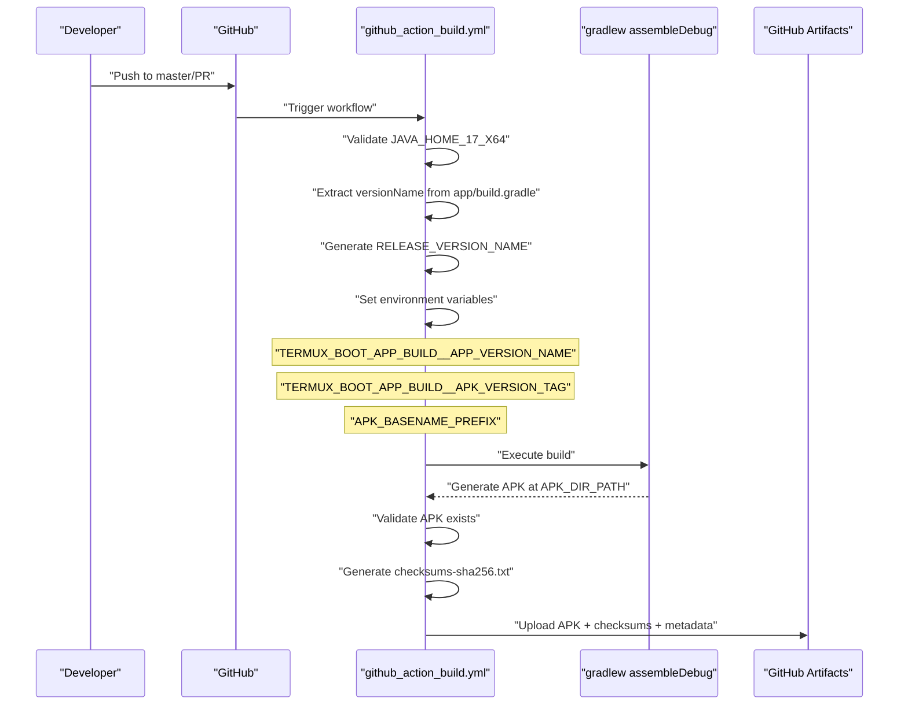
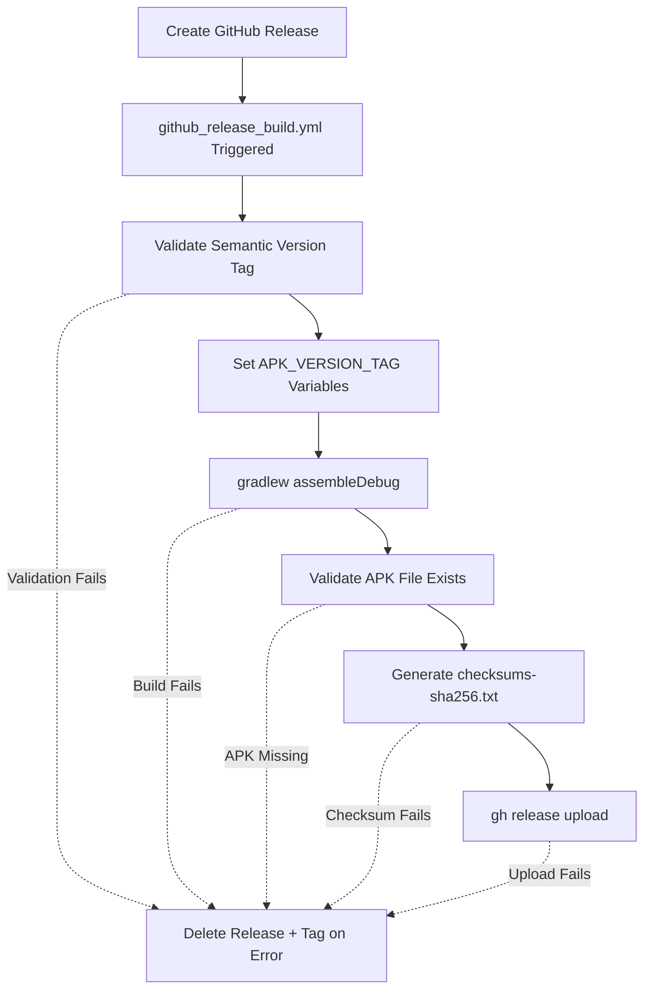
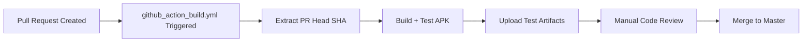

<!-- source: DeepWiki mcp.deepwiki.com · repo termux/termux-boot · page 5 Development Workflow · fetched 2026-10-26 -->

# Development Workflow

<details>
<summary>Relevant source files</summary>

The following files were used as context for generating this wiki page:

- [.github/ISSUE_TEMPLATE/bug_report.md](.github/ISSUE_TEMPLATE/bug_report.md)
- [.github/ISSUE_TEMPLATE/feature_request.md](.github/ISSUE_TEMPLATE/feature_request.md)
- [.github/workflows/github_action_build.yml](.github/workflows/github_action_build.yml)
- [.github/workflows/github_release_build.yml](.github/workflows/github_release_build.yml)

</details>


This document describes the development workflow for Termux:Boot, including continuous integration, automated testing, build processes, and contribution guidelines. It covers the technical processes developers use to modify, test, and release the application.

For information about the build system configuration, see [Build System](#4). For details about code architecture, see [Architecture and Core Components](#3).

## Development Process Overview

The Termux:Boot project follows a standard GitHub-based development workflow with automated CI/CD pipelines. The development process centers around two main GitHub Actions workflows that handle building and testing for different scenarios.

### Development Workflow



Sources: [.github/workflows/github_action_build.yml:1-81](), [.github/workflows/github_release_build.yml:1-70]()

## Continuous Integration Pipeline

The project uses two GitHub Actions workflows to automate building and testing:

### Build Triggers and Events

| Workflow | Triggers | Purpose |
|----------|----------|---------|
| `github_action_build.yml` | Push to master, Pull requests, Scheduled (bi-monthly), Manual dispatch | Development builds and testing |
| `github_release_build.yml` | Release published | Official release builds |

### CI Build Process Flow



Sources: [.github/workflows/github_action_build.yml:14-81]()

### Version Management

The CI system automatically generates version names using a specific pattern:

- **Development builds**: `v<CURRENT_VERSION_NAME>+<commit_hash>` (e.g., `v0.4.0+abc1234`)
- **Release builds**: Uses the GitHub release tag directly
- **APK naming**: `termux-boot-app_<version_tag>.apk`

The version extraction uses regex parsing from [app/build.gradle:37-39]():
```
CURRENT_VERSION_NAME_REGEX='\s+versionName "([^"]+)"$'
```

Sources: [.github/workflows/github_action_build.yml:36-46](), [.github/workflows/github_release_build.yml:35-42]()

### Build Environment Requirements

Both workflows require specific environment configuration:

| Requirement | Details |
|-------------|---------|
| **Java Version** | JDK 17 (`JAVA_HOME_17_X64`) |
| **OS** | `ubuntu-latest` |
| **Gradle** | Uses wrapper (`./gradlew`) |
| **Build Target** | `assembleDebug` |

Sources: [.github/workflows/github_action_build.yml:26-28](), [.github/workflows/github_release_build.yml:30-32]()

## Release Process

### Release Build Workflow



Sources: [.github/workflows/github_release_build.yml:19-69]()

### Error Handling

The release workflow includes comprehensive error handling through the `exit_on_error()` function that:
- Deletes the failed release using `hub release delete`
- Removes the associated git tag using `git push --delete origin`
- Prevents incomplete releases from being published

Sources: [.github/workflows/github_release_build.yml:22-28]()

## Contributing Guidelines

### Issue Reporting Process

The project provides structured issue templates to guide contributors:

#### Bug Reports

The bug report template [.github/ISSUE_TEMPLATE/bug_report.md]() requires:

| Field | Description |
|-------|-------------|
| **Problem description** | Clear description with optional screenshots |
| **Steps to reproduce** | Complete command sequence |
| **Expected behavior** | What should have happened |
| **Environment info** | Termux version, Android version, device model |

#### Feature Requests

Feature requests use [.github/ISSUE_TEMPLATE/feature_request.md]() with a simplified structure focusing on feature description and justification.

### Platform Support Policy

Both issue templates include the important notice:
> Support of Android 5.x - 6.x is finished.

This indicates the project's current platform support boundaries for contributors to understand.

Sources: [.github/ISSUE_TEMPLATE/bug_report.md:10-11](), [.github/ISSUE_TEMPLATE/feature_request.md:10-11]()

### Pull Request Workflow



The CI system specifically handles pull requests by extracting the head SHA to ensure it builds the actual PR commit rather than a merge commit: [.github/workflows/github_action_build.yml:32-34]()

Sources: [.github/workflows/github_action_build.yml:7-9](), [.github/workflows/github_action_build.yml:32-34]()

## Build Artifacts and Output

### Generated Files

Each build produces several artifacts in the `./app/build/outputs/apk/debug/` directory:

| File | Purpose |
|------|---------|
| `${APK_BASENAME_PREFIX}.apk` | The compiled Android application |
| `checksums-sha256.txt` | SHA256 hash verification |
| `output-metadata.json` | Build metadata from Android Gradle Plugin |

### Artifact Upload

Development builds upload artifacts to GitHub Actions for testing and verification, while release builds attach files directly to the GitHub release.

Sources: [.github/workflows/github_action_build.yml:73-81](), [.github/workflows/github_release_build.yml:63-69]()

---

