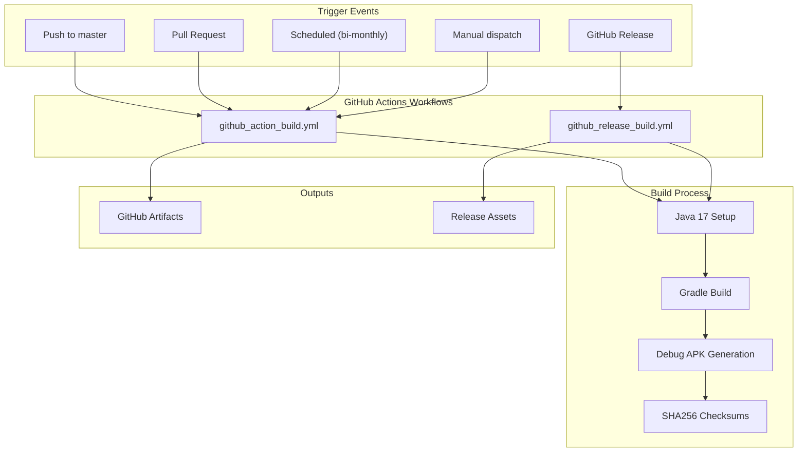
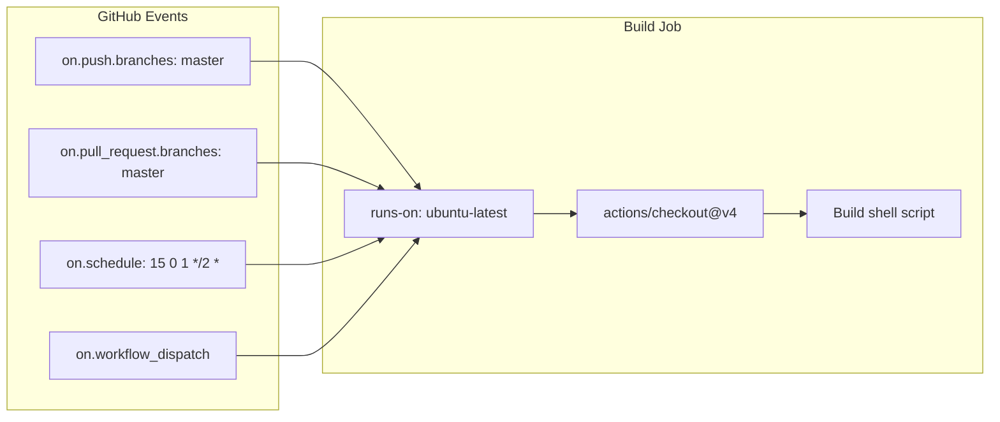
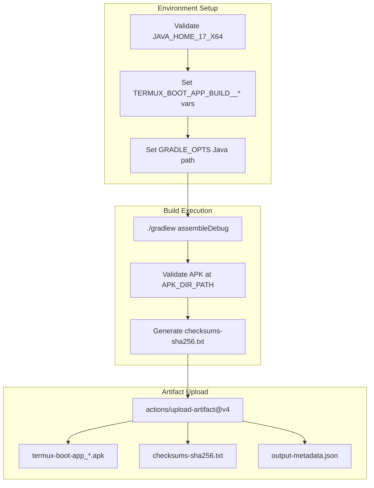
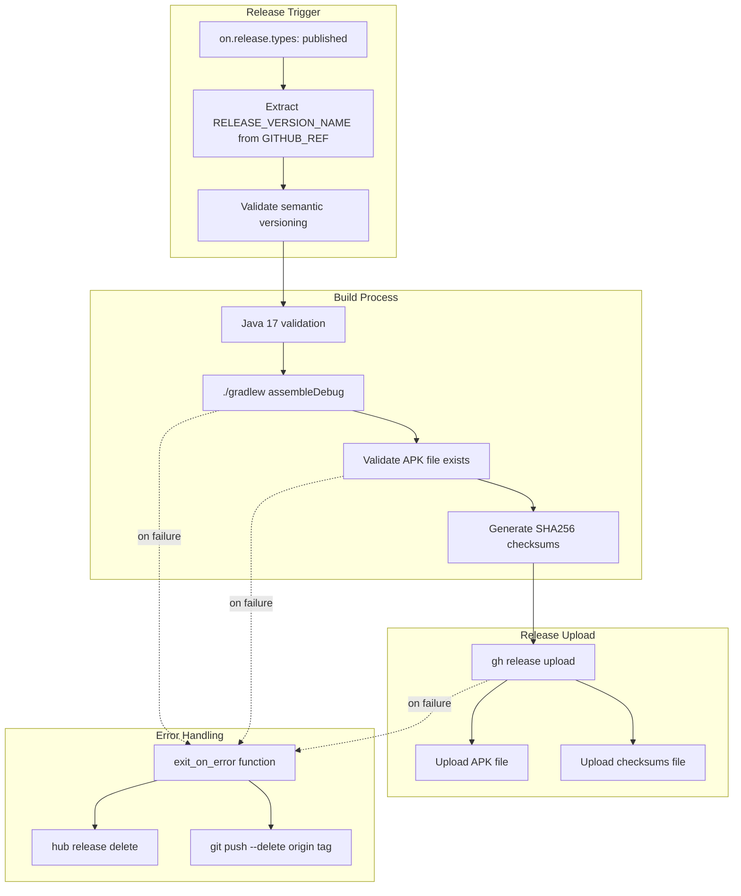

<!-- source: DeepWiki mcp.deepwiki.com · repo termux/termux-boot · page 5.1 Continuous Integration · fetched 2026-10-26 -->

# Continuous Integration

<details>
<summary>Relevant source files</summary>

The following files were used as context for generating this wiki page:

- [.github/workflows/github_action_build.yml](.github/workflows/github_action_build.yml)
- [.github/workflows/github_release_build.yml](.github/workflows/github_release_build.yml)

</details>


This page documents the automated build and release system for Termux:Boot, which uses GitHub Actions workflows to build APK files and manage releases. The CI system handles both development builds triggered by code changes and official release builds triggered by GitHub releases.

For information about the Android build configuration that these workflows execute, see [Android Application Build](#4.1). For details about contributing code changes that trigger these workflows, see [Contributing and Issues](#5.2).

## Overview

The Termux:Boot project uses two GitHub Actions workflows to automate the build and release process:

- **Build Workflow** (`github_action_build.yml`) - Runs on code changes, pull requests, and scheduled intervals
- **Release Workflow** (`github_release_build.yml`) - Runs when GitHub releases are published

Both workflows build debug APK files using the Android Gradle build system and generate SHA256 checksums for integrity verification.

**CI Pipeline Overview**



Sources: [.github/workflows/github_action_build.yml:1-81](), [.github/workflows/github_release_build.yml:1-70]()

## Build Workflow

The build workflow handles continuous integration for development builds and is defined in `github_action_build.yml`. It runs on multiple trigger conditions and uploads build artifacts to GitHub Actions.

### Trigger Conditions

The workflow activates on several events:

| Trigger Type | Condition | Purpose |
|--------------|-----------|---------|
| Push | Commits to `master` branch | Validate new changes |
| Pull Request | PRs targeting `master` branch | Pre-merge validation |
| Schedule | Bi-monthly cron (`15 0 1 */2 *`) | Periodic health checks |
| Manual | `workflow_dispatch` | On-demand builds |

**Build Trigger Flow**



Sources: [.github/workflows/github_action_build.yml:3-12]()

### Version Generation

The build workflow generates dynamic version names that include the current version from `app/build.gradle` and the commit hash:

```
RELEASE_VERSION_NAME="v$CURRENT_VERSION_NAME+${GITHUB_SHA:0:7}"
```

For pull requests, it uses the head commit SHA rather than the merge commit to ensure accurate versioning. The version follows semantic versioning 2.0.0 specification and is validated using regex pattern matching.

Sources: [.github/workflows/github_action_build.yml:32-42]()

### Build Execution

The build process uses several key steps:

1. **Java Environment Setup** - Validates Java 17 installation at `$JAVA_HOME_17_X64`
2. **Environment Variables** - Sets build-specific variables including `TERMUX_BOOT_APP_BUILD__APK_VERSION_TAG`
3. **Gradle Build** - Executes `./gradlew assembleDebug` with Java 17
4. **APK Validation** - Verifies the expected APK file exists
5. **Checksum Generation** - Creates `checksums-sha256.txt` using `sha256sum`

**Build Process Flow**



Sources: [.github/workflows/github_action_build.yml:26-28](), [.github/workflows/github_action_build.yml:44-59](), [.github/workflows/github_action_build.yml:67-71](), [.github/workflows/github_action_build.yml:73-81]()

## Release Workflow

The release workflow is triggered when GitHub releases are published and uploads build artifacts directly to the release. It is defined in `github_release_build.yml` and includes automatic cleanup on build failures.

### Release Trigger and Validation

The workflow activates on `release.published` events and validates that the release tag follows semantic versioning:

```bash
if ! printf "%s" "${RELEASE_VERSION_NAME/v/}" | grep -qP '^(0|[1-9]\d*)\.(0|[1-9]\d*)\.(0|[1-9]\d*)(?:-((?:0|[1-9]\d*|\d*[a-zA-Z-][0-9a-zA-Z-]*)(?:\.(?:0|[1-9]\d*|\d*[a-zA-Z-][0-9a-zA-Z-]*))*))?(?:\+([0-9a-zA-Z-]+(?:\.[0-9a-zA-Z-]+)*))?$'
```

Sources: [.github/workflows/github_release_build.yml:3-6](), [.github/workflows/github_release_build.yml:35-38]()

### Error Handling and Cleanup

The release workflow includes an `exit_on_error` function that automatically cleans up failed releases:

```bash
exit_on_error() {
    echo "$1"
    echo "Deleting '$RELEASE_VERSION_NAME' release and '$GITHUB_REF' tag"
    hub release delete "$RELEASE_VERSION_NAME"
    git push --delete origin "$GITHUB_REF"
    exit 1
}
```

This ensures that failed builds do not leave incomplete releases published on GitHub.

Sources: [.github/workflows/github_release_build.yml:22-28]()

### Release Asset Upload

After successful build and validation, the workflow uploads files directly to the GitHub release using the GitHub CLI:

```bash
gh release upload "$RELEASE_VERSION_NAME" \
  "$APK_DIR_PATH/${APK_BASENAME_PREFIX}.apk" \
  "$APK_DIR_PATH/checksums-sha256.txt"
```

**Release Workflow Process**



Sources: [.github/workflows/github_release_build.yml:63-69]()

## Build Artifacts and Versioning

Both workflows generate standardized build artifacts with consistent naming schemes and metadata.

### APK Naming Convention

The APK files follow a structured naming pattern:

| Workflow Type | Pattern | Example |
|---------------|---------|---------|
| Build | `termux-boot-app_v{VERSION}+{COMMIT}.github.debug.apk` | `termux-boot-app_v0.24+a1b2c3d.github.debug.apk` |
| Release | `termux-boot-app_v{TAG}+github.debug.apk` | `termux-boot-app_v0.24+github.debug.apk` |

The version tag is set via the `TERMUX_BOOT_APP_BUILD__APK_VERSION_TAG` environment variable, which is consumed by the Android build configuration.

Sources: [.github/workflows/github_action_build.yml:44-46](), [.github/workflows/github_release_build.yml:40-42]()

### Generated Files

Each build produces three primary files:

1. **APK File** - The compiled Android application package
2. **checksums-sha256.txt** - SHA256 hash for integrity verification  
3. **output-metadata.json** - Android build metadata (build workflow only)

The checksum file is generated using:
```bash
(cd "$APK_DIR_PATH"; sha256sum "${APK_BASENAME_PREFIX}.apk" > checksums-sha256.txt)
```

Sources: [.github/workflows/github_action_build.yml:67-71](), [.github/workflows/github_release_build.yml:57-61]()

## Infrastructure Requirements

The CI system has specific infrastructure dependencies that must be maintained:

### Runtime Environment

- **OS**: `ubuntu-latest` (GitHub Actions hosted runner)
- **Java**: Java 17 at `$JAVA_HOME_17_X64` path
- **Gradle**: Managed via wrapper (`./gradlew`)
- **GitHub CLI**: For release asset uploads (`gh` command)

### Required Secrets and Tokens

- **GITHUB_TOKEN** - Automatically provided secret for repository access
- Used for release deletion and Git operations in error scenarios

### External Dependencies

- **actions/checkout@v4** - Repository checkout action
- **actions/upload-artifact@v4** - Artifact upload action  
- **hub** CLI tool - For release deletion (legacy, used alongside `gh`)

Sources: [.github/workflows/github_action_build.yml:16](), [.github/workflows/github_action_build.yml:19](), [.github/workflows/github_action_build.yml:74](), [.github/workflows/github_release_build.yml:10](), [.github/workflows/github_release_build.yml:12]()

---

