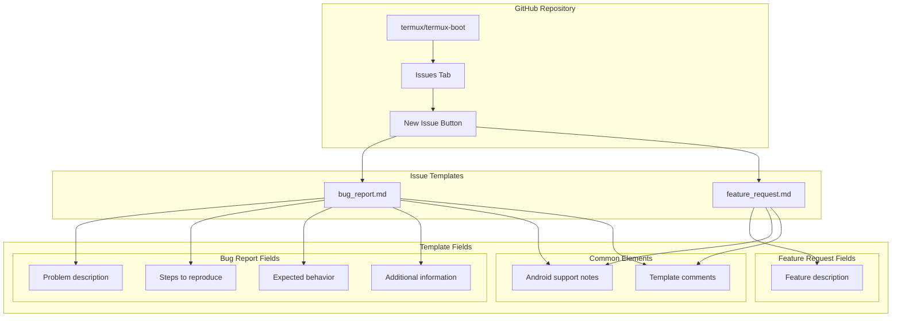
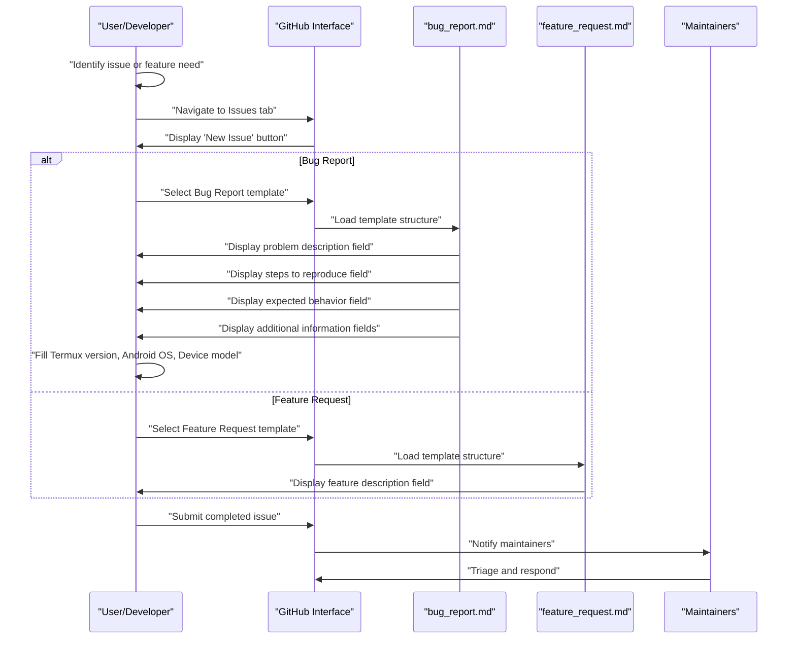

<!-- source: DeepWiki mcp.deepwiki.com · repo termux/termux-boot · page 5.2 Contributing and Issues · fetched 2026-10-26 -->

# Contributing and Issues

Relevant source files

The following files were used as context for generating this wiki page:

- [.github/ISSUE_TEMPLATE/bug_report.md](.github/ISSUE_TEMPLATE/bug_report.md)
- [.github/ISSUE_TEMPLATE/feature_request.md](.github/ISSUE_TEMPLATE/feature_request.md)

This document covers the process for submitting bug reports and feature requests for the Termux:Boot project through GitHub's issue tracking system. It explains the structured issue templates provided in the repository and the required information for effective issue submission.

For information about the continuous integration and automated build processes, see [Continuous Integration](#5.1). For broader development workflow documentation, see the parent section [Development Workflow](#5).

## Issue Submission Process

The Termux:Boot project uses GitHub's issue template system to standardize bug reports and feature requests. The templates ensure that contributors provide necessary information for effective issue resolution.

### Issue Template Structure

The following diagram shows the GitHub issue template system and its components:

Sources: [.github/ISSUE_TEMPLATE/bug_report.md:1-36](), [.github/ISSUE_TEMPLATE/feature_request.md:1-18]()

### Issue Submission Workflow

The following diagram illustrates the complete process from issue identification to template submission:

Sources: [.github/ISSUE_TEMPLATE/bug_report.md:1-36](), [.github/ISSUE_TEMPLATE/feature_request.md:1-18]()

## Bug Report Template

The bug report template located at [.github/ISSUE_TEMPLATE/bug_report.md:1-36]() provides a structured format for reporting issues with the Termux:Boot application.

### Required Information

| Field | Description | Purpose |
|-------|-------------|---------|
| Problem description | Clear description of the issue, may include screenshots | Helps maintainers understand the bug |
| Steps to reproduce | Complete command sequence to reproduce the behavior | Enables maintainers to replicate the issue |
| Expected behavior | What should have happened instead | Clarifies the intended functionality |
| Termux application version | Version of the main Termux app | Identifies compatibility issues |
| Android OS version | Android version on the device | Determines OS-specific problems |
| Device model | Specific device hardware | Helps identify device-specific issues |

### Template Structure

The bug report template includes the following sections as defined in [.github/ISSUE_TEMPLATE/bug_report.md:14-35]():

- **Problem description**: Requires clear and concise description with optional screenshots
- **Steps to reproduce**: Demands all necessary commands to reproduce the issue  
- **Expected behavior**: Expects description of intended functionality
- **Additional information**: Collects environment details for debugging

### Android Support Policy

Both issue templates include a critical notice at [.github/ISSUE_TEMPLATE/bug_report.md:10]() and [.github/ISSUE_TEMPLATE/feature_request.md:10]() stating that "Support of Android 5.x - 6.x is finished." This policy guides users to focus on supported Android versions when reporting issues.

Sources: [.github/ISSUE_TEMPLATE/bug_report.md:10-11](), [.github/ISSUE_TEMPLATE/bug_report.md:14-35]()

## Feature Request Template

The feature request template at [.github/ISSUE_TEMPLATE/feature_request.md:1-18]() provides a simplified structure for suggesting new functionality.

### Template Content

The feature request template requires only essential information:

- **Feature description**: Detailed explanation of the proposed feature and its justification
- **Android support notice**: Same policy statement about discontinued Android 5.x-6.x support

The minimal structure reflects the project's focused scope as a boot script executor, where feature requests typically involve changes to the boot execution logic rather than extensive new functionality.

Sources: [.github/ISSUE_TEMPLATE/feature_request.md:14-17]()

## Best Practices for Issue Submission

### Bug Reports

When submitting bug reports through the template, contributors should:

1. **Provide complete command sequences**: Include all commands executed before the issue occurred
2. **Specify environment details**: Always include the three required fields (Termux version, Android OS, device model)
3. **Include relevant files**: Attach or reference boot scripts that trigger the issue
4. **Follow template structure**: Complete all sections marked in the template

### Feature Requests

For feature requests, contributors should:

1. **Justify the need**: Explain why the feature would benefit Termux:Boot users
2. **Consider scope**: Ensure the request aligns with the app's purpose as a boot script executor
3. **Reference existing functionality**: Relate requests to current `BootReceiver` or `BootJobService` behavior

### Common Guidelines

Both issue types should:

- **Target supported Android versions**: Focus on Android 7.0+ as indicated in the templates
- **Search existing issues**: Avoid duplicating previously reported problems
- **Use clear language**: Write descriptions that technical maintainers can quickly understand

Sources: [.github/ISSUE_TEMPLATE/bug_report.md:7-11](), [.github/ISSUE_TEMPLATE/feature_request.md:7-11]()

---

