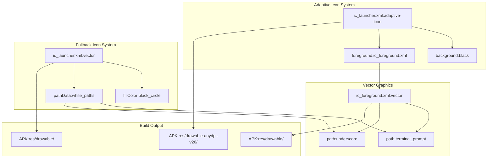
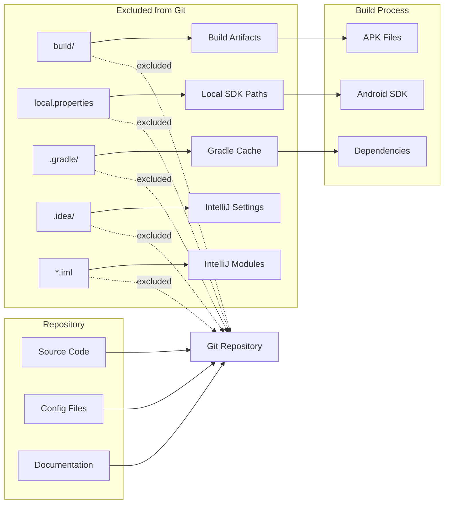
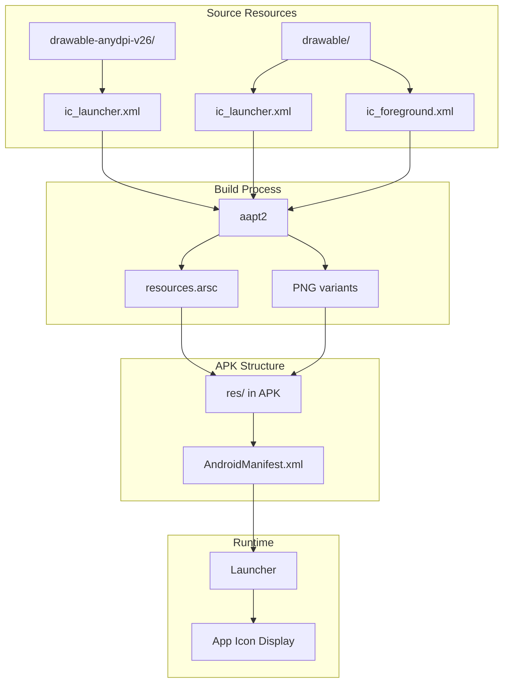

<!-- source: DeepWiki mcp.deepwiki.com · repo termux/termux-boot · page 6 Reference · fetched 2026-10-26 -->

# Reference

Relevant source files

The following files were used as context for generating this wiki page:

- [.gitignore](.gitignore)
- [app/src/main/res/drawable-anydpi-v26/ic_launcher.xml](app/src/main/res/drawable-anydpi-v26/ic_launcher.xml)
- [app/src/main/res/drawable/ic_foreground.xml](app/src/main/res/drawable/ic_foreground.xml)
- [app/src/main/res/drawable/ic_launcher.xml](app/src/main/res/drawable/ic_launcher.xml)

This document provides technical reference material for additional components of the Termux:Boot application, including visual resources and project configuration files. This covers supplementary technical details not covered in the core architecture documentation.

For information about the main application components and build system, see [Architecture and Core Components](#3) and [Build System](#4).

## Application Resources

The Termux:Boot application includes visual assets that provide the app's identity in the Android system. These resources follow Android's adaptive icon design guidelines and are built into the APK during compilation.

### Launcher Icon System

The application uses Android's adaptive icon system to provide consistent visual appearance across different device interfaces and launcher implementations.

Sources: [app/src/main/res/drawable-anydpi-v26/ic_launcher.xml:1-5](), [app/src/main/res/drawable/ic_launcher.xml:1-34](), [app/src/main/res/drawable/ic_foreground.xml:1-28]()

### Icon Design Specifications

The launcher icons implement a terminal prompt design consistent with Termux branding:

| Component | Specification | Implementation |
|-----------|---------------|----------------|
| **Adaptive Background** | Solid black color | `@android:color/black` |
| **Adaptive Foreground** | Terminal prompt symbol | Vector paths in `ic_foreground.xml` |
| **Fallback Icon** | Black circle with white terminal symbols | Combined paths in `ic_launcher.xml` |
| **Canvas Size** | 108dp × 108dp | Standard Android adaptive icon size |
| **Symbol Design** | Terminal prompt ">" and underscore "_" | White paths on black background |

The terminal prompt symbol uses the following vector path coordinates:
- Prompt symbol: `M34,38 h6 l12,16 l-12,16 h-6 l12,-16` [app/src/main/res/drawable/ic_foreground.xml:10-16]()
- Underscore: `M56,66 h18 v4 h-18` [app/src/main/res/drawable/ic_foreground.xml:21-25]()

Sources: [app/src/main/res/drawable-anydpi-v26/ic_launcher.xml:3-4](), [app/src/main/res/drawable/ic_foreground.xml:8-26](), [app/src/main/res/drawable/ic_launcher.xml:7-32]()

## Configuration Files

Project configuration files control various aspects of the development workflow, build process, and repository management.

### Version Control Configuration

The `.gitignore` file excludes build artifacts and IDE-specific files from version control:

Sources: [.gitignore:1-5]()

### Git Ignore Rules

| Pattern | Purpose | Rationale |
|---------|---------|-----------|
| `build/` | Exclude build output directories | Generated artifacts, platform-specific |
| `local.properties` | Exclude local SDK configuration | Contains machine-specific paths |
| `.gradle/` | Exclude Gradle daemon and cache | Build tool temporary files |
| `.idea/` | Exclude IntelliJ IDEA project files | IDE-specific configuration |
| `*.iml` | Exclude IntelliJ module files | Generated module definitions |

These exclusions ensure that only source code and essential configuration files are tracked in version control, while machine-specific and generated files are kept local to each development environment.

Sources: [.gitignore:1-5]()

### Resource File Integration

The application resources integrate with Android's resource compilation system during the build process:

Sources: [app/src/main/res/drawable-anydpi-v26/ic_launcher.xml:1-5](), [app/src/main/res/drawable/ic_launcher.xml:1-34](), [app/src/main/res/drawable/ic_foreground.xml:1-28]()

The adaptive icon system provides backward compatibility for devices that don't support adaptive icons while offering enhanced visual integration on devices that do. The vector graphics format ensures crisp rendering at any display density.

---

