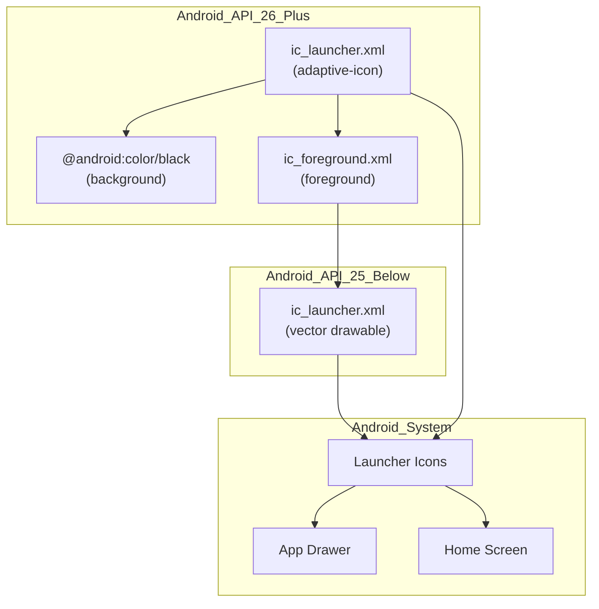
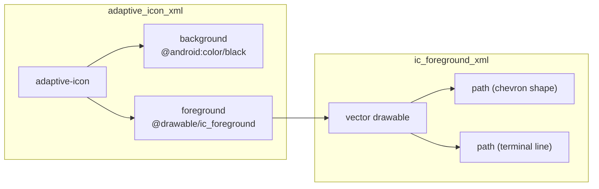
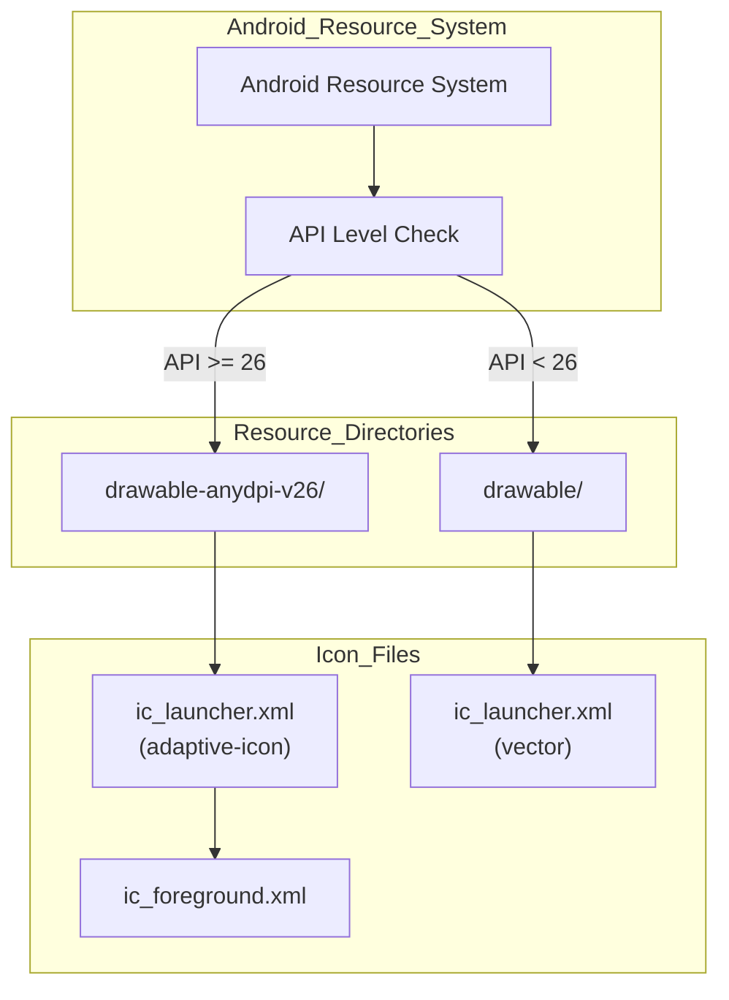

<!-- source: DeepWiki mcp.deepwiki.com · repo termux/termux-boot · page 6.1 Application Resources · fetched 2026-10-26 -->

# Application Resources

Relevant source files

The following files were used as context for generating this wiki page:

- [app/src/main/res/drawable-anydpi-v26/ic_launcher.xml](app/src/main/res/drawable-anydpi-v26/ic_launcher.xml)
- [app/src/main/res/drawable/ic_foreground.xml](app/src/main/res/drawable/ic_foreground.xml)
- [app/src/main/res/drawable/ic_launcher.xml](app/src/main/res/drawable/ic_launcher.xml)

This document covers the visual assets and drawable resources used by the Termux:Boot Android application. The resources documented here include launcher icons, adaptive icons, and their associated XML drawable definitions. This page focuses specifically on the app's visual identity components that appear in the Android system UI.

For information about other configuration files in the project, see [Configuration Files](#6.2).

## Icon System Overview

The Termux:Boot application implements a comprehensive icon system that supports both modern adaptive icons (Android API 26+) and legacy icon formats for older Android versions. The system consists of three main drawable resources that work together to provide a consistent visual identity across different Android versions and device launchers.

### Icon Resource Structure

**Sources:** [app/src/main/res/drawable-anydpi-v26/ic_launcher.xml:1-6](), [app/src/main/res/drawable/ic_launcher.xml:1-35](), [app/src/main/res/drawable/ic_foreground.xml:1-29]()

## Adaptive Icon Implementation

The adaptive icon system uses the `adaptive-icon` XML element to define separate background and foreground layers. This allows Android launchers to apply different visual effects like masks, shadows, and animations while maintaining the icon's core design elements.

### Adaptive Icon Structure

The adaptive icon configuration in [app/src/main/res/drawable-anydpi-v26/ic_launcher.xml:2-4]() defines:
- Background: Solid black color (`@android:color/black`)
- Foreground: Reference to `ic_foreground.xml` drawable

**Sources:** [app/src/main/res/drawable-anydpi-v26/ic_launcher.xml:2-4]()

## Icon Design Elements

The actual visual design consists of two geometric elements rendered as vector paths. Both the adaptive foreground and legacy icon implementations use identical path data to ensure visual consistency across Android versions.

### Vector Path Components

| Component | Path Data | Visual Element |
|-----------|-----------|----------------|
| Chevron Shape | `M34,38 h6 l12,16 l-12,16 h-6 l12,-16` | Left-pointing chevron or arrow |
| Terminal Line | `M56,66 h18 v4 h-18` | Horizontal line representing terminal cursor |

The path data creates a stylized representation of a terminal interface with a command prompt chevron and cursor line. The design uses white fill color (`#FFFFFF`) on both a black circular background (legacy) and black adaptive background.

### Design Synchronization

The codebase includes comments ensuring design consistency between icon variants:
- [app/src/main/res/drawable/ic_foreground.xml:7](): "Keep in sync with non-adaptive ic_launcher.xml"
- [app/src/main/res/drawable/ic_launcher.xml:13](): "Keep in sync with adaptive ic_foreground.xml"

**Sources:** [app/src/main/res/drawable/ic_foreground.xml:8-27](), [app/src/main/res/drawable/ic_launcher.xml:14-32]()

## File Structure and Resource Resolution

The Android resource system selects the appropriate icon based on device capabilities and API level. The directory structure and file naming follow Android resource qualifiers to ensure proper resolution.

### Resource Resolution Flow

### Resource Directory Structure

- `drawable-anydpi-v26/`: Contains adaptive icon for Android API 26 and above
- `drawable/`: Contains legacy vector icon and foreground drawable for all API levels

The `anydpi-v26` qualifier ensures the adaptive icon is only used on devices that support the adaptive icon framework, while older devices fall back to the standard vector drawable in the base `drawable/` directory.

**Sources:** [app/src/main/res/drawable-anydpi-v26/ic_launcher.xml:1](), [app/src/main/res/drawable/ic_launcher.xml:1](), [app/src/main/res/drawable/ic_foreground.xml:1]()

---

