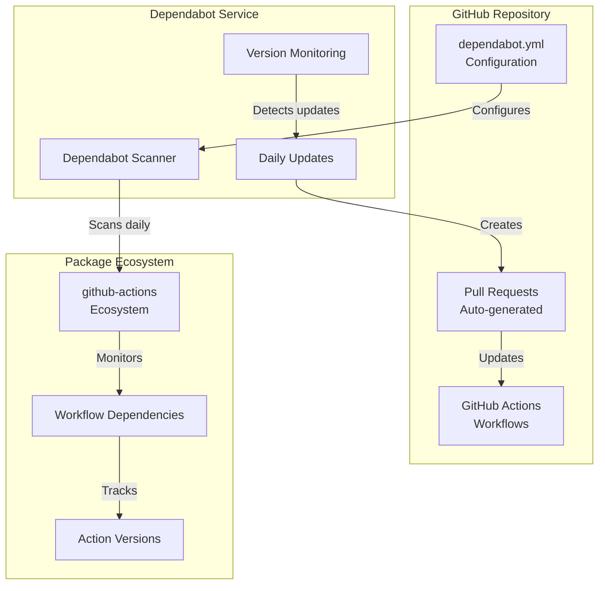
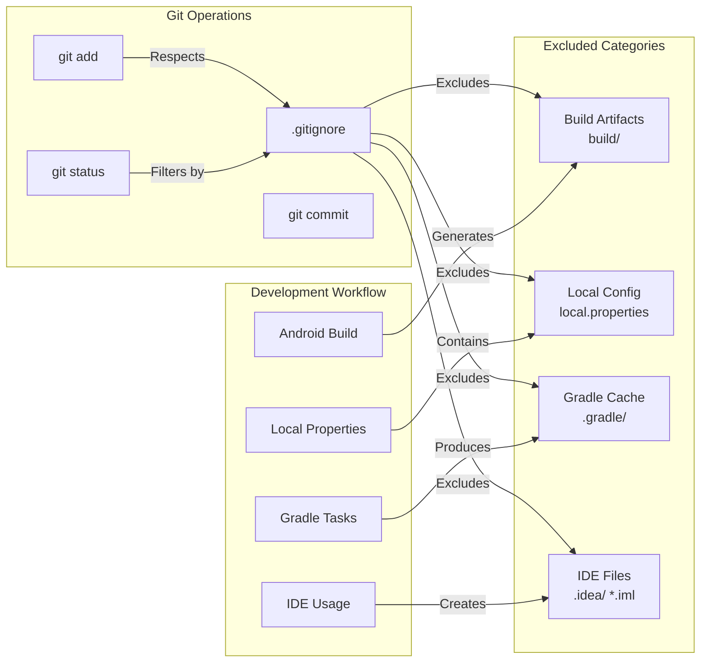
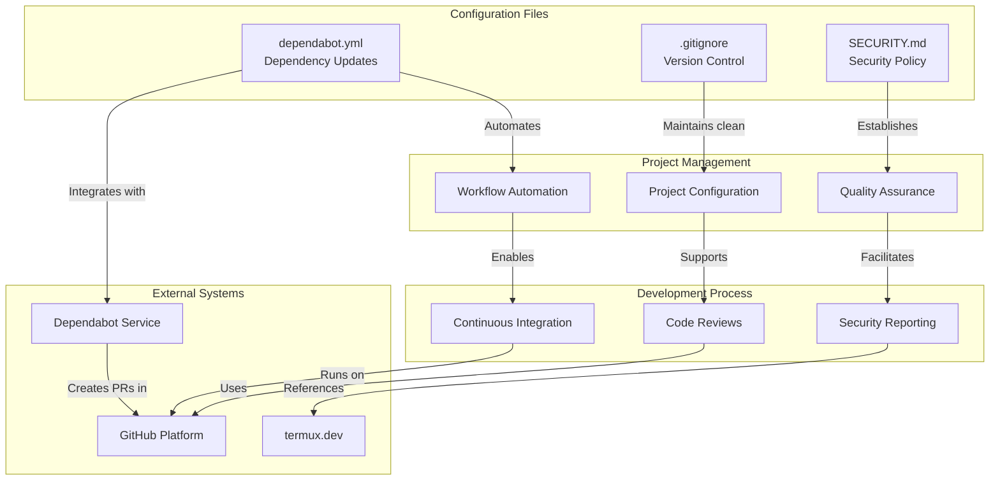

<!-- source: DeepWiki mcp.deepwiki.com · repo termux/termux-boot · page 6.2 Configuration Files · fetched 2026-10-26 -->

# Configuration Files

Relevant source files

The following files were used as context for generating this wiki page:

- [.github/dependabot.yml](.github/dependabot.yml)
- [.gitignore](.gitignore)
- [SECURITY.md](SECURITY.md)

This document covers the various configuration files that control project behavior, development workflow, and security policies for the Termux:Boot application. These files define how the project manages dependencies, version control exclusions, and security reporting procedures.

For information about build configuration files like `build.gradle`, see [Project Configuration](#4.2). For details about application manifest and permissions, see [Android Application Structure](#3.1).

## Security Policy Configuration

The project maintains a security policy file that defines how security vulnerabilities should be reported and handled.

### SECURITY.md

The [`SECURITY.md`](SECURITY.md:1-2)() file provides a centralized reference for security-related procedures. Rather than duplicating security information, it directs users to the official Termux security documentation.

| Configuration | Value |
|---|---|
| Security Policy Location | `https://termux.dev/security` |
| File Purpose | Central reference for vulnerability reporting |
| Content Type | Redirect to official documentation |

This approach ensures that security policies remain consistent across all Termux-related projects and that updates to security procedures are maintained in a single authoritative location.

**Sources:** [SECURITY.md:1-2]()

## Dependency Management Configuration

The project uses GitHub's Dependabot service to automate dependency updates and security patches.

### Dependabot Configuration

The [`.github/dependabot.yml`](.github/dependabot.yml:1-7)() file configures automated dependency monitoring for the project's GitHub Actions workflows.

#### Configuration Details

| Parameter | Value | Purpose |
|---|---|---|
| `package-ecosystem` | `github-actions` | Monitors GitHub Actions dependencies |
| `directory` | `/` | Scans entire repository root |
| `schedule.interval` | `daily` | Checks for updates every day |

The configuration focuses exclusively on GitHub Actions dependencies, ensuring that workflow actions remain up-to-date with security patches and feature improvements.

**Sources:** [.github/dependabot.yml:1-7]()

## Version Control Configuration

The project uses Git ignore rules to exclude build artifacts and development environment files from version control.

### Git Ignore Rules

The [`.gitignore`](.gitignore:1-5)() file defines patterns for files and directories that should not be tracked by Git.

#### Ignore Patterns

| Pattern | Purpose | Generated By |
|---|---|---|
| `build/` | Compiled output and APK files | Android Gradle Plugin |
| `local.properties` | SDK paths and local settings | Android Studio |
| `.gradle/` | Gradle daemon and cache files | Gradle wrapper |
| `.idea/` | IntelliJ IDEA project files | Android Studio/IntelliJ |
| `*.iml` | IntelliJ module files | Android Studio/IntelliJ |

These patterns ensure that only source code and essential configuration files are version controlled, while excluding platform-specific and generated content.

**Sources:** [.gitignore:1-5]()

## Configuration File Integration

The configuration files work together to maintain project quality and development workflow efficiency.

### Integration Points

1. **Git Ignore + CI**: Clean repositories ensure faster CI builds by excluding unnecessary files
2. **Dependabot + Security**: Automated updates help maintain security patches for workflow dependencies  
3. **Security Policy + Issues**: Centralized security reporting streamlines vulnerability management
4. **All Files + GitHub**: Integration with GitHub platform features for automated project management

**Sources:** [.gitignore:1-5](), [.github/dependabot.yml:1-7](), [SECURITY.md:1-2]()