# Page: Overview

# Overview

<details>
<summary>Relevant source files</summary>

The following files were used as context for generating this wiki page:

- [README.md](README.md)
- [app/src/main/AndroidManifest.xml](app/src/main/AndroidManifest.xml)

</details>


## Purpose and Scope

This document provides a high-level introduction to Termux:Boot, an Android add-on application that enables automatic execution of scripts when an Android device boots up. This overview covers the application's core purpose, system architecture, and integration with the main Termux application ecosystem.

For detailed installation instructions, see [Installation and Requirements](#1.2). For step-by-step usage instructions, see [Setup and Configuration](#2.1). For technical implementation details, see [Architecture and Core Components](#3).

## What is Termux:Boot

Termux:Boot is an Android application that serves as a bridge between the Android operating system's boot process and the Termux terminal emulator environment. The application monitors for the `BOOT_COMPLETED` system broadcast and automatically executes user-defined scripts located in the `~/.termux/boot/` directory.

The application operates as a minimal launcher that delegates script execution to the main Termux application via the `TermuxService` component. This design ensures that boot scripts run within the proper Termux environment with access to all installed packages and configurations.

**Key Features:**
- Automatic script execution at device boot
- Integration with Android's JobScheduler for reliable background execution  
- Shared user ID with main Termux app for seamless file system access
- Alphabetical execution order for multiple scripts
- Wake lock support to prevent device sleep during script execution

Sources: [README.md:1-57](), [app/src/main/AndroidManifest.xml:1-34]()

## System Architecture

The Termux:Boot application consists of three primary Android components that work together to handle the boot-to-execution workflow:

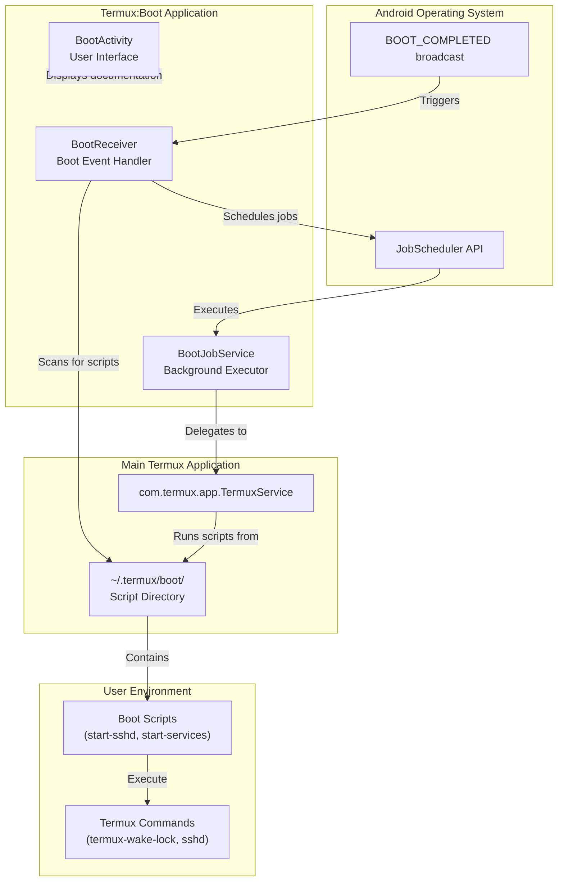

Sources: [app/src/main/AndroidManifest.xml:15-30](), [README.md:24-31]()

## Integration with Termux Ecosystem

Termux:Boot integrates tightly with the broader Termux ecosystem through several mechanisms:

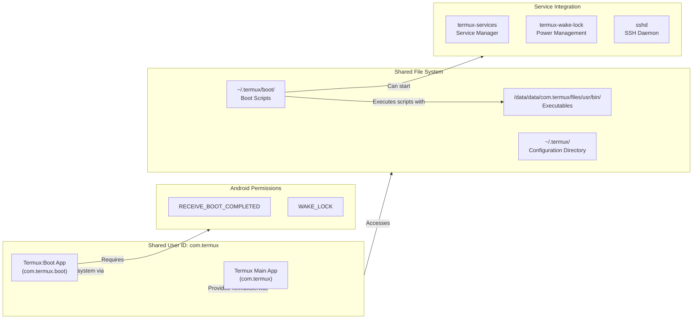

**Integration Points:**
- **Shared User ID**: Both applications use `android:sharedUserId="com.termux"` enabling file system sharing
- **Service Delegation**: Script execution delegated to `com.termux.app.TermuxService` 
- **Common File Paths**: Scripts use standard Termux paths like `/data/data/com.termux/files/usr/bin/sh`
- **Package Ecosystem**: Boot scripts can utilize any installed Termux packages and utilities

Sources: [app/src/main/AndroidManifest.xml:4](), [README.md:37-52]()

## Key Technical Characteristics

| Characteristic | Details |
|----------------|---------|
| **Android Components** | Activity (`BootActivity`), BroadcastReceiver (`BootReceiver`), JobService (`BootJobService`) |
| **Required Permissions** | `RECEIVE_BOOT_COMPLETED`, `WAKE_LOCK` |
| **Script Location** | `~/.termux/boot/` directory in user home |
| **Execution Order** | Alphabetical sorting of filenames |
| **Background Processing** | Android JobScheduler with job IDs starting at 1000 |
| **Script Interpreter** | `/data/data/com.termux/files/usr/bin/sh` (Termux shell) |
| **Service Integration** | Delegates to `com.termux.app.TermuxService` via Intent |

**Common Use Cases:**
- Starting SSH daemons for remote access
- Initializing termux-services for background services
- Acquiring wake locks to prevent device sleep
- Setting up network services and automation

Sources: [app/src/main/AndroidManifest.xml:6-7](), [app/src/main/AndroidManifest.xml:21-30](), [README.md:34-52]()

## Application Lifecycle

The application follows a simple but robust lifecycle designed for reliability across Android reboots:

1. **Initial Setup**: User installs app and launches it once to register with Android
2. **Boot Detection**: `BootReceiver` responds to `BOOT_COMPLETED` system broadcast
3. **Script Discovery**: Application scans `~/.termux/boot/` for executable files
4. **Job Scheduling**: Each script scheduled as separate JobScheduler job with 3-second deadline
5. **Background Execution**: `BootJobService` processes jobs and delegates to `TermuxService`
6. **Script Execution**: Scripts run in full Termux environment with package access

This design ensures scripts execute reliably even if the device is under memory pressure or the user hasn't actively opened the Termux application recently.

Sources: [README.md:26-30]()

---

# Page: What is Termux:Boot

# What is Termux:Boot

<details>
<summary>Relevant source files</summary>

The following files were used as context for generating this wiki page:

- [README.md](README.md)

</details>


This document provides a detailed explanation of Termux:Boot's functionality, architecture, and relationship to the main Termux application. It covers the app's core purpose as a boot script executor and its technical implementation as an Android add-on.

For installation instructions and setup procedures, see [Installation and Requirements](#1.2). For user configuration details, see [Setup and Configuration](#2.1).

## Overview

Termux:Boot is an Android add-on application designed to automatically execute user-defined scripts when an Android device boots up. It acts as a bridge between the Android system's boot process and the Termux terminal environment, enabling users to run background services, start SSH servers, acquire wake locks, or perform other initialization tasks without manual intervention.

**Core Architecture Diagram**

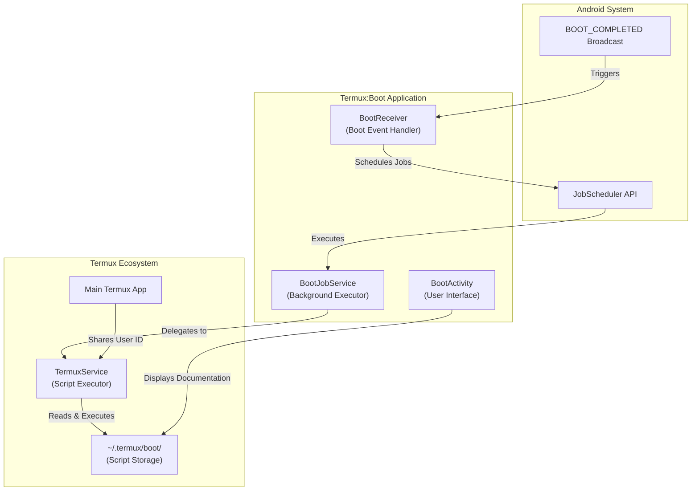

Sources: [README.md:1-57]()

## Primary Functions

Termux:Boot performs three primary functions within the Android ecosystem:

### Boot Event Detection
The application registers a `BootReceiver` component that listens for the `ACTION_BOOT_COMPLETED` broadcast intent. When the Android system finishes booting, this receiver automatically activates to begin the script execution process.

### Script Discovery and Scheduling
Upon receiving the boot signal, the system scans the `~/.termux/boot/` directory for executable scripts. Files are processed in alphabetical order, with each script scheduled as a separate background job through Android's `JobScheduler` API to ensure reliable execution even under system resource constraints.

### Background Execution Coordination
The `BootJobService` manages the actual script execution by delegating to the main Termux application's `TermuxService`. This architecture ensures that scripts run within the proper Termux environment with access to all installed packages and utilities.

**Runtime Execution Flow**

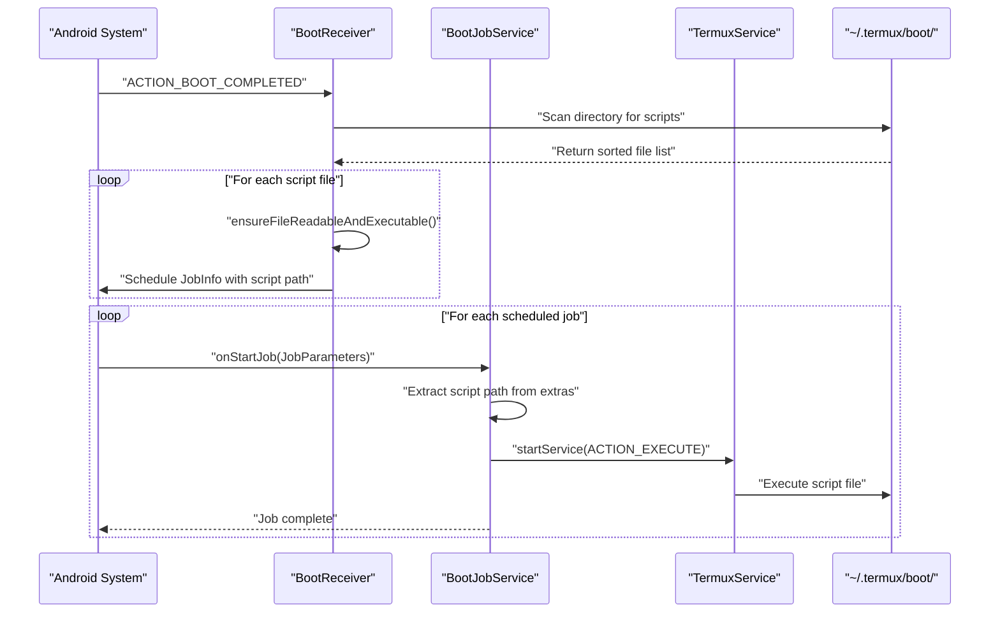

Sources: [README.md:6](), [README.md:26-30]()

## System Requirements and Dependencies

### Android Integration Requirements
Termux:Boot requires specific Android permissions and system integration to function properly:

| Requirement | Purpose | Implementation |
|-------------|---------|----------------|
| `RECEIVE_BOOT_COMPLETED` | Detect device boot events | Declared in AndroidManifest.xml |
| `WAKE_LOCK` | Prevent device sleep during execution | Enables `termux-wake-lock` functionality |
| Shared User ID | Access Termux file system | Must be signed with same key as Termux |
| JobScheduler API | Reliable background execution | Ensures scripts run even under resource pressure |

### Termux Application Dependency
The application has a hard dependency on the main Termux application being installed and properly configured. This dependency exists because:

- Scripts execute within the Termux environment using `TermuxService`
- The `~/.termux/boot/` directory resides within Termux's private file system
- Script execution requires access to Termux's installed packages and utilities
- Both applications must share the same Android user ID for file system access

### Signature Key Requirements
A critical requirement is that Termux:Boot must be signed with the same cryptographic key as the main Termux application. This security constraint ensures:

- Proper Android user ID sharing between applications
- File system access permissions to the Termux directory structure
- Ability to communicate with and control the `TermuxService` component

Sources: [README.md:8-9](), [README.md:20-22]()

## Key Characteristics

### Execution Model
Termux:Boot implements a fire-and-forget execution model where scripts run once at boot time without ongoing monitoring or restart capabilities. The system processes all scripts in the `~/.termux/boot/` directory sequentially, executing them in alphabetical filename order.

### Resource Management
The application uses Android's `JobScheduler` API rather than direct execution to ensure reliable operation under various system conditions. This approach provides:

- Automatic retry mechanisms if initial execution fails
- Proper handling of device resource constraints
- Integration with Android's battery optimization systems
- Compliance with modern Android background execution policies

### Common Usage Patterns
Based on the provided examples, typical use cases include:

```bash
# Acquire wake lock to prevent device sleep
termux-wake-lock

# Start SSH daemon for remote access
sshd

# Initialize termux-services framework
source /data/data/com.termux/files/usr/etc/profile.d/start-services.sh
```

These patterns demonstrate the application's role in establishing persistent background services and maintaining device accessibility after boot.

Sources: [README.md:29-30](), [README.md:34-52]()

---

# Page: Installation and Requirements

# Installation and Requirements

<details>
<summary>Relevant source files</summary>

The following files were used as context for generating this wiki page:

- [README.md](README.md)
- [app/src/main/assets/overview.html](app/src/main/assets/overview.html)
- [app/src/main/java/com/termux/boot/BootActivity.java](app/src/main/java/com/termux/boot/BootActivity.java)

</details>


This document covers the installation process for Termux:Boot, including available distribution channels, signature key requirements, and system prerequisites. For information about configuring and using Termux:Boot after installation, see [Setup and Configuration](#2.1).

## Installation Sources

Termux:Boot can be obtained from two primary sources, each with different signature keys and update mechanisms.

### F-Droid Distribution

The stable release of Termux:Boot is distributed through F-Droid's official repository. This version uses F-Droid's signature keys and receives updates through the F-Droid update mechanism.

**Installation URL:** `https://f-droid.org/en/packages/com.termux.boot/`

### GitHub Actions Debug Builds

Development builds are available from GitHub Actions workflows for testing latest features and pull requests. These builds use different signature keys than the F-Droid release.

**Build Location:** GitHub Actions workflow runs for `github_action_build.yml` on the master branch

Sources: [README.md:13-18]()

## Signature Key Requirements

### Same-Key Requirement with Termux

Termux:Boot must be signed with the same cryptographic key as the main Termux application to function properly. This requirement exists because Termux:Boot needs permission to execute scripts within the Termux environment.

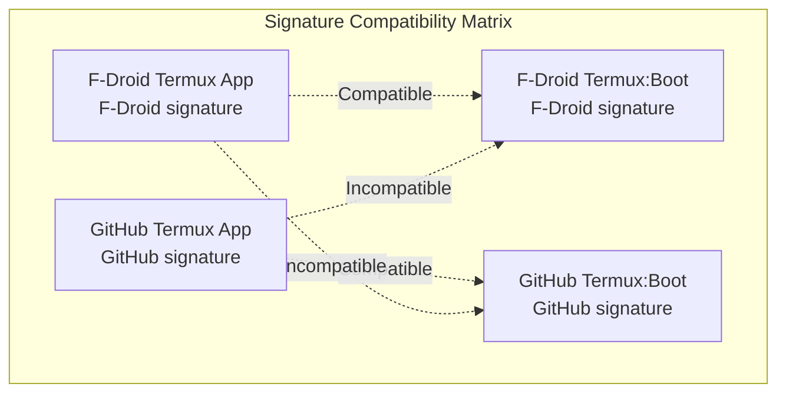

Sources: [README.md:8-9](), [README.md:20-22]()

### Installation Source Migration

When switching between F-Droid and GitHub builds, complete uninstallation of all Termux components is required due to signature key differences.

**Migration Process:**
1. Uninstall main Termux application
2. Uninstall all Termux add-on applications (including Termux:Boot)
3. Install new versions from target source

Sources: [README.md:20-22]()

## System Requirements

### Android Version Compatibility

Termux:Boot targets Android API levels that align with the main Termux application requirements. The application uses standard Android components that require specific system capabilities.

### Required Android Components

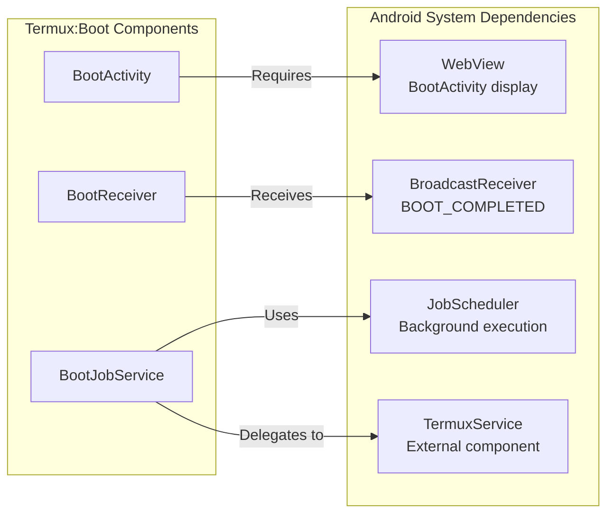

Sources: [app/src/main/java/com/termux/boot/BootActivity.java:14-15]()

## Prerequisites

### Main Termux Application

Termux:Boot is an add-on application that requires the main Termux application to be installed and functional. The main application provides:

- `TermuxService` component for script execution
- Termux file system structure (`~/.termux/boot/` directory)
- Shell environment and utilities

### Required Permissions

The application requires specific Android permissions to function:

| Permission | Purpose |
|------------|---------|
| `RECEIVE_BOOT_COMPLETED` | Receive system boot events |
| `WAKE_LOCK` | Prevent device sleep during execution |

Sources: [README.md:6]()

## Installation Process

### Standard Installation

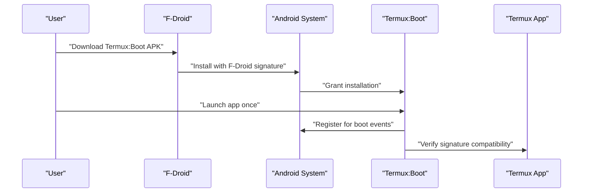

### Post-Installation Verification

After installation, the application must be launched once to activate boot event registration. The `BootActivity` displays setup instructions through the embedded `overview.html` file.

**Verification Steps:**
1. Launch Termux:Boot from application launcher
2. Verify `WebView` displays overview content
3. Confirm no signature mismatch errors
4. Test boot script directory creation capability

Sources: [README.md:26-27](), [app/src/main/assets/overview.html:5]()

## Troubleshooting Installation Issues

### Signature Mismatch Resolution

If signature compatibility issues occur:

1. Verify both Termux and Termux:Boot are from the same source
2. Check installation source consistency in package manager
3. Perform clean uninstall/reinstall if necessary

### Build Variant Considerations

Development builds from GitHub Actions may have different behavior than F-Droid releases due to:
- Different build configurations
- Latest code changes not yet in stable release
- Debug-specific features or logging

Sources: [README.md:15-18](), [README.md:20-22]()

---

# Page: User Guide

# User Guide

<details>
<summary>Relevant source files</summary>

The following files were used as context for generating this wiki page:

- [README.md](README.md)
- [app/src/main/assets/overview.html](app/src/main/assets/overview.html)
- [app/src/main/java/com/termux/boot/BootActivity.java](app/src/main/java/com/termux/boot/BootActivity.java)

</details>


This document provides comprehensive instructions for installing, configuring, and using Termux:Boot to automatically run scripts when your Android device boots up. It covers the complete user workflow from initial setup through creating and managing boot scripts.

For technical details about the underlying Android application architecture, see [Architecture and Core Components](#3). For information about building and modifying the application, see [Build System](#4).

## Purpose and Scope

Termux:Boot is an add-on application that extends the main Termux terminal emulator by providing the ability to execute scripts automatically at device boot time. This user guide covers all aspects of end-user interaction with the system, from installation through script management.

## Quick Start Overview

The basic workflow for using Termux:Boot involves four main steps that interact with specific system components:

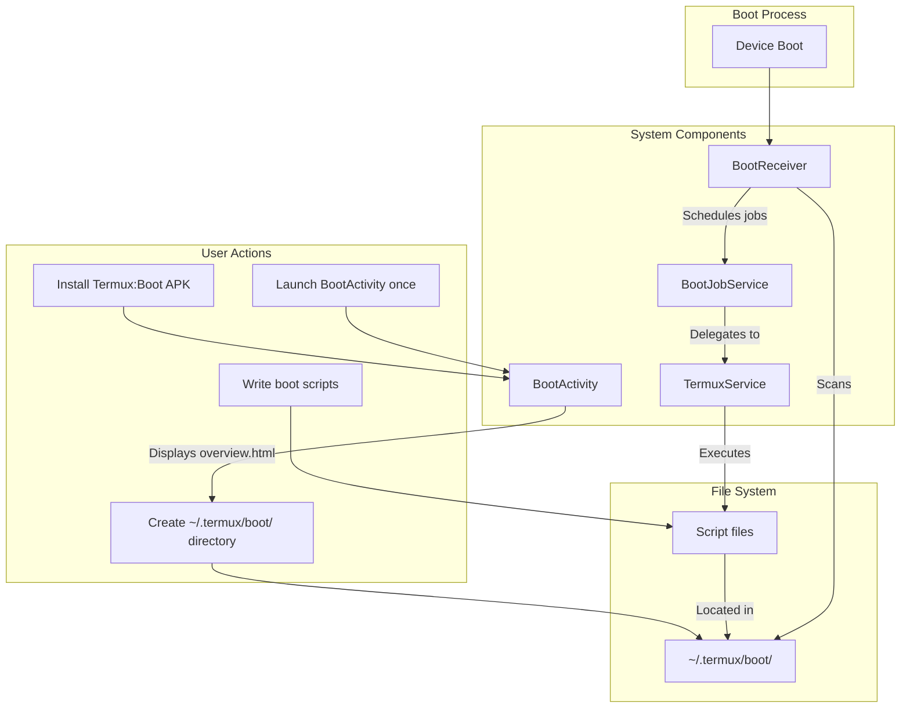

**Quick Start Overview**
*Sources: [README.md:24-31](), [app/src/main/assets/overview.html:3-10]()*

## Installation and Initial Setup

### Installing the Application

Termux:Boot can be obtained from two primary sources:

| Source | Description | Signature | Use Case |
|--------|-------------|-----------|----------|
| F-Droid | Stable releases | F-Droid key | Production use |
| GitHub Actions | Debug builds | Development key | Testing/development |

**Important:** The Termux:Boot application must be signed with the same key as your main Termux installation. Switching between different signature sources requires uninstalling and reinstalling both Termux and all add-on applications.

*Sources: [README.md:11-22]()*

### First Launch Requirement

After installation, you must launch the `BootActivity` at least once by tapping the application icon. This step is required to register the application with Android's boot system and enable the `BootReceiver` to respond to `ACTION_BOOT_COMPLETED` broadcasts.

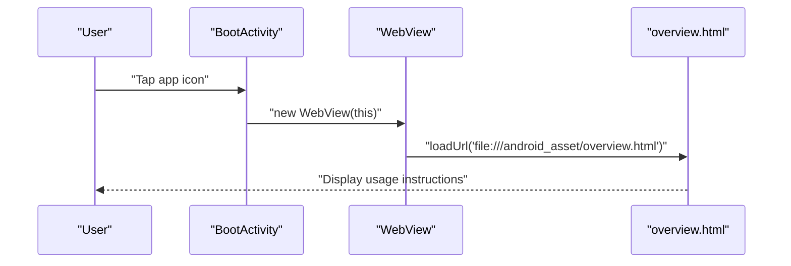

**First Launch Process**
*Sources: [README.md:26-27](), [app/src/main/java/com/termux/boot/BootActivity.java:12-17](), [app/src/main/assets/overview.html:1-10]()*

## Directory Structure and Script Placement

### Creating the Boot Directory

All boot scripts must be placed in the `~/.termux/boot/` directory within the Termux file system. This directory must be created manually:

```bash
mkdir -p ~/.termux/boot/
```

The directory path resolves to `/data/data/com.termux/files/home/.termux/boot/` in the Android file system.

### Script Execution Order

When multiple scripts exist in the boot directory, they are executed in lexicographically sorted order by filename. The `BootReceiver` scans the directory and processes files according to this ordering.

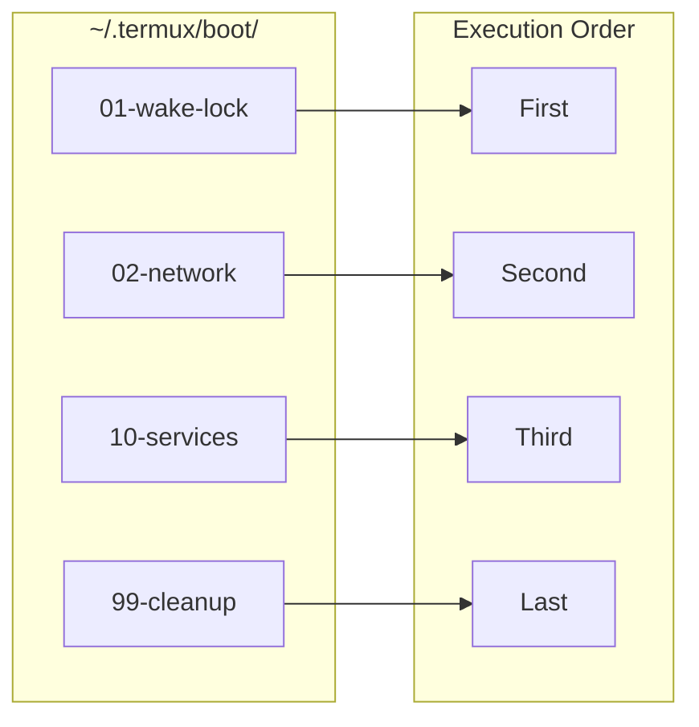

**Script Execution Order**
*Sources: [README.md:29](), [app/src/main/assets/overview.html:8]()*

## Writing Boot Scripts

### Script Structure

Boot scripts must be executable files with proper shebang lines. The recommended shebang for Termux scripts is:

```bash
#!/data/data/com.termux/files/usr/bin/sh
```

### Essential Commands

#### Wake Lock Management

The `termux-wake-lock` command prevents the device from entering sleep mode, which is typically required for network services and background processes:

```bash
#!/data/data/com.termux/files/usr/bin/sh
termux-wake-lock
# Additional commands follow
```

This command should generally be placed at the beginning of your boot scripts to ensure consistent execution of subsequent commands.

### Common Use Cases

#### SSH Server Example

To start an SSH daemon at boot with wake lock:

**File:** `~/.termux/boot/start-sshd`
```bash
#!/data/data/com.termux/files/usr/bin/sh
termux-wake-lock
sshd
```

#### Termux Services Integration

To start the termux-services system which manages enabled services:

**File:** `~/.termux/boot/start-services`
```bash
#!/data/data/com.termux/files/usr/bin/sh
termux-wake-lock
source /data/data/com.termux/files/usr/etc/profile.d/start-services.sh
```

*Sources: [README.md:32-52](), [app/src/main/assets/overview.html:12-19]()*

## Script Execution Flow

The following diagram shows how boot scripts are processed by the system components:

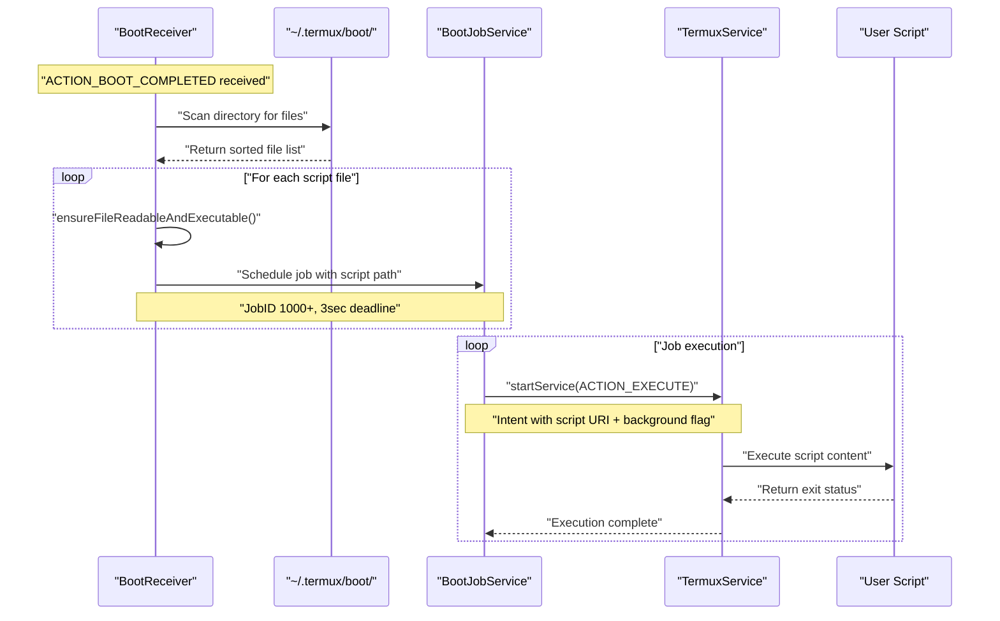

**Boot Script Execution Flow**
*Sources: [README.md:29](), [app/src/main/assets/overview.html:8]()*

## Best Practices

### File Permissions

Ensure boot scripts have executable permissions:
```bash
chmod +x ~/.termux/boot/your-script
```

### Error Handling

Include error handling in scripts to prevent boot process interruption:
```bash
#!/data/data/com.termux/files/usr/bin/sh
termux-wake-lock || echo "Wake lock failed"
sshd 2>/dev/null || echo "SSH daemon start failed"
```

### Logging

Consider adding logging to track script execution:
```bash
#!/data/data/com.termux/files/usr/bin/sh
echo "$(date): Starting boot script" >> ~/.termux/boot.log
termux-wake-lock
sshd
echo "$(date): Boot script completed" >> ~/.termux/boot.log
```

## Community and Support

For additional help and community support:
- Visit the Termux community channels at https://termux.org/community
- Report issues at the GitHub repository: https://github.com/termux/termux-boot/issues

*Sources: [app/src/main/assets/overview.html:21-25]()*

---

# Page: Setup and Configuration

# Setup and Configuration

<details>
<summary>Relevant source files</summary>

The following files were used as context for generating this wiki page:

- [README.md](README.md)
- [app/src/main/assets/overview.html](app/src/main/assets/overview.html)
- [app/src/main/java/com/termux/boot/BootActivity.java](app/src/main/java/com/termux/boot/BootActivity.java)

</details>


This page covers the initial setup and configuration process for Termux:Boot, focusing on the steps users must complete to enable boot script execution. The process involves app registration, directory creation, and script preparation. For information about writing effective boot scripts and execution behavior, see [Writing Boot Scripts](#2.2). For technical details about the underlying Android components and execution system, see [Architecture and Core Components](#3).

## Initial App Launch and Registration

The first critical step after installing Termux:Boot is launching the application at least once through the Android launcher. This step is mandatory because Android restricts background execution of apps that have never been manually started by the user.

When launched, the app displays the `BootActivity` which loads an embedded documentation view:

**App Launch Flow**
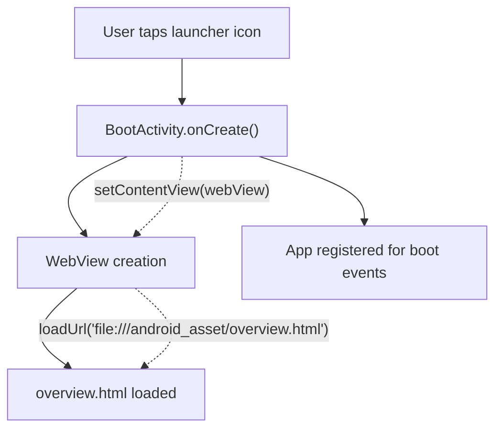

The `BootActivity` serves as both a user interface and a registration mechanism. The Android system tracks that the app has been launched, which enables the `BootReceiver` to respond to `BOOT_COMPLETED` broadcasts in the future.

Sources: [app/src/main/java/com/termux/boot/BootActivity.java:12-17](), [app/src/main/assets/overview.html:1-26]()

## Boot Directory Structure

Termux:Boot requires a specific directory structure within the Termux environment. Users must create the boot script directory manually, as the app does not automatically generate it.

**Required Directory Structure**
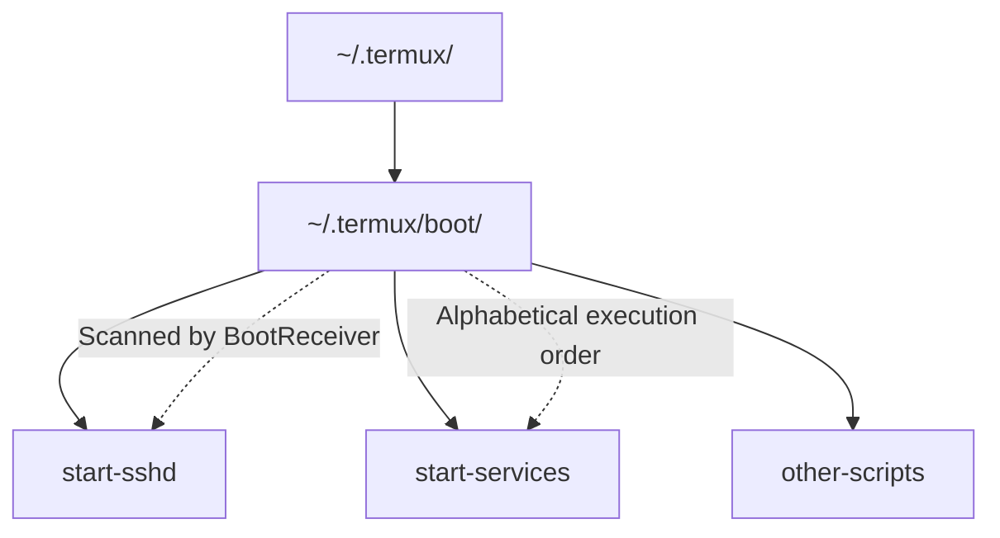

| Component | Path | Purpose |
|-----------|------|---------|
| Termux config directory | `~/.termux/` | Parent directory for Termux configuration |
| Boot scripts directory | `~/.termux/boot/` | Contains executable boot scripts |
| Individual scripts | `~/.termux/boot/*` | Executable files run at boot time |

The directory path `~/.termux/boot/` expands to the absolute path `/data/data/com.termux/files/home/.termux/boot/` within the Android application sandbox.

Sources: [README.md:28-29](), [app/src/main/assets/overview.html:6-7]()

## Script Execution Environment

Boot scripts execute within the Termux environment with specific characteristics that affect their behavior and capabilities.

**Execution Environment Configuration**
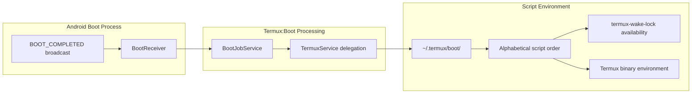

### Script Requirements

Scripts placed in the boot directory must meet specific requirements:

| Requirement | Details |
|-------------|---------|
| Executable permissions | Files must have execute permissions set |
| Proper shebang | Should begin with `#!/data/data/com.termux/files/usr/bin/sh` |
| Termux environment | Can access Termux binaries and utilities |
| Alphabetical execution | Multiple scripts execute in sorted filename order |

### Common Configuration Commands

The most frequently used configuration command is `termux-wake-lock`, which prevents the Android device from entering sleep mode:

```bash
#!/data/data/com.termux/files/usr/bin/sh
termux-wake-lock
# Additional commands follow
```

This command is critical for scripts that start long-running services, as Android may suspend background processes when the device sleeps.

Sources: [README.md:30-31](), [README.md:37-41](), [app/src/main/assets/overview.html:9-10](), [app/src/main/assets/overview.html:15-19]()

## Configuration Workflow

The complete setup process involves coordinated steps across the Android system, Termux:Boot app, and Termux environment.

**Complete Setup Workflow**
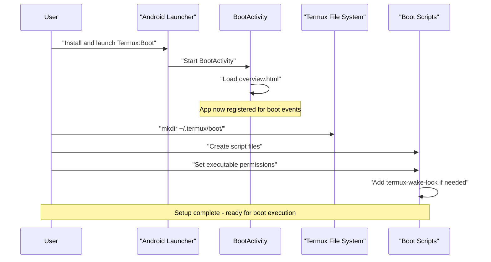

### Setup Verification

Users can verify their setup by checking:

1. **App Registration**: The app icon appears in the launcher and can be opened
2. **Directory Creation**: `ls ~/.termux/boot/` shows the directory exists
3. **Script Permissions**: `ls -la ~/.termux/boot/` shows executable permissions
4. **Script Content**: Scripts contain proper shebang and commands

### Common Setup Issues

| Issue | Symptom | Solution |
|-------|---------|----------|
| App never launched | Scripts don't run at boot | Launch app once from launcher |
| Missing directory | No script execution | Create `~/.termux/boot/` directory |
| Non-executable scripts | Scripts found but not executed | Set executable permissions with `chmod +x` |
| Incorrect shebang | Scripts fail to execute | Use `#!/data/data/com.termux/files/usr/bin/sh` |

Sources: [README.md:24-31](), [app/src/main/assets/overview.html:3-10](), [app/src/main/java/com/termux/boot/BootActivity.java:9-18]()

---

# Page: Writing Boot Scripts

# Writing Boot Scripts

<details>
<summary>Relevant source files</summary>

The following files were used as context for generating this wiki page:

- [README.md](README.md)
- [app/src/main/assets/overview.html](app/src/main/assets/overview.html)
- [app/src/main/java/com/termux/boot/BootActivity.java](app/src/main/java/com/termux/boot/BootActivity.java)

</details>


This document covers how to create and configure boot scripts that will be executed when your Android device starts up. It focuses on the user-facing aspects of script creation, placement, and common patterns. For information about setting up the Termux:Boot environment, see [Setup and Configuration](#2.1). For technical details about how the boot execution system works internally, see [Boot Execution System](#3.2).

## Script Location and Discovery

Boot scripts must be placed in the `~/.termux/boot/` directory within the Termux file system. The system automatically discovers and executes all files in this directory during the boot process.

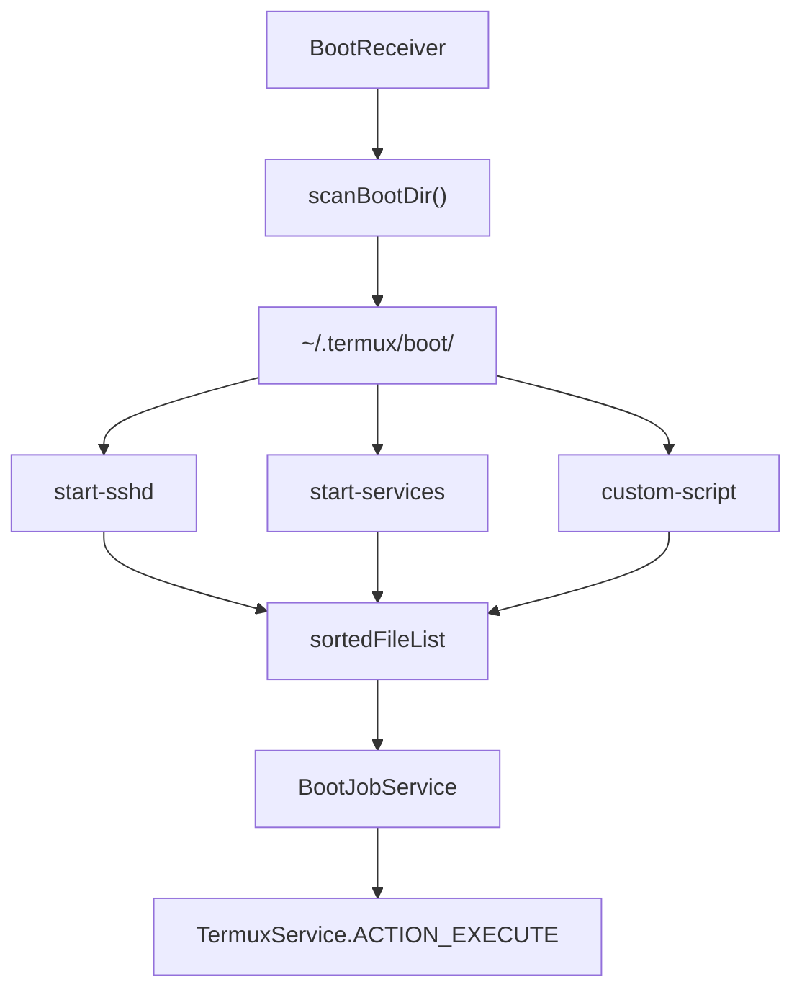

**Script Discovery and Execution Flow**

The boot system scans the boot directory and creates a sorted list of executable files. Each script is then scheduled for execution through Android's JobScheduler system.

Sources: [README.md:28-29](), [app/src/main/assets/overview.html:6-8]()

## Execution Order and Timing

Scripts are executed in **alphabetical order** based on their filename. This allows you to control the execution sequence by choosing appropriate filenames.

| Execution Order | Example Filename | Purpose |
|---|---|---|
| 1st | `01-wake-lock` | Prevent device sleep |
| 2nd | `02-network-setup` | Configure networking |
| 3rd | `10-start-services` | Start background services |
| 4th | `99-cleanup` | Final cleanup tasks |

Each script runs as a separate job with a 3-second deadline for completion. Scripts that take longer may be terminated by the Android system.

Sources: [README.md:29](), [app/src/main/assets/overview.html:8]()

## Script Structure and Requirements

### Basic Script Template

All boot scripts should follow this basic structure:

```bash
#!/data/data/com.termux/files/usr/bin/sh
# Your commands here
```

The shebang line is crucial as it specifies the correct shell interpreter within the Termux environment.

### Essential Commands

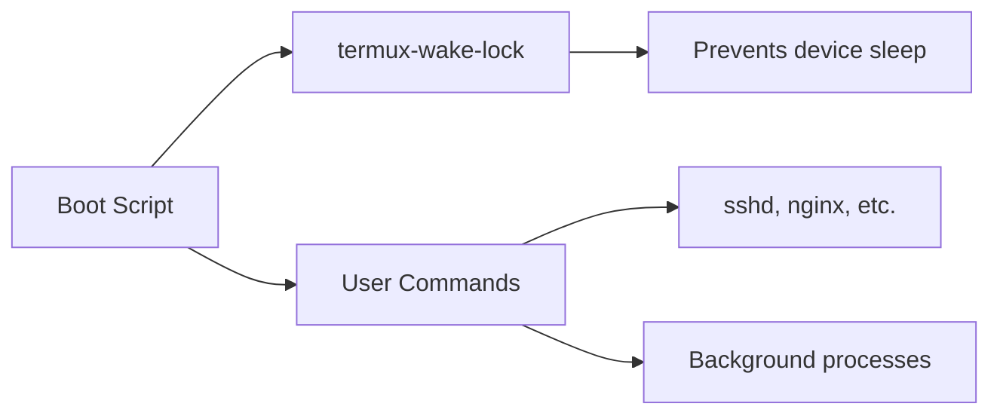

**Common Boot Script Pattern**

Most scripts begin with `termux-wake-lock` to prevent the device from entering sleep mode, which would terminate running processes.

Sources: [README.md:30](), [app/src/main/assets/overview.html:9]()

## Common Patterns and Commands

### Wake Lock Management

The `termux-wake-lock` command should typically be the first command in your boot scripts:

```bash
#!/data/data/com.termux/files/usr/bin/sh
termux-wake-lock
# Additional commands follow
```

This prevents Android from putting the device into deep sleep mode, which would kill background processes started by your scripts.

### Service Startup

For starting system services, use the termux-services infrastructure:

```bash
#!/data/data/com.termux/files/usr/bin/sh
termux-wake-lock
source /data/data/com.termux/files/usr/etc/profile.d/start-services.sh
```

Sources: [README.md:48-52](), [app/src/main/assets/overview.html:9]()

## Practical Examples

### SSH Server Startup

To start an SSH daemon at boot, create `~/.termux/boot/start-sshd`:

```bash
#!/data/data/com.termux/files/usr/bin/sh
termux-wake-lock
sshd
```

This example demonstrates the basic pattern: wake lock first, then the service command.

### Termux Services Integration

To start all enabled termux-services at boot, create `~/.termux/boot/start-services`:

```bash
#!/data/data/com.termux/files/usr/bin/sh
termux-wake-lock
source /data/data/com.termux/files/usr/etc/profile.d/start-services.sh
```

This approach leverages the existing termux-services infrastructure for managing multiple services.

Sources: [README.md:34-41](), [README.md:43-52](), [app/src/main/assets/overview.html:13-19]()

## File Permissions and Execution

### Script Permissions

Boot scripts must be readable and executable by the Termux application. The system automatically ensures proper permissions during the boot process through the `ensureFileReadableAndExecutable()` method.

### Security Considerations

- Scripts run with the same permissions as the main Termux application
- All scripts in the boot directory will be executed - avoid placing non-executable files there
- Use descriptive filenames to make the execution order clear

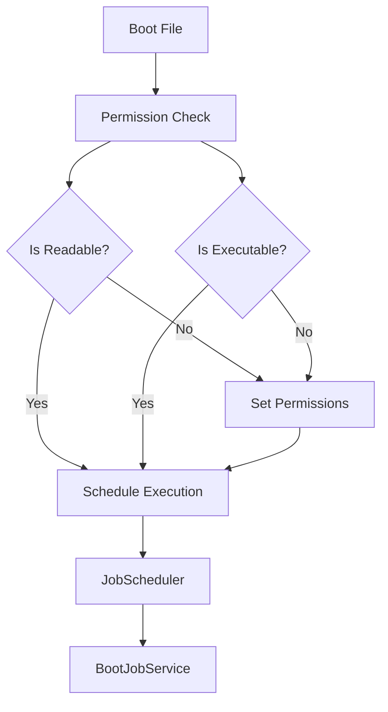

**File Permission and Execution Validation**

The system validates and corrects file permissions before scheduling scripts for execution.

Sources: [README.md:29](), [app/src/main/assets/overview.html:8]()

---

# Page: Architecture and Core Components

# Architecture and Core Components

<details>
<summary>Relevant source files</summary>

The following files were used as context for generating this wiki page:

- [app/src/main/AndroidManifest.xml](app/src/main/AndroidManifest.xml)
- [app/src/main/java/com/termux/boot/BootJobService.java](app/src/main/java/com/termux/boot/BootJobService.java)
- [app/src/main/java/com/termux/boot/BootReceiver.java](app/src/main/java/com/termux/boot/BootReceiver.java)

</details>


This document provides a technical overview of the Termux:Boot Android application architecture, focusing on the core components that handle boot event processing and script execution delegation. It covers the application's Android-specific structure, component interactions, and the execution flow from device boot to script invocation.

For user-facing setup instructions, see [Setup and Configuration](#2.1). For build system details, see [Build System](#4).

## Application Architecture Overview

Termux:Boot is structured as a lightweight Android application that acts as a bridge between the Android boot process and the main Termux application. The architecture follows Android's component-based design with three primary components that handle distinct responsibilities in the boot script execution pipeline.

The application operates with a shared user ID (`com.termux`) to access Termux's file system and delegates actual script execution to `TermuxService` rather than implementing execution directly. This design maintains separation of concerns while enabling seamless integration with the Termux environment.

**Core Android Components**

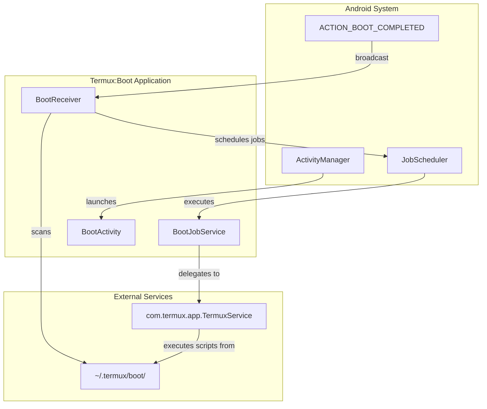

Sources: [app/src/main/AndroidManifest.xml:1-33](), [app/src/main/java/com/termux/boot/BootReceiver.java:1-68](), [app/src/main/java/com/termux/boot/BootJobService.java:1-51]()

## Component Declaration and Permissions

The application manifest defines three core components with specific Android permissions and intent filters. The `sharedUserId` attribute enables file system access to Termux directories, while `RECEIVE_BOOT_COMPLETED` and `WAKE_LOCK` permissions support boot event handling and system wake state management.

| Component | Type | Purpose | Key Attributes |
|-----------|------|---------|----------------|
| `BootActivity` | Activity | User interface and documentation display | Launcher intent filter |
| `BootReceiver` | BroadcastReceiver | Boot event handling | `BOOT_COMPLETED` intent filter, `exported="false"` |
| `BootJobService` | JobService | Background script execution coordination | `BIND_JOB_SERVICE` permission |

The `BootReceiver` component uses `android:exported="false"` for security, ensuring only the system can trigger boot events. The `BootJobService` requires `BIND_JOB_SERVICE` permission to integrate with Android's background job scheduling system.

Sources: [app/src/main/AndroidManifest.xml:4-30]()

## Boot Event Processing Flow

The boot execution system operates through a multi-stage process that transforms Android boot events into individual script execution jobs. This design ensures reliable script execution while respecting Android's background processing constraints.

**Boot Event to Script Execution Flow**

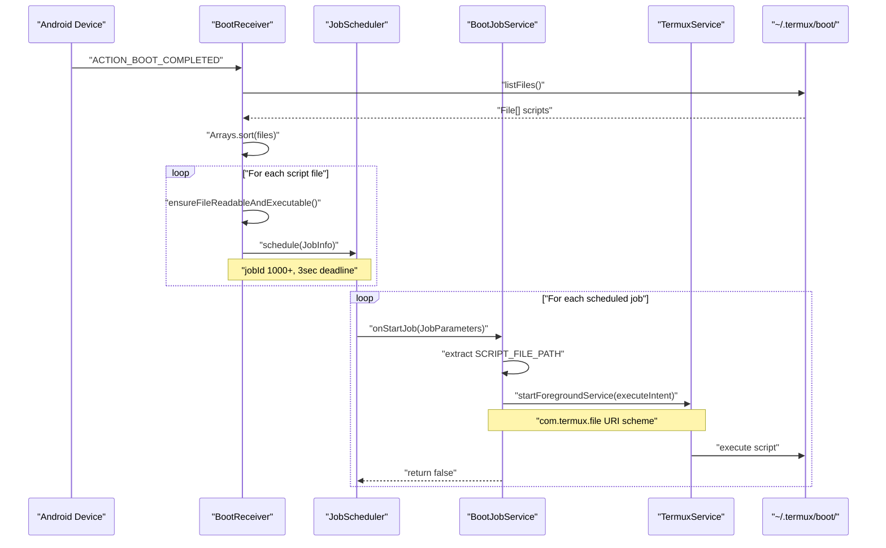

Sources: [app/src/main/java/com/termux/boot/BootReceiver.java:22-60](), [app/src/main/java/com/termux/boot/BootJobService.java:24-44]()

## BootReceiver Implementation

The `BootReceiver` class extends `BroadcastReceiver` and implements the primary boot event handling logic. The `onReceive` method filters for `ACTION_BOOT_COMPLETED` events and processes scripts from the hardcoded path `/data/data/com.termux/files/home/.termux/boot`.

Key implementation details:

- **Script Discovery**: Uses `File.listFiles()` to enumerate boot scripts and handles null return values
- **Execution Order**: Applies `Arrays.sort()` with `String.compareTo()` for deterministic alphabetical ordering  
- **Permission Management**: Calls `ensureFileReadableAndExecutable()` to automatically fix file permissions
- **Job Scheduling**: Creates `JobInfo` objects with unique job IDs starting from `TERMUX_BOOT_JOB_ID_BASE` (1000)
- **Deadline Enforcement**: Sets `setOverrideDeadline(3 * 1000)` for 3-second maximum job delay

The `PersistableBundle` extras mechanism passes the `SCRIPT_FILE_PATH` to the `BootJobService` for execution.

Sources: [app/src/main/java/com/termux/boot/BootReceiver.java:18-53](), [app/src/main/java/com/termux/boot/BootReceiver.java:64-67]()

## BootJobService Implementation  

The `BootJobService` class extends Android's `JobService` and handles background execution coordination. Rather than executing scripts directly, it constructs intents to delegate execution to the main Termux application's `TermuxService`.

**Service Delegation Pattern**

```mermaid
graph LR
    JobParameters["JobParameters"]
    PersistableBundle["PersistableBundle.extras"]
    ScriptPath["SCRIPT_FILE_PATH"]
    UriBuilder["Uri.Builder"]
    ExecuteIntent["ACTION_EXECUTE Intent"]
    TermuxService["com.termux.app.TermuxService"]
    
    JobParameters -->|"getExtras()"| PersistableBundle
    PersistableBundle -->|"getString()"| ScriptPath
    ScriptPath -->|"scheme='com.termux.file'"| UriBuilder
    UriBuilder -->|"build()"| ExecuteIntent
    ExecuteIntent -->|"startForegroundService()"| TermuxService
```

The `onStartJob` method:

1. Extracts the script file path from `JobParameters.getExtras()`
2. Constructs a URI using the `com.termux.file` scheme
3. Creates an `ACTION_EXECUTE` intent targeting `com.termux.app.TermuxService`
4. Sets `EXTRA_EXECUTE_IN_BACKGROUND` to `true` for background execution
5. Uses `startForegroundService()` on Android O+ to comply with background service restrictions

The method returns `false` to indicate immediate job completion since execution is offloaded to `TermuxService`.

Sources: [app/src/main/java/com/termux/boot/BootJobService.java:14-44]()

## Inter-Application Communication

The application communicates with the main Termux app through Android's Intent system using predefined action constants and URI schemes. This loose coupling allows Termux:Boot to remain lightweight while leveraging Termux's full execution environment.

**Communication Constants**:
- `TERMUX_SERVICE`: `"com.termux.app.TermuxService"`
- `ACTION_EXECUTE`: `"com.termux.service_execute"`  
- `EXTRA_EXECUTE_IN_BACKGROUND`: `"com.termux.execute.background"`

The URI scheme `com.termux.file` with the script's absolute path enables `TermuxService` to locate and execute the boot scripts within the shared Termux file system context.

Sources: [app/src/main/java/com/termux/boot/BootJobService.java:18-21](), [app/src/main/java/com/termux/boot/BootJobService.java:30-33]()

---

# Page: Android Application Structure

# Android Application Structure

<details>
<summary>Relevant source files</summary>

The following files were used as context for generating this wiki page:

- [app/src/main/AndroidManifest.xml](app/src/main/AndroidManifest.xml)

</details>


This document covers the Android application structure of Termux:Boot, including the application manifest, permissions model, and core Android components. It explains how the app integrates with the Android framework through Activities, BroadcastReceivers, and JobServices. For details about the boot execution flow and runtime behavior, see [Boot Execution System](#3.2). For user interface implementation details, see [User Interface](#3.3).

## Application Manifest Overview

The Termux:Boot application is defined through its Android manifest, which declares the app's integration points with the Android system. The manifest establishes three core architectural elements: shared user identity with Termux, required system permissions, and component declarations.

### Shared User Identity

Termux:Boot operates under a shared user ID with the main Termux application, enabling file system access and inter-process communication:

```xml
android:sharedUserId="com.termux"
```

This shared identity allows Termux:Boot to access the Termux application's private directories and execute scripts within the Termux environment.

### Application Configuration

The application element defines basic properties and behavior:

| Property | Value | Purpose |
|----------|-------|---------|
| `android:allowBackup` | `false` | Prevents automatic backup of app data |
| `android:icon` | `@drawable/ic_launcher` | Specifies the launcher icon resource |
| `android:label` | `@string/app_name` | Sets the application display name |
| `android:supportsRtl` | `true` | Enables right-to-left layout support |

Sources: [app/src/main/AndroidManifest.xml:9-14]()

## Permissions and Security Model

The application declares two essential system permissions that enable its boot automation functionality:

### Boot Event Permission

```xml
<uses-permission android:name="android.permission.RECEIVE_BOOT_COMPLETED" />
```

This permission allows the `BootReceiver` component to receive the `ACTION_BOOT_COMPLETED` broadcast when the device finishes booting.

### Wake Lock Permission

```xml
<uses-permission android:name="android.permission.WAKE_LOCK" />
```

This permission enables the application and subsequently launched scripts to prevent the device from entering sleep mode during critical operations.

**Android Security Integration**
```mermaid
graph TB
    AndroidFramework["Android Framework"]
    ManifestDeclaration["AndroidManifest.xml<br/>Permission Declarations"]
    BootReceiver["BootReceiver"]
    BootJobService["BootJobService"]
    SystemBroadcast["BOOT_COMPLETED<br/>System Broadcast"]
    WakeLock["WakeLock<br/>Power Management"]
    
    AndroidFramework -->|"Enforces"| ManifestDeclaration
    ManifestDeclaration -->|"Grants RECEIVE_BOOT_COMPLETED"| BootReceiver
    ManifestDeclaration -->|"Grants WAKE_LOCK"| BootJobService
    SystemBroadcast -->|"Delivered to"| BootReceiver
    BootJobService -->|"Can acquire"| WakeLock
```

Sources: [app/src/main/AndroidManifest.xml:6-7]()

## Component Architecture

The application consists of three primary Android components, each serving a distinct role in the boot automation system:

### Activity Component

```xml
<activity android:name=".BootActivity">
```

The `BootActivity` serves as the main entry point and user interface. It is configured as a launcher activity through its intent filter, making it accessible from the device's application launcher.

**Intent Filter Configuration:**
- Action: `android.intent.action.MAIN`
- Category: `android.intent.category.LAUNCHER`

### BroadcastReceiver Component

```xml
<receiver android:name=".BootReceiver" android:exported="false">
```

The `BootReceiver` handles system boot events and initiates the script execution process. The `android:exported="false"` attribute restricts access to system broadcasts only.

**Intent Filter Configuration:**
- Action: `android.intent.action.BOOT_COMPLETED`

### JobService Component

```xml
<service android:name=".BootJobService" android:permission="android.permission.BIND_JOB_SERVICE" />
```

The `BootJobService` manages background execution of boot scripts using Android's JobScheduler framework. The `BIND_JOB_SERVICE` permission ensures only the system can bind to this service.

**Component Integration Flow**
```mermaid
graph LR
    LauncherIcon["Launcher Icon"]
    BootActivity["BootActivity<br/>.BootActivity"]
    BootReceiver["BootReceiver<br/>.BootReceiver"]
    BootJobService["BootJobService<br/>.BootJobService"]
    SystemBoot["Android System<br/>Boot Process"]
    JobScheduler["Android JobScheduler"]
    
    LauncherIcon -->|"MAIN/LAUNCHER intent"| BootActivity
    SystemBoot -->|"BOOT_COMPLETED broadcast"| BootReceiver
    BootReceiver -->|"Schedules jobs"| JobScheduler
    JobScheduler -->|"Executes jobs"| BootJobService
```

Sources: [app/src/main/AndroidManifest.xml:15-30]()

## Integration with Android Framework

The application integrates with several Android framework systems to achieve its boot automation functionality:

### Activity Lifecycle Integration

The `BootActivity` follows standard Android Activity lifecycle patterns, registering with the application launcher through the `MAIN`/`LAUNCHER` intent filter combination.

### Broadcast System Integration

The `BootReceiver` integrates with Android's broadcast system to receive boot completion notifications. The receiver is declared with `exported="false"` to ensure it only receives system broadcasts.

### JobScheduler Integration

The `BootJobService` leverages Android's JobScheduler API for reliable background execution. This ensures script execution can occur even under system resource constraints and background execution limitations.

**Framework Integration Points**
```mermaid
graph TB
    subgraph "Android Framework APIs"
        ActivityManager["Activity Manager"]
        BroadcastManager["Broadcast Manager"]
        JobSchedulerAPI["JobScheduler API"]
        PackageManager["Package Manager"]
    end
    
    subgraph "Termux:Boot Components"
        BootActivity[".BootActivity"]
        BootReceiver[".BootReceiver"]
        BootJobService[".BootJobService"]
        AndroidManifest["AndroidManifest.xml"]
    end
    
    PackageManager -->|"Registers from"| AndroidManifest
    AndroidManifest -->|"Declares"| BootActivity
    AndroidManifest -->|"Declares"| BootReceiver
    AndroidManifest -->|"Declares"| BootJobService
    
    ActivityManager -->|"Manages lifecycle"| BootActivity
    BroadcastManager -->|"Delivers BOOT_COMPLETED"| BootReceiver
    JobSchedulerAPI -->|"Schedules execution"| BootJobService
```

Sources: [app/src/main/AndroidManifest.xml:1-33]()

## Component Security Model

Each component implements specific security measures aligned with Android's security framework:

| Component | Security Measure | Purpose |
|-----------|------------------|---------|
| `BootActivity` | Standard activity security | Prevents unauthorized access through launcher |
| `BootReceiver` | `exported="false"` | Restricts to system broadcasts only |
| `BootJobService` | `BIND_JOB_SERVICE` permission | Ensures only JobScheduler can bind |

The shared user ID (`com.termux`) provides the necessary file system access while maintaining security boundaries between the boot automation system and other applications.

Sources: [app/src/main/AndroidManifest.xml:4,23,30]()

---

# Page: Boot Execution System

# Boot Execution System

<details>
<summary>Relevant source files</summary>

The following files were used as context for generating this wiki page:

- [app/src/main/java/com/termux/boot/BootJobService.java](app/src/main/java/com/termux/boot/BootJobService.java)
- [app/src/main/java/com/termux/boot/BootReceiver.java](app/src/main/java/com/termux/boot/BootReceiver.java)

</details>


This document covers the core runtime system that handles boot event detection, script discovery, job scheduling, and execution delegation in Termux:Boot. The system consists of two primary Android components that work together to automatically execute user scripts when the device boots.

For information about the Android application structure and manifest configuration, see [Android Application Structure](#3.1). For details about the user interface components, see [User Interface](#3.3).

## System Overview

The boot execution system operates through a two-stage process implemented by `BootReceiver` and `BootJobService`. When the Android device completes its boot sequence, the system detects this event, discovers executable scripts in the user's boot directory, and delegates their execution to the main Termux application.

The system is designed as a lightweight bridge that handles event detection and job scheduling, while delegating the actual script execution to `TermuxService` in the main Termux application. This separation ensures that Termux:Boot remains focused on boot event handling while leveraging the full execution environment provided by Termux.

## Boot Event Detection

The `BootReceiver` class serves as the entry point for the boot execution system. It extends Android's `BroadcastReceiver` to listen for the `ACTION_BOOT_COMPLETED` broadcast that the Android system sends when the device finishes booting.

### Event Filtering and Validation

The receiver performs initial event validation to ensure it only processes genuine boot completion events:

```java
if (!Intent.ACTION_BOOT_COMPLETED.equals(intent.getAction())) return;
```

This check prevents the receiver from responding to other broadcast intents that might be delivered to the component.

**Sources:** [app/src/main/java/com/termux/boot/BootReceiver.java:23]()

## Script Discovery and Scheduling

Upon receiving a valid boot completion event, `BootReceiver` scans the designated boot script directory and schedules execution jobs for each discovered script file.

### Boot Directory Scanning

The system scans a hardcoded path that corresponds to the user's Termux boot directory:

```java
final String BOOT_SCRIPT_PATH = "/data/data/com.termux/files/home/.termux/boot";
```

The receiver creates a `File` object for this directory and retrieves all contained files using `listFiles()`. If the directory doesn't exist or is empty, the system handles this gracefully by creating an empty file array.

**Sources:** [app/src/main/java/com/termux/boot/BootReceiver.java:25-28]()

### File Sorting and Processing

To ensure consistent execution order across device reboots, the system sorts discovered files alphabetically by filename:

```java
Arrays.sort(files, (f1, f2) -> f1.getName().compareTo(f2.getName()));
```

For each file, the system performs several processing steps:

1. **File Type Validation**: Verifies that the entry is a regular file using `file.isFile()`
2. **Permission Correction**: Calls `ensureFileReadableAndExecutable()` to set appropriate permissions
3. **Job Scheduling**: Creates and schedules a `JobInfo` object for deferred execution

**Sources:** [app/src/main/java/com/termux/boot/BootReceiver.java:31-53]()

### Permission Management

The `ensureFileReadableAndExecutable()` method automatically corrects file permissions to ensure scripts can be executed:

```java
private static void ensureFileReadableAndExecutable(File file) {
    if (!file.canRead()) file.setReadable(true);
    if (!file.canExecute()) file.setExecutable(true);
}
```

This automatic permission correction prevents execution failures due to incorrect file permissions that users might have inadvertently set.

**Sources:** [app/src/main/java/com/termux/boot/BootReceiver.java:64-67]()

### Job Scheduling Configuration

Each script file gets scheduled as a separate job using Android's `JobScheduler` system. The `JobInfo` configuration includes:

- **Unique Job ID**: Sequential IDs starting from `TERMUX_BOOT_JOB_ID_BASE` (1000)
- **Target Component**: `BootJobService` class
- **Script Path**: Stored in `PersistableBundle` extras using the `SCRIPT_FILE_PATH` key
- **Execution Deadline**: 3-second override deadline to ensure prompt execution

```java
JobInfo job = new JobInfo.Builder(jobId++, serviceComponent)
        .setExtras(extras)
        .setOverrideDeadline(3 * 1000)
        .build();
```

**Sources:** [app/src/main/java/com/termux/boot/BootReceiver.java:18-19,42-49]()

## Job Execution Service

The `BootJobService` class handles the actual execution of scheduled script jobs. It extends Android's `JobService` to receive jobs from the system `JobScheduler` and delegates script execution to the Termux application.

### Job Parameter Processing

When `onStartJob()` is called, the service extracts the script file path from the job's `PersistableBundle` extras:

```java
PersistableBundle extras = params.getExtras();
String filePath = extras.getString(SCRIPT_FILE_PATH);
```

This file path was originally set by `BootReceiver` during the job scheduling phase.

**Sources:** [app/src/main/java/com/termux/boot/BootJobService.java:27-28]()

### Intent Construction for Termux Delegation

The service constructs an `Intent` to delegate script execution to `TermuxService` in the main Termux application:

```java
Uri scriptUri = new Uri.Builder().scheme("com.termux.file").path(filePath).build();
Intent executeIntent = new Intent(ACTION_EXECUTE, scriptUri);
executeIntent.setClassName("com.termux", TERMUX_SERVICE);
executeIntent.putExtra(EXTRA_EXECUTE_IN_BACKGROUND, true);
```

Key components of this delegation:
- **URI Scheme**: Uses `com.termux.file` to identify the script file
- **Action**: `ACTION_EXECUTE` constant that `TermuxService` recognizes
- **Target**: Explicitly targets the `com.termux.app.TermuxService` class
- **Background Flag**: Indicates the script should run in background mode

**Sources:** [app/src/main/java/com/termux/boot/BootJobService.java:19-21,30-33]()

### Service Startup Handling

The service handles Android version differences for starting the Termux service:

```java
if (Build.VERSION.SDK_INT >= Build.VERSION_CODES.O) {
    context.startForegroundService(executeIntent);
} else {
    context.startService(executeIntent);
}
```

Android 8.0 (API level 26) and later require foreground services for background operations, so the service uses the appropriate startup method based on the Android version.

**Sources:** [app/src/main/java/com/termux/boot/BootJobService.java:36-41]()

### Job Completion

The service returns `false` from `onStartJob()` to indicate immediate job completion:

```java
return false; // offloaded to Termux; job is done
```

This return value tells the `JobScheduler` that the job has been completed and doesn't need to be kept alive or rescheduled.

**Sources:** [app/src/main/java/com/termux/boot/BootJobService.java:43]()

## Execution Flow

#### Boot Execution Sequence Diagram
```mermaid
sequenceDiagram
    participant AS as "Android System"
    participant BR as "BootReceiver"
    participant JS as "JobScheduler"
    participant BJS as "BootJobService"
    participant TS as "TermuxService"
    participant FS as "~/.termux/boot/"
    
    AS->>BR: "ACTION_BOOT_COMPLETED broadcast"
    BR->>FS: "listFiles() scan"
    FS-->>BR: "File[] array"
    BR->>BR: "Arrays.sort() by filename"
    
    loop "For each script file"
        BR->>BR: "ensureFileReadableAndExecutable()"
        BR->>JS: "schedule() JobInfo with SCRIPT_FILE_PATH"
        Note over BR,JS: "JobID 1000+, 3sec deadline"
    end
    
    loop "For each scheduled job"
        JS->>BJS: "onStartJob(JobParameters)"
        BJS->>BJS: "Extract filePath from extras"
        BJS->>TS: "startService() with ACTION_EXECUTE"
        Note over BJS,TS: "Intent: com.termux.file URI + background flag"
        TS->>FS: "Execute script file"
        BJS-->>JS: "return false (job complete)"
    end
```

**Sources:** [app/src/main/java/com/termux/boot/BootReceiver.java:22-60](), [app/src/main/java/com/termux/boot/BootJobService.java:24-44]()

## Component Integration

#### Boot System Component Interaction
```mermaid
graph TD
    subgraph "Android Framework"
        ABC["ACTION_BOOT_COMPLETED<br/>System Broadcast"]
        JSS["JobScheduler<br/>System Service"]
    end
    
    subgraph "BootReceiver Processing"
        BR["BootReceiver<br/>onReceive()"]
        BSD["BOOT_SCRIPT_DIR<br/>/data/data/com.termux/files/home/.termux/boot"]
        EFRAX["ensureFileReadableAndExecutable()"]
        JIB["JobInfo.Builder<br/>jobId++ from 1000"]
    end
    
    subgraph "BootJobService Execution"
        BJS["BootJobService<br/>onStartJob()"]
        SFP["SCRIPT_FILE_PATH<br/>PersistableBundle extras"]
        URI["Uri.Builder<br/>com.termux.file scheme"]
        EI["Intent ACTION_EXECUTE<br/>className: com.termux.app.TermuxService"]
    end
    
    subgraph "External Termux Integration"
        TS["TermuxService<br/>com.termux.app.TermuxService"]
        TSE["Script Execution<br/>Termux Environment"]
    end
    
    ABC --> BR
    BR --> BSD
    BSD --> EFRAX
    EFRAX --> JIB
    JIB --> JSS
    JSS --> BJS
    BJS --> SFP
    SFP --> URI
    URI --> EI
    EI --> TS
    TS --> TSE
    
    style ABC fill:#f9f9f9
    style JSS fill:#f9f9f9
    style TS fill:#e8f5e8
    style TSE fill:#e8f5e8
```

**Sources:** [app/src/main/java/com/termux/boot/BootReceiver.java:22-60](), [app/src/main/java/com/termux/boot/BootJobService.java:14-44]()

## Error Handling and Logging

The system includes logging for monitoring boot script execution. The `BootReceiver` builds a log message containing the names of all executed files and outputs either a success message or a notification that no files were found:

```java
if (logMessage.length() > 0) {
    Log.i("termux", "Executed files at boot: " + logMessage);
} else {
    Log.i("termux", "No files to execute at boot");
}
```

The `BootJobService` logs job execution and cancellation events for debugging purposes.

**Sources:** [app/src/main/java/com/termux/boot/BootReceiver.java:33-59](), [app/src/main/java/com/termux/boot/BootJobService.java:25,48]()

## Constants and Configuration

The system uses several important constants that define its behavior:

| Constant | Value | Purpose |
|----------|-------|---------|
| `TERMUX_BOOT_JOB_ID_BASE` | 1000 | Starting job ID for script execution jobs |
| `SCRIPT_FILE_PATH` | "com.termux.boot.script_path" | Key for storing script paths in job extras |
| `TERMUX_SERVICE` | "com.termux.app.TermuxService" | Target service class for script execution |
| `ACTION_EXECUTE` | "com.termux.service_execute" | Intent action for script execution requests |
| `EXTRA_EXECUTE_IN_BACKGROUND` | "com.termux.execute.background" | Flag to indicate background execution mode |

**Sources:** [app/src/main/java/com/termux/boot/BootReceiver.java:18](), [app/src/main/java/com/termux/boot/BootJobService.java:14,19-21]()

---

# Page: User Interface

# User Interface

<details>
<summary>Relevant source files</summary>

The following files were used as context for generating this wiki page:

- [app/src/main/assets/overview.html](app/src/main/assets/overview.html)
- [app/src/main/java/com/termux/boot/BootActivity.java](app/src/main/java/com/termux/boot/BootActivity.java)

</details>


This section documents the user interface components of the Termux:Boot application, specifically the `BootActivity` class and the HTML-based documentation display system. The UI serves as an informational interface that guides users through the setup and configuration process for boot scripts.

For information about the boot execution system that runs in the background, see [Boot Execution System](#3.2). For the overall Android application structure and components, see [Android Application Structure](#3.1).

## BootActivity Implementation

The primary user interface component is the `BootActivity` class, which provides a simple WebView-based display for user documentation. The activity follows a minimal implementation pattern focused solely on content presentation.

```mermaid
graph TD
    User["User"] --> LaunchApp["Launch Termux:Boot App"]
    LaunchApp --> BootActivity["BootActivity.onCreate()"]
    BootActivity --> CreateWebView["new WebView(this)"]
    CreateWebView --> LoadHTML["webView.loadUrl()"]
    LoadHTML --> DisplayContent["Display overview.html"]
    DisplayContent --> UserReads["User reads instructions"]
```

The `BootActivity` class extends Android's base `Activity` class and implements the following core functionality:

| Method | Purpose | Implementation |
|--------|---------|---------------|
| `onCreate()` | Initialize the activity and display content | Creates WebView, loads HTML asset, sets as content view |

The activity implementation is intentionally minimal, with the entire user interface logic contained within the `onCreate()` method at [app/src/main/java/com/termux/boot/BootActivity.java:12-17](). The class creates a `WebView` instance, loads the HTML documentation from the app's assets, and sets it as the activity's content view.

Sources: [app/src/main/java/com/termux/boot/BootActivity.java:1-18]()

## WebView Display System

The user interface utilizes Android's `WebView` component to render HTML content directly within the application. This approach provides several advantages for displaying formatted documentation with hyperlinks and structured content.

```mermaid
graph LR
    WebView["WebView Instance"] --> LoadAsset["loadUrl('file:///android_asset/overview.html')"]
    LoadAsset --> AssetManager["Android AssetManager"]
    AssetManager --> HTMLFile["overview.html"]
    HTMLFile --> RenderedContent["Rendered HTML Content"]
    RenderedContent --> UserDisplay["User Interface Display"]
```

The WebView configuration follows these specifications:

- **Content Source**: Loads from `file:///android_asset/overview.html` URL scheme
- **Asset Location**: HTML file stored in `app/src/main/assets/` directory
- **Rendering**: Native Android WebView rendering engine
- **Navigation**: Supports HTML hyperlinks to external resources

The WebView is set as the activity's content view through `setContentView(webView)`, making it the primary and only UI element visible to users.

Sources: [app/src/main/java/com/termux/boot/BootActivity.java:14-16]()

## Documentation Content Structure

The `overview.html` file contains the structured documentation displayed to users. The content is organized into distinct sections that guide users through the setup and usage process.

```mermaid
graph TD
    OverviewHTML["overview.html"] --> Intro["Introduction Text"]
    OverviewHTML --> UsageSection["Usage Instructions"]
    OverviewHTML --> ExampleSection["Example Scripts"]
    OverviewHTML --> LearnMore["Community Links"]
    OverviewHTML --> IssueReporting["Issue Reporting"]
    
    UsageSection --> StartApp["Start app once"]
    UsageSection --> CreateDir["Create ~/.termux/boot/"]
    UsageSection --> AddScripts["Add script files"]
    UsageSection --> ExecutionOrder["Sorted execution order"]
    UsageSection --> WakeLock["termux-wake-lock usage"]
    
    ExampleSection --> SSHDExample["SSHD server startup script"]
    ExampleSection --> Shebang["#!/data/data/com.termux/files/usr/bin/sh"]
    ExampleSection --> Commands["termux-wake-lock + sshd"]
```

The HTML document structure includes:

| Section | Content | Purpose |
|---------|---------|---------|
| Introduction | Explanation of Termux:Boot functionality | Context setting |
| Usage | Step-by-step setup instructions | User guidance |
| Example | Complete SSHD script example | Practical demonstration |
| Learn More | Community resources link | Support channels |
| Report Issues | GitHub issues link | Bug reporting |

The content emphasizes the critical setup steps, particularly the requirement to launch the app once to enable boot-time execution and the creation of the `~/.termux/boot/` directory structure.

Sources: [app/src/main/assets/overview.html:1-26]()

## User Interaction Flow

The user interface supports a linear interaction flow designed to provide information and guide setup actions outside the application.

```mermaid
sequenceDiagram
    participant User
    participant BootActivity
    participant WebView
    participant AssetManager
    participant ExternalLinks
    
    User->>BootActivity: Launch application
    BootActivity->>WebView: Create WebView instance
    BootActivity->>WebView: loadUrl("file:///android_asset/overview.html")
    WebView->>AssetManager: Request overview.html
    AssetManager-->>WebView: Return HTML content
    WebView-->>User: Display rendered documentation
    
    User->>WebView: Click community link
    WebView->>ExternalLinks: Navigate to termux.org/community
    
    User->>WebView: Click issues link  
    WebView->>ExternalLinks: Navigate to GitHub issues
    
    Note over User: User exits app to follow setup instructions
```

The interface interaction pattern includes:

- **Single-screen display**: No navigation between multiple app screens
- **External link support**: Hyperlinks navigate to external websites
- **Read-only content**: No form inputs or interactive elements within the app
- **Self-contained instructions**: All necessary information provided in one view

Users typically interact with the application briefly to read the documentation, then exit to perform the actual setup tasks (creating directories, writing scripts) in the Termux terminal environment.

Sources: [app/src/main/assets/overview.html:22-25](), [app/src/main/java/com/termux/boot/BootActivity.java:14-16]()

---

# Page: Build System

# Build System

<details>
<summary>Relevant source files</summary>

The following files were used as context for generating this wiki page:

- [app/build.gradle](app/build.gradle)
- [app/testkey_untrusted.jks](app/testkey_untrusted.jks)
- [build.gradle](build.gradle)

</details>


This document covers the Android build configuration, Gradle setup, and compilation process for the Termux:Boot application. It explains how the project is structured for building APK files using the Android Gradle Plugin and Gradle wrapper system.

For information about the continuous integration workflows that automate this build system, see [Continuous Integration](#5.1). For details about the Android application components that are built by this system, see [Android Application Structure](#3.1).

## Build System Architecture

The Termux:Boot build system follows the standard Android Gradle Plugin architecture with a two-level configuration approach: a top-level project configuration and an application-specific module configuration.

### Build Configuration Structure

```mermaid
graph TB
    subgraph "Project Root"
        TBG["build.gradle<br/>Top-level configuration"]
        GP["gradle.properties<br/>Global properties"]
        GWP["gradle/wrapper/<br/>gradle-wrapper.properties"]
        GWJ["gradle/wrapper/<br/>gradle-wrapper.jar"]
    end
    
    subgraph "app/ Module"
        ABG["app/build.gradle<br/>Application configuration"]
        TKU["app/testkey_untrusted.jks<br/>Debug signing keystore"]
        PRO["app/proguard-rules.pro<br/>Obfuscation rules"]
    end
    
    subgraph "Build Outputs"
        APK["termux-boot-app_*.apk<br/>Application package"]
        MAP["mapping.txt<br/>ProGuard mappings"]
    end
    
    TBG -->|"Applies Android Gradle Plugin"| ABG
    GP -->|"Configures build properties"| ABG
    GWP -->|"Defines Gradle version"| GWJ
    GWJ -->|"Bootstraps build"| TBG
    
    ABG -->|"Compiles and packages"| APK
    TKU -->|"Signs debug builds"| APK
    PRO -->|"Minimizes release builds"| MAP
    MAP -->|"Included with"| APK
```

Sources: [build.gradle:1-18](), [app/build.gradle:1-72]()

### Build Dependencies and Plugin Configuration

The build system is anchored by the Android Gradle Plugin version `8.3.2` declared in the top-level `build.gradle`. This plugin provides the Android-specific build tasks and configurations needed to compile Java source code into Android APK packages.

```mermaid
graph LR
    subgraph "External Dependencies"
        AGP["com.android.tools.build:gradle:8.3.2<br/>Android Gradle Plugin"]
        AX["androidx.annotation:annotation:1.7.0<br/>AndroidX Annotations"]
        MC["mavenCentral()<br/>Maven repository"]
        GR["google()<br/>Google repository"]
    end
    
    subgraph "Build Configuration"
        BC["buildscript.dependencies"]
        AR["allprojects.repositories"]
        AD["app.dependencies"]
    end
    
    subgraph "Application Build"
        CP["com.android.application<br/>Plugin application"]
        CC["Compile classes"]
        PA["Package APK"]
    end
    
    MC -->|"Provides"| AGP
    GR -->|"Provides"| AGP
    GR -->|"Provides"| AX
    
    BC -->|"Declares"| AGP
    AR -->|"Configures"| MC
    AR -->|"Configures"| GR
    AD -->|"Implements"| AX
    
    AGP -->|"Enables"| CP
    CP -->|"Executes"| CC
    CC -->|"Produces"| PA
```

Sources: [build.gradle:1-18](), [app/build.gradle:56-58]()

## Application Build Configuration

The core build logic resides in [app/build.gradle:1-72](), which configures the Android application module with specific settings for the Termux:Boot app.

### Application Identity and Versioning

The application is configured with a fixed identity and semantic versioning system:

| Configuration | Value | Source |
|---------------|-------|---------|
| `applicationId` | `"com.termux.boot"` | [app/build.gradle:12]() |
| `namespace` | `"com.termux.boot"` | [app/build.gradle:4]() |
| `versionCode` | `1000` | [app/build.gradle:15]() |
| `versionName` | `"0.8.1"` (default) | [app/build.gradle:16]() |

The version name can be overridden by the environment variable `TERMUX_BOOT_APP_BUILD__APP_VERSION_NAME` for CI/CD builds, and the system includes semantic version validation via the `validateVersionName()` function at [app/build.gradle:66-71]().

### SDK Version Configuration

The build targets a wide range of Android devices through dynamic SDK version configuration:

```mermaid
graph LR
    subgraph "SDK Configuration"
        MIN["minSdk<br/>project.properties.minSdkVersion"]
        TARGET["targetSdk<br/>project.properties.targetSdkVersion"] 
        COMPILE["compileSdk<br/>project.properties.compileSdkVersion"]
    end
    
    subgraph "Runtime Properties"
        PROPS["project.properties<br/>External configuration"]
    end
    
    subgraph "Build Configuration"
        DEF["defaultConfig<br/>app/build.gradle"]
        AND["android block<br/>app/build.gradle"]
    end
    
    PROPS -->|"Provides values"| MIN
    PROPS -->|"Provides values"| TARGET
    PROPS -->|"Provides values"| COMPILE
    
    MIN -->|"Sets minimum API"| DEF
    TARGET -->|"Sets target API"| DEF
    COMPILE -->|"Sets compile API"| AND
```

Sources: [app/build.gradle:6](), [app/build.gradle:13-14]()

### Build Types and Signing Configuration

The application defines two build types with distinct configurations:

#### Debug Build Type
- Uses custom signing configuration with `testkey_untrusted.jks`
- Keystore password: `xrj45yWGLbsO7W0v`
- Key alias: `alias`
- No code obfuscation

#### Release Build Type  
- Enables ProGuard minification (`minifyEnabled true`)
- Enables resource shrinking (`shrinkResources true`)
- Uses default ProGuard configuration plus custom rules from `proguard-rules.pro`

```mermaid
graph TB
    subgraph "Signing Configuration"
        TKU["testkey_untrusted.jks<br/>Debug keystore"]
        SC["signingConfigs.debug<br/>Configuration block"]
    end
    
    subgraph "Build Types"
        DBT["debug<br/>Build type"]
        RBT["release<br/>Build type"]
    end
    
    subgraph "Output Processing"
        MIN["minifyEnabled: true"]
        SHR["shrinkResources: true"]
        PRO["proguard-rules.pro"]
    end
    
    TKU -->|"Stores key material"| SC
    SC -->|"Applied to"| DBT
    
    RBT -->|"Enables"| MIN
    RBT -->|"Enables"| SHR
    RBT -->|"Uses"| PRO
```

Sources: [app/build.gradle:22-41]()

### APK Output Naming

The build system generates APK files with descriptive names using the `applicationVariants.all` configuration block. The naming pattern follows:

```
termux-boot-app_[VERSION_TAG].apk
```

Where `VERSION_TAG` is either:
- Environment variable `TERMUX_BOOT_APP_BUILD__APK_VERSION_TAG` (for CI builds)
- `v[versionName]+[buildType]` (for local builds)

This configuration is implemented in [app/build.gradle:48-53]().

### Custom Gradle Tasks

The build includes a custom `versionName` task that outputs the current version name for use in automation scripts:

```mermaid
graph LR
    subgraph "Custom Tasks"
        VNT["versionName task<br/>line 60-64"]
    end
    
    subgraph "Configuration Access"
        DC["android.defaultConfig<br/>Version source"]
        VN["versionName property<br/>String output"]
    end
    
    subgraph "Build Automation"
        CI["CI/CD scripts<br/>External consumers"]
    end
    
    VNT -->|"Reads from"| DC
    DC -->|"Provides"| VN
    VNT -->|"Prints"| VN
    VN -->|"Consumed by"| CI
```

Sources: [app/build.gradle:60-64]()

## Project-Level Configuration

The top-level [build.gradle:1-18]() provides the foundation for the entire build system by configuring the Android Gradle Plugin and repository access.

### Plugin Management
The `buildscript` block declares the Android Gradle Plugin dependency (`com.android.tools.build:gradle:8.3.2`) and configures the repositories needed to resolve build dependencies.

### Repository Configuration
Both `buildscript` and `allprojects` blocks configure identical repository access:
- `mavenCentral()` for general Java/Kotlin dependencies
- `google()` for Android-specific artifacts and Google Play services

This dual configuration ensures that both build plugins and application dependencies can be resolved during the build process.

Sources: [build.gradle:1-18]()

---

# Page: Android Application Build

# Android Application Build

<details>
<summary>Relevant source files</summary>

The following files were used as context for generating this wiki page:

- [app/build.gradle](app/build.gradle)
- [app/testkey_untrusted.jks](app/testkey_untrusted.jks)

</details>


This page documents the Android application build configuration for Termux:Boot, covering the Gradle build script, Android Gradle Plugin settings, signing configuration, versioning, and APK generation. For broader project build configuration including top-level Gradle files, see [Project Configuration](#4.2). For CI/CD automation of builds, see [Continuous Integration](#5.1).

## Build Configuration Overview

The Termux:Boot Android application build is configured through a single Gradle build script that defines all aspects of compilation, packaging, and signing. The build system uses the Android Gradle Plugin to transform Java source code and Android resources into distributable APK files.

### Build Configuration Structure

```mermaid
graph TD
    subgraph "Build Configuration"
        ABG["app/build.gradle"]
        PP["project.properties"]
        JKS["testkey_untrusted.jks"]
    end
    
    subgraph "Android Plugin Configuration"
        AGP["com.android.application"]
        NS["namespace: com.termux.boot"]
        SDK["SDK Configuration"]
        DC["defaultConfig"]
    end
    
    subgraph "Build Variants"
        BT["buildTypes"]
        REL["release"]
        DBG["debug"]
        SC["signingConfigs"]
    end
    
    subgraph "Output Generation"
        AV["applicationVariants"]
        ON["outputFileName"]
        APK["termux-boot-app_*.apk"]
    end
    
    ABG --> AGP
    ABG --> NS
    ABG --> SDK
    ABG --> DC
    ABG --> BT
    ABG --> SC
    ABG --> AV
    
    PP --> SDK
    JKS --> SC
    
    REL --> APK
    DBG --> APK
    SC --> DBG
    AV --> ON
    ON --> APK
```

**Sources:** [app/build.gradle:1-72]()

## Android Gradle Plugin Configuration

The build applies the Android Application Plugin and configures the namespace for the application. The compilation settings reference values from the project-level properties file to maintain consistency across the build system.

| Configuration | Value | Source |
|---------------|-------|---------|
| Plugin | `com.android.application` | [app/build.gradle:1]() |
| Namespace | `com.termux.boot` | [app/build.gradle:4]() |
| Compile SDK | `project.properties.compileSdkVersion` | [app/build.gradle:6]() |
| Min SDK | `project.properties.minSdkVersion` | [app/build.gradle:13]() |
| Target SDK | `project.properties.targetSdkVersion` | [app/build.gradle:14]() |

**Sources:** [app/build.gradle:1-6](), [app/build.gradle:13-14]()

## Application Configuration

The `defaultConfig` block defines the core application metadata including package identification, version information, and SDK compatibility ranges.

### Version Management

```mermaid
graph LR
    subgraph "Version Sources"
        VC["versionCode: 1000"]
        VN["versionName: 0.8.1"]
        ENV1["TERMUX_BOOT_APP_BUILD__APP_VERSION_NAME"]
        ENV2["TERMUX_BOOT_APP_BUILD__APK_VERSION_TAG"]
    end
    
    subgraph "Version Processing"
        DC["defaultConfig"]
        VV["validateVersionName()"]
        SV["Semantic Versioning Validation"]
    end
    
    subgraph "Output"
        FVN["Final versionName"]
        APK_NAME["APK filename"]
    end
    
    VC --> DC
    VN --> DC
    ENV1 --> DC
    ENV2 --> APK_NAME
    
    DC --> VV
    VV --> SV
    DC --> FVN
    FVN --> APK_NAME
```

The build system supports environment variable overrides for version information, enabling CI/CD systems to inject dynamic version names during automated builds. Version names must conform to semantic versioning 2.0.0 specification.

**Sources:** [app/build.gradle:8-20](), [app/build.gradle:66-71]()

## Signing Configuration

Debug builds use a custom signing configuration with an untrusted test keystore. This enables installation on development devices while maintaining a consistent signature for the debug variant.

| Setting | Value |
|---------|-------|
| Keystore File | `testkey_untrusted.jks` |
| Key Alias | `alias` |
| Store Password | `xrj45yWGLbsO7W0v` |
| Key Password | `xrj45yWGLbsO7W0v` |

**Sources:** [app/build.gradle:22-29](), [app/testkey_untrusted.jks:1-10]()

## Build Types and Optimization

The build configuration defines two build types with different optimization and signing settings:

### Build Type Configuration

```mermaid
graph TD
    subgraph "Build Types"
        BT["buildTypes"]
        REL["release"]
        DBG["debug"]
    end
    
    subgraph "Release Configuration"
        MIN["minifyEnabled: true"]
        SHRINK["shrinkResources: true"]
        PG["proguard-android.txt"]
        PR["proguard-rules.pro"]
    end
    
    subgraph "Debug Configuration"
        SC_DBG["signingConfig: debug"]
        TK["testkey_untrusted.jks"]
    end
    
    subgraph "Java Compatibility"
        SRC["sourceCompatibility: VERSION_1_8"]
        TGT["targetCompatibility: VERSION_1_8"]
    end
    
    BT --> REL
    BT --> DBG
    
    REL --> MIN
    REL --> SHRINK
    REL --> PG
    REL --> PR
    
    DBG --> SC_DBG
    SC_DBG --> TK
```

The release build type enables ProGuard minification and resource shrinking to reduce APK size, while the debug build type uses the custom signing configuration for development workflows.

**Sources:** [app/build.gradle:31-46]()

## APK Output Generation

The build system customizes APK filenames to include version and build type information. The output naming strategy supports both standard version tags and environment variable overrides for CI/CD integration.

### APK Naming Strategy

```mermaid
graph LR
    subgraph "Input Variables"
        VN["versionName"]
        BT["buildType.name"]
        AVT["apkVersionTag (env)"]
    end
    
    subgraph "Filename Generation"
        AV["applicationVariants.all"]
        OF["outputFileName"]
        PREFIX["termux-boot-app_"]
    end
    
    subgraph "Output Patterns"
        STD["v{versionName}+{buildType}"]
        ENV["apkVersionTag"]
        EXT[".apk"]
    end
    
    VN --> AV
    BT --> AV
    AVT --> AV
    
    AV --> OF
    PREFIX --> OF
    
    OF --> STD
    OF --> ENV
    STD --> EXT
    ENV --> EXT
```

Example output filenames:
- Standard: `termux-boot-app_v0.8.1+debug.apk`
- With environment tag: `termux-boot-app_ci-build-123.apk`

**Sources:** [app/build.gradle:48-53]()

## Dependencies

The application has minimal external dependencies, requiring only AndroidX annotations for code quality and documentation purposes.

| Dependency | Version | Purpose |
|------------|---------|---------|
| `androidx.annotation:annotation` | `1.7.0` | Nullability and lifecycle annotations |

**Sources:** [app/build.gradle:56-58]()

## Build Tasks

The build script defines a custom `versionName` task for extracting version information during build processes, enabling integration with external tooling and CI/CD systems.

```gradle
task versionName {
    doLast {
        print android.defaultConfig.versionName
    }
}
```

**Sources:** [app/build.gradle:60-64]()

---

# Page: Project Configuration

# Project Configuration

<details>
<summary>Relevant source files</summary>

The following files were used as context for generating this wiki page:

- [build.gradle](build.gradle)
- [gradle.properties](gradle.properties)

</details>


This document covers the project-wide Gradle configuration for the Termux:Boot Android application. It focuses on the top-level build.gradle file and gradle.properties file that establish global build settings, repository configuration, and Android SDK parameters that apply to all modules in the project.

For application-specific build configuration including APK generation and module dependencies, see [Android Application Build](#4.1). For Gradle wrapper configuration, see [Gradle Wrapper](#4.3).

## Configuration File Structure

The project configuration consists of two primary files that establish the foundation for the entire build system:

```mermaid
graph TB
    subgraph "Project Root"
        BG["build.gradle<br/>Top-level build script"]
        GP["gradle.properties<br/>Global properties"]
    end
    
    subgraph "Module Level"
        ABG["app/build.gradle<br/>Application module"]
    end
    
    subgraph "Gradle System"
        GW["Gradle Wrapper<br/>gradle-wrapper.properties"]
        GD["Gradle Daemon<br/>JVM Process"]
    end
    
    BG -->|"Applies to"| ABG
    GP -->|"Configures"| GD
    GP -->|"Provides defaults to"| ABG
    GW -->|"Executes"| BG
    
    BG -->|"buildscript.repositories"| REPOS["Repository Sources<br/>mavenCentral, google"]
    BG -->|"buildscript.dependencies"| AGP["Android Gradle Plugin<br/>8.3.2"]
    BG -->|"allprojects.repositories"| REPOS
    
    GP -->|"org.gradle.jvmargs"| GD
    GP -->|"minSdkVersion=21"| ABG
    GP -->|"targetSdkVersion=28"| ABG
    GP -->|"compileSdkVersion=34"| ABG
```

**Configuration Hierarchy**
Sources: [build.gradle:1-18](), [gradle.properties:1-24]()

## Top-Level Build Script

The top-level `build.gradle` file establishes the build environment for the entire project through two main configuration blocks:

### Buildscript Configuration

The `buildscript` block configures the build system itself, specifying where to find build tools and which versions to use:

| Configuration | Value | Purpose |
|---------------|-------|---------|
| repositories | `mavenCentral()`, `google()` | Sources for build plugins |
| dependencies | `com.android.tools.build:gradle:8.3.2` | Android Gradle Plugin version |

```mermaid
graph LR
    subgraph "buildscript Block"
        BS["buildscript {}"]
        BR["repositories {}"]
        BD["dependencies {}"]
    end
    
    subgraph "Repository Sources"
        MC["mavenCentral()"]
        GR["google()"]
    end
    
    subgraph "Build Dependencies"
        AGP["Android Gradle Plugin<br/>8.3.2"]
    end
    
    BS --> BR
    BS --> BD
    BR --> MC
    BR --> GR
    BD --> AGP
    
    AGP -->|"Provides"| TOOLS["Android build tasks<br/>APK generation<br/>Resource processing"]
```

**Build System Dependencies**
Sources: [build.gradle:1-10]()

### Project Repository Configuration

The `allprojects` block applies repository configuration to all modules in the project, ensuring consistent dependency resolution:

```mermaid
graph TB
    subgraph "allprojects Configuration"
        AP["allprojects {}"]
        APR["repositories {}"]
    end
    
    subgraph "Applied To"
        ROOT["Root project"]
        APP["app module"]
        FUTURE["Future modules"]
    end
    
    subgraph "Dependency Sources"
        MC2["mavenCentral()<br/>Primary Maven repository"]
        GR2["google()<br/>Android libraries"]
    end
    
    AP --> APR
    APR --> MC2
    APR --> GR2
    
    AP -.->|"Applies to"| ROOT
    AP -.->|"Applies to"| APP
    AP -.->|"Applies to"| FUTURE
```

**Repository Inheritance**
Sources: [build.gradle:12-17]()

## Global Gradle Properties

The `gradle.properties` file defines project-wide settings that affect build behavior, performance, and Android configuration:

### JVM Configuration

The Gradle daemon JVM is configured for optimal build performance:

```
org.gradle.jvmargs=-Xmx1536m
```

This setting allocates 1536MB of heap memory to the Gradle daemon process, providing sufficient memory for Android builds while avoiding excessive resource consumption.

### Android Configuration

Global Android SDK settings are centralized in gradle.properties:

| Property | Value | Description |
|----------|-------|-------------|
| `minSdkVersion` | 21 | Minimum Android API level (Android 5.0) |
| `targetSdkVersion` | 28 | Target Android API level (Android 9.0) |
| `compileSdkVersion` | 34 | Compile-time Android API level (Android 14) |
| `android.useAndroidX` | true | Enable AndroidX library support |

```mermaid
graph TB
    subgraph "Android SDK Configuration"
        MIN["minSdkVersion=21<br/>Android 5.0+"]
        TARGET["targetSdkVersion=28<br/>Android 9.0"]
        COMPILE["compileSdkVersion=34<br/>Android 14"]
        AX["android.useAndroidX=true"]
    end
    
    subgraph "Build Impact"
        COMPAT["Device Compatibility<br/>Android 5.0 minimum"]
        FEATURES["Available APIs<br/>Android 9.0 features"]
        TOOLS["Build Tools<br/>Android 14 SDK"]
        LIBS["Library Support<br/>AndroidX packages"]
    end
    
    MIN --> COMPAT
    TARGET --> FEATURES
    COMPILE --> TOOLS
    AX --> LIBS
    
    subgraph "Module Application"
        ABG2["app/build.gradle<br/>Inherits these values"]
    end
    
    MIN -.-> ABG2
    TARGET -.-> ABG2
    COMPILE -.-> ABG2
    AX -.-> ABG2
```

**Android SDK Version Strategy**
Sources: [gradle.properties:19-24]()

### Build Performance Settings

Additional Gradle configuration controls build behavior:

- **Parallel builds**: Currently disabled (`# org.gradle.parallel=true`) to ensure build stability
- **AndroidX migration**: Enabled (`android.useAndroidX=true`) for modern Android library support

Sources: [gradle.properties:1-18]()

## Configuration Inheritance Flow

The project configuration establishes a hierarchy where global settings flow down to individual modules:

```mermaid
graph TD
    subgraph "Configuration Sources"
        GP2["gradle.properties<br/>Global settings"]
        BG2["build.gradle<br/>Build script setup"]
    end
    
    subgraph "Gradle System"
        GD2["Gradle Daemon<br/>JVM: -Xmx1536m"]
        REPOS2["Repository Resolution<br/>mavenCentral + google"]
        AGP2["Android Gradle Plugin<br/>Version 8.3.2"]
    end
    
    subgraph "Module Configuration"
        ABG3["app/build.gradle<br/>Application module"]
        MANIFEST["AndroidManifest.xml<br/>Runtime configuration"]
    end
    
    GP2 -->|"JVM args"| GD2
    GP2 -->|"SDK versions"| ABG3
    GP2 -->|"AndroidX flag"| ABG3
    
    BG2 -->|"Repositories"| REPOS2
    BG2 -->|"Plugin version"| AGP2
    
    REPOS2 --> ABG3
    AGP2 --> ABG3
    ABG3 --> MANIFEST
```

**Configuration Flow**
Sources: [build.gradle:1-18](), [gradle.properties:1-24]()

This configuration strategy ensures consistent build behavior across all modules while maintaining flexibility for module-specific customization in the application build configuration.

---

# Page: Gradle Wrapper

# Gradle Wrapper

<details>
<summary>Relevant source files</summary>

The following files were used as context for generating this wiki page:

- [gradle/wrapper/gradle-wrapper.jar](gradle/wrapper/gradle-wrapper.jar)
- [gradle/wrapper/gradle-wrapper.properties](gradle/wrapper/gradle-wrapper.properties)
- [gradlew](gradlew)
- [gradlew.bat](gradlew.bat)

</details>


This document covers the Gradle wrapper system in the termux-boot project, which provides a standardized way to execute Gradle builds without requiring users to manually install Gradle. The wrapper ensures consistent Gradle versions across different development environments and automates the download and setup of the required Gradle distribution.

For information about the Android application build configuration, see [Android Application Build](#4.1). For details about project-wide build settings, see [Project Configuration](#4.2).

## Overview

The Gradle wrapper consists of executable scripts, a bootstrap JAR file, and configuration properties that work together to download and execute a specific version of Gradle. This system eliminates the need for developers to manually install Gradle and ensures build reproducibility across different environments.

```mermaid
graph TD
    gradlew["gradlew<br/>(Unix Script)"]
    gradlewbat["gradlew.bat<br/>(Windows Script)"]
    wrapperjar["gradle-wrapper.jar<br/>(Bootstrap JAR)"]
    wrapperprops["gradle-wrapper.properties<br/>(Configuration)"]
    
    gradlew --> wrapperjar
    gradlewbat --> wrapperjar
    wrapperjar --> wrapperprops
    wrapperprops --> gradledist["Gradle 8.5 Distribution<br/>(Downloaded)"]
    
    gradledist --> buildsystem["Build Execution"]
```

**Gradle Wrapper Component Architecture**

Sources: [gradle/wrapper/gradle-wrapper.properties:1-8](), [gradlew:115](), [gradlew.bat:71]()

## Wrapper Scripts

### Unix Script (gradlew)

The `gradlew` script serves as the main entry point for Unix-like systems. It performs several key functions:

- **Java Detection**: Locates the Java executable either from `JAVA_HOME` or system PATH
- **Classpath Setup**: Configures the classpath to include the wrapper JAR file
- **JVM Configuration**: Sets default JVM options and processes environment variables
- **Main Class Execution**: Launches `org.gradle.wrapper.GradleWrapperMain`

Key configuration elements:

| Setting | Value | Line Reference |
|---------|-------|----------------|
| Classpath | `$APP_HOME/gradle/wrapper/gradle-wrapper.jar` | [gradlew:115]() |
| Main Class | `org.gradle.wrapper.GradleWrapperMain` | [gradlew:214]() |
| Default JVM Options | `-Xmx64m -Xms64m` | [gradlew:203]() |

Sources: [gradlew:115-249]()

### Windows Script (gradlew.bat)

The `gradlew.bat` script provides equivalent functionality for Windows environments:

- **Java Resolution**: Finds `java.exe` using similar logic to the Unix script
- **Path Handling**: Uses Windows-specific path separators and commands
- **Error Handling**: Implements Windows batch-specific error reporting

Sources: [gradlew.bat:69-75]()

## Wrapper JAR Components

The `gradle-wrapper.jar` contains the core wrapper implementation with several key classes:

```mermaid
graph TB
    GradleWrapperMain["GradleWrapperMain<br/>(Entry Point)"]
    WrapperExecutor["WrapperExecutor<br/>(Orchestrator)"]
    Install["Install<br/>(Distribution Manager)"]
    Download["Download<br/>(Network Handler)"]
    PathAssembler["PathAssembler<br/>(Path Logic)"]
    WrapperConfiguration["WrapperConfiguration<br/>(Config Parser)"]
    
    GradleWrapperMain --> WrapperExecutor
    WrapperExecutor --> Install
    WrapperExecutor --> WrapperConfiguration
    Install --> Download
    Install --> PathAssembler
    Download --> DownloadProgressListener["DownloadProgressListener<br/>(Progress Tracking)"]
```

**Wrapper JAR Class Hierarchy**

Sources: [gradle/wrapper/gradle-wrapper.jar]()

### Core Classes

- **`GradleWrapperMain`**: The main entry point class that initializes the wrapper execution
- **`WrapperExecutor`**: Coordinates the overall wrapper execution process
- **`Install`**: Manages Gradle distribution installation and verification
- **`Download`**: Handles downloading of Gradle distributions from remote URLs
- **`PathAssembler`**: Constructs file paths for local Gradle installations
- **`WrapperConfiguration`**: Parses and manages wrapper configuration properties

Sources: [gradle/wrapper/gradle-wrapper.jar]()

## Configuration Properties

The wrapper configuration is defined in `gradle-wrapper.properties`:

```mermaid
graph LR
    props["gradle-wrapper.properties"]
    
    props --> disturl["distributionUrl<br/>gradle-8.5-all.zip"]
    props --> distbase["distributionBase<br/>GRADLE_USER_HOME"]
    props --> distpath["distributionPath<br/>wrapper/dists"]
    props --> zipbase["zipStoreBase<br/>GRADLE_USER_HOME"]
    props --> zippath["zipStorePath<br/>wrapper/dists"]
    props --> timeout["networkTimeout<br/>10000ms"]
    props --> validate["validateDistributionUrl<br/>true"]
```

**Wrapper Configuration Properties**

### Property Definitions

| Property | Value | Purpose |
|----------|-------|---------|
| `distributionUrl` | `gradle-8.5-all.zip` | Specifies the Gradle version and distribution type |
| `distributionBase` | `GRADLE_USER_HOME` | Base directory for Gradle installations |
| `distributionPath` | `wrapper/dists` | Subdirectory path for distributions |
| `zipStoreBase` | `GRADLE_USER_HOME` | Base directory for downloaded ZIP files |
| `zipStorePath` | `wrapper/dists` | Subdirectory path for ZIP storage |
| `networkTimeout` | `10000` | Network timeout in milliseconds |
| `validateDistributionUrl` | `true` | Enables URL validation for security |

Sources: [gradle/wrapper/gradle-wrapper.properties:1-8]()

## Execution Flow

The wrapper execution follows a specific sequence from script invocation to Gradle execution:

```mermaid
sequenceDiagram
    participant User
    participant Script as "gradlew/gradlew.bat"
    participant WrapperMain as "GradleWrapperMain"
    participant WrapperExecutor
    participant Install
    participant Download
    participant Gradle as "Gradle Distribution"
    
    User->>Script: ./gradlew <task>
    Script->>Script: Setup CLASSPATH
    Script->>Script: Configure JVM options
    Script->>WrapperMain: Execute with arguments
    WrapperMain->>WrapperExecutor: Initialize execution
    WrapperExecutor->>Install: Check/install distribution
    
    alt Distribution not present
        Install->>Download: Download from distributionUrl
        Download-->>Install: Return downloaded file
        Install->>Install: Extract and validate
    end
    
    Install-->>WrapperExecutor: Distribution ready
    WrapperExecutor->>Gradle: Execute build with arguments
    Gradle-->>User: Build results
```

**Wrapper Execution Sequence**

### Key Execution Steps

1. **Script Initialization**: The wrapper script sets up environment variables and classpath
2. **Main Class Launch**: `GradleWrapperMain` is executed with the original arguments
3. **Configuration Loading**: Properties are read from `gradle-wrapper.properties`
4. **Distribution Check**: The system verifies if the required Gradle version is installed
5. **Download/Install**: If needed, downloads and extracts the Gradle distribution
6. **Gradle Execution**: Delegates to the actual Gradle installation to run the build

Sources: [gradlew:211-215](), [gradlew.bat:75]()

## File Structure

The wrapper maintains a specific directory structure within the project:

```
gradle/
├── wrapper/
│   ├── gradle-wrapper.jar      # Bootstrap JAR (binary)
│   └── gradle-wrapper.properties # Configuration file
├── gradlew                     # Unix executable script
└── gradlew.bat                # Windows executable script
```

### File Responsibilities

- **`gradle-wrapper.jar`**: Contains the wrapper implementation classes and bootstrap logic
- **`gradle-wrapper.properties`**: Defines the Gradle version and download configuration
- **`gradlew`**: Unix/Linux/macOS executable script for wrapper invocation
- **`gradlew.bat`**: Windows executable script for wrapper invocation

The wrapper stores downloaded Gradle distributions in the user's home directory under `~/.gradle/wrapper/dists/` by default.

Sources: [gradle/wrapper/gradle-wrapper.properties:1-8](), [gradlew:115](), [gradlew.bat:71]()

---

# Page: Development Workflow

# Development Workflow

<details>
<summary>Relevant source files</summary>

The following files were used as context for generating this wiki page:

- [.github/ISSUE_TEMPLATE/bug_report.md](.github/ISSUE_TEMPLATE/bug_report.md)
- [.github/ISSUE_TEMPLATE/feature_request.md](.github/ISSUE_TEMPLATE/feature_request.md)
- [.github/workflows/github_action_build.yml](.github/workflows/github_action_build.yml)
- [.github/workflows/github_release_build.yml](.github/workflows/github_release_build.yml)

</details>


This document describes the development workflow for Termux:Boot, including continuous integration, automated testing, build processes, and contribution guidelines. It covers the technical processes developers use to modify, test, and release the application.

For information about the build system configuration, see [Build System](#4). For details about code architecture, see [Architecture and Core Components](#3).

## Development Process Overview

The Termux:Boot project follows a standard GitHub-based development workflow with automated CI/CD pipelines. The development process centers around two main GitHub Actions workflows that handle building and testing for different scenarios.

### Development Workflow

```mermaid
graph TB
    Dev["Developer"]
    Fork["Fork Repository"]
    Branch["Create Feature Branch"]
    Code["Write Code Changes"]
    Commit["Commit Changes"]
    Push["Push to Fork"]
    PR["Create Pull Request"]
    CI["GitHub Actions CI"]
    Review["Code Review"]
    Merge["Merge to Master"]
    Release["Create Release"]
    ReleaseBuild["Release Build"]
    
    Dev --> Fork
    Fork --> Branch
    Branch --> Code
    Code --> Commit
    Commit --> Push
    Push --> PR
    PR --> CI
    CI --> Review
    Review --> Merge
    Merge --> Release
    Release --> ReleaseBuild
    
    CI --> |"github_action_build.yml"| CodeTest["Build APK + Tests"]
    ReleaseBuild --> |"github_release_build.yml"| ReleaseAPK["Release APK"]
```

Sources: [.github/workflows/github_action_build.yml:1-81](), [.github/workflows/github_release_build.yml:1-70]()

## Continuous Integration Pipeline

The project uses two GitHub Actions workflows to automate building and testing:

### Build Triggers and Events

| Workflow | Triggers | Purpose |
|----------|----------|---------|
| `github_action_build.yml` | Push to master, Pull requests, Scheduled (bi-monthly), Manual dispatch | Development builds and testing |
| `github_release_build.yml` | Release published | Official release builds |

### CI Build Process Flow

```mermaid
sequenceDiagram
    participant Dev as "Developer"
    participant GH as "GitHub"
    participant CI as "github_action_build.yml"
    participant Gradle as "gradlew assembleDebug"
    participant Artifacts as "GitHub Artifacts"
    
    Dev->>GH: "Push to master/PR"
    GH->>CI: "Trigger workflow"
    CI->>CI: "Validate JAVA_HOME_17_X64"
    CI->>CI: "Extract versionName from app/build.gradle"
    CI->>CI: "Generate RELEASE_VERSION_NAME"
    CI->>CI: "Set environment variables"
    
    Note over CI: "TERMUX_BOOT_APP_BUILD__APP_VERSION_NAME"
    Note over CI: "TERMUX_BOOT_APP_BUILD__APK_VERSION_TAG"
    Note over CI: "APK_BASENAME_PREFIX"
    
    CI->>Gradle: "Execute build"
    Gradle-->>CI: "Generate APK at APK_DIR_PATH"
    CI->>CI: "Validate APK exists"
    CI->>CI: "Generate checksums-sha256.txt"
    CI->>Artifacts: "Upload APK + checksums + metadata"
```

Sources: [.github/workflows/github_action_build.yml:14-81]()

### Version Management

The CI system automatically generates version names using a specific pattern:

- **Development builds**: `v<CURRENT_VERSION_NAME>+<commit_hash>` (e.g., `v0.4.0+abc1234`)
- **Release builds**: Uses the GitHub release tag directly
- **APK naming**: `termux-boot-app_<version_tag>.apk`

The version extraction uses regex parsing from [app/build.gradle:37-39]():
```
CURRENT_VERSION_NAME_REGEX='\s+versionName "([^"]+)"$'
```

Sources: [.github/workflows/github_action_build.yml:36-46](), [.github/workflows/github_release_build.yml:35-42]()

### Build Environment Requirements

Both workflows require specific environment configuration:

| Requirement | Details |
|-------------|---------|
| **Java Version** | JDK 17 (`JAVA_HOME_17_X64`) |
| **OS** | `ubuntu-latest` |
| **Gradle** | Uses wrapper (`./gradlew`) |
| **Build Target** | `assembleDebug` |

Sources: [.github/workflows/github_action_build.yml:26-28](), [.github/workflows/github_release_build.yml:30-32]()

## Release Process

### Release Build Workflow

```mermaid
graph TB
    CreateRelease["Create GitHub Release"]
    TriggerBuild["github_release_build.yml Triggered"]
    ValidateTag["Validate Semantic Version Tag"]
    SetVars["Set APK_VERSION_TAG Variables"]
    BuildAPK["gradlew assembleDebug"]
    ValidateAPK["Validate APK File Exists"]
    GenChecksum["Generate checksums-sha256.txt"]
    UploadAssets["gh release upload"]
    
    ErrorHandler["Delete Release + Tag on Error"]
    
    CreateRelease --> TriggerBuild
    TriggerBuild --> ValidateTag
    ValidateTag --> SetVars
    SetVars --> BuildAPK
    BuildAPK --> ValidateAPK
    ValidateAPK --> GenChecksum
    GenChecksum --> UploadAssets
    
    ValidateTag -.-> |"Validation Fails"| ErrorHandler
    BuildAPK -.-> |"Build Fails"| ErrorHandler
    ValidateAPK -.-> |"APK Missing"| ErrorHandler
    GenChecksum -.-> |"Checksum Fails"| ErrorHandler
    UploadAssets -.-> |"Upload Fails"| ErrorHandler
```

Sources: [.github/workflows/github_release_build.yml:19-69]()

### Error Handling

The release workflow includes comprehensive error handling through the `exit_on_error()` function that:
- Deletes the failed release using `hub release delete`
- Removes the associated git tag using `git push --delete origin`
- Prevents incomplete releases from being published

Sources: [.github/workflows/github_release_build.yml:22-28]()

## Contributing Guidelines

### Issue Reporting Process

The project provides structured issue templates to guide contributors:

#### Bug Reports

The bug report template [.github/ISSUE_TEMPLATE/bug_report.md]() requires:

| Field | Description |
|-------|-------------|
| **Problem description** | Clear description with optional screenshots |
| **Steps to reproduce** | Complete command sequence |
| **Expected behavior** | What should have happened |
| **Environment info** | Termux version, Android version, device model |

#### Feature Requests

Feature requests use [.github/ISSUE_TEMPLATE/feature_request.md]() with a simplified structure focusing on feature description and justification.

### Platform Support Policy

Both issue templates include the important notice:
> Support of Android 5.x - 6.x is finished.

This indicates the project's current platform support boundaries for contributors to understand.

Sources: [.github/ISSUE_TEMPLATE/bug_report.md:10-11](), [.github/ISSUE_TEMPLATE/feature_request.md:10-11]()

### Pull Request Workflow

```mermaid
graph LR
    PR["Pull Request Created"]
    CITrigger["github_action_build.yml Triggered"]
    SHAExtract["Extract PR Head SHA"]
    BuildTest["Build + Test APK"]
    ArtifactUpload["Upload Test Artifacts"]
    Review["Manual Code Review"]
    Merge["Merge to Master"]
    
    PR --> CITrigger
    CITrigger --> SHAExtract
    SHAExtract --> BuildTest
    BuildTest --> ArtifactUpload
    ArtifactUpload --> Review
    Review --> Merge
```

The CI system specifically handles pull requests by extracting the head SHA to ensure it builds the actual PR commit rather than a merge commit: [.github/workflows/github_action_build.yml:32-34]()

Sources: [.github/workflows/github_action_build.yml:7-9](), [.github/workflows/github_action_build.yml:32-34]()

## Build Artifacts and Output

### Generated Files

Each build produces several artifacts in the `./app/build/outputs/apk/debug/` directory:

| File | Purpose |
|------|---------|
| `${APK_BASENAME_PREFIX}.apk` | The compiled Android application |
| `checksums-sha256.txt` | SHA256 hash verification |
| `output-metadata.json` | Build metadata from Android Gradle Plugin |

### Artifact Upload

Development builds upload artifacts to GitHub Actions for testing and verification, while release builds attach files directly to the GitHub release.

Sources: [.github/workflows/github_action_build.yml:73-81](), [.github/workflows/github_release_build.yml:63-69]()

---

# Page: Continuous Integration

# Continuous Integration

<details>
<summary>Relevant source files</summary>

The following files were used as context for generating this wiki page:

- [.github/workflows/github_action_build.yml](.github/workflows/github_action_build.yml)
- [.github/workflows/github_release_build.yml](.github/workflows/github_release_build.yml)

</details>


This page documents the automated build and release system for Termux:Boot, which uses GitHub Actions workflows to build APK files and manage releases. The CI system handles both development builds triggered by code changes and official release builds triggered by GitHub releases.

For information about the Android build configuration that these workflows execute, see [Android Application Build](#4.1). For details about contributing code changes that trigger these workflows, see [Contributing and Issues](#5.2).

## Overview

The Termux:Boot project uses two GitHub Actions workflows to automate the build and release process:

- **Build Workflow** (`github_action_build.yml`) - Runs on code changes, pull requests, and scheduled intervals
- **Release Workflow** (`github_release_build.yml`) - Runs when GitHub releases are published

Both workflows build debug APK files using the Android Gradle build system and generate SHA256 checksums for integrity verification.

**CI Pipeline Overview**

```mermaid
graph TD
    subgraph "Trigger Events"
        PUSH["Push to master"]
        PR["Pull Request"]
        CRON["Scheduled (bi-monthly)"] 
        MANUAL["Manual dispatch"]
        REL["GitHub Release"]
    end
    
    subgraph "GitHub Actions Workflows"
        BUILD["github_action_build.yml"]
        RELEASE["github_release_build.yml"]
    end
    
    subgraph "Build Process"
        JAVA["Java 17 Setup"]
        GRADLE["Gradle Build"]
        APK["Debug APK Generation"]
        CHECKSUM["SHA256 Checksums"]
    end
    
    subgraph "Outputs"
        ARTIFACT["GitHub Artifacts"]
        RELASSET["Release Assets"]
    end
    
    PUSH --> BUILD
    PR --> BUILD
    CRON --> BUILD
    MANUAL --> BUILD
    REL --> RELEASE
    
    BUILD --> JAVA
    RELEASE --> JAVA
    JAVA --> GRADLE
    GRADLE --> APK
    APK --> CHECKSUM
    
    BUILD --> ARTIFACT
    RELEASE --> RELASSET
```

Sources: [.github/workflows/github_action_build.yml:1-81](), [.github/workflows/github_release_build.yml:1-70]()

## Build Workflow

The build workflow handles continuous integration for development builds and is defined in `github_action_build.yml`. It runs on multiple trigger conditions and uploads build artifacts to GitHub Actions.

### Trigger Conditions

The workflow activates on several events:

| Trigger Type | Condition | Purpose |
|--------------|-----------|---------|
| Push | Commits to `master` branch | Validate new changes |
| Pull Request | PRs targeting `master` branch | Pre-merge validation |
| Schedule | Bi-monthly cron (`15 0 1 */2 *`) | Periodic health checks |
| Manual | `workflow_dispatch` | On-demand builds |

**Build Trigger Flow**

```mermaid
graph LR
    subgraph "GitHub Events"
        PUSH_EVENT["on.push.branches: master"]
        PR_EVENT["on.pull_request.branches: master"]
        SCHEDULE_EVENT["on.schedule: 15 0 1 */2 *"]
        DISPATCH_EVENT["on.workflow_dispatch"]
    end
    
    subgraph "Build Job"
        UBUNTU["runs-on: ubuntu-latest"]
        CHECKOUT["actions/checkout@v4"]
        BUILD_SCRIPT["Build shell script"]
    end
    
    PUSH_EVENT --> UBUNTU
    PR_EVENT --> UBUNTU  
    SCHEDULE_EVENT --> UBUNTU
    DISPATCH_EVENT --> UBUNTU
    
    UBUNTU --> CHECKOUT
    CHECKOUT --> BUILD_SCRIPT
```

Sources: [.github/workflows/github_action_build.yml:3-12]()

### Version Generation

The build workflow generates dynamic version names that include the current version from `app/build.gradle` and the commit hash:

```
RELEASE_VERSION_NAME="v$CURRENT_VERSION_NAME+${GITHUB_SHA:0:7}"
```

For pull requests, it uses the head commit SHA rather than the merge commit to ensure accurate versioning. The version follows semantic versioning 2.0.0 specification and is validated using regex pattern matching.

Sources: [.github/workflows/github_action_build.yml:32-42]()

### Build Execution

The build process uses several key steps:

1. **Java Environment Setup** - Validates Java 17 installation at `$JAVA_HOME_17_X64`
2. **Environment Variables** - Sets build-specific variables including `TERMUX_BOOT_APP_BUILD__APK_VERSION_TAG`
3. **Gradle Build** - Executes `./gradlew assembleDebug` with Java 17
4. **APK Validation** - Verifies the expected APK file exists
5. **Checksum Generation** - Creates `checksums-sha256.txt` using `sha256sum`

**Build Process Flow**

```mermaid
graph TD
    subgraph "Environment Setup"
        JAVA_CHECK["Validate JAVA_HOME_17_X64"]
        ENV_VARS["Set TERMUX_BOOT_APP_BUILD__* vars"]
        GRADLE_OPTS["Set GRADLE_OPTS Java path"]
    end
    
    subgraph "Build Execution" 
        GRADLE_BUILD["./gradlew assembleDebug"]
        APK_VALIDATE["Validate APK at APK_DIR_PATH"]
        CHECKSUM_GEN["Generate checksums-sha256.txt"]
    end
    
    subgraph "Artifact Upload"
        UPLOAD_ACTION["actions/upload-artifact@v4"]
        APK_FILE["termux-boot-app_*.apk"]
        CHECKSUM_FILE["checksums-sha256.txt"] 
        METADATA_FILE["output-metadata.json"]
    end
    
    JAVA_CHECK --> ENV_VARS
    ENV_VARS --> GRADLE_OPTS
    GRADLE_OPTS --> GRADLE_BUILD
    GRADLE_BUILD --> APK_VALIDATE
    APK_VALIDATE --> CHECKSUM_GEN
    CHECKSUM_GEN --> UPLOAD_ACTION
    
    UPLOAD_ACTION --> APK_FILE
    UPLOAD_ACTION --> CHECKSUM_FILE
    UPLOAD_ACTION --> METADATA_FILE
```

Sources: [.github/workflows/github_action_build.yml:26-28](), [.github/workflows/github_action_build.yml:44-59](), [.github/workflows/github_action_build.yml:67-71](), [.github/workflows/github_action_build.yml:73-81]()

## Release Workflow

The release workflow is triggered when GitHub releases are published and uploads build artifacts directly to the release. It is defined in `github_release_build.yml` and includes automatic cleanup on build failures.

### Release Trigger and Validation

The workflow activates on `release.published` events and validates that the release tag follows semantic versioning:

```bash
if ! printf "%s" "${RELEASE_VERSION_NAME/v/}" | grep -qP '^(0|[1-9]\d*)\.(0|[1-9]\d*)\.(0|[1-9]\d*)(?:-((?:0|[1-9]\d*|\d*[a-zA-Z-][0-9a-zA-Z-]*)(?:\.(?:0|[1-9]\d*|\d*[a-zA-Z-][0-9a-zA-Z-]*))*))?(?:\+([0-9a-zA-Z-]+(?:\.[0-9a-zA-Z-]+)*))?$'
```

Sources: [.github/workflows/github_release_build.yml:3-6](), [.github/workflows/github_release_build.yml:35-38]()

### Error Handling and Cleanup

The release workflow includes an `exit_on_error` function that automatically cleans up failed releases:

```bash
exit_on_error() {
    echo "$1"
    echo "Deleting '$RELEASE_VERSION_NAME' release and '$GITHUB_REF' tag"
    hub release delete "$RELEASE_VERSION_NAME"
    git push --delete origin "$GITHUB_REF"
    exit 1
}
```

This ensures that failed builds do not leave incomplete releases published on GitHub.

Sources: [.github/workflows/github_release_build.yml:22-28]()

### Release Asset Upload

After successful build and validation, the workflow uploads files directly to the GitHub release using the GitHub CLI:

```bash
gh release upload "$RELEASE_VERSION_NAME" \
  "$APK_DIR_PATH/${APK_BASENAME_PREFIX}.apk" \
  "$APK_DIR_PATH/checksums-sha256.txt"
```

**Release Workflow Process**

```mermaid
graph TD
    subgraph "Release Trigger"
        REL_EVENT["on.release.types: published"]
        REF_EXTRACT["Extract RELEASE_VERSION_NAME from GITHUB_REF"]
        SEMVER_VALIDATE["Validate semantic versioning"]
    end
    
    subgraph "Build Process"
        JAVA_SETUP["Java 17 validation"]
        BUILD_APK["./gradlew assembleDebug"]
        VALIDATE_APK["Validate APK file exists"]
        GEN_CHECKSUM["Generate SHA256 checksums"]
    end
    
    subgraph "Release Upload"
        GH_UPLOAD["gh release upload"]
        APK_ASSET["Upload APK file"]
        CHECKSUM_ASSET["Upload checksums file"]
    end
    
    subgraph "Error Handling"
        ERROR_CLEANUP["exit_on_error function"]
        DELETE_RELEASE["hub release delete"]
        DELETE_TAG["git push --delete origin tag"]
    end
    
    REL_EVENT --> REF_EXTRACT
    REF_EXTRACT --> SEMVER_VALIDATE
    SEMVER_VALIDATE --> JAVA_SETUP
    JAVA_SETUP --> BUILD_APK
    BUILD_APK --> VALIDATE_APK
    VALIDATE_APK --> GEN_CHECKSUM
    GEN_CHECKSUM --> GH_UPLOAD
    
    GH_UPLOAD --> APK_ASSET
    GH_UPLOAD --> CHECKSUM_ASSET
    
    BUILD_APK -.->|"on failure"| ERROR_CLEANUP
    VALIDATE_APK -.->|"on failure"| ERROR_CLEANUP
    GH_UPLOAD -.->|"on failure"| ERROR_CLEANUP
    ERROR_CLEANUP --> DELETE_RELEASE
    ERROR_CLEANUP --> DELETE_TAG
```

Sources: [.github/workflows/github_release_build.yml:63-69]()

## Build Artifacts and Versioning

Both workflows generate standardized build artifacts with consistent naming schemes and metadata.

### APK Naming Convention

The APK files follow a structured naming pattern:

| Workflow Type | Pattern | Example |
|---------------|---------|---------|
| Build | `termux-boot-app_v{VERSION}+{COMMIT}.github.debug.apk` | `termux-boot-app_v0.24+a1b2c3d.github.debug.apk` |
| Release | `termux-boot-app_v{TAG}+github.debug.apk` | `termux-boot-app_v0.24+github.debug.apk` |

The version tag is set via the `TERMUX_BOOT_APP_BUILD__APK_VERSION_TAG` environment variable, which is consumed by the Android build configuration.

Sources: [.github/workflows/github_action_build.yml:44-46](), [.github/workflows/github_release_build.yml:40-42]()

### Generated Files

Each build produces three primary files:

1. **APK File** - The compiled Android application package
2. **checksums-sha256.txt** - SHA256 hash for integrity verification  
3. **output-metadata.json** - Android build metadata (build workflow only)

The checksum file is generated using:
```bash
(cd "$APK_DIR_PATH"; sha256sum "${APK_BASENAME_PREFIX}.apk" > checksums-sha256.txt)
```

Sources: [.github/workflows/github_action_build.yml:67-71](), [.github/workflows/github_release_build.yml:57-61]()

## Infrastructure Requirements

The CI system has specific infrastructure dependencies that must be maintained:

### Runtime Environment

- **OS**: `ubuntu-latest` (GitHub Actions hosted runner)
- **Java**: Java 17 at `$JAVA_HOME_17_X64` path
- **Gradle**: Managed via wrapper (`./gradlew`)
- **GitHub CLI**: For release asset uploads (`gh` command)

### Required Secrets and Tokens

- **GITHUB_TOKEN** - Automatically provided secret for repository access
- Used for release deletion and Git operations in error scenarios

### External Dependencies

- **actions/checkout@v4** - Repository checkout action
- **actions/upload-artifact@v4** - Artifact upload action  
- **hub** CLI tool - For release deletion (legacy, used alongside `gh`)

Sources: [.github/workflows/github_action_build.yml:16](), [.github/workflows/github_action_build.yml:19](), [.github/workflows/github_action_build.yml:74](), [.github/workflows/github_release_build.yml:10](), [.github/workflows/github_release_build.yml:12]()

---

# Page: Contributing and Issues

# Contributing and Issues

<details>
<summary>Relevant source files</summary>

The following files were used as context for generating this wiki page:

- [.github/ISSUE_TEMPLATE/bug_report.md](.github/ISSUE_TEMPLATE/bug_report.md)
- [.github/ISSUE_TEMPLATE/feature_request.md](.github/ISSUE_TEMPLATE/feature_request.md)

</details>


This document covers the process for submitting bug reports and feature requests for the Termux:Boot project through GitHub's issue tracking system. It explains the structured issue templates provided in the repository and the required information for effective issue submission.

For information about the continuous integration and automated build processes, see [Continuous Integration](#5.1). For broader development workflow documentation, see the parent section [Development Workflow](#5).

## Issue Submission Process

The Termux:Boot project uses GitHub's issue template system to standardize bug reports and feature requests. The templates ensure that contributors provide necessary information for effective issue resolution.

### Issue Template Structure

The following diagram shows the GitHub issue template system and its components:

```mermaid
graph TB
    subgraph "GitHub Repository"
        GR["termux/termux-boot"]
        IT["Issues Tab"]
        NT["New Issue Button"]
    end
    
    subgraph "Issue Templates"
        BRT["bug_report.md"]
        FRT["feature_request.md"]
    end
    
    subgraph "Template Fields"
        subgraph "Bug Report Fields"
            PD["Problem description"]
            STR["Steps to reproduce"]
            EB["Expected behavior"]
            AI["Additional information"]
        end
        
        subgraph "Feature Request Fields"
            FD["Feature description"]
        end
        
        subgraph "Common Elements"
            AS["Android support notes"]
            CM["Template comments"]
        end
    end
    
    GR --> IT
    IT --> NT
    NT --> BRT
    NT --> FRT
    
    BRT --> PD
    BRT --> STR
    BRT --> EB
    BRT --> AI
    BRT --> AS
    BRT --> CM
    
    FRT --> FD
    FRT --> AS
    FRT --> CM
```

Sources: [.github/ISSUE_TEMPLATE/bug_report.md:1-36](), [.github/ISSUE_TEMPLATE/feature_request.md:1-18]()

### Issue Submission Workflow

The following diagram illustrates the complete process from issue identification to template submission:

```mermaid
sequenceDiagram
    participant U as "User/Developer"
    participant GH as "GitHub Interface"
    participant BRT as "bug_report.md"
    participant FRT as "feature_request.md"
    participant MT as "Maintainers"
    
    U->>U: "Identify issue or feature need"
    U->>GH: "Navigate to Issues tab"
    GH->>U: "Display 'New Issue' button"
    
    alt Bug Report
        U->>GH: "Select Bug Report template"
        GH->>BRT: "Load template structure"
        BRT->>U: "Display problem description field"
        BRT->>U: "Display steps to reproduce field"
        BRT->>U: "Display expected behavior field"
        BRT->>U: "Display additional information fields"
        U->>U: "Fill Termux version, Android OS, Device model"
    else Feature Request
        U->>GH: "Select Feature Request template"
        GH->>FRT: "Load template structure"
        FRT->>U: "Display feature description field"
    end
    
    U->>GH: "Submit completed issue"
    GH->>MT: "Notify maintainers"
    MT->>GH: "Triage and respond"
```

Sources: [.github/ISSUE_TEMPLATE/bug_report.md:1-36](), [.github/ISSUE_TEMPLATE/feature_request.md:1-18]()

## Bug Report Template

The bug report template located at [.github/ISSUE_TEMPLATE/bug_report.md:1-36]() provides a structured format for reporting issues with the Termux:Boot application.

### Required Information

| Field | Description | Purpose |
|-------|-------------|---------|
| Problem description | Clear description of the issue, may include screenshots | Helps maintainers understand the bug |
| Steps to reproduce | Complete command sequence to reproduce the behavior | Enables maintainers to replicate the issue |
| Expected behavior | What should have happened instead | Clarifies the intended functionality |
| Termux application version | Version of the main Termux app | Identifies compatibility issues |
| Android OS version | Android version on the device | Determines OS-specific problems |
| Device model | Specific device hardware | Helps identify device-specific issues |

### Template Structure

The bug report template includes the following sections as defined in [.github/ISSUE_TEMPLATE/bug_report.md:14-35]():

- **Problem description**: Requires clear and concise description with optional screenshots
- **Steps to reproduce**: Demands all necessary commands to reproduce the issue  
- **Expected behavior**: Expects description of intended functionality
- **Additional information**: Collects environment details for debugging

### Android Support Policy

Both issue templates include a critical notice at [.github/ISSUE_TEMPLATE/bug_report.md:10]() and [.github/ISSUE_TEMPLATE/feature_request.md:10]() stating that "Support of Android 5.x - 6.x is finished." This policy guides users to focus on supported Android versions when reporting issues.

Sources: [.github/ISSUE_TEMPLATE/bug_report.md:10-11](), [.github/ISSUE_TEMPLATE/bug_report.md:14-35]()

## Feature Request Template

The feature request template at [.github/ISSUE_TEMPLATE/feature_request.md:1-18]() provides a simplified structure for suggesting new functionality.

### Template Content

The feature request template requires only essential information:

- **Feature description**: Detailed explanation of the proposed feature and its justification
- **Android support notice**: Same policy statement about discontinued Android 5.x-6.x support

The minimal structure reflects the project's focused scope as a boot script executor, where feature requests typically involve changes to the boot execution logic rather than extensive new functionality.

Sources: [.github/ISSUE_TEMPLATE/feature_request.md:14-17]()

## Best Practices for Issue Submission

### Bug Reports

When submitting bug reports through the template, contributors should:

1. **Provide complete command sequences**: Include all commands executed before the issue occurred
2. **Specify environment details**: Always include the three required fields (Termux version, Android OS, device model)
3. **Include relevant files**: Attach or reference boot scripts that trigger the issue
4. **Follow template structure**: Complete all sections marked in the template

### Feature Requests

For feature requests, contributors should:

1. **Justify the need**: Explain why the feature would benefit Termux:Boot users
2. **Consider scope**: Ensure the request aligns with the app's purpose as a boot script executor
3. **Reference existing functionality**: Relate requests to current `BootReceiver` or `BootJobService` behavior

### Common Guidelines

Both issue types should:

- **Target supported Android versions**: Focus on Android 7.0+ as indicated in the templates
- **Search existing issues**: Avoid duplicating previously reported problems
- **Use clear language**: Write descriptions that technical maintainers can quickly understand

Sources: [.github/ISSUE_TEMPLATE/bug_report.md:7-11](), [.github/ISSUE_TEMPLATE/feature_request.md:7-11]()

---

# Page: Reference

# Reference

<details>
<summary>Relevant source files</summary>

The following files were used as context for generating this wiki page:

- [.gitignore](.gitignore)
- [app/src/main/res/drawable-anydpi-v26/ic_launcher.xml](app/src/main/res/drawable-anydpi-v26/ic_launcher.xml)
- [app/src/main/res/drawable/ic_foreground.xml](app/src/main/res/drawable/ic_foreground.xml)
- [app/src/main/res/drawable/ic_launcher.xml](app/src/main/res/drawable/ic_launcher.xml)

</details>


This document provides technical reference material for additional components of the Termux:Boot application, including visual resources and project configuration files. This covers supplementary technical details not covered in the core architecture documentation.

For information about the main application components and build system, see [Architecture and Core Components](#3) and [Build System](#4).

## Application Resources

The Termux:Boot application includes visual assets that provide the app's identity in the Android system. These resources follow Android's adaptive icon design guidelines and are built into the APK during compilation.

### Launcher Icon System

The application uses Android's adaptive icon system to provide consistent visual appearance across different device interfaces and launcher implementations.

```mermaid
graph TD
    subgraph "Adaptive Icon System"
        AI[ic_launcher.xml:adaptive-icon] --> BG[background:black]
        AI --> FG[foreground:ic_foreground.xml]
    end
    
    subgraph "Fallback Icon System"  
        LI[ic_launcher.xml:vector] --> CB[fillColor:black_circle]
        LI --> WP[pathData:white_paths]
    end
    
    subgraph "Vector Graphics"
        FG --> VF[ic_foreground.xml:vector]
        VF --> P1[path:terminal_prompt]
        VF --> P2[path:underscore]
        WP --> P1
        WP --> P2
    end
    
    subgraph "Build Output"
        AI --> APK[APK:res/drawable-anydpi-v26/]
        LI --> APK2[APK:res/drawable/]
        VF --> APK3[APK:res/drawable/]
    end
```

Sources: [app/src/main/res/drawable-anydpi-v26/ic_launcher.xml:1-5](), [app/src/main/res/drawable/ic_launcher.xml:1-34](), [app/src/main/res/drawable/ic_foreground.xml:1-28]()

### Icon Design Specifications

The launcher icons implement a terminal prompt design consistent with Termux branding:

| Component | Specification | Implementation |
|-----------|---------------|----------------|
| **Adaptive Background** | Solid black color | `@android:color/black` |
| **Adaptive Foreground** | Terminal prompt symbol | Vector paths in `ic_foreground.xml` |
| **Fallback Icon** | Black circle with white terminal symbols | Combined paths in `ic_launcher.xml` |
| **Canvas Size** | 108dp × 108dp | Standard Android adaptive icon size |
| **Symbol Design** | Terminal prompt ">" and underscore "_" | White paths on black background |

The terminal prompt symbol uses the following vector path coordinates:
- Prompt symbol: `M34,38 h6 l12,16 l-12,16 h-6 l12,-16` [app/src/main/res/drawable/ic_foreground.xml:10-16]()
- Underscore: `M56,66 h18 v4 h-18` [app/src/main/res/drawable/ic_foreground.xml:21-25]()

Sources: [app/src/main/res/drawable-anydpi-v26/ic_launcher.xml:3-4](), [app/src/main/res/drawable/ic_foreground.xml:8-26](), [app/src/main/res/drawable/ic_launcher.xml:7-32]()

## Configuration Files

Project configuration files control various aspects of the development workflow, build process, and repository management.

### Version Control Configuration

The `.gitignore` file excludes build artifacts and IDE-specific files from version control:

```mermaid
graph LR
    subgraph "Excluded from Git"
        BA[build/] --> BC[Build Artifacts]
        LP[local.properties] --> LS[Local SDK Paths]
        GD[.gradle/] --> GC[Gradle Cache]
        ID[.idea/] --> IS[IntelliJ Settings]
        IML[*.iml] --> IM[IntelliJ Modules]
    end
    
    subgraph "Repository"
        SC[Source Code]
        CF[Config Files]
        DOC[Documentation]
    end
    
    subgraph "Build Process"
        BC --> APK[APK Files]
        GC --> DEP[Dependencies]
        LS --> SDK[Android SDK]
    end
    
    SC --> GIT[Git Repository]
    CF --> GIT
    DOC --> GIT
    
    BA -.->|excluded| GIT
    LP -.->|excluded| GIT
    GD -.->|excluded| GIT
    ID -.->|excluded| GIT
    IML -.->|excluded| GIT
```

Sources: [.gitignore:1-5]()

### Git Ignore Rules

| Pattern | Purpose | Rationale |
|---------|---------|-----------|
| `build/` | Exclude build output directories | Generated artifacts, platform-specific |
| `local.properties` | Exclude local SDK configuration | Contains machine-specific paths |
| `.gradle/` | Exclude Gradle daemon and cache | Build tool temporary files |
| `.idea/` | Exclude IntelliJ IDEA project files | IDE-specific configuration |
| `*.iml` | Exclude IntelliJ module files | Generated module definitions |

These exclusions ensure that only source code and essential configuration files are tracked in version control, while machine-specific and generated files are kept local to each development environment.

Sources: [.gitignore:1-5]()

### Resource File Integration

The application resources integrate with Android's resource compilation system during the build process:

```mermaid
graph TD
    subgraph "Source Resources"
        DIR1[drawable-anydpi-v26/] --> AI[ic_launcher.xml]
        DIR2[drawable/] --> LI[ic_launcher.xml]
        DIR2 --> FG[ic_foreground.xml]
    end
    
    subgraph "Build Process"
        AI --> AAPT[aapt2]
        LI --> AAPT
        FG --> AAPT
        AAPT --> RES[resources.arsc]
        AAPT --> PNG[PNG variants]
    end
    
    subgraph "APK Structure"
        RES --> RAPK[res/ in APK]
        PNG --> RAPK
        RAPK --> MAN[AndroidManifest.xml]
    end
    
    subgraph "Runtime"
        MAN --> LAU[Launcher]
        LAU --> ICO[App Icon Display]
    end
```

Sources: [app/src/main/res/drawable-anydpi-v26/ic_launcher.xml:1-5](), [app/src/main/res/drawable/ic_launcher.xml:1-34](), [app/src/main/res/drawable/ic_foreground.xml:1-28]()

The adaptive icon system provides backward compatibility for devices that don't support adaptive icons while offering enhanced visual integration on devices that do. The vector graphics format ensures crisp rendering at any display density.

---

# Page: Application Resources

# Application Resources

<details>
<summary>Relevant source files</summary>

The following files were used as context for generating this wiki page:

- [app/src/main/res/drawable-anydpi-v26/ic_launcher.xml](app/src/main/res/drawable-anydpi-v26/ic_launcher.xml)
- [app/src/main/res/drawable/ic_foreground.xml](app/src/main/res/drawable/ic_foreground.xml)
- [app/src/main/res/drawable/ic_launcher.xml](app/src/main/res/drawable/ic_launcher.xml)

</details>


This document covers the visual assets and drawable resources used by the Termux:Boot Android application. The resources documented here include launcher icons, adaptive icons, and their associated XML drawable definitions. This page focuses specifically on the app's visual identity components that appear in the Android system UI.

For information about other configuration files in the project, see [Configuration Files](#6.2).

## Icon System Overview

The Termux:Boot application implements a comprehensive icon system that supports both modern adaptive icons (Android API 26+) and legacy icon formats for older Android versions. The system consists of three main drawable resources that work together to provide a consistent visual identity across different Android versions and device launchers.

### Icon Resource Structure

```mermaid
graph TD
    subgraph "Android_API_26_Plus"
        AI["ic_launcher.xml<br/>(adaptive-icon)"]
        BG["@android:color/black<br/>(background)"]
        FG["ic_foreground.xml<br/>(foreground)"]
    end
    
    subgraph "Android_API_25_Below"
        LI["ic_launcher.xml<br/>(vector drawable)"]
    end
    
    subgraph "Android_System"
        LS["Launcher Icons"]
        AD["App Drawer"]
        HS["Home Screen"]
    end
    
    AI --> BG
    AI --> FG
    LI --> LS
    AI --> LS
    LS --> AD
    LS --> HS
    
    FG --> LI
```

**Sources:** [app/src/main/res/drawable-anydpi-v26/ic_launcher.xml:1-6](), [app/src/main/res/drawable/ic_launcher.xml:1-35](), [app/src/main/res/drawable/ic_foreground.xml:1-29]()

## Adaptive Icon Implementation

The adaptive icon system uses the `adaptive-icon` XML element to define separate background and foreground layers. This allows Android launchers to apply different visual effects like masks, shadows, and animations while maintaining the icon's core design elements.

### Adaptive Icon Structure

```mermaid
graph LR
    subgraph "adaptive_icon_xml"
        AI_ROOT["adaptive-icon"]
        BG_REF["background<br/>@android:color/black"]
        FG_REF["foreground<br/>@drawable/ic_foreground"]
    end
    
    subgraph "ic_foreground_xml"
        VD["vector drawable"]
        PATH1["path (chevron shape)"]
        PATH2["path (terminal line)"]
    end
    
    AI_ROOT --> BG_REF
    AI_ROOT --> FG_REF
    FG_REF --> VD
    VD --> PATH1
    VD --> PATH2
```

The adaptive icon configuration in [app/src/main/res/drawable-anydpi-v26/ic_launcher.xml:2-4]() defines:
- Background: Solid black color (`@android:color/black`)
- Foreground: Reference to `ic_foreground.xml` drawable

**Sources:** [app/src/main/res/drawable-anydpi-v26/ic_launcher.xml:2-4]()

## Icon Design Elements

The actual visual design consists of two geometric elements rendered as vector paths. Both the adaptive foreground and legacy icon implementations use identical path data to ensure visual consistency across Android versions.

### Vector Path Components

| Component | Path Data | Visual Element |
|-----------|-----------|----------------|
| Chevron Shape | `M34,38 h6 l12,16 l-12,16 h-6 l12,-16` | Left-pointing chevron or arrow |
| Terminal Line | `M56,66 h18 v4 h-18` | Horizontal line representing terminal cursor |

The path data creates a stylized representation of a terminal interface with a command prompt chevron and cursor line. The design uses white fill color (`#FFFFFF`) on both a black circular background (legacy) and black adaptive background.

### Design Synchronization

The codebase includes comments ensuring design consistency between icon variants:
- [app/src/main/res/drawable/ic_foreground.xml:7](): "Keep in sync with non-adaptive ic_launcher.xml"
- [app/src/main/res/drawable/ic_launcher.xml:13](): "Keep in sync with adaptive ic_foreground.xml"

**Sources:** [app/src/main/res/drawable/ic_foreground.xml:8-27](), [app/src/main/res/drawable/ic_launcher.xml:14-32]()

## File Structure and Resource Resolution

The Android resource system selects the appropriate icon based on device capabilities and API level. The directory structure and file naming follow Android resource qualifiers to ensure proper resolution.

### Resource Resolution Flow

```mermaid
graph TD
    subgraph "Android_Resource_System"
        ARS["Android Resource System"]
        API_CHECK["API Level Check"]
    end
    
    subgraph "Resource_Directories"
        ANYDPI["drawable-anydpi-v26/"]
        DRAWABLE["drawable/"]
    end
    
    subgraph "Icon_Files"
        ADAPTIVE["ic_launcher.xml<br/>(adaptive-icon)"]
        LEGACY["ic_launcher.xml<br/>(vector)"]
        FOREGROUND["ic_foreground.xml"]
    end
    
    ARS --> API_CHECK
    API_CHECK -->|"API >= 26"| ANYDPI
    API_CHECK -->|"API < 26"| DRAWABLE
    ANYDPI --> ADAPTIVE
    DRAWABLE --> LEGACY
    ADAPTIVE --> FOREGROUND
```

### Resource Directory Structure

- `drawable-anydpi-v26/`: Contains adaptive icon for Android API 26 and above
- `drawable/`: Contains legacy vector icon and foreground drawable for all API levels

The `anydpi-v26` qualifier ensures the adaptive icon is only used on devices that support the adaptive icon framework, while older devices fall back to the standard vector drawable in the base `drawable/` directory.

**Sources:** [app/src/main/res/drawable-anydpi-v26/ic_launcher.xml:1](), [app/src/main/res/drawable/ic_launcher.xml:1](), [app/src/main/res/drawable/ic_foreground.xml:1]()

---

# Page: Configuration Files

# Configuration Files

<details>
<summary>Relevant source files</summary>

The following files were used as context for generating this wiki page:

- [.github/dependabot.yml](.github/dependabot.yml)
- [.gitignore](.gitignore)
- [SECURITY.md](SECURITY.md)

</details>


This document covers the various configuration files that control project behavior, development workflow, and security policies for the Termux:Boot application. These files define how the project manages dependencies, version control exclusions, and security reporting procedures.

For information about build configuration files like `build.gradle`, see [Project Configuration](#4.2). For details about application manifest and permissions, see [Android Application Structure](#3.1).

## Security Policy Configuration

The project maintains a security policy file that defines how security vulnerabilities should be reported and handled.

### SECURITY.md

The [`SECURITY.md`](SECURITY.md:1-2)() file provides a centralized reference for security-related procedures. Rather than duplicating security information, it directs users to the official Termux security documentation.

| Configuration | Value |
|---|---|
| Security Policy Location | `https://termux.dev/security` |
| File Purpose | Central reference for vulnerability reporting |
| Content Type | Redirect to official documentation |

This approach ensures that security policies remain consistent across all Termux-related projects and that updates to security procedures are maintained in a single authoritative location.

**Sources:** [SECURITY.md:1-2]()

## Dependency Management Configuration

The project uses GitHub's Dependabot service to automate dependency updates and security patches.

### Dependabot Configuration

The [`.github/dependabot.yml`](.github/dependabot.yml:1-7)() file configures automated dependency monitoring for the project's GitHub Actions workflows.

```mermaid
graph TB
    subgraph "GitHub Repository"
        DY["dependabot.yml<br/>Configuration"]
        GA["GitHub Actions<br/>Workflows"]
        PR["Pull Requests<br/>Auto-generated"]
    end
    
    subgraph "Dependabot Service"
        DS["Dependabot Scanner"]
        DU["Daily Updates"]
        VM["Version Monitoring"]
    end
    
    subgraph "Package Ecosystem"
        GHA["github-actions<br/>Ecosystem"]
        WF["Workflow Dependencies"]
        AC["Action Versions"]
    end
    
    DY -->|"Configures"| DS
    DS -->|"Scans daily"| GHA
    GHA -->|"Monitors"| WF
    WF -->|"Tracks"| AC
    VM -->|"Detects updates"| DU
    DU -->|"Creates"| PR
    PR -->|"Updates"| GA
```

#### Configuration Details

| Parameter | Value | Purpose |
|---|---|---|
| `package-ecosystem` | `github-actions` | Monitors GitHub Actions dependencies |
| `directory` | `/` | Scans entire repository root |
| `schedule.interval` | `daily` | Checks for updates every day |

The configuration focuses exclusively on GitHub Actions dependencies, ensuring that workflow actions remain up-to-date with security patches and feature improvements.

**Sources:** [.github/dependabot.yml:1-7]()

## Version Control Configuration

The project uses Git ignore rules to exclude build artifacts and development environment files from version control.

### Git Ignore Rules

The [`.gitignore`](.gitignore:1-5)() file defines patterns for files and directories that should not be tracked by Git.

```mermaid
graph LR
    subgraph "Excluded Categories"
        BA["Build Artifacts<br/>build/"]
        LC["Local Config<br/>local.properties"]
        GC["Gradle Cache<br/>.gradle/"]
        IDE["IDE Files<br/>.idea/ *.iml"]
    end
    
    subgraph "Git Operations"
        GI[".gitignore"]
        GA["git add"]
        GC_OP["git commit"]
        GS["git status"]
    end
    
    subgraph "Development Workflow"
        AB["Android Build"]
        ID["IDE Usage"]
        GL["Gradle Tasks"]
        LP["Local Properties"]
    end
    
    GI -->|"Excludes"| BA
    GI -->|"Excludes"| LC
    GI -->|"Excludes"| GC
    GI -->|"Excludes"| IDE
    
    AB -->|"Generates"| BA
    ID -->|"Creates"| IDE
    GL -->|"Produces"| GC
    LP -->|"Contains"| LC
    
    GA -->|"Respects"| GI
    GS -->|"Filters by"| GI
```

#### Ignore Patterns

| Pattern | Purpose | Generated By |
|---|---|---|
| `build/` | Compiled output and APK files | Android Gradle Plugin |
| `local.properties` | SDK paths and local settings | Android Studio |
| `.gradle/` | Gradle daemon and cache files | Gradle wrapper |
| `.idea/` | IntelliJ IDEA project files | Android Studio/IntelliJ |
| `*.iml` | IntelliJ module files | Android Studio/IntelliJ |

These patterns ensure that only source code and essential configuration files are version controlled, while excluding platform-specific and generated content.

**Sources:** [.gitignore:1-5]()

## Configuration File Integration

The configuration files work together to maintain project quality and development workflow efficiency.

```mermaid
graph TB
    subgraph "Project Management"
        PC["Project Configuration"]
        WF["Workflow Automation"]
        QA["Quality Assurance"]
    end
    
    subgraph "Configuration Files"
        GI[".gitignore<br/>Version Control"]
        DY["dependabot.yml<br/>Dependency Updates"]
        SM["SECURITY.md<br/>Security Policy"]
    end
    
    subgraph "Development Process"
        CR["Code Reviews"]
        CI["Continuous Integration"]
        SR["Security Reporting"]
    end
    
    subgraph "External Systems"
        GH["GitHub Platform"]
        TD["termux.dev"]
        DB["Dependabot Service"]
    end
    
    GI -->|"Maintains clean"| PC
    DY -->|"Automates"| WF
    SM -->|"Establishes"| QA
    
    PC -->|"Supports"| CR
    WF -->|"Enables"| CI
    QA -->|"Facilitates"| SR
    
    CR -->|"Uses"| GH
    CI -->|"Runs on"| GH
    SR -->|"References"| TD
    
    DY -->|"Integrates with"| DB
    DB -->|"Creates PRs in"| GH
```

### Integration Points

1. **Git Ignore + CI**: Clean repositories ensure faster CI builds by excluding unnecessary files
2. **Dependabot + Security**: Automated updates help maintain security patches for workflow dependencies  
3. **Security Policy + Issues**: Centralized security reporting streamlines vulnerability management
4. **All Files + GitHub**: Integration with GitHub platform features for automated project management

**Sources:** [.gitignore:1-5](), [.github/dependabot.yml:1-7](), [SECURITY.md:1-2]()