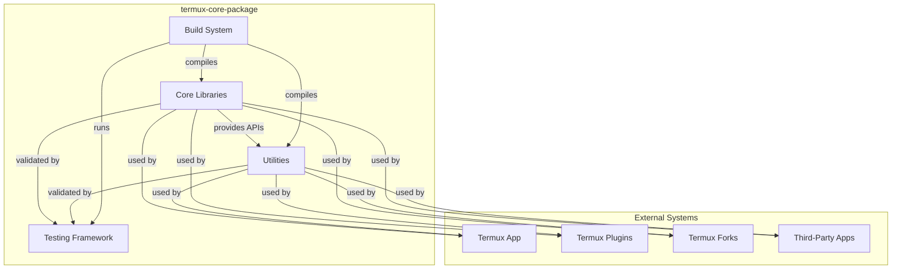
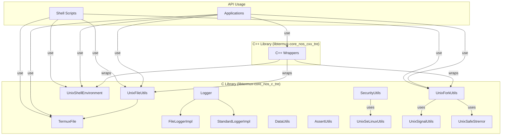
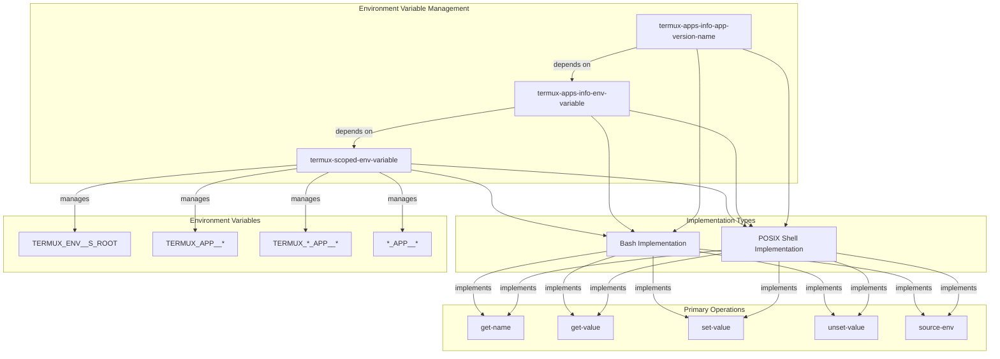
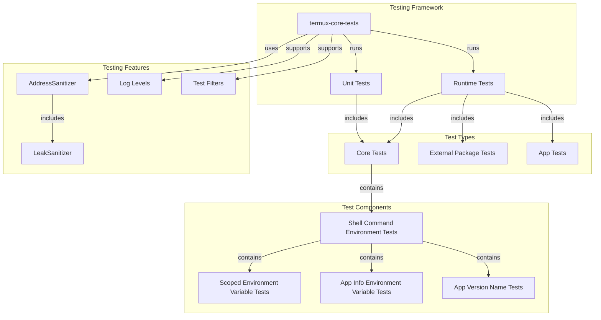

<!-- source: DeepWiki mcp.deepwiki.com · repo termux/termux-core-package · page 1 Overview · fetched 2026-10-26 -->

# Overview

Relevant source files

The following files were used as context for generating this wiki page:

- [Makefile](Makefile)
- [README.md](README.md)
- [packaging/debian/termux-core-package.json.in](packaging/debian/termux-core-package.json.in)
- [site/pages/en/projects/releases/0/v0.3.0.md](site/pages/en/projects/releases/0/v0.3.0.md)
- [site/pages/en/projects/releases/index.md](site/pages/en/projects/releases/index.md)

## Purpose and Scope

Termux Core Package (`termux-core-package`) provides essential utilities and libraries for the Termux core functionality. This package contains components that must exist in all Termux execution environments, including forks, and serves as a foundation for other Termux packages and third-party applications. The current version is 0.3.0.

This document provides a high-level overview of the termux-core-package architecture, its core components, and how they interact with each other. For detailed information about the build system, see [Build System](#2). For core libraries documentation, see [Core Libraries](#3).

Sources: [README.md:1-3](), [Makefile:1]()

## System Architecture

The termux-core-package is organized into several key components that work together to provide core functionality.

Sources: [Makefile:181-227](), [README.md:1-3]()

## Core Libraries

The termux-core-package provides two primary libraries that form the foundation of its functionality:

### libtermux-core_nos_c_tre (C Library)

This library contains core C utilities for file operations, process management, and shell environments. Key components include:

- `UnixFileUtils`: Handles file system operations and path manipulation
- `UnixForkUtils`: Manages process creation and child process handling
- `UnixShellEnvironment`: Provides shell environment interaction utilities
- `TermuxFile`: Termux-specific file operations

### libtermux-core_nos_cxx_tre (C++ Library)

This library provides C++ wrappers around the C library components.

Sources: [Makefile:232-249](), [Makefile:259-264]()

## Environment Variable Utilities

Termux Core Package includes a system for managing environment variables, which is critical for application integration and context-aware operations.

Sources: [Makefile:23-37](), [Makefile:322-328]()

## Build System

The package uses a well-structured build system to compile, test, and package its components. The build system handles architecture detection, environment setup, and ensures proper compilation flags are used.

### Key Build Targets

| Target | Description |
|--------|-------------|
| `all` | Builds all components |
| `pre-build` | Prepares build environment |
| `build-termux-core-main-app` | Builds the main application scripts |
| `build-libtermux-core_nos_c_tre` | Builds the C library |
| `build-libtermux-core_nos_cxx_tre` | Builds the C++ library |
| `clean` | Removes build artifacts |
| `install` | Installs the package into the specified prefix |
| `uninstall` | Uninstalls the package |
| `packaging-debian-build` | Creates a Debian package |
| `test` | Runs all tests |
| `test-unit` | Runs unit tests only |
| `test-runtime` | Runs runtime tests only |

Sources: [Makefile:299-513]()

## Testing Framework

The package includes a comprehensive testing framework for ensuring functionality and reliability.

The `termux-core-tests` utility serves as the main entry point for running tests, supporting various options for test selection, logging verbosity, and sanitizer usage.

Sources: [Makefile:374-394](), [Makefile:487-512]()

## Installation and Configuration

The termux-core-package installs components into the following directories:

| Component | Installation Path |
|-----------|------------------|
| Binaries | `$(TERMUX__PREFIX)/bin` |
| Headers | `$(TERMUX__PREFIX)/include/termux-core` |
| Libraries | `$(TERMUX__PREFIX)/lib` |
| Tests | `$(TERMUX__PREFIX)/libexec/installed-tests/termux-core` |

The package automatically detects architecture and configures builds accordingly, supporting `aarch64`, `arm`, `i686`, `x86_64`, and `riscv64` architectures.

Sources: [Makefile:66-88](), [Makefile:428-457]()

## Release History

The termux-core-package is currently at version 0.3.0. For detailed release notes and changelogs, see the [Release History](#6) page.

Sources: [site/pages/en/projects/releases/index.md:5-41](), [site/pages/en/projects/releases/0/v0.3.0.md:5-48]()

---

