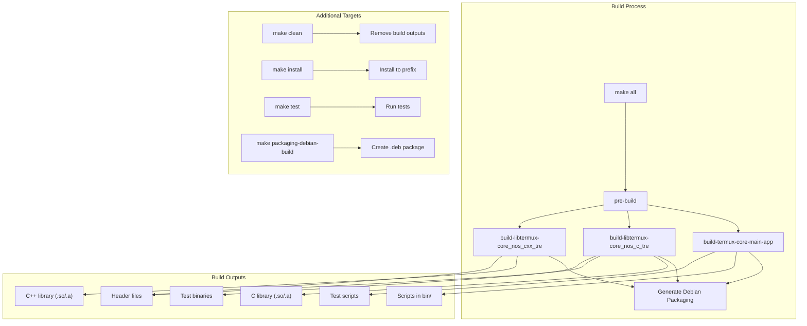
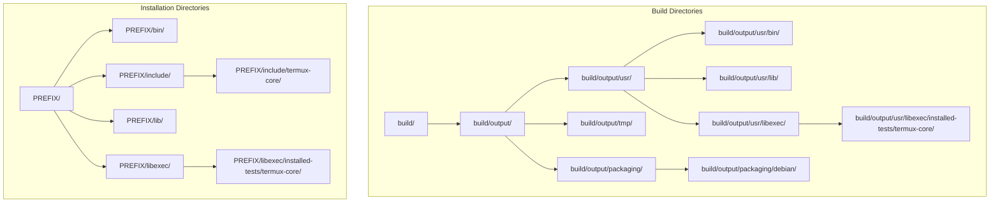
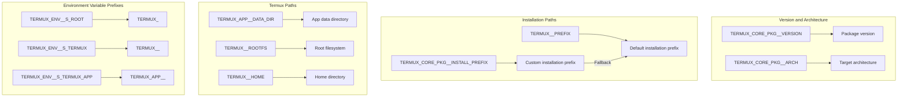
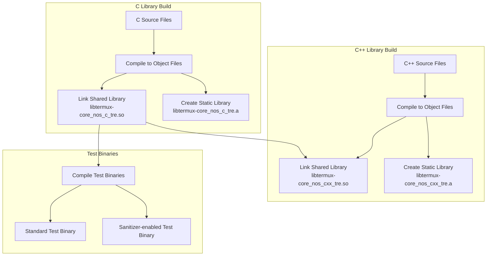
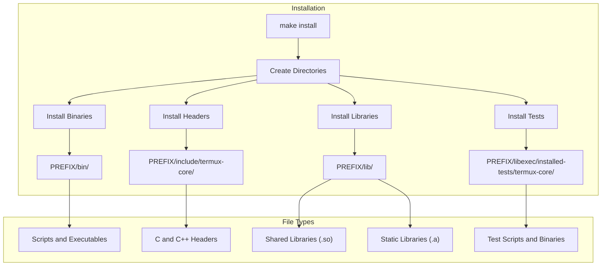
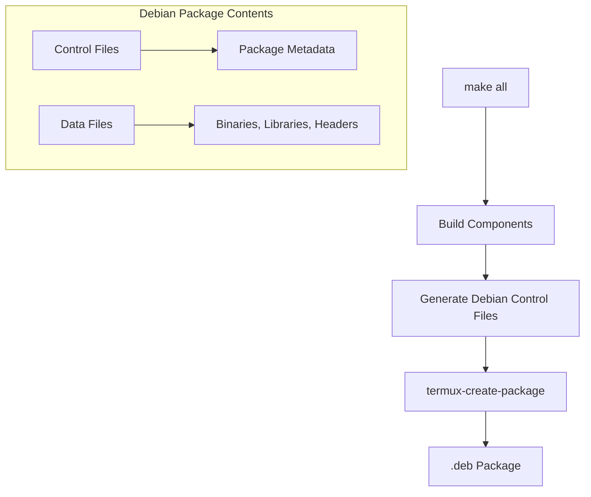
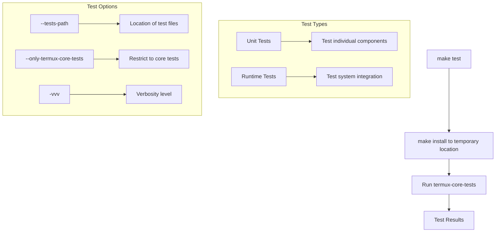

<!-- source: DeepWiki mcp.deepwiki.com · repo termux/termux-core-package · page 2 Build System · fetched 2026-10-26 -->

# Build System

Relevant source files

The following files were used as context for generating this wiki page:

- [LICENSE](LICENSE)
- [Makefile](Makefile)
- [licenses/termux__termux-core-package__MIT.md](licenses/termux__termux-core-package__MIT.md)
- [packaging/debian/termux-core-package.json.in](packaging/debian/termux-core-package.json.in)

## Purpose and Scope

This document describes the build system used by the termux-core-package repository. It explains the build process, configuration mechanisms, compilation parameters, installation procedures, and package generation. The build system uses GNU Make as its foundation and provides a comprehensive set of targets for building, testing, installing, and packaging the termux-core components.

For information about the testing framework that integrates with this build system, see [Testing Framework](#5).

## Build System Overview

The termux-core-package build system is designed to compile, test, and package various components including C and C++ libraries, shell scripts, and test utilities. It supports both on-device builds and cross-compilation.

### Build System Architecture

Sources: [Makefile:298-517]()

### Build Directory Structure

Sources: [Makefile:94-108](), [Makefile:111-123]()

## Configuration and Environment Variables

The build system defines numerous environment variables to configure paths, package names, version numbers, and architecture-specific settings. These variables are used throughout the build process to ensure consistency.

### Key Configuration Variables

Sources: [Makefile:1-44]()

### Architecture Detection

The build system can automatically detect the target architecture if not specified. It examines predefined macros from the C compiler to determine whether the target is:

- i686
- x86_64
- aarch64
- arm
- riscv64

This allows the build to adapt to different architectures without manual configuration.

Sources: [Makefile:66-88]()

## Compilation Process

### Compiler Flags and Optimization

The build system sets up compiler flags for both C and C++ compilation:

| Flag Category | Purpose | Example Flags |
|---------------|---------|---------------|
| Default Flags | Platform compatibility | `-march=armv7-a` (for ARM) |
| Optimization | Performance | `-O2` |
| Hardening | Security | `-D_FORTIFY_SOURCE=2`, `-fstack-protector-strong` |
| Warning Control | Code quality | `-Wall`, `-Wextra`, `-Werror`, `-Wshadow` |
| Linking | Library handling | `-Wl,--as-needed`, `-Wl,--enable-new-dtags` |
| Sanitization (tests) | Bug detection | `-fsanitize=address` |

For architecture-specific compilation, specialized flags are used. For example, ARM builds use `-march=armv7-a -mfpu=neon -mfloat-abi=softfp -mthumb`.

Sources: [Makefile:180-228]()

### Library Compilation Process

The build system compiles two main libraries:

1. **libtermux-core_nos_c_tre**: A C library providing core functionality
2. **libtermux-core_nos_cxx_tre**: A C++ library that wraps the C library

For each library, both shared (`.so`) and static (`.a`) versions are created. The compilation process involves:

1. Compiling individual source files to object files
2. Linking object files into shared libraries
3. Creating static archives

The libraries are built with visibility controls to carefully manage the exported symbols, using `-fvisibility=hidden` by default and explicitly marking exported functions with `-fvisibility=default`.

Sources: [Makefile:232-421]()

## Build Targets

The build system provides several primary targets for different operations:

| Target | Description |
|--------|-------------|
| `all` | Builds all components and packaging |
| `pre-build` | Prepares build directories and runs clean |
| `build-termux-core-main-app` | Builds main application scripts and tests |
| `build-libtermux-core_nos_c_tre` | Builds the C library |
| `build-libtermux-core_nos_cxx_tre` | Builds the C++ library |
| `clean` | Removes build outputs |
| `install` | Installs built components to the target prefix |
| `uninstall` | Removes installed components |
| `packaging-debian-build` | Creates a Debian package |
| `test` | Runs all tests |
| `test-unit` | Runs unit tests only |
| `test-runtime` | Runs runtime tests only |

These targets are defined as phony targets in the Makefile to ensure they run regardless of file timestamps.

Sources: [Makefile:298-516]()

## Installation Process

The installation process copies built components to their destination directories under the specified prefix (`TERMUX_CORE_PKG__INSTALL_PREFIX`):

### Installed Components

The installation process also sets appropriate permissions for installed files:
- Executable files (700): Binaries, scripts, test runners
- Non-executable files (600): Headers

Sources: [Makefile:428-458]()

## Packaging System

The build system can generate Debian packages for distribution. This is done through the `packaging-debian-build` target.

### Debian Package Generation

The packaging process:
1. Uses templates in `packaging/debian/` directory
2. Substitutes variables in these templates
3. Creates package control files (metadata)
4. Packages built components (binaries, libraries, headers)
5. Runs `termux-create-package` to generate the final .deb file

Sources: [Makefile:480-484](), [packaging/debian/termux-core-package.json.in:1-22]()

## Testing Integration

The build system integrates with the testing framework to validate built components:

### Test Execution Process

The build system provides three test-related targets:
- `test`: Runs all tests
- `test-unit`: Runs only unit tests
- `test-runtime`: Runs only runtime tests

Tests are executed via the `termux-core-tests` script with appropriate parameters.

Sources: [Makefile:486-513]()

## License Information

The termux-core-package, including its build system, is released under the MIT License unless specified otherwise for specific files.

Sources: [LICENSE:1-11](), [licenses/termux__termux-core-package__MIT.md:1-24]()

---

