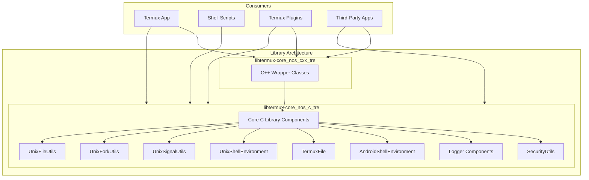
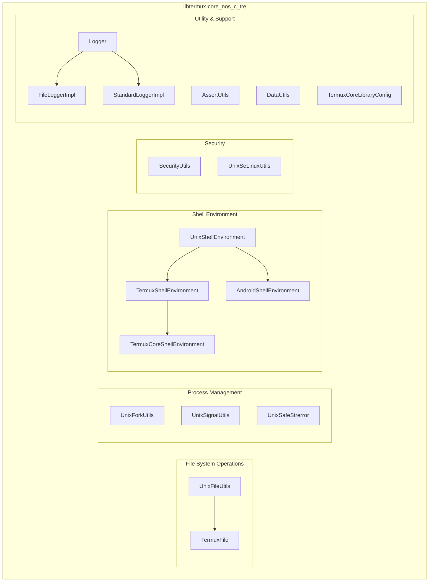

<!-- source: DeepWiki mcp.deepwiki.com · repo termux/termux-core-package · page 3 Core Libraries · fetched 2026-10-26 -->

# Core Libraries

<details>
<summary>Relevant source files</summary>

The following files were used as context for generating this wiki page:

- [Makefile](Makefile)
- [packaging/debian/termux-core-package.json.in](packaging/debian/termux-core-package.json.in)
- [site/pages/en/projects/releases/0/v0.1.0.md](site/pages/en/projects/releases/0/v0.1.0.md)

</details>


The Core Libraries in termux-core-package provide the foundational functionality required by Termux applications, plugins, and third-party software. These libraries offer standardized interfaces for interacting with the Android file system, process management, shell environments, and other core OS functionality. This document covers the architecture and components of the C and C++ libraries that form the foundation of the package. For environment variable utilities, see [Environment Variable Utilities](#4), and for testing framework details, see [Testing Framework](#5).

## Library Architecture Overview

The termux-core-package provides two primary libraries:

1. **C Library (libtermux-core_nos_c_tre)**: A core C library implementing fundamental Unix and Termux-specific utilities
2. **C++ Library (libtermux-core_nos_cxx_tre)**: A C++ wrapper library that provides object-oriented interfaces to the C library

These libraries are built as both shared libraries (`.so`) and static libraries (`.a`) for maximum flexibility in different integration scenarios.



Sources: [Makefile:232-249](), [Makefile:259-260]()

## C Library (libtermux-core_nos_c_tre)

The C library provides low-level functionality focused on system operations. It's designed to be lightweight, efficient, and provide a consistent API for interacting with the underlying Android system.

### Key Components



Sources: [Makefile:232-249]()

### File System Utilities

The file system utilities provide an abstraction layer for interacting with Unix and Termux file systems. These utilities handle path validation, file operations, permissions, and directory management.

Key components include:

- **UnixFileUtils**: Core file operations for Unix-like environments
- **TermuxFile**: Termux-specific file operations and path management

For more detailed information about file system utilities, see [File System Utilities](#3.1).

Sources: [Makefile:244](), [Makefile:241]()

### Process Management

The process management components handle process forking, signal handling, and error reporting. They provide a safer way to interact with system processes and handle error conditions.

Key components include:

- **UnixForkUtils**: Process forking and management
- **UnixSignalUtils**: Signal handling and management
- **UnixSafeStrerror**: Thread-safe error string generation

For more detailed information about process management, see [Process Management](#3.2).

Sources: [Makefile:245-247]()

### Shell Environment

The shell environment components provide utilities for interacting with shell environments, setting up environment variables, and managing shell contexts.

Key components include:

- **UnixShellEnvironment**: Generic Unix shell environment utilities
- **TermuxShellEnvironment**: Termux-specific shell environment utilities
- **AndroidShellEnvironment**: Android-specific shell environment utilities
- **TermuxCoreShellEnvironment**: Core shell utilities specific to Termux

For more detailed information about shell environment, see [Shell Environment](#3.3).

Sources: [Makefile:233](), [Makefile:242-243](), [Makefile:249]()

### Security Utilities

The security components provide utilities for handling security-related operations, including SELinux context management.

Key components include:

- **SecurityUtils**: General security utilities
- **UnixSeLinuxUtils**: SELinux context management and operations

Sources: [Makefile:240](), [Makefile:248]()

### Logging System

The logging system provides configurable logging capabilities for applications using the core libraries.

Key components include:

- **Logger**: Core logging interface
- **FileLoggerImpl**: Implementation for logging to files
- **StandardLoggerImpl**: Implementation for logging to standard output/error

Sources: [Makefile:237-239]()

## C++ Library (libtermux-core_nos_cxx_tre)

The C++ library provides object-oriented wrappers around the C library components. It makes the functionality more accessible to C++ applications and provides additional utility classes that leverage C++ features.

```mermaid
graph TD
    subgraph "libtermux-core_nos_cxx_tre"
        CxxWrappers["C++ Wrappers"]
        LibConfig["TermuxCoreLibraryConfig"]
    end
    
    subgraph "libtermux-core_nos_c_tre Dependencies"
        UnixFileUtils["UnixFileUtils"]
        UnixForkUtils["UnixForkUtils"]
        UnixShellEnv["UnixShellEnvironment"]
        TermuxFile["TermuxFile"]
    end
    
    CxxWrappers --> UnixFileUtils
    CxxWrappers --> UnixForkUtils
    CxxWrappers --> UnixShellEnv
    CxxWrappers --> TermuxFile
    LibConfig --> "C Library Config"
```

Sources: [Makefile:259-260](), [Makefile:412-418]()

The C++ library is designed to work seamlessly with the C library while providing the benefits of C++ language features:

- Object-oriented interfaces with proper resource management
- RAII (Resource Acquisition Is Initialization) pattern for safer resource handling
- Exception-based error handling
- STL integration

## Build and Installation

The core libraries are built as both shared libraries (`.so`) and static libraries (`.a`). This allows applications to either dynamically link against the libraries or statically include them.

### Library Build Process

The build system compiles source files with position-independent code (`-fPIC`) and creates both shared and static library versions:

1. Object files are compiled from source files
2. Shared libraries are created with visibility controls
3. Static libraries are archived from object files

### Installation Paths

The libraries and headers are installed in the following default locations:

| Component | Installation Path |
|-----------|------------------|
| Shared Libraries | `$(TERMUX__PREFIX)/lib/` |
| Static Libraries | `$(TERMUX__PREFIX)/lib/` |
| Headers | `$(TERMUX__PREFIX)/include/termux-core/termux/` |

Sources: [Makefile:442-447]()

## Integration with Applications

Applications can integrate with the core libraries in several ways:

### C Applications

C applications can include the appropriate headers and link against either the shared or static libraries:

```c
#include <termux-core/termux/termux_core__nos__c/unix/file/UnixFileUtils.h>
```

### C++ Applications

C++ applications can use the object-oriented wrappers:

```cpp
#include <termux-core/termux/termux_core__nos__cxx/file/FileUtils.hpp>
```

### Runtime Dependencies

Applications using the shared libraries must have the following runtime dependencies:
- `libtermux-core_nos_c_tre.so` (for both C and C++ applications)
- `libtermux-core_nos_cxx_tre.so` (for C++ applications)

## Versioning and Compatibility

The core libraries follow semantic versioning. The current version is encoded in the Makefile.

Sources: [Makefile:1]()

The libraries are designed to maintain backward compatibility within major versions. API changes that would break compatibility require a new major version.

---

