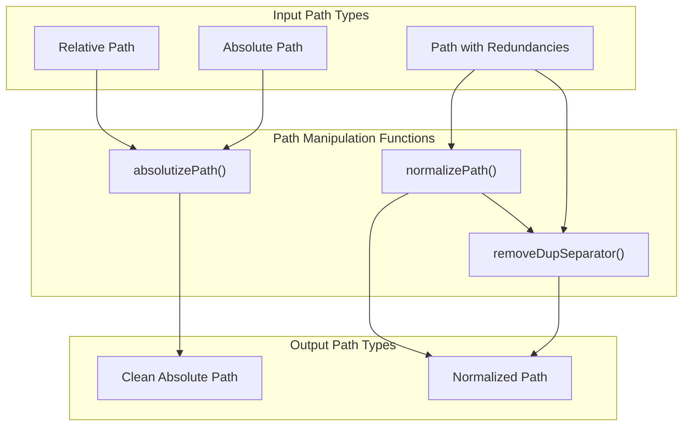
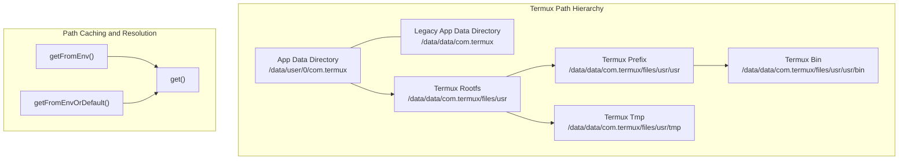
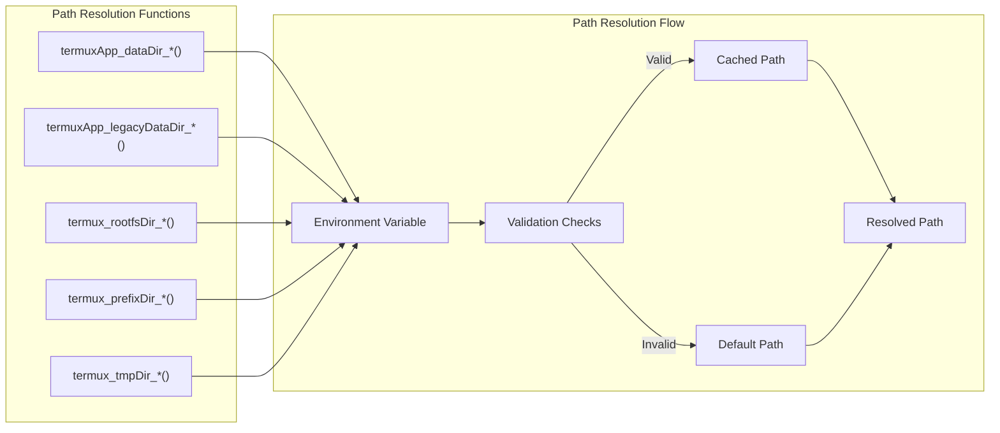
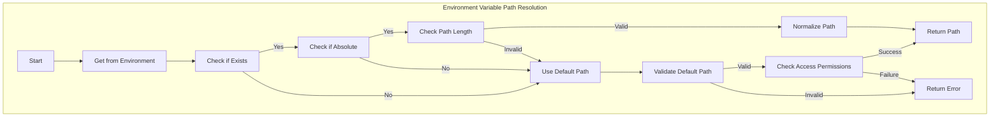

<!-- source: DeepWiki mcp.deepwiki.com · repo termux/termux-core-package · page 3.1 File System Utilities · fetched 2026-10-26 -->

# File System Utilities

<details>
<summary>Relevant source files</summary>

The following files were used as context for generating this wiki page:

- [lib/termux-core_nos_c_tre/include/termux/termux_core__nos__c/v1/termux/file/TermuxFile.h](lib/termux-core_nos_c_tre/include/termux/termux_core__nos__c/v1/termux/file/TermuxFile.h)
- [lib/termux-core_nos_c_tre/include/termux/termux_core__nos__c/v1/unix/file/UnixFileUtils.h](lib/termux-core_nos_c_tre/include/termux/termux_core__nos__c/v1/unix/file/UnixFileUtils.h)
- [lib/termux-core_nos_c_tre/src/termux/file/TermuxFile.c](lib/termux-core_nos_c_tre/src/termux/file/TermuxFile.c)
- [lib/termux-core_nos_c_tre/src/unix/file/UnixFileUtils.c](lib/termux-core_nos_c_tre/src/unix/file/UnixFileUtils.c)
- [lib/termux-core_nos_c_tre/tests/src/termux/file/TermuxFile_UnitBinaryTests.c](lib/termux-core_nos_c_tre/tests/src/termux/file/TermuxFile_UnitBinaryTests.c)

</details>


## Purpose and Scope

This document details the file system utilities provided by the Termux Core Package, focusing on path manipulation, validation, directory management, and Termux-specific file operations. These utilities form a critical foundation for file operations within the Termux environment, ensuring consistent handling of paths across the unique filesystem layout of Termux.

For information about process management capabilities, see [Process Management](#3.2).
For shell environment utilities, see [Shell Environment](#3.3).

## Overview

The file system utilities in Termux Core Package are divided into two main components:

1. **Unix File Utilities**: General-purpose utilities for Unix path operations
2. **Termux-specific File Utilities**: Functions tailored to Termux's unique file system structure

## Unix File Utilities

### Path Manipulation Functions

These functions provide essential path handling capabilities:

| Function | Description |
|----------|-------------|
| `absolutizePath` | Converts a relative path to an absolute path using the current working directory |
| `normalizePath` | Cleans paths by removing redundancies like duplicate separators, `./`, and optionally `../` |
| `removeDupSeparator` | Removes consecutive path separators and optionally trailing separators |



Sources: [lib/termux-core_nos_c_tre/src/unix/file/UnixFileUtils.c:27-93](), [lib/termux-core_nos_c_tre/src/unix/file/UnixFileUtils.c:99-101](), [lib/termux-core_nos_c_tre/src/unix/file/UnixFileUtils.c:106-131]()

#### Path Normalization Behavior

The `normalizePath` function handles various path cleanup operations:

- Removes duplicate separators (`//` → `/`)
- Removes trailing separators (unless specified to keep)
- Replaces `/./` with `/` and removes leading `./`
- Optionally resolves `../` by removing parent directory components

```
Examples:
"/foo//bar/" → "/foo/bar"
"/foo/./bar" → "/foo/bar"
"/foo/../bar" → "/bar"
"a/../../b" → null (if removing double dots)
```

Sources: [lib/termux-core_nos_c_tre/include/termux/termux_core__nos__c/v1/unix/file/UnixFileUtils.h:31-145]()

### Path Validation Functions

| Function | Description |
|----------|-------------|
| `isFdPath` | Checks if a path matches the format for file descriptor paths (`/proc/self/fd/<num>` or `/proc/<pid>/fd/<num>`) |
| `isPathInDirPath` | Determines if a path is within a specified directory |
| `isPathOrFdPathInDirPath` | Checks if a path or an fd path's real path is within a directory |

Sources: [lib/termux-core_nos_c_tre/src/unix/file/UnixFileUtils.c:137-265]()

### Directory and File Operations

| Function | Description |
|----------|-------------|
| `createDirectoryFile` | Creates a directory including all parent directories (similar to `mkdir -p`) |
| `closeFD` | Safely closes a file descriptor with proper error handling |
| `redirectStdFdToDevNull` | Redirects standard file descriptors (stdin, stdout, stderr) to `/dev/null` |
| `getRegularFileFdRealPath` | Resolves the real path of a file descriptor path |

Sources: [lib/termux-core_nos_c_tre/src/unix/file/UnixFileUtils.c:447-589]()

## Termux File System Structure

Termux has a specific file system layout with important path constraints. The File System Utilities module provides constants and functions to work with this structure.



Sources: [lib/termux-core_nos_c_tre/include/termux/termux_core__nos__c/v1/termux/file/TermuxFile.h:10-125](), [lib/termux-core_nos_c_tre/src/termux/file/TermuxFile.c:28-59]()

### Path Length Limits

The Termux file system has specific path length limitations defined as constants:

| Constant | Value | Description |
|----------|-------|-------------|
| `TERMUX_APP__DATA_DIR___MAX_LEN` | 69 | Max length for app data directory path |
| `TERMUX__APPS_DIR___MAX_LEN` | 84 | Max length for apps directory path |
| `TERMUX__ROOTFS_DIR___MAX_LEN` | 86 | Max length for rootfs directory path |
| `TERMUX__PREFIX_DIR___MAX_LEN` | 90 | Max length for prefix directory path |
| `TERMUX__PREFIX__BIN_FILE___SAFE_MAX_LEN` | 127 | Safe max length for bin file path |

These limits exist to ensure compatibility with the Linux kernel and Android system limitations, particularly for executable paths.

Sources: [lib/termux-core_nos_c_tre/include/termux/termux_core__nos__c/v1/termux/file/TermuxFile.h:10-114]()

## Termux Path Management

### Directory Path Resolution

The library provides three categories of functions for each Termux directory type:

1. `*_get()` - Returns cached path value
2. `*_getFromEnv()` - Gets path from environment variable
3. `*_getFromEnvOrDefault()` - Gets path from environment or falls back to default



Sources: [lib/termux-core_nos_c_tre/src/termux/file/TermuxFile.c:64-277]()

### Key Path Resolution Functions

| Function Group | Description |
|----------------|-------------|
| `termuxApp_dataDir_*` | Functions to get, cache and validate Termux app data directory |
| `termuxApp_legacyDataDir_*` | Functions for legacy app data directory support |
| `termux_rootfsDir_*` | Functions for Termux rootfs directory |
| `termux_prefixDir_*` | Functions for Termux prefix directory |
| `termux_tmpDir_*` | Functions for Termux temporary directory |

Sources: [lib/termux-core_nos_c_tre/include/termux/termux_core__nos__c/v1/termux/file/TermuxFile.h:134-321]()

### Legacy Path Support

Termux supports both modern Android data paths (`/data/user/<user_id>/<package_name>`) and legacy paths (`/data/data/<package_name>`). The function `termuxApp_dataDir_convertToLegacyPath()` handles conversion between these formats.

Sources: [lib/termux-core_nos_c_tre/src/termux/file/TermuxFile.c:139-199]()

### Path Validation and Prefixing

The library provides:

- `termuxApp_dataDir_isPathUnder()`: Checks if a path is under app data directory
- `termux_rootfsDir_isPathUnder()`: Checks if a path is under rootfs directory
- `termuxPrefixPath()`: Prefixes paths with Termux prefix (e.g., `/bin/sh` → `$PREFIX/bin/sh`)

Sources: [lib/termux-core_nos_c_tre/src/termux/file/TermuxFile.c:283-449]()

## Environment Variable Path Handling

The utility provides functions to safely retrieve paths from environment variables with validation and fallbacks:



Sources: [lib/termux-core_nos_c_tre/src/unix/file/UnixFileUtils.c:292-436]()

### Important Path Resolution Functions

| Function | Description |
|----------|-------------|
| `getPathFromEnv` | Gets a path from an environment variable with validation |
| `getPathFromEnvOrDefault` | Gets a path from environment or falls back to default |

Both functions perform comprehensive validation including:
- Existence check
- Absolute path verification
- Path length validation
- Optional path normalization
- Access permissions check (for default paths)

Sources: [lib/termux-core_nos_c_tre/include/termux/termux_core__nos__c/v1/unix/file/UnixFileUtils.h:236-313]()

## Best Practices

When working with the File System Utilities, consider the following best practices:

1. Always use the provided functions instead of direct path manipulation to ensure consistency
2. Be aware of path length limits, especially for executable paths
3. Use cached path getters (`*_get()`) for frequently accessed paths
4. Normalize paths before validation when appropriate
5. Handle both modern and legacy path formats when necessary
6. Check return values for error conditions

---

