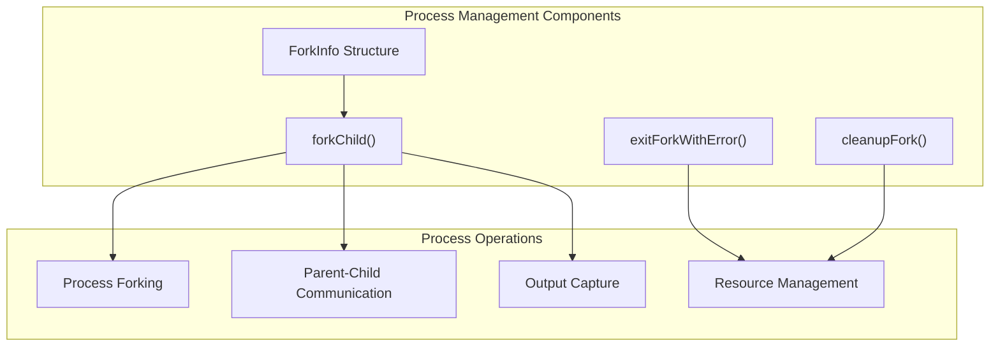
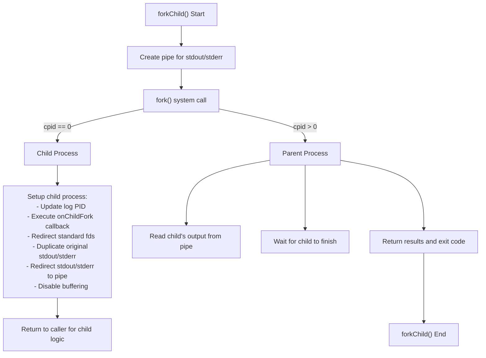
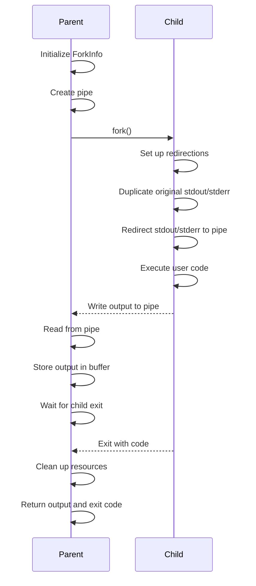
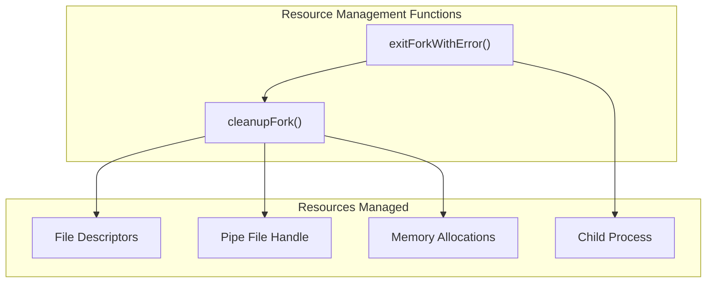
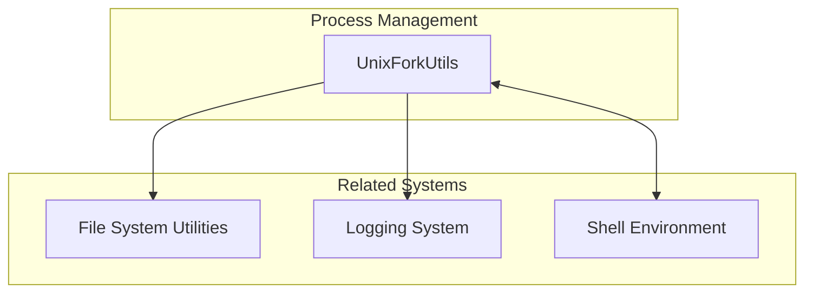

<!-- source: DeepWiki mcp.deepwiki.com · repo termux/termux-core-package · page 3.2 Process Management · fetched 2026-10-26 -->

# Process Management

<details>
<summary>Relevant source files</summary>

The following files were used as context for generating this wiki page:

- [lib/termux-core_nos_c_tre/include/termux/termux_core__nos__c/v1/unix/os/process/UnixForkUtils.h](lib/termux-core_nos_c_tre/include/termux/termux_core__nos__c/v1/unix/os/process/UnixForkUtils.h)
- [lib/termux-core_nos_c_tre/src/unix/os/process/UnixForkUtils.c](lib/termux-core_nos_c_tre/src/unix/os/process/UnixForkUtils.c)

</details>


## Purpose and Scope

This document describes the process management functionality provided by the Termux Core Package. It focuses on the Unix process forking utilities and child process management mechanisms implemented in the C library. The process management system enables controlled creation of child processes, capturing their output, and managing their lifecycle while ensuring proper resource cleanup.

For information about shell environment management, see [Shell Environment](#3.3).

## Overview

The process management system in Termux Core provides a structured approach to fork Unix processes, establish parent-child communication through pipes, and manage process resources. It abstracts the complexities of Unix process forking while providing fine-grained control over standard I/O streams.



Sources: [lib/termux-core_nos_c_tre/include/termux/termux_core__nos__c/v1/unix/os/process/UnixForkUtils.h:1-58](), [lib/termux-core_nos_c_tre/src/unix/os/process/UnixForkUtils.c:1-224]()

## ForkInfo Structure

The process management system is built around a central data structure called `ForkInfo`, which encapsulates all information related to a fork operation.

### Structure Fields

| Field | Type | Description |
|-------|------|-------------|
| `isChild` | bool | Indicates whether this is the child process |
| `cpid` | int | Child process ID |
| `exitCode` | int | Exit code of the child process |
| `status` | int | Process status information |
| `stdoutFd` | int | Original stdout file descriptor of child |
| `stderrFd` | int | Original stderr file descriptor of child |
| `pipeFds[2]` | int | File descriptors for the pipe between parent and child |
| `pipeFile` | FILE* | File handle for reading pipe in parent |
| `output` | char* | Buffer for storing captured child output |
| `returnOutput` | bool | Whether to return the captured output |
| `redirectChildStdinToDevNull` | bool | Whether to redirect child's stdin to /dev/null |
| `redirectChildStdoutToDevNull` | bool | Whether to redirect child's stdout to /dev/null |
| `redirectChildStderrToDevNull` | bool | Whether to redirect child's stderr to /dev/null |
| `outputInitialBuffer` | size_t | Initial buffer size for capturing output |
| `parentLogTag` | const char* | Log tag for parent process |
| `childLogTag` | const char* | Log tag for child process |
| `onChildFork` | function pointer | Callback function invoked in child after fork |

A convenience macro `INIT_FORK_INFO` is provided to initialize this structure with default values:

```c
INIT_FORK_INFO(forkInfo);
```

This initializes a ForkInfo structure with appropriate default values for all fields.

Sources: [lib/termux-core_nos_c_tre/include/termux/termux_core__nos__c/v1/unix/os/process/UnixForkUtils.h:11-44]()

## Core Process Management Functions

### forkChild

The `forkChild` function is the main entry point for process forking operations.



The `forkChild` function performs the following key operations:

1. Creates a pipe for communication between parent and child
2. Forks the process using the Unix `fork()` system call
3. In the child process:
   - Sets up proper logging
   - Executes the optional `onChildFork` callback
   - Redirects standard file descriptors as configured
   - Duplicates original stdout/stderr for potential restoration
   - Redirects stdout/stderr to pipe for parent capture
   - Disables buffering for stdout/stderr
4. In the parent process:
   - Reads and captures the child's output through the pipe
   - Dynamically resizes the buffer as needed
   - Waits for the child to exit
   - Returns the exit code and captured output

Sources: [lib/termux-core_nos_c_tre/src/unix/os/process/UnixForkUtils.c:19-183]()

### exitForkWithError

The `exitForkWithError` function provides a controlled way to exit a process in error conditions:

```c
void exitForkWithError(ForkInfo *info, int exitCode);
```

This function:
1. Cleans up resources by calling `cleanupFork`
2. If in the parent process, kills the child process if it's still running
3. Exits with the specified exit code

Sources: [lib/termux-core_nos_c_tre/src/unix/os/process/UnixForkUtils.c:185-191]()

### cleanupFork

The `cleanupFork` function ensures proper resource cleanup:

```c
void cleanupFork(ForkInfo *info);
```

This function handles:
1. Closing file descriptors (stdout, stderr, pipe)
2. Closing the pipe file handle
3. Freeing allocated memory for output buffer

Proper resource cleanup is essential to prevent resource leaks in both normal and error scenarios.

Sources: [lib/termux-core_nos_c_tre/src/unix/os/process/UnixForkUtils.c:193-223]()

## Parent-Child Communication

The process management system implements a robust parent-child communication mechanism using Unix pipes.



Key aspects of the communication mechanism:

1. **Pipe Creation**: The parent creates a pipe before forking
2. **Redirection**: The child redirects its stdout/stderr to the pipe
3. **Dynamic Buffer Management**: The parent dynamically resizes the output buffer as needed
4. **Process Synchronization**: The parent waits for the child to complete execution

Sources: [lib/termux-core_nos_c_tre/src/unix/os/process/UnixForkUtils.c:19-183]()

## Resource Management

The process management system implements careful resource management to prevent leaks and ensure clean process termination.



Resource management occurs in multiple scenarios:

1. **Normal Completion**: Resources are cleaned up after child completion
2. **Error Handling**: The `exitForkWithError` function ensures cleanup before exit
3. **Child Process Termination**: When necessary, the parent can forcibly terminate the child process

Proper resource management is crucial for preventing file descriptor leaks, memory leaks, and zombie processes.

Sources: [lib/termux-core_nos_c_tre/src/unix/os/process/UnixForkUtils.c:185-223]()

## Usage Patterns

The process management system is designed to be flexible and can be used in various scenarios:

1. **Output Capture**: Capturing the output from child processes
2. **Controlled Execution**: Executing commands with controlled stdin/stdout/stderr
3. **Custom Child Logic**: Using the `onChildFork` callback for specialized child process setup

Example usage pattern (conceptual):

```c
// Initialize ForkInfo structure
INIT_FORK_INFO(forkInfo);

// Configure options
forkInfo.parentLogTag = "MyParent";
forkInfo.childLogTag = "MyChild";
forkInfo.onChildFork = mySetupFunction;

// Fork the child process
if (forkChild(&forkInfo) == 0) {
    if (forkInfo.isChild) {
        // Child-specific code
        // ...
        exit(0);
    } else {
        // Parent-specific code
        printf("Child output: %s\n", forkInfo.output);
        printf("Child exit code: %d\n", forkInfo.exitCode);
    }
}

// Clean up resources
cleanupFork(&forkInfo);
```

Sources: [lib/termux-core_nos_c_tre/include/termux/termux_core__nos__c/v1/unix/os/process/UnixForkUtils.h:1-58](), [lib/termux-core_nos_c_tre/src/unix/os/process/UnixForkUtils.c:1-224]()

## Integration with Other Systems

The process management system integrates with other components in the Termux Core Package:

1. **Logging System**: Uses logging functions for error reporting
2. **File System Utilities**: Relies on file descriptor management functions
3. **Shell Environment**: Can be used in conjunction with shell environment utilities



Sources: [lib/termux-core_nos_c_tre/src/unix/os/process/UnixForkUtils.c:1-16]()

---

