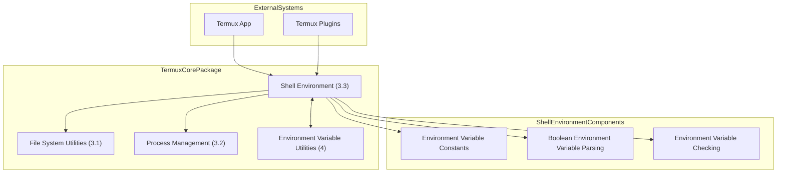
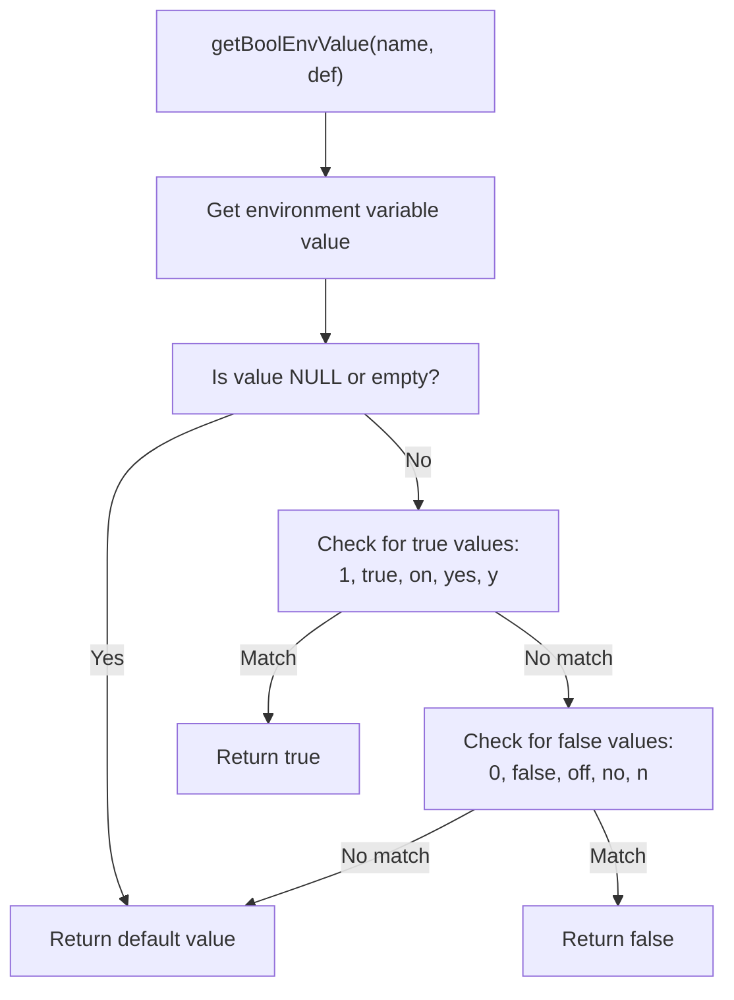

<!-- source: DeepWiki mcp.deepwiki.com · repo termux/termux-core-package · page 3.3 Shell Environment · fetched 2026-10-26 -->

# Shell Environment

<details>
<summary>Relevant source files</summary>

The following files were used as context for generating this wiki page:

- [lib/termux-core_nos_c_tre/include/termux/termux_core__nos__c/v1/unix/shell/command/environment/UnixShellEnvironment.h](lib/termux-core_nos_c_tre/include/termux/termux_core__nos__c/v1/unix/shell/command/environment/UnixShellEnvironment.h)
- [lib/termux-core_nos_c_tre/src/unix/shell/command/environment/UnixShellEnvironment.c](lib/termux-core_nos_c_tre/src/unix/shell/command/environment/UnixShellEnvironment.c)

</details>


This page documents the Shell Environment utilities in the Termux Core Package. These utilities provide standardized methods for interacting with the Unix shell environment, specifically focusing on environment variable access, parsing, and validation.

For information related to process creation and management, see [Process Management](#3.2).
For environment variable utilities that build upon these core functions, see [Environment Variable Utilities](#4).

## System Architecture

### Shell Environment Component Architecture



Sources: [lib/termux-core_nos_c_tre/include/termux/termux_core__nos__c/v1/unix/shell/command/environment/UnixShellEnvironment.h:1-137]()

## Environment Variable Constants

The Shell Environment subsystem defines constants for standard Unix environment variables that are used throughout the Termux ecosystem.

### Standard Environment Variables

| Constant | Description | Reference |
|----------|-------------|-----------|
| `ENV__PATH` | Executable search paths | [lib/termux-core_nos_c_tre/include/termux/termux_core__nos__c/v1/unix/shell/command/environment/UnixShellEnvironment.h:34]() |
| `ENV__LD_LIBRARY_PATH` | Dynamic library search paths | [lib/termux-core_nos_c_tre/include/termux/termux_core__nos__c/v1/unix/shell/command/environment/UnixShellEnvironment.h:51]() |
| `ENV__LD_PRELOAD` | Preloaded shared objects | [lib/termux-core_nos_c_tre/include/termux/termux_core__nos__c/v1/unix/shell/command/environment/UnixShellEnvironment.h:64]() |
| `ENV__TMPDIR` | Temporary file directory | [lib/termux-core_nos_c_tre/include/termux/termux_core__nos__c/v1/unix/shell/command/environment/UnixShellEnvironment.h:77]() |

Each environment variable also has a corresponding prefix constant (e.g., `ENV_PREFIX__PATH`) that includes the equals sign, which is useful for environment variable manipulation.

Sources: [lib/termux-core_nos_c_tre/include/termux/termux_core__nos__c/v1/unix/shell/command/environment/UnixShellEnvironment.h:34-78]()

## Environment Variable Processing Functions

### Boolean Environment Variable Parsing

#### Boolean Environment Variable Processing Flow



The `getBoolEnvValue` function parses environment variables as boolean values:

| Parameter | Description |
|-----------|-------------|
| `name` | Environment variable name to look up |
| `def` | Default boolean value if variable doesn't exist or has unrecognized value |

Recognized boolean values:
- True: "1", "true", "on", "yes", "y"
- False: "0", "false", "off", "no", "n"

Sources: 
- [lib/termux-core_nos_c_tre/include/termux/termux_core__nos__c/v1/unix/shell/command/environment/UnixShellEnvironment.h:85-103]()
- [lib/termux-core_nos_c_tre/src/unix/shell/command/environment/UnixShellEnvironment.c:13-25]()

### Environment Variable Checking Functions

#### Environment Variable Checking Flow

```mermaid
flowchart TD
    subgraph "areVarsInEnv"
        avStart["areVarsInEnv(envp, vars, n)"]
        avLoop["Iterate through envp"]
        avCheck["Check if any var in vars<br>is a prefix of current env var"]
        avReturnTrue["Return true"]
        avReturnFalse["Return false"]
        
        avStart --> avLoop
        avLoop --> avCheck
        avCheck -->|"Match found"| avReturnTrue
        avCheck -->|"No match, more vars"| avLoop
        avCheck -->|"No match, end of envp"| avReturnFalse
    end
    
    subgraph "areEmptyVarsInEnv"
        aevStart["areEmptyVarsInEnv(envp, vars, n)"]
        aevLoop["Iterate through envp"]
        aevCheck["Check if any var in vars<br>exactly matches current env var"]
        aevReturnTrue["Return true"]
        aevReturnFalse["Return false"]
        
        aevStart --> aevLoop
        aevLoop --> aevCheck
        aevCheck -->|"Match found"| aevReturnTrue
        aevCheck -->|"No match, more vars"| aevLoop
        aevCheck -->|"No match, end of envp"| aevReturnFalse
    end
```



Two functions are provided for checking environment variables:

| Function | Purpose |
|----------|---------|
| `areVarsInEnv` | Checks if any of a set of variables exist in an environment array |
| `areEmptyVarsInEnv` | Checks if any variables exist with empty values |

Parameters for both functions:
- `envp`: Environment array (strings in "NAME=VALUE" format)
- `vars`: Array of variable prefixes to search for ("NAME=" format)
- `n`: Number of prefixes in `vars` to search for

Sources:
- [lib/termux-core_nos_c_tre/include/termux/termux_core__nos__c/v1/unix/shell/command/environment/UnixShellEnvironment.h:108-129]()
- [lib/termux-core_nos_c_tre/src/unix/shell/command/environment/UnixShellEnvironment.c:29-53]()

## Usage Examples

### Boolean Environment Variable Parsing

The `getBoolEnvValue` function controls application behavior based on environment settings:

```c
// Check if debugging is enabled via the DEBUG environment variable
bool debugEnabled = getBoolEnvValue("DEBUG", false);

if (debugEnabled) {
    // Perform additional logging or debugging operations
    printf("Debug mode enabled\n");
}
```

### Environment Variable Checking

The environment variable checking functions enable conditional behavior:

```c
// Define environment variables to check
const char *pathVars[] = {ENV_PREFIX__PATH, ENV_PREFIX__LD_LIBRARY_PATH};

// Check if any path-related variables exist
if (areVarsInEnv(environ, pathVars, 2)) {
    // Process paths
}

// Check if any path-related variables exist but are empty
if (areEmptyVarsInEnv(environ, pathVars, 2)) {
    // Handle empty path variables
    fprintf(stderr, "Warning: Empty path variable detected\n");
}
```

## Implementation Details

### Boolean Environment Variable Parsing

The `getBoolEnvValue` function implementation:

1. Retrieves the environment variable value using `getenv`
2. Checks if the value exists and is not empty
3. Performs case-sensitive string comparisons against known true/false values
4. Returns the default value if no match is found

Key implementation:
```c
bool getBoolEnvValue(const char *name, bool def) {
    const char* value = getenv(name);
    if (value == NULL || strlen(value) < 1) {
        return def;
    } else if (strcmp(value, "1") == 0 || strcmp(value, "true") == 0 ||
               strcmp(value, "on") == 0 || strcmp(value, "yes") == 0 || strcmp(value, "y") == 0) {
        return true;
    } else if (strcmp(value, "0") == 0 || strcmp(value, "false") == 0 ||
               strcmp(value, "off") == 0 || strcmp(value, "no") == 0 || strcmp(value, "n") == 0) {
        return false;
    }
    return def;
}
```

Sources: [lib/termux-core_nos_c_tre/src/unix/shell/command/environment/UnixShellEnvironment.c:13-25]()

### Environment Variable Checking

The environment variable checking functions:

- `areVarsInEnv`: Uses `stringStartsWith` to check if any variable prefix matches the beginning of an environment variable
- `areEmptyVarsInEnv`: Uses `strcmp` to check for exact matches with prefixes (indicating empty variables)

Implementation:
```c
bool areVarsInEnv(char *const *envp, const char *vars[], int n) {
    int envLength = 0;
    while (envp[envLength] != NULL) {
        for (int i = 0; i < n; i++) {
            if (stringStartsWith(envp[envLength], vars[i])) {
                return true;
            }
        }
        envLength++;
    }
    return false;
}

bool areEmptyVarsInEnv(char *const *envp, const char *vars[], int n) {
    int envLength = 0;
    while (envp[envLength] != NULL) {
        for (int i = 0; i < n; i++) {
            if (strcmp(envp[envLength], vars[i]) == 0) {
                return true;
            }
        }
        envLength++;
    }
    return false;
}
```

Sources: [lib/termux-core_nos_c_tre/src/unix/shell/command/environment/UnixShellEnvironment.c:29-53]()

## Integration with Termux Ecosystem

The Shell Environment subsystem provides foundations for the [Environment Variable Utilities](#4), which build on these functions for specialized environment variable handling.

It also integrates with:
- [Process Management](#3.2) for environment manipulation in processes
- [File System Utilities](#3.1) for path operations

---

