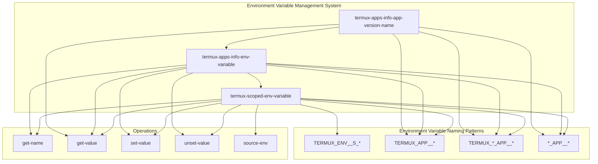
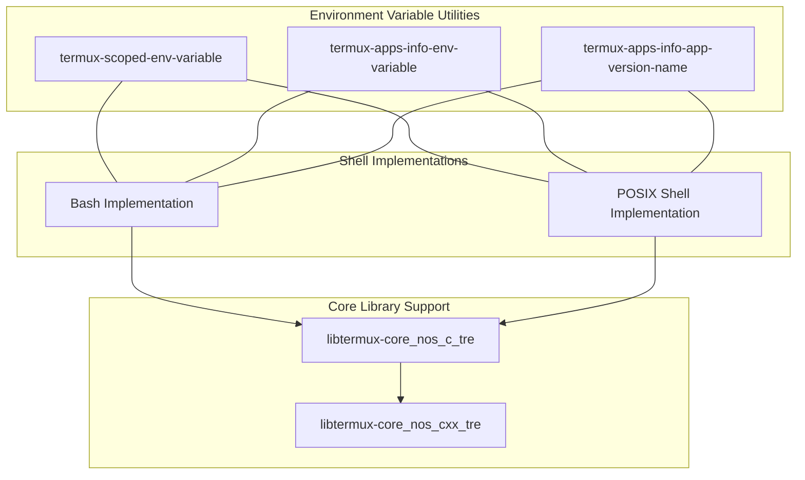
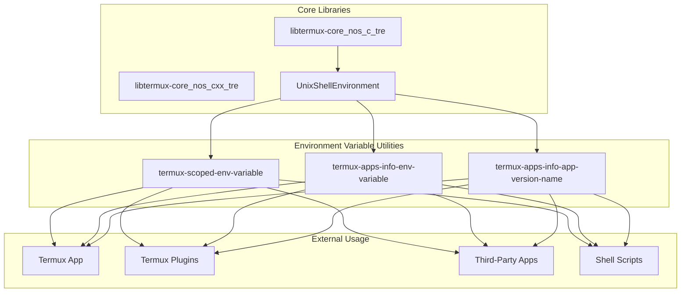

<!-- source: DeepWiki mcp.deepwiki.com · repo termux/termux-core-package · page 4 Environment Variable Utilities · fetched 2026-10-26 -->

# Environment Variable Utilities

Relevant source files

The following files were used as context for generating this wiki page:

- [site/pages/en/projects/docs/usage/index.md](site/pages/en/projects/docs/usage/index.md)
- [site/pages/en/projects/releases/0/v0.1.0.md](site/pages/en/projects/releases/0/v0.1.0.md)

This page documents the environment variable management utilities provided by the termux-core-package. These utilities enable consistent handling of environment variables across different Termux environments, including the main Termux app, Termux forks, and third-party applications.

For information about the shell environment in general, see [Shell Environment](#3.3). For detailed documentation of individual environment variable utilities, see [Scoped Environment Variables](#4.1), [App Info Environment Variables](#4.2), and [App Version Name Utility](#4.3).

## Overview

The termux-core-package provides three main utilities for environment variable management:

1. `termux-scoped-env-variable` - A utility for managing scoped environment variables following specific naming conventions
2. `termux-apps-info-env-variable` - A utility for accessing and managing application information through environment variables
3. `termux-apps-info-app-version-name` - A specialized utility for retrieving application version information

These utilities are designed to work in both Bash and POSIX shell environments, providing a consistent interface for environment variable operations across different shell implementations.

Sources: [site/pages/en/projects/docs/usage/index.md:30-33]()

## Environment Variable Management Architecture

Sources: [site/pages/en/projects/docs/usage/index.md:30-33](), [site/pages/en/projects/releases/0/v0.1.0.md:20-22]()

## Utility Implementations and Shell Compatibility

Sources: [site/pages/en/projects/releases/0/v0.1.0.md:19-22]()

## Common Operations

Each utility supports a standard set of operations, though not all utilities implement all operations:

| Operation | Description | `termux-scoped-env-variable` | `termux-apps-info-env-variable` | `termux-apps-info-app-version-name` |
|-----------|-------------|:----------------------------:|:-------------------------------:|:-----------------------------------:|
| `get-name` | Returns the fully qualified environment variable name | ✓ | ✓ | - |
| `get-value` | Returns the value of the environment variable | ✓ | ✓ | ✓ |
| `set-value` | Sets the value of the environment variable | ✓ | ✓ | - |
| `unset-value` | Unsets/removes the environment variable | ✓ | ✓ | - |
| `source-env` | Sources environment variables into the current shell | ✓ | - | - |

Sources: [site/pages/en/projects/docs/usage/index.md:30-33]()

## Environment Variable Naming Conventions

The environment variable utilities enforce a structured naming convention to ensure proper scoping and avoid namespace collisions:

| Pattern | Description | Example |
|---------|-------------|---------|
| `TERMUX_ENV__S_*` | Termux system environment variables | `TERMUX_ENV__S_ROOT` |
| `TERMUX_APP__*` | Termux application environment variables | `TERMUX_APP__VERSION_NAME` |
| `TERMUX_*_APP__*` | Termux plugin application environment variables | `TERMUX_FLOAT_APP__VISIBLE` |
| `*_APP__*` | External application environment variables | `SOME_APP__SETTING` |

This structured naming enables effective isolation of environment variables between different applications and components of the Termux ecosystem.

Sources: [site/pages/en/projects/docs/usage/index.md:30-33]()

## Use Cases

The environment variable utilities serve several key purposes in the Termux ecosystem:

1. **Application Information Access** - Enabling scripts and applications to retrieve information about the Termux app and its plugins
2. **Cross-Application Communication** - Facilitating data sharing between Termux and other applications through a standardized environment variable interface
3. **Runtime Configuration** - Providing a consistent way to configure runtime behavior across different shell environments
4. **Environment Isolation** - Maintaining separation between environment variables from different applications and components

These utilities are core components that enable reliable operation across various Termux execution environments, including forks and third-party integrations.

Sources: [site/pages/en/projects/docs/usage/index.md:9](), [site/pages/en/projects/docs/usage/index.md:30-33]()

## Integration with Core Libraries

The environment variable utilities build on the core `UnixShellEnvironment` functionality provided by the `libtermux-core_nos_c_tre` library. They serve as a bridge between the low-level environment access provided by the core libraries and the specific needs of applications and scripts running in the Termux ecosystem.

Sources: [site/pages/en/projects/releases/0/v0.1.0.md:19-22]()

## History and Development

The environment variable utilities were introduced in version 0.1.0 of the termux-core-package:

- `termux-scoped-env-variable` - Added in commit `cdd7645a`
- `termux-apps-info-env-variable` - Added in commit `7fe72c9a`
- `termux-apps-info-app-version-name` - Added in commit `72db9fda`

These utilities were part of the initial release of the termux-core-package, highlighting their fundamental importance to the Termux ecosystem.

Sources: [site/pages/en/projects/releases/0/v0.1.0.md:20-22]()

---

