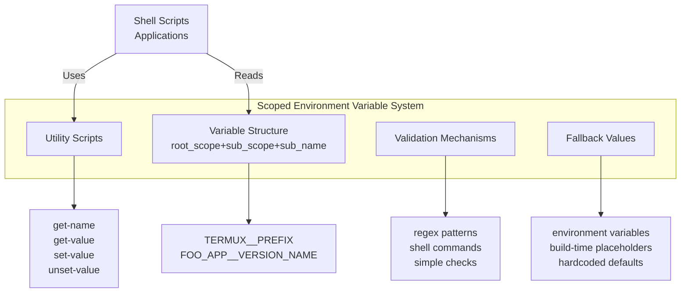
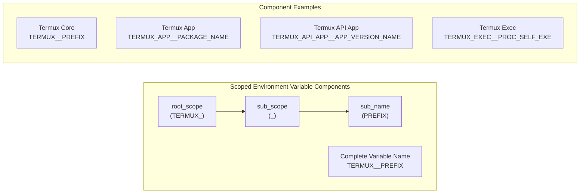
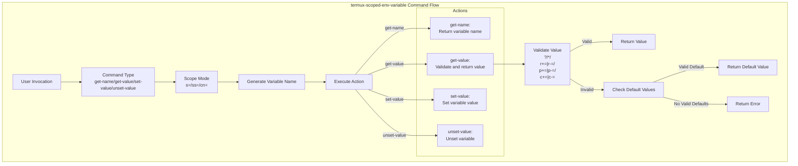
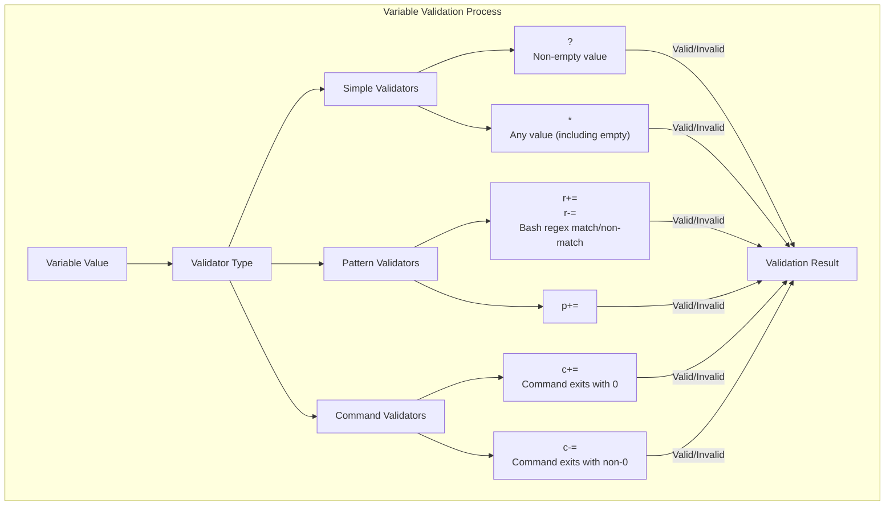
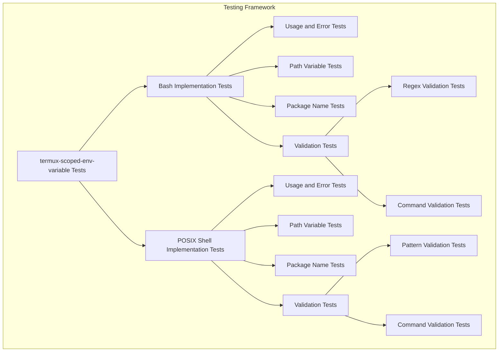

<!-- source: DeepWiki mcp.deepwiki.com · repo termux/termux-core-package · page 4.1 Scoped Environment Variables · fetched 2026-10-26 -->

# Scoped Environment Variables

<details>
<summary>Relevant source files</summary>

The following files were used as context for generating this wiki page:

- [app/main/scripts/termux/shell/command/environment/termux-scoped-env-variable.bash.in](app/main/scripts/termux/shell/command/environment/termux-scoped-env-variable.bash.in)
- [app/main/scripts/termux/shell/command/environment/termux-scoped-env-variable.sh.in](app/main/scripts/termux/shell/command/environment/termux-scoped-env-variable.sh.in)
- [app/main/tests/scripts/termux/shell/command/environment/termux-scoped-env-variable_runtime-script-tests.in](app/main/tests/scripts/termux/shell/command/environment/termux-scoped-env-variable_runtime-script-tests.in)
- [site/pages/en/projects/docs/usage/utils/termux/shell/command/environment/termux-scoped-env-variable.md](site/pages/en/projects/docs/usage/utils/termux/shell/command/environment/termux-scoped-env-variable.md)

</details>


This document explains the Termux scoped environment variable system, which provides a standardized way to manage and access environment variables across different Termux components. It includes the structure, naming conventions, and utility scripts for working with scoped environment variables.

For information about App Info Environment Variables specifically, see [App Info Environment Variables](#4.2).

## Overview

Scoped environment variables in Termux follow a structured naming pattern to organize variables by component and function. They provide a fork-friendly approach to environment variables that works consistently across different Termux distributions and forks that may use different root scopes. 

The system includes utility scripts for getting, setting, validating, and unsetting these variables, along with fallback mechanisms for backward compatibility with older Termux versions.



Sources: [app/main/scripts/termux/shell/command/environment/termux-scoped-env-variable.bash.in:8-280](), [app/main/scripts/termux/shell/command/environment/termux-scoped-env-variable.sh.in:4-222](), [site/pages/en/projects/docs/usage/utils/termux/shell/command/environment/termux-scoped-env-variable.md:5-75]()

## Variable Structure

Scoped environment variables follow a consistent naming structure with three parts:



- **root_scope**: The top-level namespace, typically `TERMUX_`, controlled by `$TERMUX_ENV__S_ROOT`
- **sub_scope**: Component-specific namespace (e.g., `_` for core, `APP__` for the main app)
- **sub_name**: The actual variable name (e.g., `PREFIX`, `ROOTFS`, `PACKAGE_NAME`)

This structure enables multiple Termux components to avoid variable name conflicts while maintaining a consistent naming convention.

Sources: [site/pages/en/projects/docs/usage/utils/termux/shell/command/environment/termux-scoped-env-variable.md:66-97](), [app/main/scripts/termux/shell/command/environment/termux-scoped-env-variable.bash.in:304-341](), [app/main/scripts/termux/shell/command/environment/termux-scoped-env-variable.sh.in:104-142]()

## Utility Script

The `termux-scoped-env-variable` utility provides a standardized way to interact with scoped environment variables. It offers implementations for bash and POSIX shell environments.



The utility supports several key functions:

1. **get-name**: Returns the full variable name based on scope parameters
2. **get-value**: Retrieves the variable value with validation and fallbacks
3. **set-value**: Sets the variable to a specified value
4. **unset-value**: Unsets the variable

Sources: [app/main/scripts/termux/shell/command/environment/termux-scoped-env-variable.bash.in:10-222](), [app/main/scripts/termux/shell/command/environment/termux-scoped-env-variable.sh.in:10-222](), [site/pages/en/projects/docs/usage/utils/termux/shell/command/environment/termux-scoped-env-variable.md:120-202]()

## Scope Modes

When using the utility scripts, there are three ways to specify the scope:

1. **s=\<scoped_var_scope_name>**: Direct specification of the full scope (root+sub)
   ```
   s="TERMUX__" "PREFIX"  # Generates TERMUX__PREFIX
   ```

2. **ss=\<scoped_var_sub_scope_name>**: Specify only the sub-scope, root is determined dynamically
   ```
   ss="_" "PREFIX"  # Generates (root)_PREFIX (e.g., TERMUX__PREFIX or FOO__PREFIX)
   ```

3. **cn=\<scoped_var_component_name>**: Use a predefined component name
   ```
   cn="termux-app" "PACKAGE_NAME"  # Generates TERMUX_APP__PACKAGE_NAME
   ```

The component name mode (`cn=`) supports various Termux components:

| Component Name | Translates to Sub-scope | Example Variable |
|----------------|-------------------------|-----------------------|
| termux         | `_`                    | TERMUX__PREFIX |
| termux-app     | `APP__`                | TERMUX_APP__PACKAGE_NAME |
| termux-api-app | `API_APP__`            | TERMUX_API_APP__APP_VERSION_NAME |
| termux-exec    | `EXEC__`               | TERMUX_EXEC__PROC_SELF_EXE |

Sources: [app/main/scripts/termux/shell/command/environment/termux-scoped-env-variable.bash.in:304-341](), [app/main/scripts/termux/shell/command/environment/termux-scoped-env-variable.sh.in:104-142](), [site/pages/en/projects/docs/usage/utils/termux/shell/command/environment/termux-scoped-env-variable.md:303-336]()

## Validation Mechanisms

The utility provides several validation methods to ensure variable values meet expected formats:



### Simple Validators

- **?**: Value must be set and non-empty
- **\***: Value must be set (can be empty)

### Pattern Validators

#### In bash implementation:
- **r+=\<regex>**: Value must match the POSIX extended regex
- **r-=\<regex>**: Value must NOT match the POSIX extended regex

#### In sh implementation:
- **p+=\<pattern>**: Value must match the shell pattern
- **p-=\<pattern>**: Value must NOT match the shell pattern

### Command Validators

- **c+=\<command>**: Command must exit with 0 when passed the value
- **c-=\<command>**: Command must NOT exit with 0 when passed the value

Sources: [app/main/scripts/termux/shell/command/environment/termux-scoped-env-variable.bash.in:345-405](), [app/main/scripts/termux/shell/command/environment/termux-scoped-env-variable.sh.in:146-216](), [site/pages/en/projects/docs/usage/utils/termux/shell/command/environment/termux-scoped-env-variable.md:345-406](), [site/pages/en/projects/docs/usage/utils/termux/shell/command/environment/termux-scoped-env-variable.md:713-781]()

## Usage Examples

### Basic Examples

#### Retrieving PATH Variables

```bash
# Get TERMUX__PREFIX with fallback to hardcoded path
termux-scoped-env-variable get-value '>' cn="termux" "PREFIX" \
  r+='^(/[^/]+)+$' "@TERMUX__PREFIX@" "/data/data/com.termux/files/usr"

# Get TERMUX__HOME with fallback
termux-scoped-env-variable get-value '>' cn="termux" "HOME" \
  r+='^(/[^/]+)+$' "@TERMUX__HOME@" "/data/data/com.termux/files/home"
```

#### Retrieving App-Specific Variables

```bash
# Get TERMUX_APP__PACKAGE_NAME
termux-scoped-env-variable get-value '>' cn="termux-app" "PACKAGE_NAME" \
  r+="^[a-zA-Z][a-zA-Z0-9_]*(\.[a-zA-Z][a-zA-Z0-9_]*)+$" \
  "@TERMUX_APP__PACKAGE_NAME@" "com.termux"
```

### Advanced Usage

#### For Bash Scripts (Sourced)

```bash
# Source the bash implementation
source_file_from_path() {
  local source_file="${1:-}"
  [ $# -gt 0 ] && shift 1
  local source_path
  if source_path="$(command -v "$source_file")" && [ -n "$source_path" ]; then
    source "$source_path" || return $?
  else
    echo "Failed to find the '$source_file' file to source." 1>&2
    return 1
  fi
}

source_file_from_path "termux-scoped-env-variable.bash" || exit $?

# Now use the function directly with variable output
termux_core__bash__termux_scoped_env_variable get-value "TERMUX__PREFIX" \
  cn="termux" "PREFIX" r+='^(/[^/]+)+$' "@TERMUX__PREFIX@" \
  "/data/data/com.termux/files/usr"
```

#### Using Custom Validation Functions

```bash
# Define a validator function
is_valid_android_app_package_name() {
  [[ "${1:-}" =~ ^[a-zA-Z][a-zA-Z0-9_]*(\.[a-zA-Z][a-zA-Z0-9_]*)+$ ]] && 
  [ "${#1}" -le 255 ]
}

# Export function if executing (not needed if sourcing)
export -f is_valid_android_app_package_name

# Use with command validator
termux-scoped-env-variable get-value '>' cn="termux-app" "PACKAGE_NAME" \
  c+='is_valid_android_app_package_name' 
```

Sources: [site/pages/en/projects/docs/usage/utils/termux/shell/command/environment/termux-scoped-env-variable.md:139-202](), [site/pages/en/projects/docs/usage/utils/termux/shell/command/environment/termux-scoped-env-variable.md:433-520](), [site/pages/en/projects/docs/usage/utils/termux/shell/command/environment/termux-scoped-env-variable.md:793-876](), [app/main/tests/scripts/termux/shell/command/environment/termux-scoped-env-variable_runtime-script-tests.in:63-125]()

## Implementations

The scoped environment variable system has several implementations:

1. **Executable in PATH** (`termux-scoped-env-variable`):
   - A symlink to the bash implementation
   - Available for executing directly from scripts in any language

2. **Bash Implementation** (`termux-scoped-env-variable.bash`):
   - Full-featured implementation
   - Supports extended regex validation with `r+=` and `r-=`
   - Can be sourced or executed directly

3. **POSIX Shell Implementation** (`termux-scoped-env-variable.sh`):
   - Compatible with POSIX shell environments
   - Uses shell patterns for validation with `p+=` and `p-=`
   - Requires the `local` keyword support

4. **C/C++**:
   - No direct implementation provided
   - Can use the utility script or create a custom implementation
   - `libtermux-core_nos_c_tre` from the termux-core package can be used as reference

Sources: [site/pages/en/projects/docs/usage/utils/termux/shell/command/environment/termux-scoped-env-variable.md:107-119](), [site/pages/en/projects/docs/usage/utils/termux/shell/command/environment/termux-scoped-env-variable.md:170-216](), [site/pages/en/projects/docs/usage/utils/termux/shell/command/environment/termux-scoped-env-variable.md:539-588](), [site/pages/en/projects/docs/usage/utils/termux/shell/command/environment/termux-scoped-env-variable.md:907-917]()

## Rationale and Benefits

The scoped environment variable system was designed to address several key challenges:

1. **Fork-Friendliness**: Supporting Termux forks that use different root scopes (e.g., `TERMUX_` vs `FOO_`)
2. **Backward Compatibility**: Working with older Termux versions (pre-0.119.0) that don't export scoped variables
3. **Validation**: Ensuring environment variables meet expected formats and constraints
4. **Namespace Organization**: Preventing variable name conflicts between Termux components

By using this system, packages and scripts can work consistently across different Termux distributions and versions.

Sources: [site/pages/en/projects/docs/usage/utils/termux/shell/command/environment/termux-scoped-env-variable.md:23-57]()

## Common Termux Scoped Variables

| Variable | Component | Description | Example |
|----------|-----------|-------------|---------|
| TERMUX__ROOTFS | Termux Core | Path to the Termux root filesystem | /data/data/com.termux/files |
| TERMUX__HOME | Termux Core | Path to the Termux home directory | /data/data/com.termux/files/home |
| TERMUX__PREFIX | Termux Core | Path to the Termux prefix directory | /data/data/com.termux/files/usr |
| TERMUX__PACKAGE_NAME | Termux Core | Package name of the running app | com.termux |
| TERMUX__USER_ID | Termux Core | Android user ID | 0 |
| TERMUX_APP__PACKAGE_NAME | Termux App | Package name of the Termux app | com.termux |
| TERMUX_APP__APP_VERSION_NAME | Termux App | Version name of the Termux app | 0.119.0 |
| TERMUX_EXEC__PROC_SELF_EXE | Termux Exec | Path of the currently executing process | /data/data/com.termux/files/usr/bin/bash |

Sources: [site/pages/en/projects/docs/usage/utils/termux/shell/command/environment/termux-scoped-env-variable.md:78-84](), [app/main/tests/scripts/termux/shell/command/environment/termux-scoped-env-variable_runtime-script-tests.in:54-168]()

## Testing Framework

The scoped environment variable utility is thoroughly tested through a test suite that validates various functionality:



The tests cover:
- Basic usage and error handling
- Retrieving and validating path variables
- Package name validation
- Different validation mechanisms
- Different scope modes

The test suite helps ensure consistent behavior across implementations and environments.

Sources: [app/main/tests/scripts/termux/shell/command/environment/termux-scoped-env-variable_runtime-script-tests.in:1-1177]()

---

