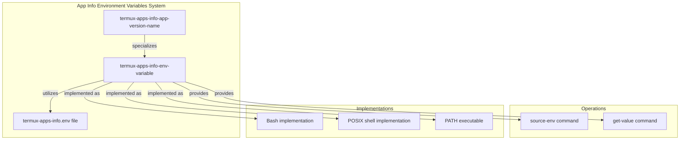
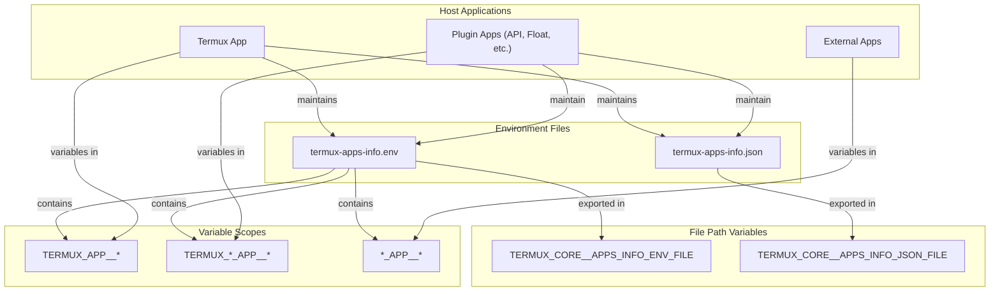
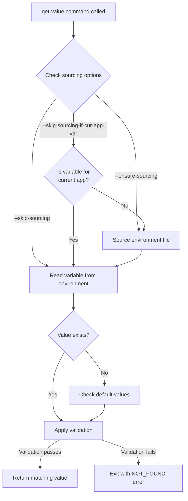
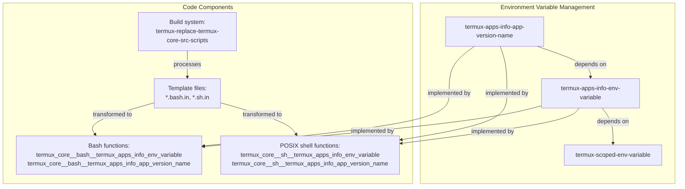
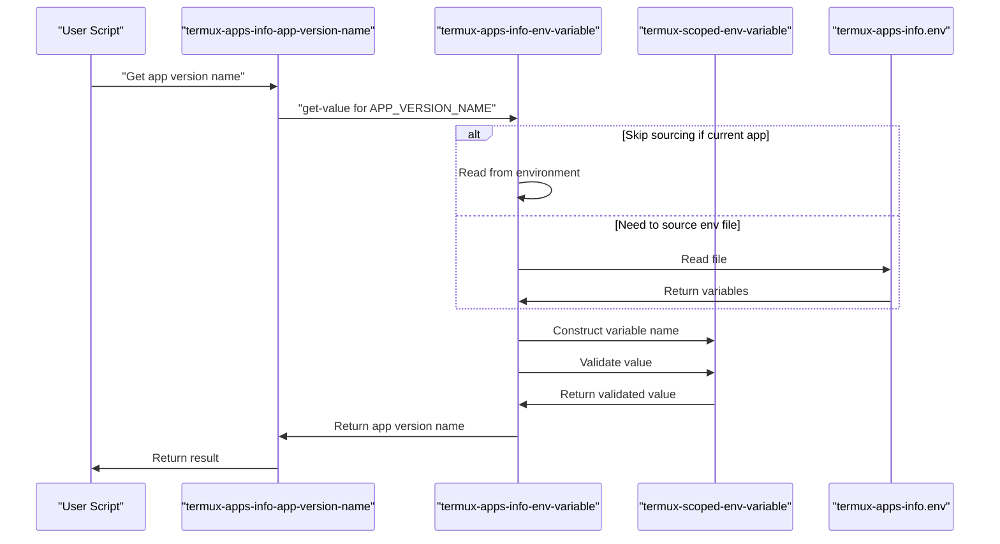

<!-- source: DeepWiki mcp.deepwiki.com · repo termux/termux-core-package · page 4.2 App Info Environment Variables · fetched 2026-10-26 -->

# App Info Environment Variables

<details>
<summary>Relevant source files</summary>

The following files were used as context for generating this wiki page:

- [app/main/scripts/termux/shell/command/environment/termux-apps-info-env-variable.bash.in](app/main/scripts/termux/shell/command/environment/termux-apps-info-env-variable.bash.in)
- [app/main/scripts/termux/shell/command/environment/termux-apps-info-env-variable.sh.in](app/main/scripts/termux/shell/command/environment/termux-apps-info-env-variable.sh.in)
- [app/main/tests/scripts/termux/shell/command/environment/termux-apps-info-app-version-name_runtime-script-tests.in](app/main/tests/scripts/termux/shell/command/environment/termux-apps-info-app-version-name_runtime-script-tests.in)
- [site/pages/en/projects/docs/usage/utils/termux/shell/command/environment/termux-apps-info-env-variable.md](site/pages/en/projects/docs/usage/utils/termux/shell/command/environment/termux-apps-info-env-variable.md)

</details>


This page documents the App Info Environment Variables utilities within the termux-core-package, which provide mechanisms for accessing and manipulating environment variables related to Termux and other applications. These utilities are particularly useful for retrieving current state information about installed apps, such as installation status, version numbers, and file paths.

For information about general environment variable scoping, see [Scoped Environment Variables](#4.1).

## Overview and Purpose

The App Info Environment Variables utilities solve a critical problem in the Termux environment: how to access up-to-date information about apps when environment variables are typically only set at shell creation time. 



Sources: [app/main/scripts/termux/shell/command/environment/termux-apps-info-env-variable.bash.in:1-161](), [app/main/scripts/termux/shell/command/environment/termux-apps-info-env-variable.sh.in:1-190](), [site/pages/en/projects/docs/usage/utils/termux/shell/command/environment/termux-apps-info-env-variable.md:1-543]()

### Key Problems Solved

1. **State Staleness**: When environment variables are set only at shell creation, they don't reflect changes in app state (installations, updates, or uninstallations).

2. **Latency Requirements**: Accessing current app information needs to be fast, especially for time-sensitive programs.

3. **Shell and Binary Compatibility**: The mechanism must be usable from various shell environments (bash, POSIX sh) and other programs.

4. **Environment Clutter**: Exporting all app variables for every shell would clutter the environment and increase memory usage.

## Architecture and Design

The system uses an environment file-based approach. Each Termux app (version ≥ 0.119.0) creates and updates two files at startup:

1. `termux-apps-info.env` - Contains shell-compatible variable definitions
2. `termux-apps-info.json` - Contains the same information in JSON format

These files are updated whenever relevant apps are installed, updated, or uninstalled.



Sources: [site/pages/en/projects/docs/usage/utils/termux/shell/command/environment/termux-apps-info-env-variable.md:24-52]()

### Variable Naming Conventions

The App Info Environment Variables follow a structured naming convention:

| Variable Pattern | Description | Example |
|------------------|-------------|---------|
| `TERMUX_APP__*` | Variables for the main Termux app | `TERMUX_APP__DATA_DIR` |
| `TERMUX_*_APP__*` | Variables for official Termux plugin apps | `TERMUX_API_APP__APP_VERSION_NAME` |
| `*_APP__*` | Variables for external apps | `FOO_APP__UID` |

The variables are scoped and can have different root scopes based on the `$TERMUX_ENV__S_ROOT` variable, which allows multiple environments to coexist.

Sources: [site/pages/en/projects/docs/usage/utils/termux/shell/command/environment/termux-apps-info-env-variable.md:24-52](), [app/main/tests/scripts/termux/shell/command/environment/termux-apps-info-app-version-name_runtime-script-tests.in:50-88]()

## Core Commands

The `termux-apps-info-env-variable` utility provides two main commands:

### source-env Command

This command sources the `termux-apps-info.env` file into the current environment. 

```
termux-apps-info-env-variable.bash source-env
```

If the file doesn't exist, the command returns with exit code 69 (`EX__UNAVAILABLE`).

Sources: [site/pages/en/projects/docs/usage/utils/termux/shell/command/environment/termux-apps-info-env-variable.md:160-165](), [app/main/scripts/termux/shell/command/environment/termux-apps-info-env-variable.bash.in:60-64](), [app/main/scripts/termux/shell/command/environment/termux-apps-info-env-variable.sh.in:58-60]()

### get-value Command

This command retrieves the value of a specified variable after optionally sourcing the environment file.

```
termux-apps-info-env-variable.bash get-value [<command_options>] \
  <output_mode> \
  <scoped_var_scope_mode> <scoped_var_sub_name> \
  <extended_validator> [<default_values...>]
```

The command options determine the sourcing behavior:

| Option | Description |
|--------|-------------|
| `--ensure-sourcing` | Always source the environment file first |
| `--skip-sourcing` | Don't source the environment file |
| `--skip-sourcing-if-cur-app-var` | Skip sourcing if the variable is for the current app |

Sources: [site/pages/en/projects/docs/usage/utils/termux/shell/command/environment/termux-apps-info-env-variable.md:167-215](), [app/main/scripts/termux/shell/command/environment/termux-apps-info-env-variable.bash.in:65-75](), [app/main/scripts/termux/shell/command/environment/termux-apps-info-env-variable.sh.in:61-71]()



Sources: [site/pages/en/projects/docs/usage/utils/termux/shell/command/environment/termux-apps-info-env-variable.md:36-52](), [app/main/scripts/termux/shell/command/environment/termux-apps-info-env-variable.bash.in:65-75](), [app/main/scripts/termux/shell/command/environment/termux-apps-info-env-variable.sh.in:61-71]()

## Implementations

The App Info Environment Variables system has three implementations:

### Executable in $PATH

A symlink to the bash implementation, available as `termux-apps-info-env-variable` in the default PATH.

```
termux-apps-info-env-variable get-value '>' cn="termux-app" "DATA_DIR" r+="^(/[^/]+)+$"
```

Sources: [site/pages/en/projects/docs/usage/utils/termux/shell/command/environment/termux-apps-info-env-variable.md:72-94]()

### Bash Implementation

A bash script implementation (`termux-apps-info-env-variable.bash`) with extended validation features.

```
source termux-apps-info-env-variable.bash
termux_core__bash__termux_apps_info_env_variable get-value TERMUX_APP__DATA_DIR cn="termux-app" "DATA_DIR" r+="^(/[^/]+)+$" 
```

Sources: [site/pages/en/projects/docs/usage/utils/termux/shell/command/environment/termux-apps-info-env-variable.md:102-310](), [app/main/scripts/termux/shell/command/environment/termux-apps-info-env-variable.bash.in:11-99]()

### POSIX Shell Implementation

A POSIX shell compatible implementation (`termux-apps-info-env-variable.sh`) with POSIX-compatible validation.

```
. termux-apps-info-env-variable.sh --sourcing-script
termux_core__sh__termux_apps_info_env_variable get-value TERMUX_APP__DATA_DIR cn="termux-app" "DATA_DIR" p+="/*[!/]"
```

Sources: [site/pages/en/projects/docs/usage/utils/termux/shell/command/environment/termux-apps-info-env-variable.md:316-522](), [app/main/scripts/termux/shell/command/environment/termux-apps-info-env-variable.sh.in:8-97]()

## Integration with Termux-Core-Package

The App Info Environment Variables system is part of the larger environment variable management system in the termux-core-package:



Sources: [site/pages/en/projects/docs/usage/utils/termux/shell/command/environment/termux-apps-info-env-variable.md:536-542]()

## Common Use Cases

### Retrieving App Data Directory

Getting the data directory path for the Termux app:

```shell
# Using bash implementation after sourcing
termux_core__bash__termux_apps_info_env_variable get-value TERMUX_APP__DATA_DIR cn="termux-app" "DATA_DIR" r+="^(/[^/]+)+$" 

# Using POSIX shell implementation after sourcing
termux_core__sh__termux_apps_info_env_variable get-value TERMUX_APP__DATA_DIR cn="termux-app" "DATA_DIR" p+="/*[!/]"

# Executing directly with output to stdout
termux-apps-info-env-variable get-value '>' cn="termux-app" "DATA_DIR" r+="^(/[^/]+)+$"
```

Sources: [site/pages/en/projects/docs/usage/utils/termux/shell/command/environment/termux-apps-info-env-variable.md:254-267](), [site/pages/en/projects/docs/usage/utils/termux/shell/command/environment/termux-apps-info-env-variable.md:468-481]()

### Retrieving App Version Information

Getting the target SDK version for the Termux app:

```shell
# Using bash implementation with custom validation
is_valid_target_sdk() { case "${1:-}" in ''|*[!0-9]*|0[0-9]*) return 1;; esac; [ "$1" -le 10000 ]; }

termux_core__bash__termux_apps_info_env_variable get-value TERMUX_APP__TARGET_SDK cn="termux-app" "TARGET_SDK" c+='is_valid_target_sdk'
```

Sources: [site/pages/en/projects/docs/usage/utils/termux/shell/command/environment/termux-apps-info-env-variable.md:272-280](), [site/pages/en/projects/docs/usage/utils/termux/shell/command/environment/termux-apps-info-env-variable.md:486-494](), [app/main/tests/scripts/termux/shell/command/environment/termux-apps-info-app-version-name_runtime-script-tests.in:50-88]()

### Multiple Variable Reading

Reading multiple variables efficiently by sourcing the environment file once:

```shell
# Unset variables to ensure fresh values
termux_core__bash__termux_scoped_env_variable unset-value cn="termux-app" "APK_FILE"
termux_core__bash__termux_scoped_env_variable unset-value cn="termux-app" "DATA_DIR"

# Source the environment file once
termux_core__bash__termux_apps_info_env_variable source-env

# Read multiple variables without sourcing again
termux_core__bash__termux_apps_info_env_variable get-value --skip-sourcing TERMUX_APP__APK_FILE cn="termux-app" "APK_FILE" r+="^(/[^/]+)+$"
termux_core__bash__termux_apps_info_env_variable get-value --skip-sourcing TERMUX_APP__DATA_DIR cn="termux-app" "DATA_DIR" r+="^(/[^/]+)+$"
```

Sources: [site/pages/en/projects/docs/usage/utils/termux/shell/command/environment/termux-apps-info-env-variable.md:285-296](), [site/pages/en/projects/docs/usage/utils/termux/shell/command/environment/termux-apps-info-env-variable.md:500-509]()

### Working with External Apps

The system also supports variables for external apps:

```shell
# Get the UID for an external "FOO" app
termux_core__bash__termux_apps_info_env_variable get-value FOO_APP__UID s="FOO_APP__" "UID" r+="^[0-9]+$"
```

Sources: [site/pages/en/projects/docs/usage/utils/termux/shell/command/environment/termux-apps-info-env-variable.md:301-308](), [site/pages/en/projects/docs/usage/utils/termux/shell/command/environment/termux-apps-info-env-variable.md:514-522]()

## Special Handling for termux-apps-info-app-version-name

The `termux-apps-info-app-version-name` utility is a specialized tool that focuses specifically on retrieving app version names. It's a simpler interface built on top of `termux-apps-info-env-variable` that specifically targets the `APP_VERSION_NAME` variable for various apps.



Sources: [app/main/tests/scripts/termux/shell/command/environment/termux-apps-info-app-version-name_runtime-script-tests.in:50-88](), [app/main/tests/scripts/termux/shell/command/environment/termux-apps-info-app-version-name_runtime-script-tests.in:227-264]()

## Error Handling and Exit Codes

The App Info Environment Variables utilities use consistent error codes:

| Exit Code | Symbolic Name | Description |
|-----------|---------------|-------------|
| 0 | EX__SUCCESS | Operation completed successfully |
| 64 | EX__USAGE | Invalid command usage |
| 69 | EX__UNAVAILABLE | Required resource unavailable (e.g., env file not found) |
| 81 | C_EX__NOT_FOUND | No valid value found for the requested variable |

Sources: [app/main/scripts/termux/shell/command/environment/termux-apps-info-env-variable.bash.in:60-75](), [app/main/scripts/termux/shell/command/environment/termux-apps-info-env-variable.sh.in:58-71]()

## Advanced Usage

### Variable Validation

Both bash and POSIX implementations support validation:

- Bash uses extended regex validation with patterns like `r+=^(/[^/]+)+$`
- POSIX shell uses POSIX pattern matching like `p+="/*[!/]"`
- Both support custom validation functions through `c+='function_name'`

Sources: [site/pages/en/projects/docs/usage/utils/termux/shell/command/environment/termux-apps-info-env-variable.md:272-280](), [site/pages/en/projects/docs/usage/utils/termux/shell/command/environment/termux-apps-info-env-variable.md:486-494]()

### Efficiency Considerations

For performance-critical applications:

1. Source the environment file once and then use `--skip-sourcing` for multiple variable reads
2. For the highest performance, import the functions directly into your script at build time
3. Use `--skip-sourcing-if-cur-app-var` to avoid unnecessary sourcing for current app variables

Sources: [site/pages/en/projects/docs/usage/utils/termux/shell/command/environment/termux-apps-info-env-variable.md:130-134](), [site/pages/en/projects/docs/usage/utils/termux/shell/command/environment/termux-apps-info-env-variable.md:343-347]()

---

