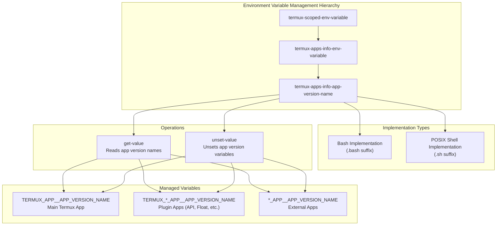
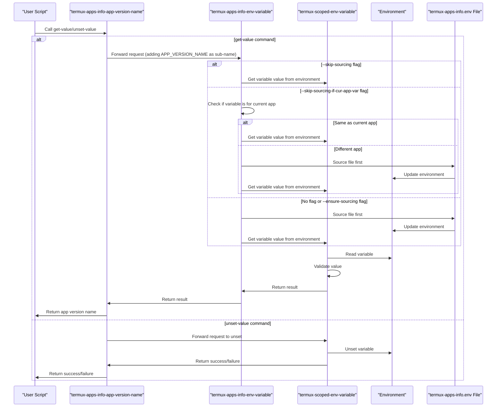
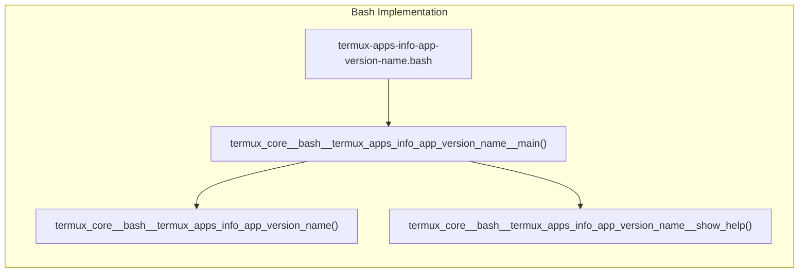
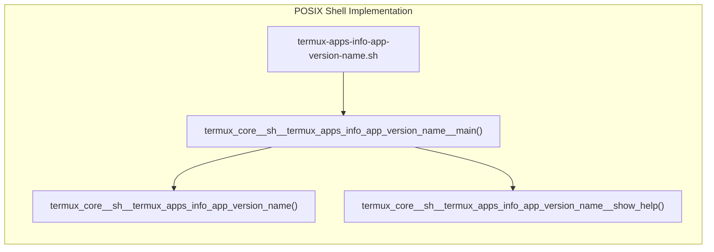

<!-- source: DeepWiki mcp.deepwiki.com · repo termux/termux-core-package · page 4.3 App Version Name Utility · fetched 2026-10-26 -->

# App Version Name Utility

<details>
<summary>Relevant source files</summary>

The following files were used as context for generating this wiki page:

- [app/main/scripts/termux/shell/command/environment/termux-apps-info-app-version-name.bash.in](app/main/scripts/termux/shell/command/environment/termux-apps-info-app-version-name.bash.in)
- [app/main/scripts/termux/shell/command/environment/termux-apps-info-app-version-name.sh.in](app/main/scripts/termux/shell/command/environment/termux-apps-info-app-version-name.sh.in)
- [app/main/tests/scripts/termux/shell/command/environment/termux-apps-info-app-version-name_runtime-script-tests.in](app/main/tests/scripts/termux/shell/command/environment/termux-apps-info-app-version-name_runtime-script-tests.in)
- [site/pages/en/projects/docs/usage/utils/termux/shell/command/environment/termux-apps-info-env-variable.md](site/pages/en/projects/docs/usage/utils/termux/shell/command/environment/termux-apps-info-env-variable.md)

</details>


## Overview

The App Version Name Utility is a specialized environment variable management tool that provides access to application version information for Termux and related applications. It enables scripts and programs to retrieve and manage the app version name environment variables (`*_APP__APP_VERSION_NAME`) for Termux app (`TERMUX_APP__`), its plugin apps (`TERMUX_*_APP__`), and external apps (`*_APP__`). The utility supports validation of version values and works in conjunction with the broader Termux environment variable management system.

For information about general app info environment variables, see [App Info Environment Variables](#4.2).

Sources: [app/main/scripts/termux/shell/command/environment/termux-apps-info-app-version-name.bash.in:12-87](), [app/main/scripts/termux/shell/command/environment/termux-apps-info-app-version-name.sh.in:10-98]()

## Architecture

The App Version Name Utility is part of a three-tier environment variable management hierarchy in the Termux Core Package. It specifically focuses on application version information, building upon more general-purpose environment variable utilities.

### System Position Diagram



Sources: [app/main/scripts/termux/shell/command/environment/termux-apps-info-app-version-name.bash.in:14-19](), [app/main/scripts/termux/shell/command/environment/termux-apps-info-app-version-name.sh.in:11-16]()

### Operational Flow



Sources: [app/main/scripts/termux/shell/command/environment/termux-apps-info-app-version-name.bash.in:59-76](), [app/main/scripts/termux/shell/command/environment/termux-apps-info-app-version-name.sh.in:56-73]()

## Commands and Operations

The App Version Name Utility provides two primary commands:

| Command | Description | Available When Executing | Available When Sourcing |
|---------|-------------|--------------------------|-------------------------|
| `get-value` | Retrieves the app version name from the specified variable | Yes | Yes |
| `unset-value` | Unsets the app version name variable | No | Yes |

### get-value Command

The `get-value` command retrieves the application version name for a specific app. It automatically validates that the retrieved value is a valid version name (by default, this means the value must start with a number).

Key options for `get-value`:
- `--skip-sourcing`: Skip sourcing the `termux-apps-info.env` file before reading
- `--skip-sourcing-if-cur-app-var`: Skip sourcing if variable is for current app (default)
- `--extended-validator` (bash) / `--posix-validator` (sh): Custom validators for version format

Sources: [app/main/scripts/termux/shell/command/environment/termux-apps-info-app-version-name.bash.in:34-50](), [app/main/scripts/termux/shell/command/environment/termux-apps-info-app-version-name.sh.in:31-47]()

### unset-value Command

The `unset-value` command unsets the app version name variable. This command is only available when the script is sourced, not when executed directly, since unsetting a variable in a child process would not affect the parent environment.

Sources: [app/main/scripts/termux/shell/command/environment/termux-apps-info-app-version-name.bash.in:53-55](), [app/main/scripts/termux/shell/command/environment/termux-apps-info-app-version-name.sh.in:50-52]()

## Implementations

The App Version Name Utility is provided in two different shell script implementations to accommodate various usage scenarios:

### Bash Implementation

The Bash implementation (`termux-apps-info-app-version-name.bash`) provides enhanced functionality, including extended validators using regular expressions. This implementation is suitable for scripts running in Bash environments.



The Bash implementation uses regular expressions (`r+=`) with the `--extended-validator` option for validating version names.

Sources: [app/main/scripts/termux/shell/command/environment/termux-apps-info-app-version-name.bash.in:1-165]()

### POSIX Shell Implementation

The POSIX shell implementation (`termux-apps-info-app-version-name.sh`) provides compatibility with a broader range of shell environments. It uses POSIX-compatible pattern matching for validation instead of regular expressions.



The POSIX implementation uses pattern matching (`p+=`) with the `--posix-validator` option for validating version names.

Sources: [app/main/scripts/termux/shell/command/environment/termux-apps-info-app-version-name.sh.in:1-192]()

## Special Features

### Version Name Validation

By default, app version names are validated to ensure they start with a number, which is the typical format for semantic versioning (e.g., "0.1.0"). The utility provides options for custom validation:

- In Bash: Use `--extended-validator="r+=REGEX"` to provide a custom regex pattern
- In POSIX shell: Use `--posix-validator="p+=PATTERN"` for POSIX pattern matching

For example, to allow version names starting with "termux-" followed by a number:
- Bash: `--extended-validator="r+=^(()|(termux-[0-9].*))$"`
- POSIX: `--posix-validator="p+=''|termux-[0-9]*"`

Sources: [app/main/scripts/termux/shell/command/environment/termux-apps-info-app-version-name.bash.in:45-49](), [app/main/scripts/termux/shell/command/environment/termux-apps-info-app-version-name.sh.in:42-46](), [app/main/tests/scripts/termux/shell/command/environment/termux-apps-info-app-version-name_runtime-script-tests.in:227-264]()

### TERMUX_VERSION Fallback

For the main Termux app, the utility will automatically check for the `TERMUX_VERSION` environment variable as a fallback when the regular environment variable is not set or empty. This maintains compatibility with older Termux versions that use this variable format.

Sources: [app/main/tests/scripts/termux/shell/command/environment/termux-apps-info-app-version-name_runtime-script-tests.in:655-672]()

## Usage Examples

### Getting Termux App Version Name

```shell
# Execute the script (output to stdout)
version=$(termux-apps-info-app-version-name.bash get-value '>' cn="termux-app")
echo "Termux app version: $version"

# Source the script and save to variable
source $(command -v termux-apps-info-app-version-name.bash)
termux_core__bash__termux_apps_info_app_version_name get-value VERSION_VAR cn="termux-app"
echo "Termux app version: $VERSION_VAR"
```

### Getting Plugin App Version with Custom Validation

```shell
# Get Termux:API version, allowing "termux-" prefix
version=$(termux-apps-info-app-version-name.bash get-value \
  --extended-validator="r+=^(()|(termux-[0-9].*))$" '>' cn="termux-api-app")
echo "Termux:API version: $version"
```

### Working with Multiple Version Checks

```shell
# Source once and check multiple apps efficiently
source $(command -v termux-apps-info-app-version-name.bash)

# Unset previous variables first
termux_core__bash__termux_scoped_env_variable unset-value cn="termux-app" "APP_VERSION_NAME"
termux_core__bash__termux_scoped_env_variable unset-value cn="termux-api-app" "APP_VERSION_NAME"

# Source environment once
source $(command -v termux-apps-info-env-variable.bash)
termux_core__bash__termux_apps_info_env_variable source-env

# Get values without re-sourcing
termux_core__bash__termux_apps_info_app_version_name get-value --skip-sourcing TERMUX_VERSION cn="termux-app"
termux_core__bash__termux_apps_info_app_version_name get-value --skip-sourcing API_VERSION cn="termux-api-app"

echo "Termux: $TERMUX_VERSION, API: $API_VERSION"
```

Sources: [app/main/scripts/termux/shell/command/environment/termux-apps-info-app-version-name.bash.in:139-156](), [app/main/scripts/termux/shell/command/environment/termux-apps-info-app-version-name.sh.in:139-161]()

## Error Handling

The App Version Name Utility uses standard exit codes to indicate success or failure:

| Exit Code | Meaning | Description |
|-----------|---------|-------------|
| 0 | Success | Operation completed successfully |
| 64 | Usage Error | Incorrect usage of commands or arguments |
| 69 | Unavailable | Required resource (like env file) is unavailable |
| 80 | Unsupported | Operation not supported (e.g., unset-value when executed) |
| 81 | Not Found | No valid app version name was found |

When executing the script, if usage errors occur, help text is automatically displayed.

Sources: [app/main/scripts/termux/shell/command/environment/termux-apps-info-app-version-name.bash.in:120-131](), [app/main/scripts/termux/shell/command/environment/termux-apps-info-app-version-name.sh.in:117-128]()

## Integration with Other Utilities

The App Version Name Utility is built on top of and works closely with other utilities in the Termux environment variable management system:

1. **termux-scoped-env-variable**: Provides the foundation for managing scoped environment variables with validation
2. **termux-apps-info-env-variable**: Handles sourcing the `termux-apps-info.env` file and accessing app information

The app version name utility adds app version-specific validation and special handling on top of these base utilities.

For more detailed information about these related utilities, see:
- [Scoped Environment Variables](#4.1)
- [App Info Environment Variables](#4.2)

Sources: [app/main/scripts/termux/shell/command/environment/termux-apps-info-app-version-name.bash.in:84-103](), [app/main/scripts/termux/shell/command/environment/termux-apps-info-app-version-name.sh.in:85-98]()

---

