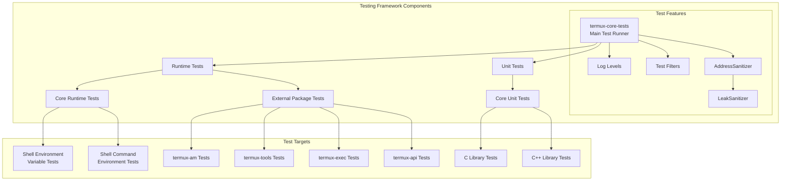
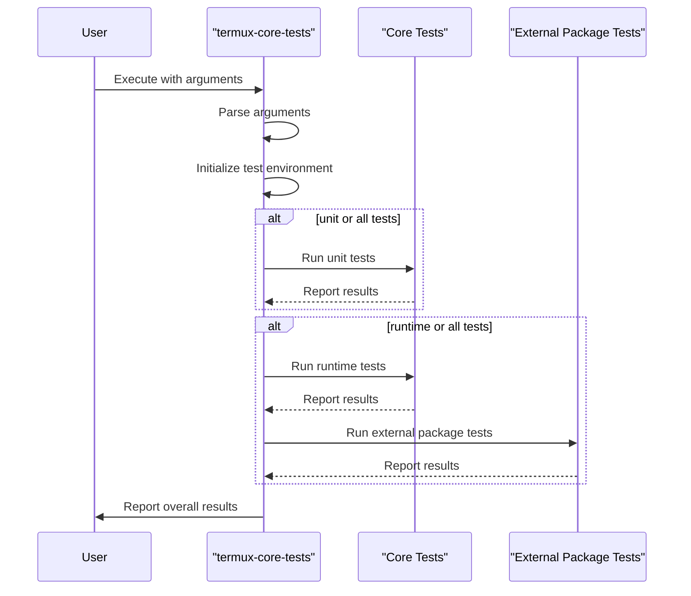
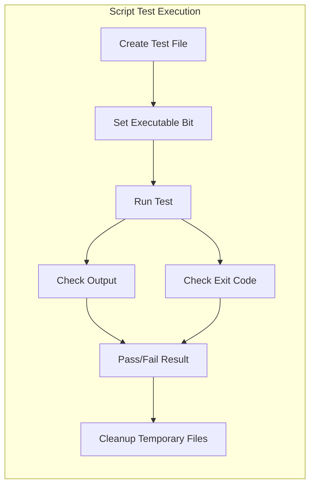
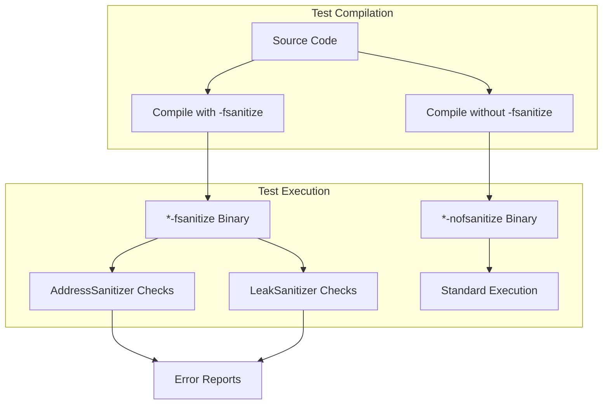
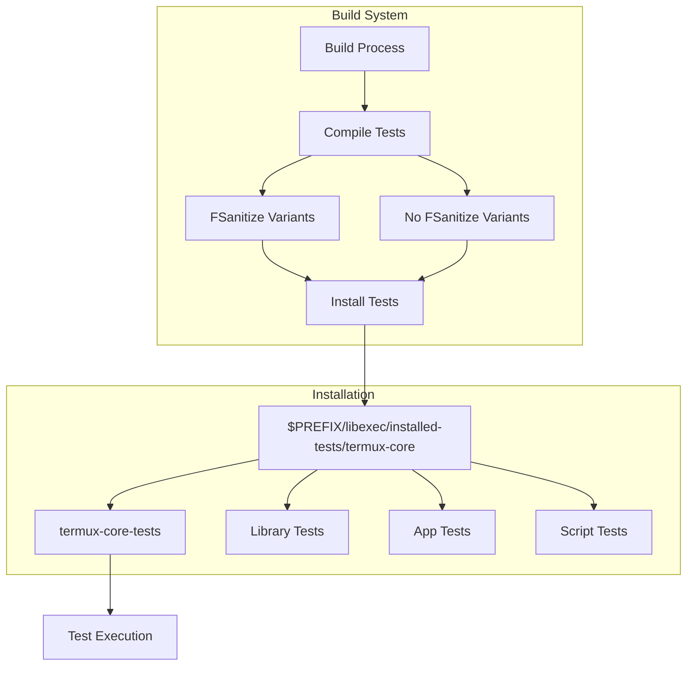

<!-- source: DeepWiki mcp.deepwiki.com · repo termux/termux-core-package · page 5 Testing Framework · fetched 2026-10-26 -->

# Testing Framework

<details>
<summary>Relevant source files</summary>

The following files were used as context for generating this wiki page:

- [app/main/tests/scripts/termux-core-main-app_runtime-script-tests.in](app/main/tests/scripts/termux-core-main-app_runtime-script-tests.in)
- [app/main/tests/termux-core-tests.in](app/main/tests/termux-core-tests.in)
- [app/main/tests/termux-external-packages_tests.in](app/main/tests/termux-external-packages_tests.in)
- [site/pages/en/projects/docs/developer/test/index.md](site/pages/en/projects/docs/developer/test/index.md)

</details>


The Testing Framework in termux-core-package provides comprehensive infrastructure for validating package functionality through automated testing. It supports both unit tests for individual components and runtime tests for on-device execution verification. This page documents the architecture, components, and usage of the testing framework.

## Architecture Overview

The testing framework is structured to support multiple test types, test packages, and various test features such as sanitizers and logging levels. It serves as a critical component in ensuring the reliability of both core libraries and utilities.

### Testing Framework Architecture Diagram



Sources: [app/main/tests/termux-core-tests.in:1-1019](), [app/main/tests/termux-external-packages_tests.in:1-462]()

## Test Categories

The testing framework provides two primary categories of tests, each serving a distinct purpose in ensuring code quality.

| Test Type | Purpose | Example Tests |
|-----------|---------|---------------|
| Unit Tests | Validate specific components in isolation | C Library functions, C++ wrappers |
| Runtime Tests | Validate on-device execution in real environment | Shell scripts, environment variables, installed utilities |

Sources: [app/main/tests/termux-core-tests.in:124-146](), [site/pages/en/projects/docs/developer/test/index.md:15-18]()

## Main Test Runner

The `termux-core-tests` script serves as the entry point to the testing framework. It handles:

1. Command-line argument processing
2. Test environment setup
3. Test filtering and selection
4. Running the appropriate test suites
5. Reporting test results

The test runner follows a modular design, loading and executing different test modules based on the user's configuration.

### Command Flow Diagram



Sources: [app/main/tests/termux-core-tests.in:118-236]()

## Test Utilities

The testing framework provides several utility functions to assist in test creation and execution.

### Script Test Execution

The framework includes a powerful utility called `termux_core__tests__run_script_test` that allows for testing shell scripts. This function:

1. Creates a temporary script file with specified content
2. Executes the script with given arguments
3. Verifies the exit code and output match expected values
4. Cleans up the temporary files

This enables testing of shell scripts, commands, and command-line utilities in a controlled environment.



Sources: [app/main/tests/termux-core-tests.in:342-517]()

## Test Filtering and Organization

The testing framework provides flexible filtering capabilities to allow developers to focus on specific tests. These filtering mechanisms include:

1. **Test Names Filter**: Allows running tests that match a specific regex pattern
2. **Test Packages Filter**: Enables filtering which package tests should be run

Tests are organized hierarchically:
- By package (termux-core, external packages)
- By test type (unit, runtime)
- By component (C library, shell environment, etc.)

This organization allows for granular control over which tests are executed, making it easier to focus on specific components during development.

Sources: [app/main/tests/termux-core-tests.in:27-29](), [app/main/tests/termux-core-tests.in:887-911]()

## External Package Testing

The testing framework extends beyond the core package to test integration with external Termux packages. This ensures compatibility and proper functioning of the entire Termux ecosystem.

### External Package Tests Table

| Package | Tests |
|---------|-------|
| android-tools | getprop, pm, logcat |
| termux-tools | getprop, pm, logcat, termux-info |
| termux-am | broadcast, start activity, start service |
| termux-am-socket | broadcast, start activity, start service |
| termux-api | battery status, USB, clipboard |
| termux-exec | Based on installed tests |
| tudo | Based on installed tests |
| sudo | Based on installed tests |

Sources: [app/main/tests/termux-external-packages_tests.in:38-461]()

## Sanitizers and Debug Features

The testing framework includes support for memory sanitizers to help detect memory-related issues:

1. **AddressSanitizer**: Detects memory errors like buffer overflows and use-after-free
2. **LeakSanitizer**: Detects memory leaks

The framework maintains two versions of test binaries:
- One compiled with sanitizers enabled (`-fsanitize` in filename)
- One compiled without sanitizers (`-nofsanitize` in filename)

This dual approach ensures tests can run on all Android versions and architectures, even when sanitizers may not be fully supported on some platforms.



Sources: [app/main/tests/termux-core-tests.in:23-26](), [site/pages/en/projects/docs/developer/test/index.md:21-29]()

## Logging System

The testing framework implements a flexible logging system with multiple verbosity levels to assist in debugging and test development.

| Log Level | Purpose |
|-----------|---------|
| 0 (OFF) | No output except errors |
| 1 (NORMAL) | Basic test information (default) |
| 2 (DEBUG) | Detailed test execution information |
| 3 (VERBOSE) | Detailed test setup and execution |
| 4 (VVERBOSE) | Very detailed debugging information |
| 5 (VVVERBOSE) | Maximum detail including test internals |

The log level can be set using command-line options (`-q` for quiet, `-v` through `-vvvvv` for increasing verbosity).

Sources: [app/main/tests/termux-core-tests.in:13-15](), [app/main/tests/termux-core-tests.in:110-112]()

## Usage

To use the testing framework, execute the `termux-core-tests` script with the appropriate command and options:

```
termux-core-tests [command_options] <command>
```

### Available Commands

- `unit`: Run unit tests only
- `runtime`: Run runtime tests only
- `all`: Run all tests

### Common Options

- `-h, --help`: Display help information
- `-q, --quiet`: Set log level to OFF
- `-v, -vv, -vvv, -vvvv, -vvvvv`: Increase verbosity level
- `-f`: Use binaries with AddressSanitizer enabled
- `-l`: Enable LeakSanitizer (requires `-f`)
- `--only-termux-core-tests`: Only run termux-core package tests
- `--test-names-filter=<regex>`: Filter tests by name
- `--test-packages-filter=<regex>`: Filter tests by package
- `--no-clean`: Do not clean temporary test files on failure

Sources: [app/main/tests/termux-core-tests.in:968-1005](), [site/pages/en/projects/docs/developer/test/index.md:51-89]()

## Integration with Build System

The testing framework is integrated with the termux-core-package build system, which ensures that tests are properly compiled, packaged, and installed. The tests are installed in the `$TERMUX__PREFIX/libexec/installed-tests/termux-core` directory, allowing them to be run after installation.



Sources: [app/main/tests/termux-core-tests.in:87-91](), [site/pages/en/projects/docs/developer/test/index.md:15-16]()

---

