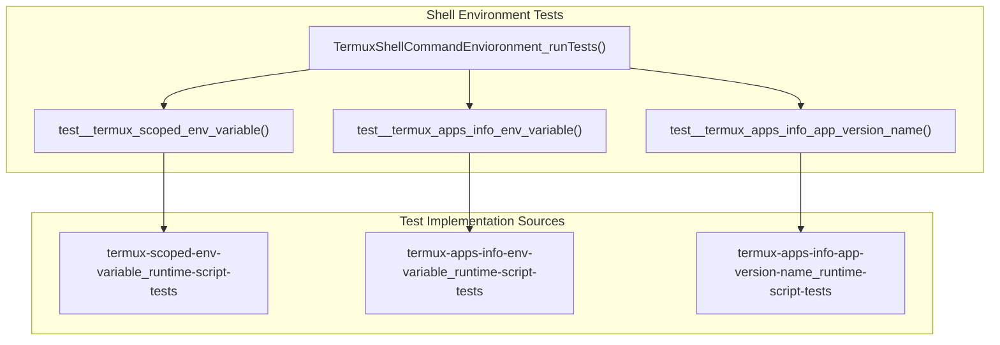
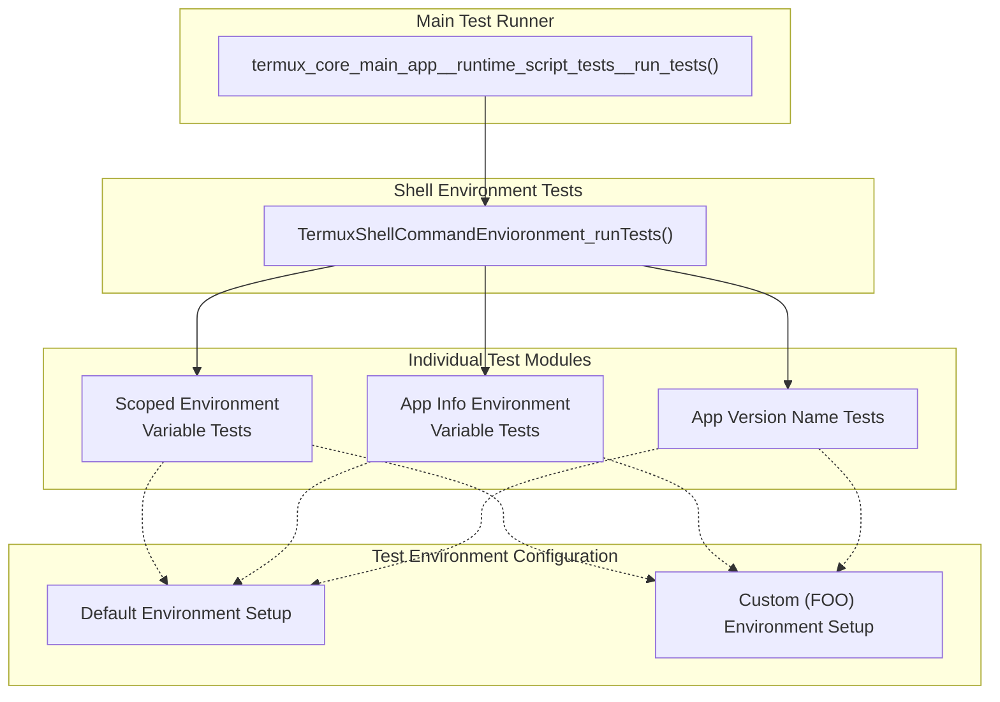
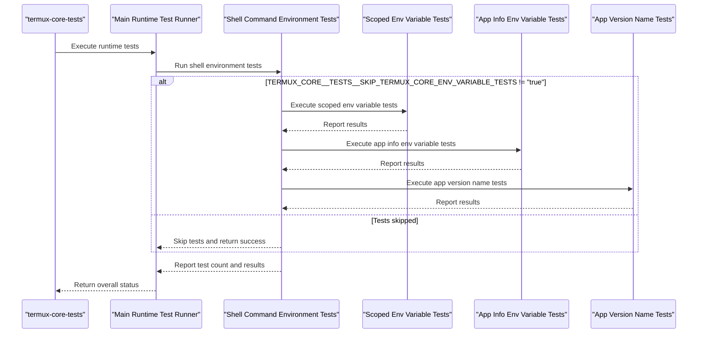

<!-- source: DeepWiki mcp.deepwiki.com · repo termux/termux-core-package · page 5.1 Shell Environment Tests · fetched 2026-10-26 -->

# Shell Environment Tests

<details>
<summary>Relevant source files</summary>

The following files were used as context for generating this wiki page:

- [app/main/tests/scripts/termux-core-main-app_runtime-script-tests.in](app/main/tests/scripts/termux-core-main-app_runtime-script-tests.in)
- [app/main/tests/scripts/termux/shell/command/environment/termux-shell-command-environment_runtime-script-tests.in](app/main/tests/scripts/termux/shell/command/environment/termux-shell-command-environment_runtime-script-tests.in)
- [site/pages/en/projects/docs/developer/test/index.md](site/pages/en/projects/docs/developer/test/index.md)

</details>


## Purpose and Scope

This document covers the shell environment testing functionality within the Termux Core Package testing framework. These tests verify the correct behavior of shell command environments and related utilities that manipulate environment variables in the Termux ecosystem.

Shell Environment Tests focus specifically on validating three core environment utilities:
- Scoped Environment Variables
- App Info Environment Variables
- App Version Name Utilities

For information about the overall testing framework architecture, see [Testing Framework](#5). For details on the specific environment variable utilities being tested, see [Environment Variable Utilities](#4).

## Overview of Shell Environment Tests

The Shell Environment Tests are a critical component of the Termux Core testing framework, validating the proper operation of environment-related utilities that enable Termux applications to share information through standardized environment variables.



Sources: [app/main/tests/scripts/termux/shell/command/environment/termux-shell-command-environment_runtime-script-tests.in:7-28](), [app/main/tests/scripts/termux/shell/command/environment/termux-shell-command-environment_runtime-script-tests.in:37-80]()

## Test Structure and Organization

The Shell Environment Tests are integrated into the main testing framework and can be run as part of the runtime tests suite. The tests follow a hierarchical structure where the main test runner invokes specialized test functions for each utility.



Sources: [app/main/tests/scripts/termux-core-main-app_runtime-script-tests.in:24-45](), [app/main/tests/scripts/termux/shell/command/environment/termux-shell-command-environment_runtime-script-tests.in:7-28]()

## Test Components

### Scoped Environment Variable Tests

The Scoped Environment Variable tests validate the `termux-scoped-env-variable` utility, which manages environment variables with specific scopes for different Termux applications. These tests ensure that environment variables can be properly set, retrieved, and managed across different application scopes.

Key test aspects include:
- Environment variable name validation
- Value retrieval and setting
- Variable scoping between different applications
- Error handling for invalid operations

Sources: [app/main/tests/scripts/termux/shell/command/environment/termux-shell-command-environment_runtime-script-tests.in:37-48]()

### App Info Environment Variable Tests

The App Info Environment Variable tests validate the `termux-apps-info-env-variable` utility, which provides access to application-specific information through environment variables. This enables applications to discover information about themselves and other Termux applications.

Key test aspects include:
- Application information retrieval
- Environment variable parsing
- Cross-application information access
- Error handling

Sources: [app/main/tests/scripts/termux/shell/command/environment/termux-shell-command-environment_runtime-script-tests.in:53-64]()

### App Version Name Tests

The App Version Name tests validate the `termux-apps-info-app-version-name` utility, which provides a specialized mechanism for retrieving application version information. This allows scripts and applications to check version compatibility.

Key test aspects include:
- Version string retrieval
- Format validation
- Error handling for unknown applications
- Compatibility with package management

Sources: [app/main/tests/scripts/termux/shell/command/environment/termux-shell-command-environment_runtime-script-tests.in:69-80]()

## Test Environment Configuration

The Shell Environment Tests use predefined test environments to validate behavior across different scenarios. Two main environment configurations are supported:

| Configuration | Purpose | Key Environment Variables |
|---------------|---------|---------------------------|
| Default | Uses current Termux environment | `TERMUX_ENV__S_ROOT`, `TERMUX_APP__PACKAGE_NAME`, `TERMUX__PREFIX`, etc. |
| FOO | Simulates alternative app environment | Uses custom paths with `com.foo` package name |

These test environments allow validating that the shell environment utilities work correctly across different application contexts and directory structures.

Sources: [app/main/tests/scripts/termux/shell/command/environment/termux-shell-command-environment_runtime-script-tests.in:83-103]()

## Running Shell Environment Tests

### Running All Shell Environment Tests

The Shell Environment Tests can be run as part of the complete test suite or individually. To run all tests including the Shell Environment Tests:

```bash
"${TERMUX__PREFIX:-$PREFIX}/libexec/installed-tests/termux-core/app/main/termux-core-tests" -vv runtime
```

### Running Only Shell Environment Tests

To focus specifically on the Shell Environment Tests, you can use the test filter option:

```bash
"${TERMUX__PREFIX:-$PREFIX}/libexec/installed-tests/termux-core/app/main/termux-core-tests" -vv runtime \
  --test-names-filter="termux_shell_command_environment"
```

### Skipping Shell Environment Tests

If you want to skip the Shell Environment Tests (which can be time-consuming as they may take around 5 minutes), you can use the following option:

```bash
"${TERMUX__PREFIX:-$PREFIX}/libexec/installed-tests/termux-core/app/main/termux-core-tests" -vv runtime \
  --skip-termux-core-env-variable-tests
```

Sources: [site/pages/en/projects/docs/developer/test/index.md:33-36]()

## Integration with Testing Framework

The Shell Environment Tests integrate with the overall testing framework through the main test runner. The test execution flow follows this process:



Sources: [app/main/tests/scripts/termux/shell/command/environment/termux-shell-command-environment_runtime-script-tests.in:7-28](), [app/main/tests/scripts/termux-core-main-app_runtime-script-tests.in:24-45]()

## Test Counters and Reporting

The Shell Environment Tests maintain test counters to track the number of tests executed. The test framework provides:

- Individual test counts for each test module
- Aggregated test counts for reporting
- Elapsed time reporting
- Log level control for test output verbosity

This information helps developers understand test coverage and identify potential issues in the shell environment utilities.

Sources: [app/main/tests/scripts/termux/shell/command/environment/termux-shell-command-environment_runtime-script-tests.in:14-25]()

## Troubleshooting

When running Shell Environment Tests, be aware of the following potential issues:

1. **Long execution time**: As noted in the documentation, these tests can take around 5 minutes to complete under normal circumstances with the Termux app in the foreground.

2. **Environment variable conflicts**: If you have custom environment variables set that conflict with the test environment, you may encounter unexpected test failures.

3. **Permissions issues**: Some tests may require specific permissions to execute properly, especially when testing cross-application functionality.

If tests fail, review the verbose output and check that the Termux environment is properly configured.

Sources: [site/pages/en/projects/docs/developer/test/index.md:33-36]()

---

