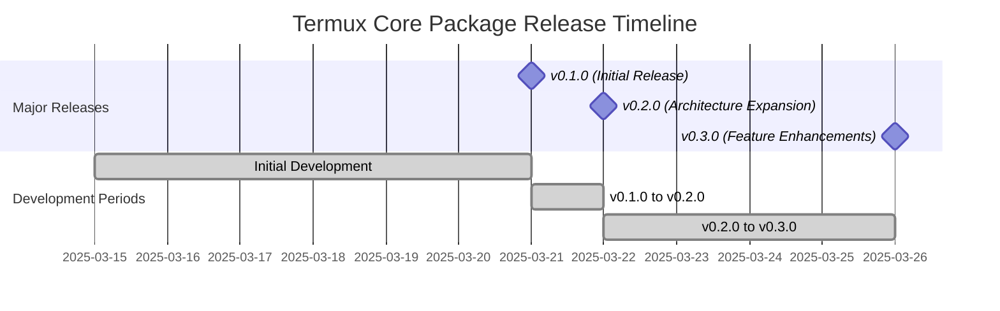
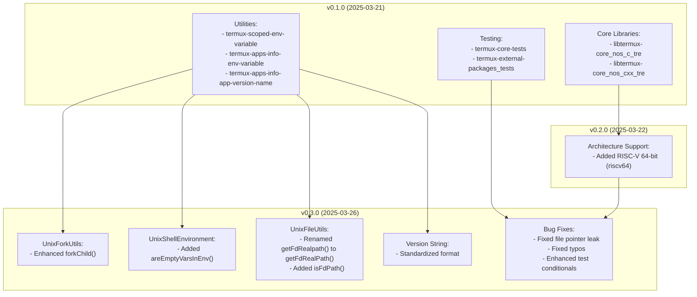
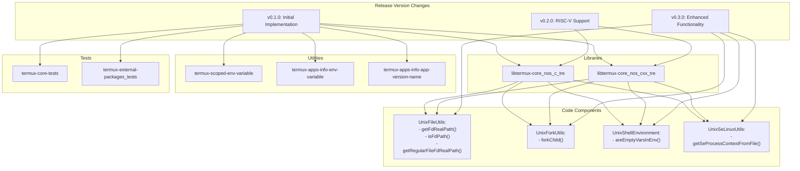
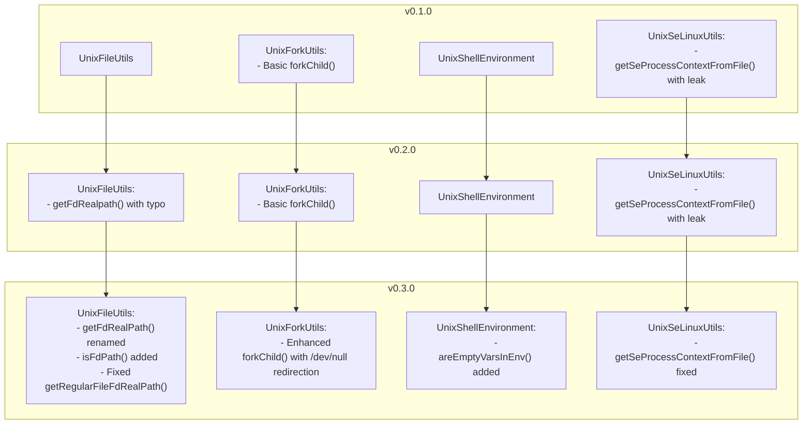

<!-- source: DeepWiki mcp.deepwiki.com · repo termux/termux-core-package · page 6 Release History · fetched 2026-10-26 -->

# Release History

Relevant source files

The following files were used as context for generating this wiki page:

- [site/pages/en/projects/releases/0/v0.1.0.md](site/pages/en/projects/releases/0/v0.1.0.md)
- [site/pages/en/projects/releases/0/v0.2.0.md](site/pages/en/projects/releases/0/v0.2.0.md)
- [site/pages/en/projects/releases/0/v0.3.0.md](site/pages/en/projects/releases/0/v0.3.0.md)
- [site/pages/en/projects/releases/index.md](site/pages/en/projects/releases/index.md)

This page documents the chronological release history of the termux-core-package, including version details, feature additions, changes, bug fixes, and component evolution. For information about build processes and package generation, see [Build System](#2), and for details about the core libraries and utilities, refer to [Core Libraries](#3).

## Release Timeline

The following diagram illustrates the release timeline of the termux-core-package:

Sources: [site/pages/en/projects/releases/index.md](), [site/pages/en/projects/releases/0/v0.1.0.md](), [site/pages/en/projects/releases/0/v0.2.0.md](), [site/pages/en/projects/releases/0/v0.3.0.md]()

## Version Summary

The following table provides a summary of all releases to date:

| Version | Release Date | Summary | Commit Range |
|---------|--------------|---------|--------------|
| v0.1.0  | 2025-03-21   | Initial release with core libraries, utilities and test framework | c6a3bcd5...v0.1.0 |
| v0.2.0  | 2025-03-22   | Added RISC-V 64-bit architecture support | v0.1.0...v0.2.0 |
| v0.3.0  | 2025-03-26   | Enhanced utilities functionality, standardized version output, fixed bugs | v0.2.0...v0.3.0 |

Sources: [site/pages/en/projects/releases/index.md](), [site/pages/en/projects/releases/0/v0.1.0.md](), [site/pages/en/projects/releases/0/v0.2.0.md](), [site/pages/en/projects/releases/0/v0.3.0.md]()

## Component Evolution

This diagram shows how the key components of the termux-core-package have evolved across releases:

Sources: [site/pages/en/projects/releases/0/v0.1.0.md](), [site/pages/en/projects/releases/0/v0.2.0.md](), [site/pages/en/projects/releases/0/v0.3.0.md]()

## Detailed Release Information

### v0.3.0 (2025-03-26)

This is the current latest release of termux-core-package, focusing on enhancing utility functions and fixing bugs.

#### Added

- Enhanced `forkChild()` in UnixForkUtils to support redirecting stdin/stdout/stderr to /dev/null and saving original stdout/stderr
- Added `areEmptyVarsInEnv()` function to UnixShellEnvironment
- Renamed `getFdRealpath()` to `getFdRealPath()` in UnixFileUtils (correcting a typo)
- Added `isFdPath()` function to UnixFileUtils

#### Changed

- Standardized version string output format to `<component_name> version=<name> org=<name> project=<name>`

#### Fixed

- Fixed incorrect errno return in `getRegularFileFdRealPath()` function
- Fixed file pointer leak in `getSeProcessContextFromFile()`
- Improved test execution logic for tudo and sudo tests
- Fixed typo in riscv64 support implementation

**Commit History:** v0.2.0...v0.3.0

Sources: [site/pages/en/projects/releases/0/v0.3.0.md]()

### v0.2.0 (2025-03-22)

This minor release added support for an additional hardware architecture.

#### Added

- Added support for RISC-V 64-bit architecture (riscv64)

**Commit History:** v0.1.0...v0.2.0

Sources: [site/pages/en/projects/releases/0/v0.2.0.md]()

### v0.1.0 (2025-03-21)

The initial release of termux-core-package, establishing the foundation with core libraries, utilities, and testing framework.

#### Added

- Introduced `termux-core-tests` for core testing functionality
- Added `termux-external-packages_tests` for testing external packages
- Established core C and C++ libraries:
  - `libtermux-core_nos_c_tre`
  - `libtermux-core_nos_cxx_tre`
- Created utility scripts:
  - `termux-scoped-env-variable`
  - `termux-apps-info-env-variable`
  - `termux-apps-info-app-version-name`

**Commit History:** c6a3bcd5...v0.1.0

Sources: [site/pages/en/projects/releases/0/v0.1.0.md]()

## Code Entity Relationships

The following diagram maps release components to their specific code entities to help bridge natural language descriptions with actual code implementations:

Sources: [site/pages/en/projects/releases/0/v0.1.0.md](), [site/pages/en/projects/releases/0/v0.2.0.md](), [site/pages/en/projects/releases/0/v0.3.0.md]()

## Function Evolution Through Releases

The following diagram illustrates the evolution of specific functions and their capabilities across releases:

Sources: [site/pages/en/projects/releases/0/v0.1.0.md](), [site/pages/en/projects/releases/0/v0.2.0.md](), [site/pages/en/projects/releases/0/v0.3.0.md]()

## Release Sources

The termux-core-package releases are available from the following sources:

- GitHub Releases: [https://github.com/termux/termux-core-package/releases](https://github.com/termux/termux-core-package/releases)

The release changelogs follow the [Keep a Changelog](https://github.com/olivierlacan/keep-a-changelog) specification format.

Sources: [site/pages/en/projects/releases/index.md]()