# Page: Overview

# Overview

<details>
<summary>Relevant source files</summary>

The following files were used as context for generating this wiki page:

- [Makefile](Makefile)
- [README.md](README.md)
- [packaging/debian/termux-core-package.json.in](packaging/debian/termux-core-package.json.in)
- [site/pages/en/projects/releases/0/v0.3.0.md](site/pages/en/projects/releases/0/v0.3.0.md)
- [site/pages/en/projects/releases/index.md](site/pages/en/projects/releases/index.md)

</details>


## Purpose and Scope

Termux Core Package (`termux-core-package`) provides essential utilities and libraries for the Termux core functionality. This package contains components that must exist in all Termux execution environments, including forks, and serves as a foundation for other Termux packages and third-party applications. The current version is 0.3.0.

This document provides a high-level overview of the termux-core-package architecture, its core components, and how they interact with each other. For detailed information about the build system, see [Build System](#2). For core libraries documentation, see [Core Libraries](#3).

Sources: [README.md:1-3](), [Makefile:1]()

## System Architecture

The termux-core-package is organized into several key components that work together to provide core functionality.

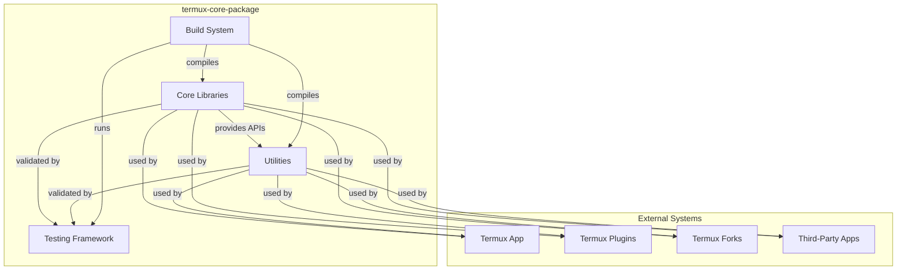

Sources: [Makefile:181-227](), [README.md:1-3]()

## Core Libraries

The termux-core-package provides two primary libraries that form the foundation of its functionality:

### libtermux-core_nos_c_tre (C Library)

This library contains core C utilities for file operations, process management, and shell environments. Key components include:

- `UnixFileUtils`: Handles file system operations and path manipulation
- `UnixForkUtils`: Manages process creation and child process handling
- `UnixShellEnvironment`: Provides shell environment interaction utilities
- `TermuxFile`: Termux-specific file operations

### libtermux-core_nos_cxx_tre (C++ Library)

This library provides C++ wrappers around the C library components.

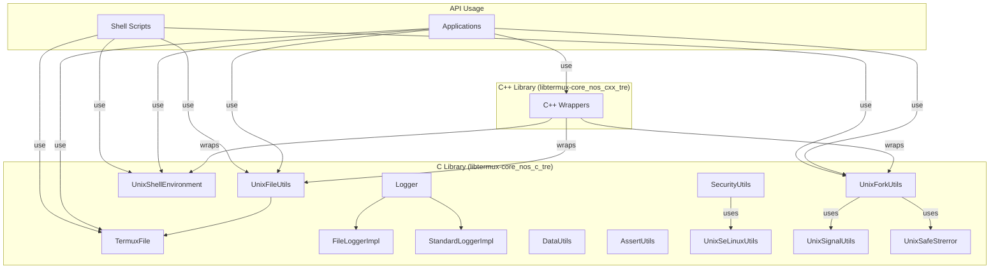

Sources: [Makefile:232-249](), [Makefile:259-264]()

## Environment Variable Utilities

Termux Core Package includes a system for managing environment variables, which is critical for application integration and context-aware operations.

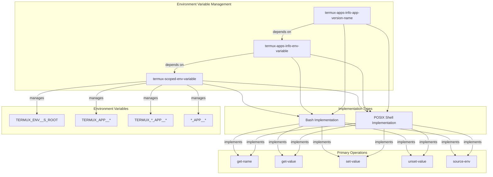

Sources: [Makefile:23-37](), [Makefile:322-328]()

## Build System

The package uses a well-structured build system to compile, test, and package its components. The build system handles architecture detection, environment setup, and ensures proper compilation flags are used.

### Key Build Targets

| Target | Description |
|--------|-------------|
| `all` | Builds all components |
| `pre-build` | Prepares build environment |
| `build-termux-core-main-app` | Builds the main application scripts |
| `build-libtermux-core_nos_c_tre` | Builds the C library |
| `build-libtermux-core_nos_cxx_tre` | Builds the C++ library |
| `clean` | Removes build artifacts |
| `install` | Installs the package into the specified prefix |
| `uninstall` | Uninstalls the package |
| `packaging-debian-build` | Creates a Debian package |
| `test` | Runs all tests |
| `test-unit` | Runs unit tests only |
| `test-runtime` | Runs runtime tests only |

Sources: [Makefile:299-513]()

## Testing Framework

The package includes a comprehensive testing framework for ensuring functionality and reliability.

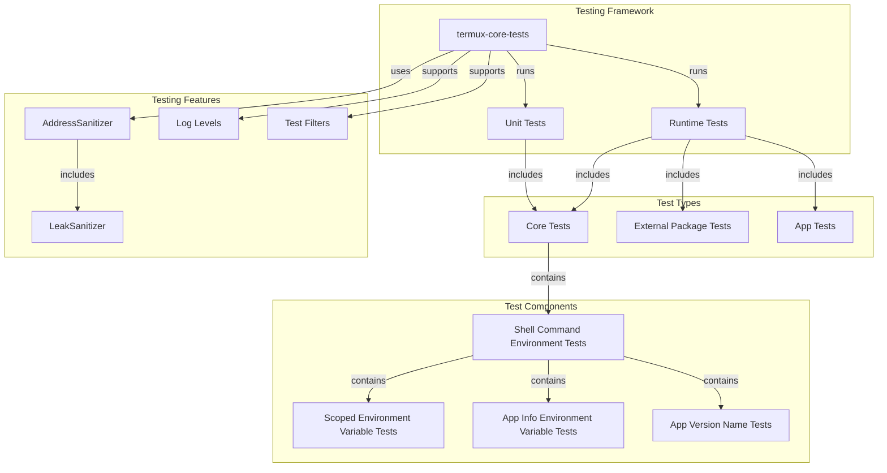

The `termux-core-tests` utility serves as the main entry point for running tests, supporting various options for test selection, logging verbosity, and sanitizer usage.

Sources: [Makefile:374-394](), [Makefile:487-512]()

## Installation and Configuration

The termux-core-package installs components into the following directories:

| Component | Installation Path |
|-----------|------------------|
| Binaries | `$(TERMUX__PREFIX)/bin` |
| Headers | `$(TERMUX__PREFIX)/include/termux-core` |
| Libraries | `$(TERMUX__PREFIX)/lib` |
| Tests | `$(TERMUX__PREFIX)/libexec/installed-tests/termux-core` |

The package automatically detects architecture and configures builds accordingly, supporting `aarch64`, `arm`, `i686`, `x86_64`, and `riscv64` architectures.

Sources: [Makefile:66-88](), [Makefile:428-457]()

## Release History

The termux-core-package is currently at version 0.3.0. For detailed release notes and changelogs, see the [Release History](#6) page.

Sources: [site/pages/en/projects/releases/index.md:5-41](), [site/pages/en/projects/releases/0/v0.3.0.md:5-48]()

---

# Page: Build System

# Build System

<details>
<summary>Relevant source files</summary>

The following files were used as context for generating this wiki page:

- [LICENSE](LICENSE)
- [Makefile](Makefile)
- [licenses/termux__termux-core-package__MIT.md](licenses/termux__termux-core-package__MIT.md)
- [packaging/debian/termux-core-package.json.in](packaging/debian/termux-core-package.json.in)

</details>


## Purpose and Scope

This document describes the build system used by the termux-core-package repository. It explains the build process, configuration mechanisms, compilation parameters, installation procedures, and package generation. The build system uses GNU Make as its foundation and provides a comprehensive set of targets for building, testing, installing, and packaging the termux-core components.

For information about the testing framework that integrates with this build system, see [Testing Framework](#5).

## Build System Overview

The termux-core-package build system is designed to compile, test, and package various components including C and C++ libraries, shell scripts, and test utilities. It supports both on-device builds and cross-compilation.

### Build System Architecture

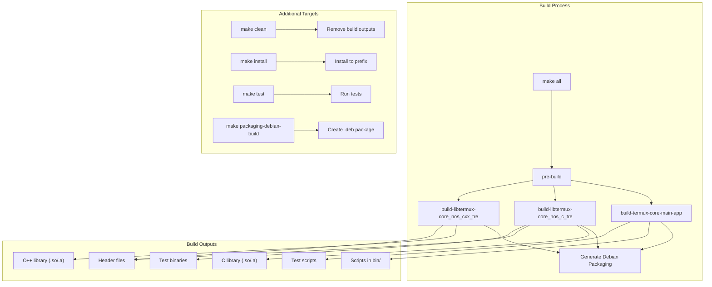

Sources: [Makefile:298-517]()

### Build Directory Structure

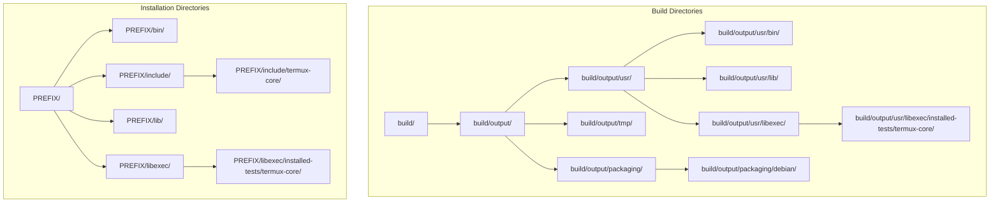

Sources: [Makefile:94-108](), [Makefile:111-123]()

## Configuration and Environment Variables

The build system defines numerous environment variables to configure paths, package names, version numbers, and architecture-specific settings. These variables are used throughout the build process to ensure consistency.

### Key Configuration Variables

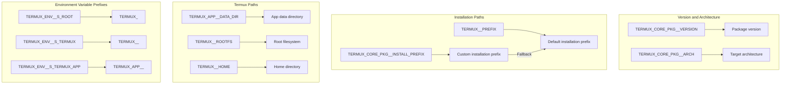

Sources: [Makefile:1-44]()

### Architecture Detection

The build system can automatically detect the target architecture if not specified. It examines predefined macros from the C compiler to determine whether the target is:

- i686
- x86_64
- aarch64
- arm
- riscv64

This allows the build to adapt to different architectures without manual configuration.

Sources: [Makefile:66-88]()

## Compilation Process

### Compiler Flags and Optimization

The build system sets up compiler flags for both C and C++ compilation:

| Flag Category | Purpose | Example Flags |
|---------------|---------|---------------|
| Default Flags | Platform compatibility | `-march=armv7-a` (for ARM) |
| Optimization | Performance | `-O2` |
| Hardening | Security | `-D_FORTIFY_SOURCE=2`, `-fstack-protector-strong` |
| Warning Control | Code quality | `-Wall`, `-Wextra`, `-Werror`, `-Wshadow` |
| Linking | Library handling | `-Wl,--as-needed`, `-Wl,--enable-new-dtags` |
| Sanitization (tests) | Bug detection | `-fsanitize=address` |

For architecture-specific compilation, specialized flags are used. For example, ARM builds use `-march=armv7-a -mfpu=neon -mfloat-abi=softfp -mthumb`.

Sources: [Makefile:180-228]()

### Library Compilation Process

The build system compiles two main libraries:

1. **libtermux-core_nos_c_tre**: A C library providing core functionality
2. **libtermux-core_nos_cxx_tre**: A C++ library that wraps the C library

For each library, both shared (`.so`) and static (`.a`) versions are created. The compilation process involves:

1. Compiling individual source files to object files
2. Linking object files into shared libraries
3. Creating static archives

The libraries are built with visibility controls to carefully manage the exported symbols, using `-fvisibility=hidden` by default and explicitly marking exported functions with `-fvisibility=default`.

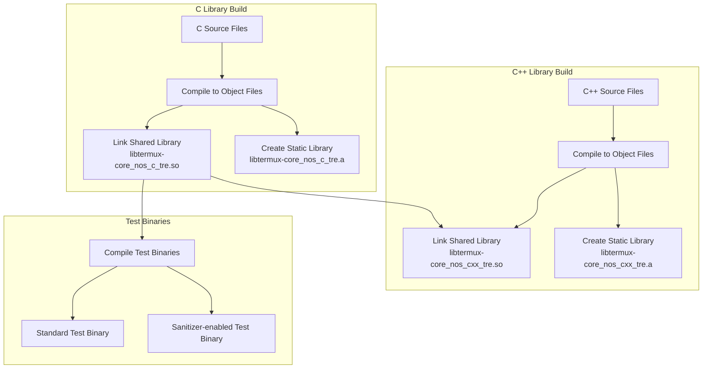

Sources: [Makefile:232-421]()

## Build Targets

The build system provides several primary targets for different operations:

| Target | Description |
|--------|-------------|
| `all` | Builds all components and packaging |
| `pre-build` | Prepares build directories and runs clean |
| `build-termux-core-main-app` | Builds main application scripts and tests |
| `build-libtermux-core_nos_c_tre` | Builds the C library |
| `build-libtermux-core_nos_cxx_tre` | Builds the C++ library |
| `clean` | Removes build outputs |
| `install` | Installs built components to the target prefix |
| `uninstall` | Removes installed components |
| `packaging-debian-build` | Creates a Debian package |
| `test` | Runs all tests |
| `test-unit` | Runs unit tests only |
| `test-runtime` | Runs runtime tests only |

These targets are defined as phony targets in the Makefile to ensure they run regardless of file timestamps.

Sources: [Makefile:298-516]()

## Installation Process

The installation process copies built components to their destination directories under the specified prefix (`TERMUX_CORE_PKG__INSTALL_PREFIX`):

### Installed Components

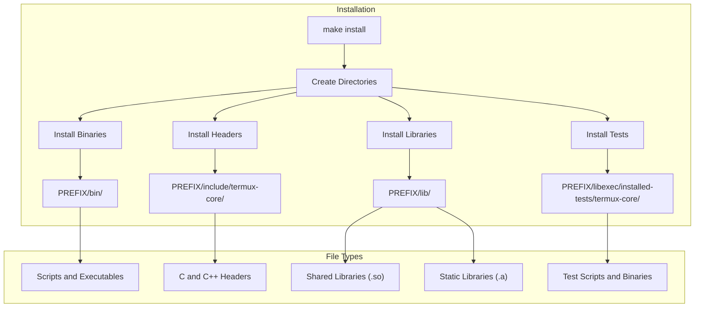

The installation process also sets appropriate permissions for installed files:
- Executable files (700): Binaries, scripts, test runners
- Non-executable files (600): Headers

Sources: [Makefile:428-458]()

## Packaging System

The build system can generate Debian packages for distribution. This is done through the `packaging-debian-build` target.

### Debian Package Generation

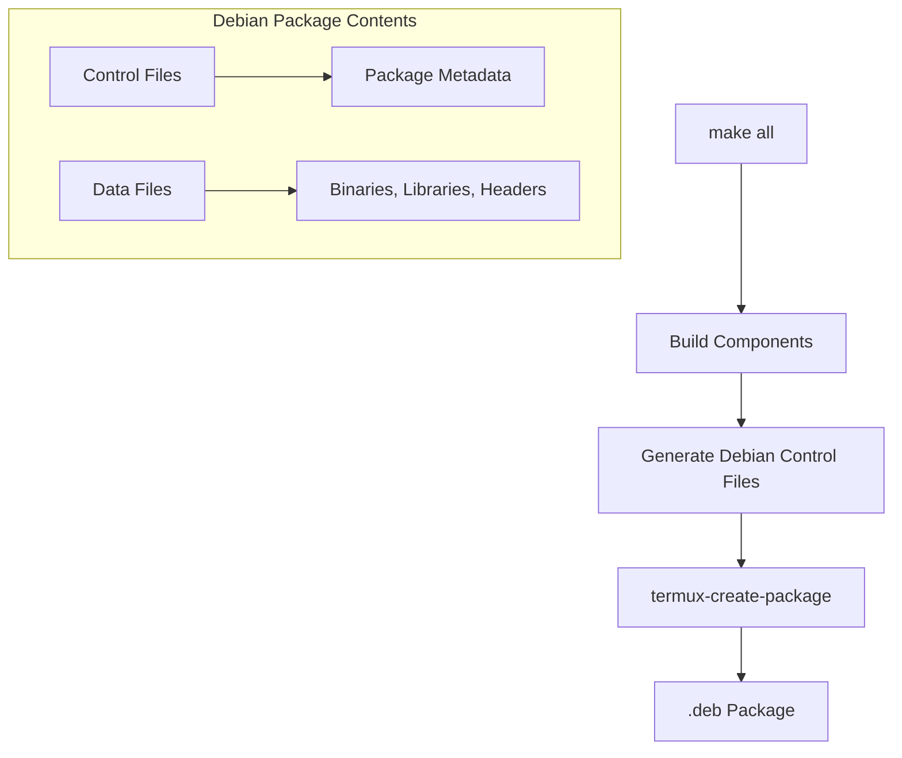

The packaging process:
1. Uses templates in `packaging/debian/` directory
2. Substitutes variables in these templates
3. Creates package control files (metadata)
4. Packages built components (binaries, libraries, headers)
5. Runs `termux-create-package` to generate the final .deb file

Sources: [Makefile:480-484](), [packaging/debian/termux-core-package.json.in:1-22]()

## Testing Integration

The build system integrates with the testing framework to validate built components:

### Test Execution Process

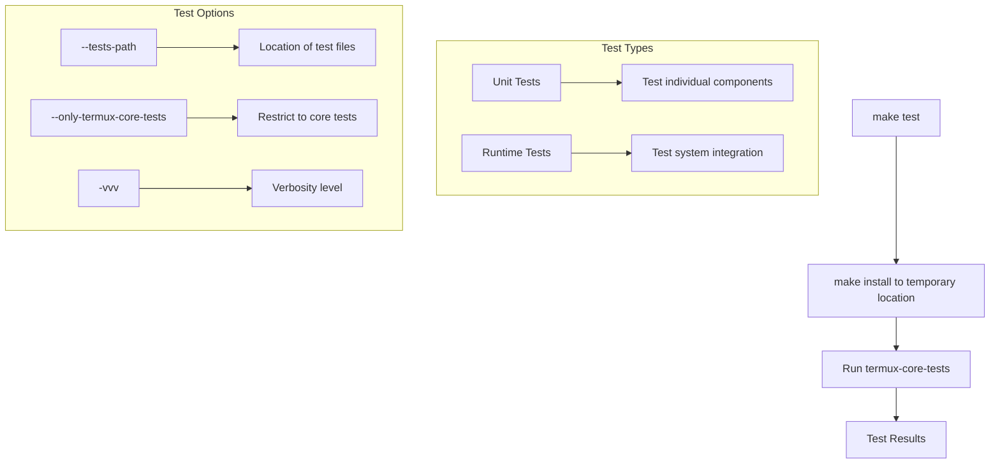

The build system provides three test-related targets:
- `test`: Runs all tests
- `test-unit`: Runs only unit tests
- `test-runtime`: Runs only runtime tests

Tests are executed via the `termux-core-tests` script with appropriate parameters.

Sources: [Makefile:486-513]()

## License Information

The termux-core-package, including its build system, is released under the MIT License unless specified otherwise for specific files.

Sources: [LICENSE:1-11](), [licenses/termux__termux-core-package__MIT.md:1-24]()

---

# Page: Core Libraries

# Core Libraries

<details>
<summary>Relevant source files</summary>

The following files were used as context for generating this wiki page:

- [Makefile](Makefile)
- [packaging/debian/termux-core-package.json.in](packaging/debian/termux-core-package.json.in)
- [site/pages/en/projects/releases/0/v0.1.0.md](site/pages/en/projects/releases/0/v0.1.0.md)

</details>


The Core Libraries in termux-core-package provide the foundational functionality required by Termux applications, plugins, and third-party software. These libraries offer standardized interfaces for interacting with the Android file system, process management, shell environments, and other core OS functionality. This document covers the architecture and components of the C and C++ libraries that form the foundation of the package. For environment variable utilities, see [Environment Variable Utilities](#4), and for testing framework details, see [Testing Framework](#5).

## Library Architecture Overview

The termux-core-package provides two primary libraries:

1. **C Library (libtermux-core_nos_c_tre)**: A core C library implementing fundamental Unix and Termux-specific utilities
2. **C++ Library (libtermux-core_nos_cxx_tre)**: A C++ wrapper library that provides object-oriented interfaces to the C library

These libraries are built as both shared libraries (`.so`) and static libraries (`.a`) for maximum flexibility in different integration scenarios.

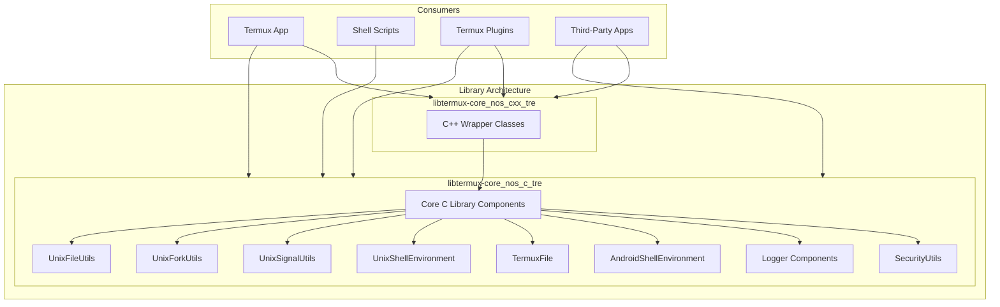

Sources: [Makefile:232-249](), [Makefile:259-260]()

## C Library (libtermux-core_nos_c_tre)

The C library provides low-level functionality focused on system operations. It's designed to be lightweight, efficient, and provide a consistent API for interacting with the underlying Android system.

### Key Components

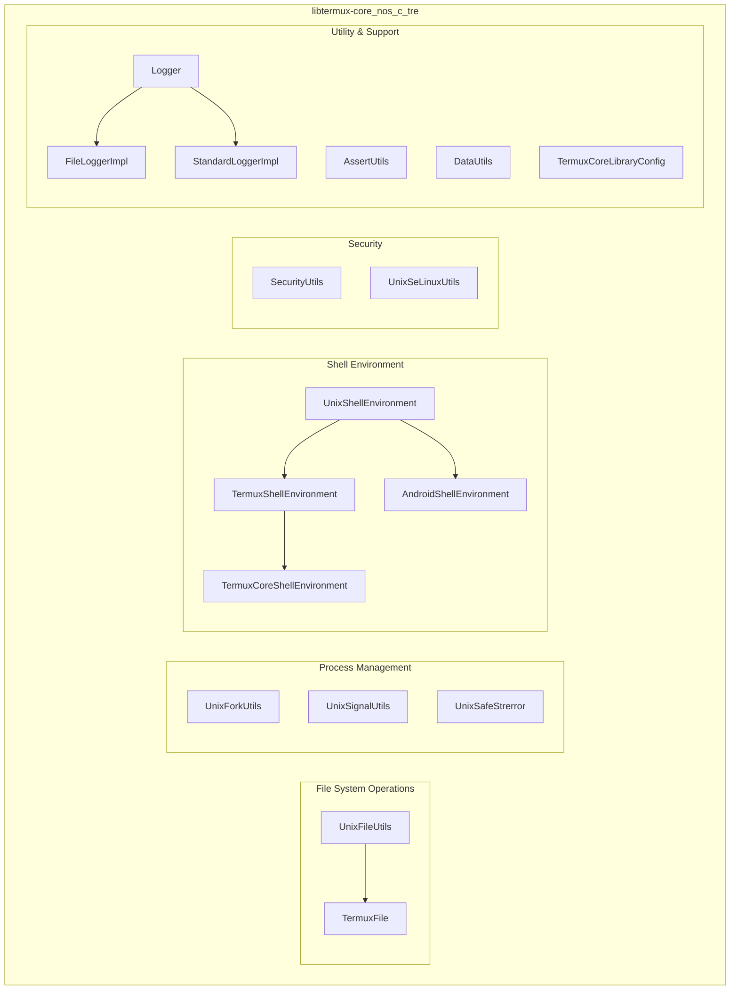

Sources: [Makefile:232-249]()

### File System Utilities

The file system utilities provide an abstraction layer for interacting with Unix and Termux file systems. These utilities handle path validation, file operations, permissions, and directory management.

Key components include:

- **UnixFileUtils**: Core file operations for Unix-like environments
- **TermuxFile**: Termux-specific file operations and path management

For more detailed information about file system utilities, see [File System Utilities](#3.1).

Sources: [Makefile:244](), [Makefile:241]()

### Process Management

The process management components handle process forking, signal handling, and error reporting. They provide a safer way to interact with system processes and handle error conditions.

Key components include:

- **UnixForkUtils**: Process forking and management
- **UnixSignalUtils**: Signal handling and management
- **UnixSafeStrerror**: Thread-safe error string generation

For more detailed information about process management, see [Process Management](#3.2).

Sources: [Makefile:245-247]()

### Shell Environment

The shell environment components provide utilities for interacting with shell environments, setting up environment variables, and managing shell contexts.

Key components include:

- **UnixShellEnvironment**: Generic Unix shell environment utilities
- **TermuxShellEnvironment**: Termux-specific shell environment utilities
- **AndroidShellEnvironment**: Android-specific shell environment utilities
- **TermuxCoreShellEnvironment**: Core shell utilities specific to Termux

For more detailed information about shell environment, see [Shell Environment](#3.3).

Sources: [Makefile:233](), [Makefile:242-243](), [Makefile:249]()

### Security Utilities

The security components provide utilities for handling security-related operations, including SELinux context management.

Key components include:

- **SecurityUtils**: General security utilities
- **UnixSeLinuxUtils**: SELinux context management and operations

Sources: [Makefile:240](), [Makefile:248]()

### Logging System

The logging system provides configurable logging capabilities for applications using the core libraries.

Key components include:

- **Logger**: Core logging interface
- **FileLoggerImpl**: Implementation for logging to files
- **StandardLoggerImpl**: Implementation for logging to standard output/error

Sources: [Makefile:237-239]()

## C++ Library (libtermux-core_nos_cxx_tre)

The C++ library provides object-oriented wrappers around the C library components. It makes the functionality more accessible to C++ applications and provides additional utility classes that leverage C++ features.

```mermaid
graph TD
    subgraph "libtermux-core_nos_cxx_tre"
        CxxWrappers["C++ Wrappers"]
        LibConfig["TermuxCoreLibraryConfig"]
    end
    
    subgraph "libtermux-core_nos_c_tre Dependencies"
        UnixFileUtils["UnixFileUtils"]
        UnixForkUtils["UnixForkUtils"]
        UnixShellEnv["UnixShellEnvironment"]
        TermuxFile["TermuxFile"]
    end
    
    CxxWrappers --> UnixFileUtils
    CxxWrappers --> UnixForkUtils
    CxxWrappers --> UnixShellEnv
    CxxWrappers --> TermuxFile
    LibConfig --> "C Library Config"
```

Sources: [Makefile:259-260](), [Makefile:412-418]()

The C++ library is designed to work seamlessly with the C library while providing the benefits of C++ language features:

- Object-oriented interfaces with proper resource management
- RAII (Resource Acquisition Is Initialization) pattern for safer resource handling
- Exception-based error handling
- STL integration

## Build and Installation

The core libraries are built as both shared libraries (`.so`) and static libraries (`.a`). This allows applications to either dynamically link against the libraries or statically include them.

### Library Build Process

The build system compiles source files with position-independent code (`-fPIC`) and creates both shared and static library versions:

1. Object files are compiled from source files
2. Shared libraries are created with visibility controls
3. Static libraries are archived from object files

### Installation Paths

The libraries and headers are installed in the following default locations:

| Component | Installation Path |
|-----------|------------------|
| Shared Libraries | `$(TERMUX__PREFIX)/lib/` |
| Static Libraries | `$(TERMUX__PREFIX)/lib/` |
| Headers | `$(TERMUX__PREFIX)/include/termux-core/termux/` |

Sources: [Makefile:442-447]()

## Integration with Applications

Applications can integrate with the core libraries in several ways:

### C Applications

C applications can include the appropriate headers and link against either the shared or static libraries:

```c
#include <termux-core/termux/termux_core__nos__c/unix/file/UnixFileUtils.h>
```

### C++ Applications

C++ applications can use the object-oriented wrappers:

```cpp
#include <termux-core/termux/termux_core__nos__cxx/file/FileUtils.hpp>
```

### Runtime Dependencies

Applications using the shared libraries must have the following runtime dependencies:
- `libtermux-core_nos_c_tre.so` (for both C and C++ applications)
- `libtermux-core_nos_cxx_tre.so` (for C++ applications)

## Versioning and Compatibility

The core libraries follow semantic versioning. The current version is encoded in the Makefile.

Sources: [Makefile:1]()

The libraries are designed to maintain backward compatibility within major versions. API changes that would break compatibility require a new major version.

---

# Page: File System Utilities

# File System Utilities

<details>
<summary>Relevant source files</summary>

The following files were used as context for generating this wiki page:

- [lib/termux-core_nos_c_tre/include/termux/termux_core__nos__c/v1/termux/file/TermuxFile.h](lib/termux-core_nos_c_tre/include/termux/termux_core__nos__c/v1/termux/file/TermuxFile.h)
- [lib/termux-core_nos_c_tre/include/termux/termux_core__nos__c/v1/unix/file/UnixFileUtils.h](lib/termux-core_nos_c_tre/include/termux/termux_core__nos__c/v1/unix/file/UnixFileUtils.h)
- [lib/termux-core_nos_c_tre/src/termux/file/TermuxFile.c](lib/termux-core_nos_c_tre/src/termux/file/TermuxFile.c)
- [lib/termux-core_nos_c_tre/src/unix/file/UnixFileUtils.c](lib/termux-core_nos_c_tre/src/unix/file/UnixFileUtils.c)
- [lib/termux-core_nos_c_tre/tests/src/termux/file/TermuxFile_UnitBinaryTests.c](lib/termux-core_nos_c_tre/tests/src/termux/file/TermuxFile_UnitBinaryTests.c)

</details>


## Purpose and Scope

This document details the file system utilities provided by the Termux Core Package, focusing on path manipulation, validation, directory management, and Termux-specific file operations. These utilities form a critical foundation for file operations within the Termux environment, ensuring consistent handling of paths across the unique filesystem layout of Termux.

For information about process management capabilities, see [Process Management](#3.2).
For shell environment utilities, see [Shell Environment](#3.3).

## Overview

The file system utilities in Termux Core Package are divided into two main components:

1. **Unix File Utilities**: General-purpose utilities for Unix path operations
2. **Termux-specific File Utilities**: Functions tailored to Termux's unique file system structure

## Unix File Utilities

### Path Manipulation Functions

These functions provide essential path handling capabilities:

| Function | Description |
|----------|-------------|
| `absolutizePath` | Converts a relative path to an absolute path using the current working directory |
| `normalizePath` | Cleans paths by removing redundancies like duplicate separators, `./`, and optionally `../` |
| `removeDupSeparator` | Removes consecutive path separators and optionally trailing separators |

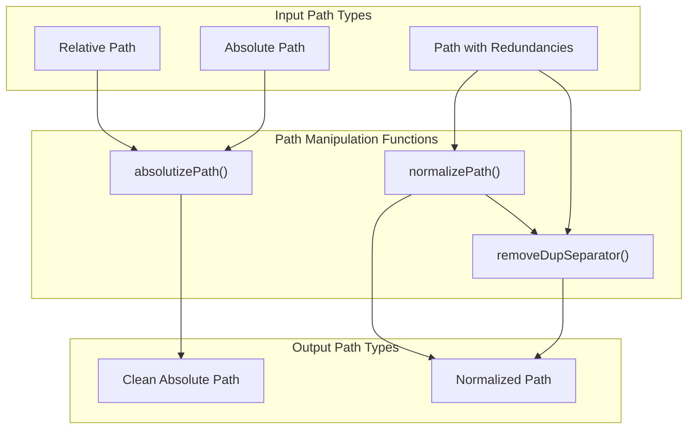

Sources: [lib/termux-core_nos_c_tre/src/unix/file/UnixFileUtils.c:27-93](), [lib/termux-core_nos_c_tre/src/unix/file/UnixFileUtils.c:99-101](), [lib/termux-core_nos_c_tre/src/unix/file/UnixFileUtils.c:106-131]()

#### Path Normalization Behavior

The `normalizePath` function handles various path cleanup operations:

- Removes duplicate separators (`//` → `/`)
- Removes trailing separators (unless specified to keep)
- Replaces `/./` with `/` and removes leading `./`
- Optionally resolves `../` by removing parent directory components

```
Examples:
"/foo//bar/" → "/foo/bar"
"/foo/./bar" → "/foo/bar"
"/foo/../bar" → "/bar"
"a/../../b" → null (if removing double dots)
```

Sources: [lib/termux-core_nos_c_tre/include/termux/termux_core__nos__c/v1/unix/file/UnixFileUtils.h:31-145]()

### Path Validation Functions

| Function | Description |
|----------|-------------|
| `isFdPath` | Checks if a path matches the format for file descriptor paths (`/proc/self/fd/<num>` or `/proc/<pid>/fd/<num>`) |
| `isPathInDirPath` | Determines if a path is within a specified directory |
| `isPathOrFdPathInDirPath` | Checks if a path or an fd path's real path is within a directory |

Sources: [lib/termux-core_nos_c_tre/src/unix/file/UnixFileUtils.c:137-265]()

### Directory and File Operations

| Function | Description |
|----------|-------------|
| `createDirectoryFile` | Creates a directory including all parent directories (similar to `mkdir -p`) |
| `closeFD` | Safely closes a file descriptor with proper error handling |
| `redirectStdFdToDevNull` | Redirects standard file descriptors (stdin, stdout, stderr) to `/dev/null` |
| `getRegularFileFdRealPath` | Resolves the real path of a file descriptor path |

Sources: [lib/termux-core_nos_c_tre/src/unix/file/UnixFileUtils.c:447-589]()

## Termux File System Structure

Termux has a specific file system layout with important path constraints. The File System Utilities module provides constants and functions to work with this structure.

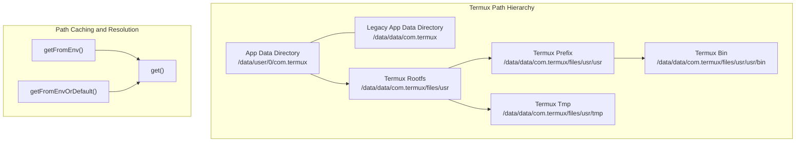

Sources: [lib/termux-core_nos_c_tre/include/termux/termux_core__nos__c/v1/termux/file/TermuxFile.h:10-125](), [lib/termux-core_nos_c_tre/src/termux/file/TermuxFile.c:28-59]()

### Path Length Limits

The Termux file system has specific path length limitations defined as constants:

| Constant | Value | Description |
|----------|-------|-------------|
| `TERMUX_APP__DATA_DIR___MAX_LEN` | 69 | Max length for app data directory path |
| `TERMUX__APPS_DIR___MAX_LEN` | 84 | Max length for apps directory path |
| `TERMUX__ROOTFS_DIR___MAX_LEN` | 86 | Max length for rootfs directory path |
| `TERMUX__PREFIX_DIR___MAX_LEN` | 90 | Max length for prefix directory path |
| `TERMUX__PREFIX__BIN_FILE___SAFE_MAX_LEN` | 127 | Safe max length for bin file path |

These limits exist to ensure compatibility with the Linux kernel and Android system limitations, particularly for executable paths.

Sources: [lib/termux-core_nos_c_tre/include/termux/termux_core__nos__c/v1/termux/file/TermuxFile.h:10-114]()

## Termux Path Management

### Directory Path Resolution

The library provides three categories of functions for each Termux directory type:

1. `*_get()` - Returns cached path value
2. `*_getFromEnv()` - Gets path from environment variable
3. `*_getFromEnvOrDefault()` - Gets path from environment or falls back to default

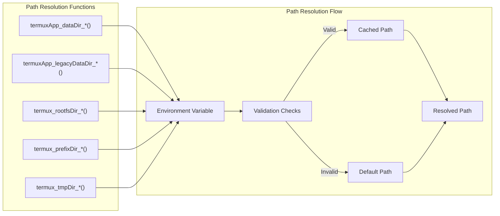

Sources: [lib/termux-core_nos_c_tre/src/termux/file/TermuxFile.c:64-277]()

### Key Path Resolution Functions

| Function Group | Description |
|----------------|-------------|
| `termuxApp_dataDir_*` | Functions to get, cache and validate Termux app data directory |
| `termuxApp_legacyDataDir_*` | Functions for legacy app data directory support |
| `termux_rootfsDir_*` | Functions for Termux rootfs directory |
| `termux_prefixDir_*` | Functions for Termux prefix directory |
| `termux_tmpDir_*` | Functions for Termux temporary directory |

Sources: [lib/termux-core_nos_c_tre/include/termux/termux_core__nos__c/v1/termux/file/TermuxFile.h:134-321]()

### Legacy Path Support

Termux supports both modern Android data paths (`/data/user/<user_id>/<package_name>`) and legacy paths (`/data/data/<package_name>`). The function `termuxApp_dataDir_convertToLegacyPath()` handles conversion between these formats.

Sources: [lib/termux-core_nos_c_tre/src/termux/file/TermuxFile.c:139-199]()

### Path Validation and Prefixing

The library provides:

- `termuxApp_dataDir_isPathUnder()`: Checks if a path is under app data directory
- `termux_rootfsDir_isPathUnder()`: Checks if a path is under rootfs directory
- `termuxPrefixPath()`: Prefixes paths with Termux prefix (e.g., `/bin/sh` → `$PREFIX/bin/sh`)

Sources: [lib/termux-core_nos_c_tre/src/termux/file/TermuxFile.c:283-449]()

## Environment Variable Path Handling

The utility provides functions to safely retrieve paths from environment variables with validation and fallbacks:

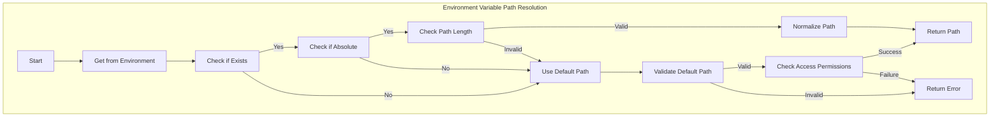

Sources: [lib/termux-core_nos_c_tre/src/unix/file/UnixFileUtils.c:292-436]()

### Important Path Resolution Functions

| Function | Description |
|----------|-------------|
| `getPathFromEnv` | Gets a path from an environment variable with validation |
| `getPathFromEnvOrDefault` | Gets a path from environment or falls back to default |

Both functions perform comprehensive validation including:
- Existence check
- Absolute path verification
- Path length validation
- Optional path normalization
- Access permissions check (for default paths)

Sources: [lib/termux-core_nos_c_tre/include/termux/termux_core__nos__c/v1/unix/file/UnixFileUtils.h:236-313]()

## Best Practices

When working with the File System Utilities, consider the following best practices:

1. Always use the provided functions instead of direct path manipulation to ensure consistency
2. Be aware of path length limits, especially for executable paths
3. Use cached path getters (`*_get()`) for frequently accessed paths
4. Normalize paths before validation when appropriate
5. Handle both modern and legacy path formats when necessary
6. Check return values for error conditions

---

# Page: Process Management

# Process Management

<details>
<summary>Relevant source files</summary>

The following files were used as context for generating this wiki page:

- [lib/termux-core_nos_c_tre/include/termux/termux_core__nos__c/v1/unix/os/process/UnixForkUtils.h](lib/termux-core_nos_c_tre/include/termux/termux_core__nos__c/v1/unix/os/process/UnixForkUtils.h)
- [lib/termux-core_nos_c_tre/src/unix/os/process/UnixForkUtils.c](lib/termux-core_nos_c_tre/src/unix/os/process/UnixForkUtils.c)

</details>


## Purpose and Scope

This document describes the process management functionality provided by the Termux Core Package. It focuses on the Unix process forking utilities and child process management mechanisms implemented in the C library. The process management system enables controlled creation of child processes, capturing their output, and managing their lifecycle while ensuring proper resource cleanup.

For information about shell environment management, see [Shell Environment](#3.3).

## Overview

The process management system in Termux Core provides a structured approach to fork Unix processes, establish parent-child communication through pipes, and manage process resources. It abstracts the complexities of Unix process forking while providing fine-grained control over standard I/O streams.

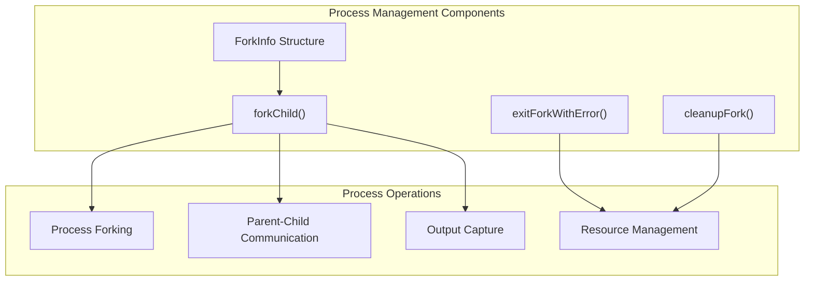

Sources: [lib/termux-core_nos_c_tre/include/termux/termux_core__nos__c/v1/unix/os/process/UnixForkUtils.h:1-58](), [lib/termux-core_nos_c_tre/src/unix/os/process/UnixForkUtils.c:1-224]()

## ForkInfo Structure

The process management system is built around a central data structure called `ForkInfo`, which encapsulates all information related to a fork operation.

### Structure Fields

| Field | Type | Description |
|-------|------|-------------|
| `isChild` | bool | Indicates whether this is the child process |
| `cpid` | int | Child process ID |
| `exitCode` | int | Exit code of the child process |
| `status` | int | Process status information |
| `stdoutFd` | int | Original stdout file descriptor of child |
| `stderrFd` | int | Original stderr file descriptor of child |
| `pipeFds[2]` | int | File descriptors for the pipe between parent and child |
| `pipeFile` | FILE* | File handle for reading pipe in parent |
| `output` | char* | Buffer for storing captured child output |
| `returnOutput` | bool | Whether to return the captured output |
| `redirectChildStdinToDevNull` | bool | Whether to redirect child's stdin to /dev/null |
| `redirectChildStdoutToDevNull` | bool | Whether to redirect child's stdout to /dev/null |
| `redirectChildStderrToDevNull` | bool | Whether to redirect child's stderr to /dev/null |
| `outputInitialBuffer` | size_t | Initial buffer size for capturing output |
| `parentLogTag` | const char* | Log tag for parent process |
| `childLogTag` | const char* | Log tag for child process |
| `onChildFork` | function pointer | Callback function invoked in child after fork |

A convenience macro `INIT_FORK_INFO` is provided to initialize this structure with default values:

```c
INIT_FORK_INFO(forkInfo);
```

This initializes a ForkInfo structure with appropriate default values for all fields.

Sources: [lib/termux-core_nos_c_tre/include/termux/termux_core__nos__c/v1/unix/os/process/UnixForkUtils.h:11-44]()

## Core Process Management Functions

### forkChild

The `forkChild` function is the main entry point for process forking operations.

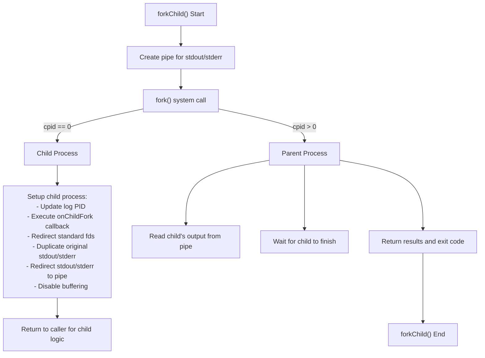

The `forkChild` function performs the following key operations:

1. Creates a pipe for communication between parent and child
2. Forks the process using the Unix `fork()` system call
3. In the child process:
   - Sets up proper logging
   - Executes the optional `onChildFork` callback
   - Redirects standard file descriptors as configured
   - Duplicates original stdout/stderr for potential restoration
   - Redirects stdout/stderr to pipe for parent capture
   - Disables buffering for stdout/stderr
4. In the parent process:
   - Reads and captures the child's output through the pipe
   - Dynamically resizes the buffer as needed
   - Waits for the child to exit
   - Returns the exit code and captured output

Sources: [lib/termux-core_nos_c_tre/src/unix/os/process/UnixForkUtils.c:19-183]()

### exitForkWithError

The `exitForkWithError` function provides a controlled way to exit a process in error conditions:

```c
void exitForkWithError(ForkInfo *info, int exitCode);
```

This function:
1. Cleans up resources by calling `cleanupFork`
2. If in the parent process, kills the child process if it's still running
3. Exits with the specified exit code

Sources: [lib/termux-core_nos_c_tre/src/unix/os/process/UnixForkUtils.c:185-191]()

### cleanupFork

The `cleanupFork` function ensures proper resource cleanup:

```c
void cleanupFork(ForkInfo *info);
```

This function handles:
1. Closing file descriptors (stdout, stderr, pipe)
2. Closing the pipe file handle
3. Freeing allocated memory for output buffer

Proper resource cleanup is essential to prevent resource leaks in both normal and error scenarios.

Sources: [lib/termux-core_nos_c_tre/src/unix/os/process/UnixForkUtils.c:193-223]()

## Parent-Child Communication

The process management system implements a robust parent-child communication mechanism using Unix pipes.

```mermaid
sequenceDiagram
    participant Parent
    participant Child
    
    Parent->>Parent: Initialize ForkInfo
    Parent->>Parent: Create pipe
    Parent->>Child: fork()
    
    Child->>Child: Set up redirections
    Child->>Child: Duplicate original stdout/stderr
    Child->>Child: Redirect stdout/stderr to pipe
    Child->>Child: Execute user code
    
    Child-->>Parent: Write output to pipe
    
    Parent->>Parent: Read from pipe
    Parent->>Parent: Store output in buffer
    Parent->>Parent: Wait for child exit
    
    Child-->>Parent: Exit with code
    
    Parent->>Parent: Clean up resources
    Parent->>Parent: Return output and exit code
```

Key aspects of the communication mechanism:

1. **Pipe Creation**: The parent creates a pipe before forking
2. **Redirection**: The child redirects its stdout/stderr to the pipe
3. **Dynamic Buffer Management**: The parent dynamically resizes the output buffer as needed
4. **Process Synchronization**: The parent waits for the child to complete execution

Sources: [lib/termux-core_nos_c_tre/src/unix/os/process/UnixForkUtils.c:19-183]()

## Resource Management

The process management system implements careful resource management to prevent leaks and ensure clean process termination.

```mermaid
graph TD
    subgraph "Resources Managed"
        FD["File Descriptors"]
        PF["Pipe File Handle"]
        MM["Memory Allocations"]
        CP["Child Process"]
    end
    
    subgraph "Resource Management Functions"
        CF["cleanupFork()"]
        EF["exitForkWithError()"]
    end
    
    CF --> FD
    CF --> PF
    CF --> MM
    EF --> CF
    EF --> CP
```

Resource management occurs in multiple scenarios:

1. **Normal Completion**: Resources are cleaned up after child completion
2. **Error Handling**: The `exitForkWithError` function ensures cleanup before exit
3. **Child Process Termination**: When necessary, the parent can forcibly terminate the child process

Proper resource management is crucial for preventing file descriptor leaks, memory leaks, and zombie processes.

Sources: [lib/termux-core_nos_c_tre/src/unix/os/process/UnixForkUtils.c:185-223]()

## Usage Patterns

The process management system is designed to be flexible and can be used in various scenarios:

1. **Output Capture**: Capturing the output from child processes
2. **Controlled Execution**: Executing commands with controlled stdin/stdout/stderr
3. **Custom Child Logic**: Using the `onChildFork` callback for specialized child process setup

Example usage pattern (conceptual):

```c
// Initialize ForkInfo structure
INIT_FORK_INFO(forkInfo);

// Configure options
forkInfo.parentLogTag = "MyParent";
forkInfo.childLogTag = "MyChild";
forkInfo.onChildFork = mySetupFunction;

// Fork the child process
if (forkChild(&forkInfo) == 0) {
    if (forkInfo.isChild) {
        // Child-specific code
        // ...
        exit(0);
    } else {
        // Parent-specific code
        printf("Child output: %s\n", forkInfo.output);
        printf("Child exit code: %d\n", forkInfo.exitCode);
    }
}

// Clean up resources
cleanupFork(&forkInfo);
```

Sources: [lib/termux-core_nos_c_tre/include/termux/termux_core__nos__c/v1/unix/os/process/UnixForkUtils.h:1-58](), [lib/termux-core_nos_c_tre/src/unix/os/process/UnixForkUtils.c:1-224]()

## Integration with Other Systems

The process management system integrates with other components in the Termux Core Package:

1. **Logging System**: Uses logging functions for error reporting
2. **File System Utilities**: Relies on file descriptor management functions
3. **Shell Environment**: Can be used in conjunction with shell environment utilities

```mermaid
graph TD
    subgraph "Process Management"
        PM["UnixForkUtils"]
    end
    
    subgraph "Related Systems"
        FS["File System Utilities"]
        LOG["Logging System"]
        SE["Shell Environment"]
    end
    
    PM --> FS
    PM --> LOG
    PM <--> SE
```

Sources: [lib/termux-core_nos_c_tre/src/unix/os/process/UnixForkUtils.c:1-16]()

---

# Page: Shell Environment

# Shell Environment

<details>
<summary>Relevant source files</summary>

The following files were used as context for generating this wiki page:

- [lib/termux-core_nos_c_tre/include/termux/termux_core__nos__c/v1/unix/shell/command/environment/UnixShellEnvironment.h](lib/termux-core_nos_c_tre/include/termux/termux_core__nos__c/v1/unix/shell/command/environment/UnixShellEnvironment.h)
- [lib/termux-core_nos_c_tre/src/unix/shell/command/environment/UnixShellEnvironment.c](lib/termux-core_nos_c_tre/src/unix/shell/command/environment/UnixShellEnvironment.c)

</details>


This page documents the Shell Environment utilities in the Termux Core Package. These utilities provide standardized methods for interacting with the Unix shell environment, specifically focusing on environment variable access, parsing, and validation.

For information related to process creation and management, see [Process Management](#3.2).
For environment variable utilities that build upon these core functions, see [Environment Variable Utilities](#4).

## System Architecture

### Shell Environment Component Architecture

```mermaid
graph TD
    subgraph "TermuxCorePackage"
        FSU["File System Utilities (3.1)"]
        PM["Process Management (3.2)"]
        SE["Shell Environment (3.3)"]
        ENV["Environment Variable Utilities (4)"]
    end
    
    subgraph "ExternalSystems"
        TermuxApp["Termux App"]
        TermuxPlugins["Termux Plugins"]
    end
    
    SE --> FSU
    SE --> PM
    SE <--> ENV
    
    TermuxApp --> SE
    TermuxPlugins --> SE
    
    subgraph "ShellEnvironmentComponents"
        EnvVarConst["Environment Variable Constants"]
        BoolParse["Boolean Environment Variable Parsing"]
        EnvCheck["Environment Variable Checking"]
    end
    
    SE --> EnvVarConst
    SE --> BoolParse
    SE --> EnvCheck
```

Sources: [lib/termux-core_nos_c_tre/include/termux/termux_core__nos__c/v1/unix/shell/command/environment/UnixShellEnvironment.h:1-137]()

## Environment Variable Constants

The Shell Environment subsystem defines constants for standard Unix environment variables that are used throughout the Termux ecosystem.

### Standard Environment Variables

| Constant | Description | Reference |
|----------|-------------|-----------|
| `ENV__PATH` | Executable search paths | [lib/termux-core_nos_c_tre/include/termux/termux_core__nos__c/v1/unix/shell/command/environment/UnixShellEnvironment.h:34]() |
| `ENV__LD_LIBRARY_PATH` | Dynamic library search paths | [lib/termux-core_nos_c_tre/include/termux/termux_core__nos__c/v1/unix/shell/command/environment/UnixShellEnvironment.h:51]() |
| `ENV__LD_PRELOAD` | Preloaded shared objects | [lib/termux-core_nos_c_tre/include/termux/termux_core__nos__c/v1/unix/shell/command/environment/UnixShellEnvironment.h:64]() |
| `ENV__TMPDIR` | Temporary file directory | [lib/termux-core_nos_c_tre/include/termux/termux_core__nos__c/v1/unix/shell/command/environment/UnixShellEnvironment.h:77]() |

Each environment variable also has a corresponding prefix constant (e.g., `ENV_PREFIX__PATH`) that includes the equals sign, which is useful for environment variable manipulation.

Sources: [lib/termux-core_nos_c_tre/include/termux/termux_core__nos__c/v1/unix/shell/command/environment/UnixShellEnvironment.h:34-78]()

## Environment Variable Processing Functions

### Boolean Environment Variable Parsing

#### Boolean Environment Variable Processing Flow

```mermaid
flowchart TD
    start["getBoolEnvValue(name, def)"]
    getenv["Get environment variable value"]
    checkNull["Is value NULL or empty?"]
    checkTrue["Check for true values:<br>1, true, on, yes, y"]
    checkFalse["Check for false values:<br>0, false, off, no, n"]
    returnDef["Return default value"]
    returnTrue["Return true"]
    returnFalse["Return false"]
    
    start --> getenv
    getenv --> checkNull
    checkNull -->|"Yes"| returnDef
    checkNull -->|"No"| checkTrue
    checkTrue -->|"Match"| returnTrue
    checkTrue -->|"No match"| checkFalse
    checkFalse -->|"Match"| returnFalse
    checkFalse -->|"No match"| returnDef
```

The `getBoolEnvValue` function parses environment variables as boolean values:

| Parameter | Description |
|-----------|-------------|
| `name` | Environment variable name to look up |
| `def` | Default boolean value if variable doesn't exist or has unrecognized value |

Recognized boolean values:
- True: "1", "true", "on", "yes", "y"
- False: "0", "false", "off", "no", "n"

Sources: 
- [lib/termux-core_nos_c_tre/include/termux/termux_core__nos__c/v1/unix/shell/command/environment/UnixShellEnvironment.h:85-103]()
- [lib/termux-core_nos_c_tre/src/unix/shell/command/environment/UnixShellEnvironment.c:13-25]()

### Environment Variable Checking Functions

#### Environment Variable Checking Flow

```mermaid
flowchart TD
    subgraph "areVarsInEnv"
        avStart["areVarsInEnv(envp, vars, n)"]
        avLoop["Iterate through envp"]
        avCheck["Check if any var in vars<br>is a prefix of current env var"]
        avReturnTrue["Return true"]
        avReturnFalse["Return false"]
        
        avStart --> avLoop
        avLoop --> avCheck
        avCheck -->|"Match found"| avReturnTrue
        avCheck -->|"No match, more vars"| avLoop
        avCheck -->|"No match, end of envp"| avReturnFalse
    end
    
    subgraph "areEmptyVarsInEnv"
        aevStart["areEmptyVarsInEnv(envp, vars, n)"]
        aevLoop["Iterate through envp"]
        aevCheck["Check if any var in vars<br>exactly matches current env var"]
        aevReturnTrue["Return true"]
        aevReturnFalse["Return false"]
        
        aevStart --> aevLoop
        aevLoop --> aevCheck
        aevCheck -->|"Match found"| aevReturnTrue
        aevCheck -->|"No match, more vars"| aevLoop
        aevCheck -->|"No match, end of envp"| aevReturnFalse
    end
```

Two functions are provided for checking environment variables:

| Function | Purpose |
|----------|---------|
| `areVarsInEnv` | Checks if any of a set of variables exist in an environment array |
| `areEmptyVarsInEnv` | Checks if any variables exist with empty values |

Parameters for both functions:
- `envp`: Environment array (strings in "NAME=VALUE" format)
- `vars`: Array of variable prefixes to search for ("NAME=" format)
- `n`: Number of prefixes in `vars` to search for

Sources:
- [lib/termux-core_nos_c_tre/include/termux/termux_core__nos__c/v1/unix/shell/command/environment/UnixShellEnvironment.h:108-129]()
- [lib/termux-core_nos_c_tre/src/unix/shell/command/environment/UnixShellEnvironment.c:29-53]()

## Usage Examples

### Boolean Environment Variable Parsing

The `getBoolEnvValue` function controls application behavior based on environment settings:

```c
// Check if debugging is enabled via the DEBUG environment variable
bool debugEnabled = getBoolEnvValue("DEBUG", false);

if (debugEnabled) {
    // Perform additional logging or debugging operations
    printf("Debug mode enabled\n");
}
```

### Environment Variable Checking

The environment variable checking functions enable conditional behavior:

```c
// Define environment variables to check
const char *pathVars[] = {ENV_PREFIX__PATH, ENV_PREFIX__LD_LIBRARY_PATH};

// Check if any path-related variables exist
if (areVarsInEnv(environ, pathVars, 2)) {
    // Process paths
}

// Check if any path-related variables exist but are empty
if (areEmptyVarsInEnv(environ, pathVars, 2)) {
    // Handle empty path variables
    fprintf(stderr, "Warning: Empty path variable detected\n");
}
```

## Implementation Details

### Boolean Environment Variable Parsing

The `getBoolEnvValue` function implementation:

1. Retrieves the environment variable value using `getenv`
2. Checks if the value exists and is not empty
3. Performs case-sensitive string comparisons against known true/false values
4. Returns the default value if no match is found

Key implementation:
```c
bool getBoolEnvValue(const char *name, bool def) {
    const char* value = getenv(name);
    if (value == NULL || strlen(value) < 1) {
        return def;
    } else if (strcmp(value, "1") == 0 || strcmp(value, "true") == 0 ||
               strcmp(value, "on") == 0 || strcmp(value, "yes") == 0 || strcmp(value, "y") == 0) {
        return true;
    } else if (strcmp(value, "0") == 0 || strcmp(value, "false") == 0 ||
               strcmp(value, "off") == 0 || strcmp(value, "no") == 0 || strcmp(value, "n") == 0) {
        return false;
    }
    return def;
}
```

Sources: [lib/termux-core_nos_c_tre/src/unix/shell/command/environment/UnixShellEnvironment.c:13-25]()

### Environment Variable Checking

The environment variable checking functions:

- `areVarsInEnv`: Uses `stringStartsWith` to check if any variable prefix matches the beginning of an environment variable
- `areEmptyVarsInEnv`: Uses `strcmp` to check for exact matches with prefixes (indicating empty variables)

Implementation:
```c
bool areVarsInEnv(char *const *envp, const char *vars[], int n) {
    int envLength = 0;
    while (envp[envLength] != NULL) {
        for (int i = 0; i < n; i++) {
            if (stringStartsWith(envp[envLength], vars[i])) {
                return true;
            }
        }
        envLength++;
    }
    return false;
}

bool areEmptyVarsInEnv(char *const *envp, const char *vars[], int n) {
    int envLength = 0;
    while (envp[envLength] != NULL) {
        for (int i = 0; i < n; i++) {
            if (strcmp(envp[envLength], vars[i]) == 0) {
                return true;
            }
        }
        envLength++;
    }
    return false;
}
```

Sources: [lib/termux-core_nos_c_tre/src/unix/shell/command/environment/UnixShellEnvironment.c:29-53]()

## Integration with Termux Ecosystem

The Shell Environment subsystem provides foundations for the [Environment Variable Utilities](#4), which build on these functions for specialized environment variable handling.

It also integrates with:
- [Process Management](#3.2) for environment manipulation in processes
- [File System Utilities](#3.1) for path operations

---

# Page: Environment Variable Utilities

# Environment Variable Utilities

<details>
<summary>Relevant source files</summary>

The following files were used as context for generating this wiki page:

- [site/pages/en/projects/docs/usage/index.md](site/pages/en/projects/docs/usage/index.md)
- [site/pages/en/projects/releases/0/v0.1.0.md](site/pages/en/projects/releases/0/v0.1.0.md)

</details>


This page documents the environment variable management utilities provided by the termux-core-package. These utilities enable consistent handling of environment variables across different Termux environments, including the main Termux app, Termux forks, and third-party applications.

For information about the shell environment in general, see [Shell Environment](#3.3). For detailed documentation of individual environment variable utilities, see [Scoped Environment Variables](#4.1), [App Info Environment Variables](#4.2), and [App Version Name Utility](#4.3).

## Overview

The termux-core-package provides three main utilities for environment variable management:

1. `termux-scoped-env-variable` - A utility for managing scoped environment variables following specific naming conventions
2. `termux-apps-info-env-variable` - A utility for accessing and managing application information through environment variables
3. `termux-apps-info-app-version-name` - A specialized utility for retrieving application version information

These utilities are designed to work in both Bash and POSIX shell environments, providing a consistent interface for environment variable operations across different shell implementations.

Sources: [site/pages/en/projects/docs/usage/index.md:30-33]()

## Environment Variable Management Architecture

```mermaid
graph TD
    subgraph "Environment Variable Management System"
        direction TB
        tsev["termux-scoped-env-variable"]
        taiev["termux-apps-info-env-variable"]
        taavn["termux-apps-info-app-version-name"]
        
        taiev --> tsev
        taavn --> taiev
    end
    
    subgraph "Operations"
        direction TB
        getName["get-name"]
        getValue["get-value"]
        setValue["set-value"]
        unsetValue["unset-value"]
        sourceEnv["source-env"]
    end
    
    tsev --> getName & getValue & setValue & unsetValue & sourceEnv
    taiev --> getName & getValue & setValue & unsetValue
    taavn --> getValue
    
    subgraph "Environment Variable Naming Patterns"
        direction TB
        termuxEnv["TERMUX_ENV__S_*"]
        appEnv["TERMUX_APP__*"]
        pluginEnv["TERMUX_*_APP__*"]
        externalEnv["*_APP__*"]
    end
    
    tsev --> termuxEnv & appEnv & pluginEnv & externalEnv
    taiev --> appEnv & pluginEnv & externalEnv
    taavn --> appEnv & pluginEnv & externalEnv
```

Sources: [site/pages/en/projects/docs/usage/index.md:30-33](), [site/pages/en/projects/releases/0/v0.1.0.md:20-22]()

## Utility Implementations and Shell Compatibility

```mermaid
graph TD
    subgraph "Shell Implementations"
        direction TB
        bash["Bash Implementation"]
        posix["POSIX Shell Implementation"]
    end
    
    subgraph "Environment Variable Utilities"
        direction TB
        tsev["termux-scoped-env-variable"]
        taiev["termux-apps-info-env-variable"]
        taavn["termux-apps-info-app-version-name"]
    end
    
    tsev --- bash & posix
    taiev --- bash & posix
    taavn --- bash & posix
    
    subgraph "Core Library Support"
        direction TB
        libc["libtermux-core_nos_c_tre"]
        libcxx["libtermux-core_nos_cxx_tre"]
    end
    
    bash & posix --> libc
    libc --> libcxx
```

Sources: [site/pages/en/projects/releases/0/v0.1.0.md:19-22]()

## Common Operations

Each utility supports a standard set of operations, though not all utilities implement all operations:

| Operation | Description | `termux-scoped-env-variable` | `termux-apps-info-env-variable` | `termux-apps-info-app-version-name` |
|-----------|-------------|:----------------------------:|:-------------------------------:|:-----------------------------------:|
| `get-name` | Returns the fully qualified environment variable name | ✓ | ✓ | - |
| `get-value` | Returns the value of the environment variable | ✓ | ✓ | ✓ |
| `set-value` | Sets the value of the environment variable | ✓ | ✓ | - |
| `unset-value` | Unsets/removes the environment variable | ✓ | ✓ | - |
| `source-env` | Sources environment variables into the current shell | ✓ | - | - |

Sources: [site/pages/en/projects/docs/usage/index.md:30-33]()

## Environment Variable Naming Conventions

The environment variable utilities enforce a structured naming convention to ensure proper scoping and avoid namespace collisions:

| Pattern | Description | Example |
|---------|-------------|---------|
| `TERMUX_ENV__S_*` | Termux system environment variables | `TERMUX_ENV__S_ROOT` |
| `TERMUX_APP__*` | Termux application environment variables | `TERMUX_APP__VERSION_NAME` |
| `TERMUX_*_APP__*` | Termux plugin application environment variables | `TERMUX_FLOAT_APP__VISIBLE` |
| `*_APP__*` | External application environment variables | `SOME_APP__SETTING` |

This structured naming enables effective isolation of environment variables between different applications and components of the Termux ecosystem.

Sources: [site/pages/en/projects/docs/usage/index.md:30-33]()

## Use Cases

The environment variable utilities serve several key purposes in the Termux ecosystem:

1. **Application Information Access** - Enabling scripts and applications to retrieve information about the Termux app and its plugins
2. **Cross-Application Communication** - Facilitating data sharing between Termux and other applications through a standardized environment variable interface
3. **Runtime Configuration** - Providing a consistent way to configure runtime behavior across different shell environments
4. **Environment Isolation** - Maintaining separation between environment variables from different applications and components

These utilities are core components that enable reliable operation across various Termux execution environments, including forks and third-party integrations.

Sources: [site/pages/en/projects/docs/usage/index.md:9](), [site/pages/en/projects/docs/usage/index.md:30-33]()

## Integration with Core Libraries

```mermaid
graph TD
    subgraph "Environment Variable Utilities"
        direction TB
        tsev["termux-scoped-env-variable"]
        taiev["termux-apps-info-env-variable"]
        taavn["termux-apps-info-app-version-name"]
    end
    
    subgraph "Core Libraries"
        direction TB
        libc["libtermux-core_nos_c_tre"]
        libcxx["libtermux-core_nos_cxx_tre"]
        shellEnv["UnixShellEnvironment"]
    end
    
    libc --> shellEnv
    shellEnv --> tsev & taiev & taavn
    
    subgraph "External Usage"
        direction TB
        termuxApp["Termux App"]
        plugins["Termux Plugins"]
        thirdParty["Third-Party Apps"]
        scripts["Shell Scripts"]
    end
    
    tsev & taiev & taavn --> termuxApp & plugins & thirdParty & scripts
```

The environment variable utilities build on the core `UnixShellEnvironment` functionality provided by the `libtermux-core_nos_c_tre` library. They serve as a bridge between the low-level environment access provided by the core libraries and the specific needs of applications and scripts running in the Termux ecosystem.

Sources: [site/pages/en/projects/releases/0/v0.1.0.md:19-22]()

## History and Development

The environment variable utilities were introduced in version 0.1.0 of the termux-core-package:

- `termux-scoped-env-variable` - Added in commit `cdd7645a`
- `termux-apps-info-env-variable` - Added in commit `7fe72c9a`
- `termux-apps-info-app-version-name` - Added in commit `72db9fda`

These utilities were part of the initial release of the termux-core-package, highlighting their fundamental importance to the Termux ecosystem.

Sources: [site/pages/en/projects/releases/0/v0.1.0.md:20-22]()

---

# Page: Scoped Environment Variables

# Scoped Environment Variables

<details>
<summary>Relevant source files</summary>

The following files were used as context for generating this wiki page:

- [app/main/scripts/termux/shell/command/environment/termux-scoped-env-variable.bash.in](app/main/scripts/termux/shell/command/environment/termux-scoped-env-variable.bash.in)
- [app/main/scripts/termux/shell/command/environment/termux-scoped-env-variable.sh.in](app/main/scripts/termux/shell/command/environment/termux-scoped-env-variable.sh.in)
- [app/main/tests/scripts/termux/shell/command/environment/termux-scoped-env-variable_runtime-script-tests.in](app/main/tests/scripts/termux/shell/command/environment/termux-scoped-env-variable_runtime-script-tests.in)
- [site/pages/en/projects/docs/usage/utils/termux/shell/command/environment/termux-scoped-env-variable.md](site/pages/en/projects/docs/usage/utils/termux/shell/command/environment/termux-scoped-env-variable.md)

</details>


This document explains the Termux scoped environment variable system, which provides a standardized way to manage and access environment variables across different Termux components. It includes the structure, naming conventions, and utility scripts for working with scoped environment variables.

For information about App Info Environment Variables specifically, see [App Info Environment Variables](#4.2).

## Overview

Scoped environment variables in Termux follow a structured naming pattern to organize variables by component and function. They provide a fork-friendly approach to environment variables that works consistently across different Termux distributions and forks that may use different root scopes. 

The system includes utility scripts for getting, setting, validating, and unsetting these variables, along with fallback mechanisms for backward compatibility with older Termux versions.

```mermaid
graph TD
    subgraph "Scoped Environment Variable System"
        Structure["Variable Structure<br>root_scope+sub_scope+sub_name"]
        Utils["Utility Scripts"]
        Validation["Validation Mechanisms"]
        Fallbacks["Fallback Values"]
    end

    Structure --> Naming["TERMUX__PREFIX<br>FOO_APP__VERSION_NAME"]
    Utils --> Commands["get-name<br>get-value<br>set-value<br>unset-value"]
    Validation --> Methods["regex patterns<br>shell commands<br>simple checks"]
    Fallbacks --> Sources["environment variables<br>build-time placeholders<br>hardcoded defaults"]

    User["Shell Scripts<br>Applications"] -- "Uses" --> Utils
    User -- "Reads" --> Structure
```

Sources: [app/main/scripts/termux/shell/command/environment/termux-scoped-env-variable.bash.in:8-280](), [app/main/scripts/termux/shell/command/environment/termux-scoped-env-variable.sh.in:4-222](), [site/pages/en/projects/docs/usage/utils/termux/shell/command/environment/termux-scoped-env-variable.md:5-75]()

## Variable Structure

Scoped environment variables follow a consistent naming structure with three parts:

```mermaid
graph LR
    subgraph "Scoped Environment Variable Components"
        direction LR
        Root["root_scope<br>(TERMUX_)"] --> SubScope["sub_scope<br>(_)"] --> SubName["sub_name<br>(PREFIX)"]
        Full["Complete Variable Name<br>TERMUX__PREFIX"]
    end
    
    subgraph "Component Examples"
        direction TB
        TermuxCore["Termux Core<br>TERMUX__PREFIX"]
        TermuxApp["Termux App<br>TERMUX_APP__PACKAGE_NAME"]
        TermuxAPIApp["Termux API App<br>TERMUX_API_APP__APP_VERSION_NAME"]
        TermuxExec["Termux Exec<br>TERMUX_EXEC__PROC_SELF_EXE"]
    end
```

- **root_scope**: The top-level namespace, typically `TERMUX_`, controlled by `$TERMUX_ENV__S_ROOT`
- **sub_scope**: Component-specific namespace (e.g., `_` for core, `APP__` for the main app)
- **sub_name**: The actual variable name (e.g., `PREFIX`, `ROOTFS`, `PACKAGE_NAME`)

This structure enables multiple Termux components to avoid variable name conflicts while maintaining a consistent naming convention.

Sources: [site/pages/en/projects/docs/usage/utils/termux/shell/command/environment/termux-scoped-env-variable.md:66-97](), [app/main/scripts/termux/shell/command/environment/termux-scoped-env-variable.bash.in:304-341](), [app/main/scripts/termux/shell/command/environment/termux-scoped-env-variable.sh.in:104-142]()

## Utility Script

The `termux-scoped-env-variable` utility provides a standardized way to interact with scoped environment variables. It offers implementations for bash and POSIX shell environments.

```mermaid
flowchart TD
    subgraph "termux-scoped-env-variable Command Flow"
        Start["User Invocation"] --> Command["Command Type<br>get-name/get-value/set-value/unset-value"]
        Command --> ScopeMode["Scope Mode<br>s=/ss=/cn="]
        ScopeMode --> VarName["Generate Variable Name"]
        VarName --> Action["Execute Action"]
        
        subgraph "Actions"
            GetName["get-name:<br>Return variable name"]
            GetValue["get-value:<br>Validate and return value"]
            SetValue["set-value:<br>Set variable value"]
            UnsetValue["unset-value:<br>Unset variable"]
        end
        
        Action --> |"get-name"| GetName
        Action --> |"get-value"| GetValue
        Action --> |"set-value"| SetValue
        Action --> |"unset-value"| UnsetValue
        
        GetValue --> Validate["Validate Value<br>?/*/<br>r+=|r-=/<br>p+=|p-=/<br>c+=|c-="]
        Validate --> |"Valid"| ReturnValue["Return Value"]
        Validate --> |"Invalid"| CheckDefaults["Check Default Values"]
        CheckDefaults --> |"Valid Default"| ReturnDefault["Return Default Value"]
        CheckDefaults --> |"No Valid Defaults"| ReturnError["Return Error"]
    end
```

The utility supports several key functions:

1. **get-name**: Returns the full variable name based on scope parameters
2. **get-value**: Retrieves the variable value with validation and fallbacks
3. **set-value**: Sets the variable to a specified value
4. **unset-value**: Unsets the variable

Sources: [app/main/scripts/termux/shell/command/environment/termux-scoped-env-variable.bash.in:10-222](), [app/main/scripts/termux/shell/command/environment/termux-scoped-env-variable.sh.in:10-222](), [site/pages/en/projects/docs/usage/utils/termux/shell/command/environment/termux-scoped-env-variable.md:120-202]()

## Scope Modes

When using the utility scripts, there are three ways to specify the scope:

1. **s=\<scoped_var_scope_name>**: Direct specification of the full scope (root+sub)
   ```
   s="TERMUX__" "PREFIX"  # Generates TERMUX__PREFIX
   ```

2. **ss=\<scoped_var_sub_scope_name>**: Specify only the sub-scope, root is determined dynamically
   ```
   ss="_" "PREFIX"  # Generates (root)_PREFIX (e.g., TERMUX__PREFIX or FOO__PREFIX)
   ```

3. **cn=\<scoped_var_component_name>**: Use a predefined component name
   ```
   cn="termux-app" "PACKAGE_NAME"  # Generates TERMUX_APP__PACKAGE_NAME
   ```

The component name mode (`cn=`) supports various Termux components:

| Component Name | Translates to Sub-scope | Example Variable |
|----------------|-------------------------|-----------------------|
| termux         | `_`                    | TERMUX__PREFIX |
| termux-app     | `APP__`                | TERMUX_APP__PACKAGE_NAME |
| termux-api-app | `API_APP__`            | TERMUX_API_APP__APP_VERSION_NAME |
| termux-exec    | `EXEC__`               | TERMUX_EXEC__PROC_SELF_EXE |

Sources: [app/main/scripts/termux/shell/command/environment/termux-scoped-env-variable.bash.in:304-341](), [app/main/scripts/termux/shell/command/environment/termux-scoped-env-variable.sh.in:104-142](), [site/pages/en/projects/docs/usage/utils/termux/shell/command/environment/termux-scoped-env-variable.md:303-336]()

## Validation Mechanisms

The utility provides several validation methods to ensure variable values meet expected formats:

```mermaid
flowchart TD
    subgraph "Variable Validation Process"
        Input["Variable Value"] --> Validator["Validator Type"]
        
        Validator --> Simple["Simple Validators"]
        Validator --> Pattern["Pattern Validators"]
        Validator --> Command["Command Validators"]
        
        Simple --> Question["?<br>Non-empty value"]
        Simple --> Star["*<br>Any value (including empty)"]
        
        Pattern --> BashRegex["r+=<regex><br>r-=<regex><br>Bash regex match/non-match"]
        Pattern --> ShellPattern["p+=<pattern><br>p-=<pattern><br>Shell pattern match/non-match"]
        
        Command --> CmdMatch["c+=<command><br>Command exits with 0"]
        Command --> CmdNonMatch["c-=<command><br>Command exits with non-0"]
        
        Question --> |"Valid/Invalid"| Result["Validation Result"]
        Star --> |"Valid/Invalid"| Result
        BashRegex --> |"Valid/Invalid"| Result
        ShellPattern --> |"Valid/Invalid"| Result
        CmdMatch --> |"Valid/Invalid"| Result
        CmdNonMatch --> |"Valid/Invalid"| Result
    end
```

### Simple Validators

- **?**: Value must be set and non-empty
- **\***: Value must be set (can be empty)

### Pattern Validators

#### In bash implementation:
- **r+=\<regex>**: Value must match the POSIX extended regex
- **r-=\<regex>**: Value must NOT match the POSIX extended regex

#### In sh implementation:
- **p+=\<pattern>**: Value must match the shell pattern
- **p-=\<pattern>**: Value must NOT match the shell pattern

### Command Validators

- **c+=\<command>**: Command must exit with 0 when passed the value
- **c-=\<command>**: Command must NOT exit with 0 when passed the value

Sources: [app/main/scripts/termux/shell/command/environment/termux-scoped-env-variable.bash.in:345-405](), [app/main/scripts/termux/shell/command/environment/termux-scoped-env-variable.sh.in:146-216](), [site/pages/en/projects/docs/usage/utils/termux/shell/command/environment/termux-scoped-env-variable.md:345-406](), [site/pages/en/projects/docs/usage/utils/termux/shell/command/environment/termux-scoped-env-variable.md:713-781]()

## Usage Examples

### Basic Examples

#### Retrieving PATH Variables

```bash
# Get TERMUX__PREFIX with fallback to hardcoded path
termux-scoped-env-variable get-value '>' cn="termux" "PREFIX" \
  r+='^(/[^/]+)+$' "@TERMUX__PREFIX@" "/data/data/com.termux/files/usr"

# Get TERMUX__HOME with fallback
termux-scoped-env-variable get-value '>' cn="termux" "HOME" \
  r+='^(/[^/]+)+$' "@TERMUX__HOME@" "/data/data/com.termux/files/home"
```

#### Retrieving App-Specific Variables

```bash
# Get TERMUX_APP__PACKAGE_NAME
termux-scoped-env-variable get-value '>' cn="termux-app" "PACKAGE_NAME" \
  r+="^[a-zA-Z][a-zA-Z0-9_]*(\.[a-zA-Z][a-zA-Z0-9_]*)+$" \
  "@TERMUX_APP__PACKAGE_NAME@" "com.termux"
```

### Advanced Usage

#### For Bash Scripts (Sourced)

```bash
# Source the bash implementation
source_file_from_path() {
  local source_file="${1:-}"
  [ $# -gt 0 ] && shift 1
  local source_path
  if source_path="$(command -v "$source_file")" && [ -n "$source_path" ]; then
    source "$source_path" || return $?
  else
    echo "Failed to find the '$source_file' file to source." 1>&2
    return 1
  fi
}

source_file_from_path "termux-scoped-env-variable.bash" || exit $?

# Now use the function directly with variable output
termux_core__bash__termux_scoped_env_variable get-value "TERMUX__PREFIX" \
  cn="termux" "PREFIX" r+='^(/[^/]+)+$' "@TERMUX__PREFIX@" \
  "/data/data/com.termux/files/usr"
```

#### Using Custom Validation Functions

```bash
# Define a validator function
is_valid_android_app_package_name() {
  [[ "${1:-}" =~ ^[a-zA-Z][a-zA-Z0-9_]*(\.[a-zA-Z][a-zA-Z0-9_]*)+$ ]] && 
  [ "${#1}" -le 255 ]
}

# Export function if executing (not needed if sourcing)
export -f is_valid_android_app_package_name

# Use with command validator
termux-scoped-env-variable get-value '>' cn="termux-app" "PACKAGE_NAME" \
  c+='is_valid_android_app_package_name' 
```

Sources: [site/pages/en/projects/docs/usage/utils/termux/shell/command/environment/termux-scoped-env-variable.md:139-202](), [site/pages/en/projects/docs/usage/utils/termux/shell/command/environment/termux-scoped-env-variable.md:433-520](), [site/pages/en/projects/docs/usage/utils/termux/shell/command/environment/termux-scoped-env-variable.md:793-876](), [app/main/tests/scripts/termux/shell/command/environment/termux-scoped-env-variable_runtime-script-tests.in:63-125]()

## Implementations

The scoped environment variable system has several implementations:

1. **Executable in PATH** (`termux-scoped-env-variable`):
   - A symlink to the bash implementation
   - Available for executing directly from scripts in any language

2. **Bash Implementation** (`termux-scoped-env-variable.bash`):
   - Full-featured implementation
   - Supports extended regex validation with `r+=` and `r-=`
   - Can be sourced or executed directly

3. **POSIX Shell Implementation** (`termux-scoped-env-variable.sh`):
   - Compatible with POSIX shell environments
   - Uses shell patterns for validation with `p+=` and `p-=`
   - Requires the `local` keyword support

4. **C/C++**:
   - No direct implementation provided
   - Can use the utility script or create a custom implementation
   - `libtermux-core_nos_c_tre` from the termux-core package can be used as reference

Sources: [site/pages/en/projects/docs/usage/utils/termux/shell/command/environment/termux-scoped-env-variable.md:107-119](), [site/pages/en/projects/docs/usage/utils/termux/shell/command/environment/termux-scoped-env-variable.md:170-216](), [site/pages/en/projects/docs/usage/utils/termux/shell/command/environment/termux-scoped-env-variable.md:539-588](), [site/pages/en/projects/docs/usage/utils/termux/shell/command/environment/termux-scoped-env-variable.md:907-917]()

## Rationale and Benefits

The scoped environment variable system was designed to address several key challenges:

1. **Fork-Friendliness**: Supporting Termux forks that use different root scopes (e.g., `TERMUX_` vs `FOO_`)
2. **Backward Compatibility**: Working with older Termux versions (pre-0.119.0) that don't export scoped variables
3. **Validation**: Ensuring environment variables meet expected formats and constraints
4. **Namespace Organization**: Preventing variable name conflicts between Termux components

By using this system, packages and scripts can work consistently across different Termux distributions and versions.

Sources: [site/pages/en/projects/docs/usage/utils/termux/shell/command/environment/termux-scoped-env-variable.md:23-57]()

## Common Termux Scoped Variables

| Variable | Component | Description | Example |
|----------|-----------|-------------|---------|
| TERMUX__ROOTFS | Termux Core | Path to the Termux root filesystem | /data/data/com.termux/files |
| TERMUX__HOME | Termux Core | Path to the Termux home directory | /data/data/com.termux/files/home |
| TERMUX__PREFIX | Termux Core | Path to the Termux prefix directory | /data/data/com.termux/files/usr |
| TERMUX__PACKAGE_NAME | Termux Core | Package name of the running app | com.termux |
| TERMUX__USER_ID | Termux Core | Android user ID | 0 |
| TERMUX_APP__PACKAGE_NAME | Termux App | Package name of the Termux app | com.termux |
| TERMUX_APP__APP_VERSION_NAME | Termux App | Version name of the Termux app | 0.119.0 |
| TERMUX_EXEC__PROC_SELF_EXE | Termux Exec | Path of the currently executing process | /data/data/com.termux/files/usr/bin/bash |

Sources: [site/pages/en/projects/docs/usage/utils/termux/shell/command/environment/termux-scoped-env-variable.md:78-84](), [app/main/tests/scripts/termux/shell/command/environment/termux-scoped-env-variable_runtime-script-tests.in:54-168]()

## Testing Framework

The scoped environment variable utility is thoroughly tested through a test suite that validates various functionality:

```mermaid
flowchart TD
    subgraph "Testing Framework"
        Tests["termux-scoped-env-variable Tests"] --> BashTests["Bash Implementation Tests"]
        Tests --> ShTests["POSIX Shell Implementation Tests"]
        
        BashTests --> UsageTests["Usage and Error Tests"]
        BashTests --> PathTests["Path Variable Tests"]
        BashTests --> PackageNameTests["Package Name Tests"]
        BashTests --> ValidationTests["Validation Tests"]
        
        ShTests --> ShUsageTests["Usage and Error Tests"]
        ShTests --> ShPathTests["Path Variable Tests"]
        ShTests --> ShPackageNameTests["Package Name Tests"] 
        ShTests --> ShValidationTests["Validation Tests"]
        
        ValidationTests --> Regex["Regex Validation Tests"]
        ValidationTests --> CommandVal["Command Validation Tests"]
        
        ShValidationTests --> Pattern["Pattern Validation Tests"]
        ShValidationTests --> ShCommandVal["Command Validation Tests"]
    end
```

The tests cover:
- Basic usage and error handling
- Retrieving and validating path variables
- Package name validation
- Different validation mechanisms
- Different scope modes

The test suite helps ensure consistent behavior across implementations and environments.

Sources: [app/main/tests/scripts/termux/shell/command/environment/termux-scoped-env-variable_runtime-script-tests.in:1-1177]()

---

# Page: App Info Environment Variables

# App Info Environment Variables

<details>
<summary>Relevant source files</summary>

The following files were used as context for generating this wiki page:

- [app/main/scripts/termux/shell/command/environment/termux-apps-info-env-variable.bash.in](app/main/scripts/termux/shell/command/environment/termux-apps-info-env-variable.bash.in)
- [app/main/scripts/termux/shell/command/environment/termux-apps-info-env-variable.sh.in](app/main/scripts/termux/shell/command/environment/termux-apps-info-env-variable.sh.in)
- [app/main/tests/scripts/termux/shell/command/environment/termux-apps-info-app-version-name_runtime-script-tests.in](app/main/tests/scripts/termux/shell/command/environment/termux-apps-info-app-version-name_runtime-script-tests.in)
- [site/pages/en/projects/docs/usage/utils/termux/shell/command/environment/termux-apps-info-env-variable.md](site/pages/en/projects/docs/usage/utils/termux/shell/command/environment/termux-apps-info-env-variable.md)

</details>


This page documents the App Info Environment Variables utilities within the termux-core-package, which provide mechanisms for accessing and manipulating environment variables related to Termux and other applications. These utilities are particularly useful for retrieving current state information about installed apps, such as installation status, version numbers, and file paths.

For information about general environment variable scoping, see [Scoped Environment Variables](#4.1).

## Overview and Purpose

The App Info Environment Variables utilities solve a critical problem in the Termux environment: how to access up-to-date information about apps when environment variables are typically only set at shell creation time. 

```mermaid
graph TD
    subgraph "App Info Environment Variables System"
        TAIEV["termux-apps-info-env-variable"]
        TAAVN["termux-apps-info-app-version-name"]
        EnvFile["termux-apps-info.env file"]
    end

    subgraph "Operations"
        SourceEnv["source-env command"]
        GetValue["get-value command"]
    end

    subgraph "Implementations"
        BashImpl["Bash implementation"]
        PosixImpl["POSIX shell implementation"]
        PathExec["PATH executable"]
    end

    TAIEV -- "utilizes" --> EnvFile
    TAAVN -- "specializes" --> TAIEV
    TAIEV -- "provides" --> SourceEnv
    TAIEV -- "provides" --> GetValue
    TAIEV -- "implemented as" --> BashImpl
    TAIEV -- "implemented as" --> PosixImpl
    TAIEV -- "implemented as" --> PathExec
```

Sources: [app/main/scripts/termux/shell/command/environment/termux-apps-info-env-variable.bash.in:1-161](), [app/main/scripts/termux/shell/command/environment/termux-apps-info-env-variable.sh.in:1-190](), [site/pages/en/projects/docs/usage/utils/termux/shell/command/environment/termux-apps-info-env-variable.md:1-543]()

### Key Problems Solved

1. **State Staleness**: When environment variables are set only at shell creation, they don't reflect changes in app state (installations, updates, or uninstallations).

2. **Latency Requirements**: Accessing current app information needs to be fast, especially for time-sensitive programs.

3. **Shell and Binary Compatibility**: The mechanism must be usable from various shell environments (bash, POSIX sh) and other programs.

4. **Environment Clutter**: Exporting all app variables for every shell would clutter the environment and increase memory usage.

## Architecture and Design

The system uses an environment file-based approach. Each Termux app (version ≥ 0.119.0) creates and updates two files at startup:

1. `termux-apps-info.env` - Contains shell-compatible variable definitions
2. `termux-apps-info.json` - Contains the same information in JSON format

These files are updated whenever relevant apps are installed, updated, or uninstalled.

```mermaid
graph TD
    subgraph "Environment Files"
        EnvFile["termux-apps-info.env"]
        JsonFile["termux-apps-info.json"]
    end

    subgraph "File Path Variables"
        EnvFileVar["TERMUX_CORE__APPS_INFO_ENV_FILE"]
        JsonFileVar["TERMUX_CORE__APPS_INFO_JSON_FILE"]
    end

    subgraph "Variable Scopes"
        TermuxVars["TERMUX_APP__*"]
        PluginVars["TERMUX_*_APP__*"]
        ExternalVars["*_APP__*"]
    end

    subgraph "Host Applications"
        TermuxApp["Termux App"]
        PluginApps["Plugin Apps (API, Float, etc.)"]
        ExternalApps["External Apps"]
    end

    TermuxApp -- "maintains" --> EnvFile
    TermuxApp -- "maintains" --> JsonFile
    PluginApps -- "maintain" --> EnvFile
    PluginApps -- "maintain" --> JsonFile
    
    EnvFile -- "exported in" --> EnvFileVar
    JsonFile -- "exported in" --> JsonFileVar
    
    EnvFile -- "contains" --> TermuxVars
    EnvFile -- "contains" --> PluginVars
    EnvFile -- "contains" --> ExternalVars
    
    TermuxApp -- "variables in" --> TermuxVars
    PluginApps -- "variables in" --> PluginVars
    ExternalApps -- "variables in" --> ExternalVars
```

Sources: [site/pages/en/projects/docs/usage/utils/termux/shell/command/environment/termux-apps-info-env-variable.md:24-52]()

### Variable Naming Conventions

The App Info Environment Variables follow a structured naming convention:

| Variable Pattern | Description | Example |
|------------------|-------------|---------|
| `TERMUX_APP__*` | Variables for the main Termux app | `TERMUX_APP__DATA_DIR` |
| `TERMUX_*_APP__*` | Variables for official Termux plugin apps | `TERMUX_API_APP__APP_VERSION_NAME` |
| `*_APP__*` | Variables for external apps | `FOO_APP__UID` |

The variables are scoped and can have different root scopes based on the `$TERMUX_ENV__S_ROOT` variable, which allows multiple environments to coexist.

Sources: [site/pages/en/projects/docs/usage/utils/termux/shell/command/environment/termux-apps-info-env-variable.md:24-52](), [app/main/tests/scripts/termux/shell/command/environment/termux-apps-info-app-version-name_runtime-script-tests.in:50-88]()

## Core Commands

The `termux-apps-info-env-variable` utility provides two main commands:

### source-env Command

This command sources the `termux-apps-info.env` file into the current environment. 

```
termux-apps-info-env-variable.bash source-env
```

If the file doesn't exist, the command returns with exit code 69 (`EX__UNAVAILABLE`).

Sources: [site/pages/en/projects/docs/usage/utils/termux/shell/command/environment/termux-apps-info-env-variable.md:160-165](), [app/main/scripts/termux/shell/command/environment/termux-apps-info-env-variable.bash.in:60-64](), [app/main/scripts/termux/shell/command/environment/termux-apps-info-env-variable.sh.in:58-60]()

### get-value Command

This command retrieves the value of a specified variable after optionally sourcing the environment file.

```
termux-apps-info-env-variable.bash get-value [<command_options>] \
  <output_mode> \
  <scoped_var_scope_mode> <scoped_var_sub_name> \
  <extended_validator> [<default_values...>]
```

The command options determine the sourcing behavior:

| Option | Description |
|--------|-------------|
| `--ensure-sourcing` | Always source the environment file first |
| `--skip-sourcing` | Don't source the environment file |
| `--skip-sourcing-if-cur-app-var` | Skip sourcing if the variable is for the current app |

Sources: [site/pages/en/projects/docs/usage/utils/termux/shell/command/environment/termux-apps-info-env-variable.md:167-215](), [app/main/scripts/termux/shell/command/environment/termux-apps-info-env-variable.bash.in:65-75](), [app/main/scripts/termux/shell/command/environment/termux-apps-info-env-variable.sh.in:61-71]()

```mermaid
flowchart TD
    Start["get-value command called"]
    CheckSourcing{"Check sourcing options"}
    SourceEnv["Source environment file"]
    ReadVar["Read variable from environment"]
    ReadDefaults["Check default values"]
    Validate["Apply validation"]
    Return["Return matching value"]
    NotFound["Exit with NOT_FOUND error"]
    
    Start --> CheckSourcing
    CheckSourcing -- "--ensure-sourcing" --> SourceEnv
    CheckSourcing -- "--skip-sourcing" --> ReadVar
    CheckSourcing -- "--skip-sourcing-if-cur-app-var" --> ScopeCheck{"Is variable for\ncurrent app?"}
    ScopeCheck -- "Yes" --> ReadVar
    ScopeCheck -- "No" --> SourceEnv
    SourceEnv --> ReadVar
    ReadVar --> ValidValue{"Value exists?"}
    ValidValue -- "Yes" --> Validate
    ValidValue -- "No" --> ReadDefaults
    ReadDefaults --> Validate
    Validate -- "Validation passes" --> Return
    Validate -- "Validation fails" --> NotFound
```

Sources: [site/pages/en/projects/docs/usage/utils/termux/shell/command/environment/termux-apps-info-env-variable.md:36-52](), [app/main/scripts/termux/shell/command/environment/termux-apps-info-env-variable.bash.in:65-75](), [app/main/scripts/termux/shell/command/environment/termux-apps-info-env-variable.sh.in:61-71]()

## Implementations

The App Info Environment Variables system has three implementations:

### Executable in $PATH

A symlink to the bash implementation, available as `termux-apps-info-env-variable` in the default PATH.

```
termux-apps-info-env-variable get-value '>' cn="termux-app" "DATA_DIR" r+="^(/[^/]+)+$"
```

Sources: [site/pages/en/projects/docs/usage/utils/termux/shell/command/environment/termux-apps-info-env-variable.md:72-94]()

### Bash Implementation

A bash script implementation (`termux-apps-info-env-variable.bash`) with extended validation features.

```
source termux-apps-info-env-variable.bash
termux_core__bash__termux_apps_info_env_variable get-value TERMUX_APP__DATA_DIR cn="termux-app" "DATA_DIR" r+="^(/[^/]+)+$" 
```

Sources: [site/pages/en/projects/docs/usage/utils/termux/shell/command/environment/termux-apps-info-env-variable.md:102-310](), [app/main/scripts/termux/shell/command/environment/termux-apps-info-env-variable.bash.in:11-99]()

### POSIX Shell Implementation

A POSIX shell compatible implementation (`termux-apps-info-env-variable.sh`) with POSIX-compatible validation.

```
. termux-apps-info-env-variable.sh --sourcing-script
termux_core__sh__termux_apps_info_env_variable get-value TERMUX_APP__DATA_DIR cn="termux-app" "DATA_DIR" p+="/*[!/]"
```

Sources: [site/pages/en/projects/docs/usage/utils/termux/shell/command/environment/termux-apps-info-env-variable.md:316-522](), [app/main/scripts/termux/shell/command/environment/termux-apps-info-env-variable.sh.in:8-97]()

## Integration with Termux-Core-Package

The App Info Environment Variables system is part of the larger environment variable management system in the termux-core-package:

```mermaid
graph TD
    subgraph "Environment Variable Management"
        TSEV["termux-scoped-env-variable"]
        TAIEV["termux-apps-info-env-variable"]
        TAAVN["termux-apps-info-app-version-name"]
    end

    subgraph "Code Components"
        BashImpl["Bash functions:\ntermux_core__bash__termux_apps_info_env_variable\ntermux_core__bash__termux_apps_info_app_version_name"]
        ShImpl["POSIX shell functions:\ntermux_core__sh__termux_apps_info_env_variable\ntermux_core__sh__termux_apps_info_app_version_name"]
        InFiles["Template files:\n*.bash.in, *.sh.in"]
        BuildSystem["Build system:\ntermux-replace-termux-core-src-scripts"]
    end

    TAIEV -- "depends on" --> TSEV
    TAAVN -- "depends on" --> TAIEV
    
    TAIEV -- "implemented by" --> BashImpl
    TAIEV -- "implemented by" --> ShImpl
    TAAVN -- "implemented by" --> BashImpl
    TAAVN -- "implemented by" --> ShImpl
    
    InFiles -- "transformed to" --> BashImpl
    InFiles -- "transformed to" --> ShImpl
    BuildSystem -- "processes" --> InFiles
```

Sources: [site/pages/en/projects/docs/usage/utils/termux/shell/command/environment/termux-apps-info-env-variable.md:536-542]()

## Common Use Cases

### Retrieving App Data Directory

Getting the data directory path for the Termux app:

```shell
# Using bash implementation after sourcing
termux_core__bash__termux_apps_info_env_variable get-value TERMUX_APP__DATA_DIR cn="termux-app" "DATA_DIR" r+="^(/[^/]+)+$" 

# Using POSIX shell implementation after sourcing
termux_core__sh__termux_apps_info_env_variable get-value TERMUX_APP__DATA_DIR cn="termux-app" "DATA_DIR" p+="/*[!/]"

# Executing directly with output to stdout
termux-apps-info-env-variable get-value '>' cn="termux-app" "DATA_DIR" r+="^(/[^/]+)+$"
```

Sources: [site/pages/en/projects/docs/usage/utils/termux/shell/command/environment/termux-apps-info-env-variable.md:254-267](), [site/pages/en/projects/docs/usage/utils/termux/shell/command/environment/termux-apps-info-env-variable.md:468-481]()

### Retrieving App Version Information

Getting the target SDK version for the Termux app:

```shell
# Using bash implementation with custom validation
is_valid_target_sdk() { case "${1:-}" in ''|*[!0-9]*|0[0-9]*) return 1;; esac; [ "$1" -le 10000 ]; }

termux_core__bash__termux_apps_info_env_variable get-value TERMUX_APP__TARGET_SDK cn="termux-app" "TARGET_SDK" c+='is_valid_target_sdk'
```

Sources: [site/pages/en/projects/docs/usage/utils/termux/shell/command/environment/termux-apps-info-env-variable.md:272-280](), [site/pages/en/projects/docs/usage/utils/termux/shell/command/environment/termux-apps-info-env-variable.md:486-494](), [app/main/tests/scripts/termux/shell/command/environment/termux-apps-info-app-version-name_runtime-script-tests.in:50-88]()

### Multiple Variable Reading

Reading multiple variables efficiently by sourcing the environment file once:

```shell
# Unset variables to ensure fresh values
termux_core__bash__termux_scoped_env_variable unset-value cn="termux-app" "APK_FILE"
termux_core__bash__termux_scoped_env_variable unset-value cn="termux-app" "DATA_DIR"

# Source the environment file once
termux_core__bash__termux_apps_info_env_variable source-env

# Read multiple variables without sourcing again
termux_core__bash__termux_apps_info_env_variable get-value --skip-sourcing TERMUX_APP__APK_FILE cn="termux-app" "APK_FILE" r+="^(/[^/]+)+$"
termux_core__bash__termux_apps_info_env_variable get-value --skip-sourcing TERMUX_APP__DATA_DIR cn="termux-app" "DATA_DIR" r+="^(/[^/]+)+$"
```

Sources: [site/pages/en/projects/docs/usage/utils/termux/shell/command/environment/termux-apps-info-env-variable.md:285-296](), [site/pages/en/projects/docs/usage/utils/termux/shell/command/environment/termux-apps-info-env-variable.md:500-509]()

### Working with External Apps

The system also supports variables for external apps:

```shell
# Get the UID for an external "FOO" app
termux_core__bash__termux_apps_info_env_variable get-value FOO_APP__UID s="FOO_APP__" "UID" r+="^[0-9]+$"
```

Sources: [site/pages/en/projects/docs/usage/utils/termux/shell/command/environment/termux-apps-info-env-variable.md:301-308](), [site/pages/en/projects/docs/usage/utils/termux/shell/command/environment/termux-apps-info-env-variable.md:514-522]()

## Special Handling for termux-apps-info-app-version-name

The `termux-apps-info-app-version-name` utility is a specialized tool that focuses specifically on retrieving app version names. It's a simpler interface built on top of `termux-apps-info-env-variable` that specifically targets the `APP_VERSION_NAME` variable for various apps.

```mermaid
sequenceDiagram
    participant Script as "User Script"
    participant TAAVN as "termux-apps-info-app-version-name"
    participant TAIEV as "termux-apps-info-env-variable"
    participant TSEV as "termux-scoped-env-variable"
    participant EnvFile as "termux-apps-info.env"
    
    Script->>TAAVN: "Get app version name"
    TAAVN->>TAIEV: "get-value for APP_VERSION_NAME"
    
    alt Skip sourcing if current app
        TAIEV->>TAIEV: Read from environment
    else Need to source env file
        TAIEV->>EnvFile: Read file
        EnvFile->>TAIEV: Return variables
    end
    
    TAIEV->>TSEV: Construct variable name
    TAIEV->>TSEV: Validate value
    TSEV->>TAIEV: Return validated value
    TAIEV->>TAAVN: Return app version name
    TAAVN->>Script: Return result
```

Sources: [app/main/tests/scripts/termux/shell/command/environment/termux-apps-info-app-version-name_runtime-script-tests.in:50-88](), [app/main/tests/scripts/termux/shell/command/environment/termux-apps-info-app-version-name_runtime-script-tests.in:227-264]()

## Error Handling and Exit Codes

The App Info Environment Variables utilities use consistent error codes:

| Exit Code | Symbolic Name | Description |
|-----------|---------------|-------------|
| 0 | EX__SUCCESS | Operation completed successfully |
| 64 | EX__USAGE | Invalid command usage |
| 69 | EX__UNAVAILABLE | Required resource unavailable (e.g., env file not found) |
| 81 | C_EX__NOT_FOUND | No valid value found for the requested variable |

Sources: [app/main/scripts/termux/shell/command/environment/termux-apps-info-env-variable.bash.in:60-75](), [app/main/scripts/termux/shell/command/environment/termux-apps-info-env-variable.sh.in:58-71]()

## Advanced Usage

### Variable Validation

Both bash and POSIX implementations support validation:

- Bash uses extended regex validation with patterns like `r+=^(/[^/]+)+$`
- POSIX shell uses POSIX pattern matching like `p+="/*[!/]"`
- Both support custom validation functions through `c+='function_name'`

Sources: [site/pages/en/projects/docs/usage/utils/termux/shell/command/environment/termux-apps-info-env-variable.md:272-280](), [site/pages/en/projects/docs/usage/utils/termux/shell/command/environment/termux-apps-info-env-variable.md:486-494]()

### Efficiency Considerations

For performance-critical applications:

1. Source the environment file once and then use `--skip-sourcing` for multiple variable reads
2. For the highest performance, import the functions directly into your script at build time
3. Use `--skip-sourcing-if-cur-app-var` to avoid unnecessary sourcing for current app variables

Sources: [site/pages/en/projects/docs/usage/utils/termux/shell/command/environment/termux-apps-info-env-variable.md:130-134](), [site/pages/en/projects/docs/usage/utils/termux/shell/command/environment/termux-apps-info-env-variable.md:343-347]()

---

# Page: App Version Name Utility

# App Version Name Utility

<details>
<summary>Relevant source files</summary>

The following files were used as context for generating this wiki page:

- [app/main/scripts/termux/shell/command/environment/termux-apps-info-app-version-name.bash.in](app/main/scripts/termux/shell/command/environment/termux-apps-info-app-version-name.bash.in)
- [app/main/scripts/termux/shell/command/environment/termux-apps-info-app-version-name.sh.in](app/main/scripts/termux/shell/command/environment/termux-apps-info-app-version-name.sh.in)
- [app/main/tests/scripts/termux/shell/command/environment/termux-apps-info-app-version-name_runtime-script-tests.in](app/main/tests/scripts/termux/shell/command/environment/termux-apps-info-app-version-name_runtime-script-tests.in)
- [site/pages/en/projects/docs/usage/utils/termux/shell/command/environment/termux-apps-info-env-variable.md](site/pages/en/projects/docs/usage/utils/termux/shell/command/environment/termux-apps-info-env-variable.md)

</details>


## Overview

The App Version Name Utility is a specialized environment variable management tool that provides access to application version information for Termux and related applications. It enables scripts and programs to retrieve and manage the app version name environment variables (`*_APP__APP_VERSION_NAME`) for Termux app (`TERMUX_APP__`), its plugin apps (`TERMUX_*_APP__`), and external apps (`*_APP__`). The utility supports validation of version values and works in conjunction with the broader Termux environment variable management system.

For information about general app info environment variables, see [App Info Environment Variables](#4.2).

Sources: [app/main/scripts/termux/shell/command/environment/termux-apps-info-app-version-name.bash.in:12-87](), [app/main/scripts/termux/shell/command/environment/termux-apps-info-app-version-name.sh.in:10-98]()

## Architecture

The App Version Name Utility is part of a three-tier environment variable management hierarchy in the Termux Core Package. It specifically focuses on application version information, building upon more general-purpose environment variable utilities.

### System Position Diagram

```mermaid
graph TD
    subgraph "Environment Variable Management Hierarchy"
        TSEV["termux-scoped-env-variable"]
        TAIEV["termux-apps-info-env-variable"]
        TAAVN["termux-apps-info-app-version-name"]
    end

    TSEV --> TAIEV
    TAIEV --> TAAVN

    subgraph "Implementation Types"
        Bash["Bash Implementation<br>(.bash suffix)"]
        POSIX["POSIX Shell Implementation<br>(.sh suffix)"]
    end

    TAAVN --> Bash
    TAAVN --> POSIX

    subgraph "Operations"
        GetValue["get-value<br>Reads app version names"]
        UnsetValue["unset-value<br>Unsets app version variables"]
    end

    TAAVN --> GetValue
    TAAVN --> UnsetValue

    subgraph "Managed Variables"
        TERMUX_APP["TERMUX_APP__APP_VERSION_NAME<br>Main Termux App"]
        PLUGIN_APPS["TERMUX_*_APP__APP_VERSION_NAME<br>Plugin Apps (API, Float, etc.)"]
        EXTERNAL["*_APP__APP_VERSION_NAME<br>External Apps"]
    end

    GetValue --> TERMUX_APP
    GetValue --> PLUGIN_APPS
    GetValue --> EXTERNAL
    UnsetValue --> TERMUX_APP
    UnsetValue --> PLUGIN_APPS
    UnsetValue --> EXTERNAL
```

Sources: [app/main/scripts/termux/shell/command/environment/termux-apps-info-app-version-name.bash.in:14-19](), [app/main/scripts/termux/shell/command/environment/termux-apps-info-app-version-name.sh.in:11-16]()

### Operational Flow

```mermaid
sequenceDiagram
    participant Script as "User Script"
    participant TAAVN as "termux-apps-info-app-version-name"
    participant TAIEV as "termux-apps-info-env-variable"
    participant TSEV as "termux-scoped-env-variable"
    participant Env as "Environment"
    participant EnvFile as "termux-apps-info.env File"
    
    Script->>TAAVN: Call get-value/unset-value
    
    alt get-value command
        TAAVN->>TAIEV: Forward request (adding APP_VERSION_NAME as sub-name)
        
        alt --skip-sourcing flag
            TAIEV->>TSEV: Get variable value from environment
        else --skip-sourcing-if-cur-app-var flag
            TAIEV->>TAIEV: Check if variable is for current app
            alt Same as current app
                TAIEV->>TSEV: Get variable value from environment
            else Different app
                TAIEV->>EnvFile: Source file first
                EnvFile->>Env: Update environment
                TAIEV->>TSEV: Get variable value from environment
            end
        else No flag or --ensure-sourcing flag
            TAIEV->>EnvFile: Source file first
            EnvFile->>Env: Update environment
            TAIEV->>TSEV: Get variable value from environment
        end
        
        TSEV->>Env: Read variable
        TSEV->>TSEV: Validate value
        TSEV->>TAIEV: Return result
        TAIEV->>TAAVN: Return result
        TAAVN->>Script: Return app version name
    else unset-value command
        TAAVN->>TSEV: Forward request to unset 
        TSEV->>Env: Unset variable
        TSEV->>TAAVN: Return success/failure
        TAAVN->>Script: Return success/failure
    end
```

Sources: [app/main/scripts/termux/shell/command/environment/termux-apps-info-app-version-name.bash.in:59-76](), [app/main/scripts/termux/shell/command/environment/termux-apps-info-app-version-name.sh.in:56-73]()

## Commands and Operations

The App Version Name Utility provides two primary commands:

| Command | Description | Available When Executing | Available When Sourcing |
|---------|-------------|--------------------------|-------------------------|
| `get-value` | Retrieves the app version name from the specified variable | Yes | Yes |
| `unset-value` | Unsets the app version name variable | No | Yes |

### get-value Command

The `get-value` command retrieves the application version name for a specific app. It automatically validates that the retrieved value is a valid version name (by default, this means the value must start with a number).

Key options for `get-value`:
- `--skip-sourcing`: Skip sourcing the `termux-apps-info.env` file before reading
- `--skip-sourcing-if-cur-app-var`: Skip sourcing if variable is for current app (default)
- `--extended-validator` (bash) / `--posix-validator` (sh): Custom validators for version format

Sources: [app/main/scripts/termux/shell/command/environment/termux-apps-info-app-version-name.bash.in:34-50](), [app/main/scripts/termux/shell/command/environment/termux-apps-info-app-version-name.sh.in:31-47]()

### unset-value Command

The `unset-value` command unsets the app version name variable. This command is only available when the script is sourced, not when executed directly, since unsetting a variable in a child process would not affect the parent environment.

Sources: [app/main/scripts/termux/shell/command/environment/termux-apps-info-app-version-name.bash.in:53-55](), [app/main/scripts/termux/shell/command/environment/termux-apps-info-app-version-name.sh.in:50-52]()

## Implementations

The App Version Name Utility is provided in two different shell script implementations to accommodate various usage scenarios:

### Bash Implementation

The Bash implementation (`termux-apps-info-app-version-name.bash`) provides enhanced functionality, including extended validators using regular expressions. This implementation is suitable for scripts running in Bash environments.

```mermaid
graph LR
    subgraph "Bash Implementation"
        BashScript["termux-apps-info-app-version-name.bash"]
        Func["termux_core__bash__termux_apps_info_app_version_name()"]
        ShowHelp["termux_core__bash__termux_apps_info_app_version_name__show_help()"] 
        Main["termux_core__bash__termux_apps_info_app_version_name__main()"]
    end

    BashScript --> Main
    Main --> Func
    Main --> ShowHelp
```

The Bash implementation uses regular expressions (`r+=`) with the `--extended-validator` option for validating version names.

Sources: [app/main/scripts/termux/shell/command/environment/termux-apps-info-app-version-name.bash.in:1-165]()

### POSIX Shell Implementation

The POSIX shell implementation (`termux-apps-info-app-version-name.sh`) provides compatibility with a broader range of shell environments. It uses POSIX-compatible pattern matching for validation instead of regular expressions.

```mermaid
graph LR
    subgraph "POSIX Shell Implementation"
        ShScript["termux-apps-info-app-version-name.sh"]
        Func["termux_core__sh__termux_apps_info_app_version_name()"]
        ShowHelp["termux_core__sh__termux_apps_info_app_version_name__show_help()"]
        Main["termux_core__sh__termux_apps_info_app_version_name__main()"]
    end

    ShScript --> Main
    Main --> Func
    Main --> ShowHelp
```

The POSIX implementation uses pattern matching (`p+=`) with the `--posix-validator` option for validating version names.

Sources: [app/main/scripts/termux/shell/command/environment/termux-apps-info-app-version-name.sh.in:1-192]()

## Special Features

### Version Name Validation

By default, app version names are validated to ensure they start with a number, which is the typical format for semantic versioning (e.g., "0.1.0"). The utility provides options for custom validation:

- In Bash: Use `--extended-validator="r+=REGEX"` to provide a custom regex pattern
- In POSIX shell: Use `--posix-validator="p+=PATTERN"` for POSIX pattern matching

For example, to allow version names starting with "termux-" followed by a number:
- Bash: `--extended-validator="r+=^(()|(termux-[0-9].*))$"`
- POSIX: `--posix-validator="p+=''|termux-[0-9]*"`

Sources: [app/main/scripts/termux/shell/command/environment/termux-apps-info-app-version-name.bash.in:45-49](), [app/main/scripts/termux/shell/command/environment/termux-apps-info-app-version-name.sh.in:42-46](), [app/main/tests/scripts/termux/shell/command/environment/termux-apps-info-app-version-name_runtime-script-tests.in:227-264]()

### TERMUX_VERSION Fallback

For the main Termux app, the utility will automatically check for the `TERMUX_VERSION` environment variable as a fallback when the regular environment variable is not set or empty. This maintains compatibility with older Termux versions that use this variable format.

Sources: [app/main/tests/scripts/termux/shell/command/environment/termux-apps-info-app-version-name_runtime-script-tests.in:655-672]()

## Usage Examples

### Getting Termux App Version Name

```shell
# Execute the script (output to stdout)
version=$(termux-apps-info-app-version-name.bash get-value '>' cn="termux-app")
echo "Termux app version: $version"

# Source the script and save to variable
source $(command -v termux-apps-info-app-version-name.bash)
termux_core__bash__termux_apps_info_app_version_name get-value VERSION_VAR cn="termux-app"
echo "Termux app version: $VERSION_VAR"
```

### Getting Plugin App Version with Custom Validation

```shell
# Get Termux:API version, allowing "termux-" prefix
version=$(termux-apps-info-app-version-name.bash get-value \
  --extended-validator="r+=^(()|(termux-[0-9].*))$" '>' cn="termux-api-app")
echo "Termux:API version: $version"
```

### Working with Multiple Version Checks

```shell
# Source once and check multiple apps efficiently
source $(command -v termux-apps-info-app-version-name.bash)

# Unset previous variables first
termux_core__bash__termux_scoped_env_variable unset-value cn="termux-app" "APP_VERSION_NAME"
termux_core__bash__termux_scoped_env_variable unset-value cn="termux-api-app" "APP_VERSION_NAME"

# Source environment once
source $(command -v termux-apps-info-env-variable.bash)
termux_core__bash__termux_apps_info_env_variable source-env

# Get values without re-sourcing
termux_core__bash__termux_apps_info_app_version_name get-value --skip-sourcing TERMUX_VERSION cn="termux-app"
termux_core__bash__termux_apps_info_app_version_name get-value --skip-sourcing API_VERSION cn="termux-api-app"

echo "Termux: $TERMUX_VERSION, API: $API_VERSION"
```

Sources: [app/main/scripts/termux/shell/command/environment/termux-apps-info-app-version-name.bash.in:139-156](), [app/main/scripts/termux/shell/command/environment/termux-apps-info-app-version-name.sh.in:139-161]()

## Error Handling

The App Version Name Utility uses standard exit codes to indicate success or failure:

| Exit Code | Meaning | Description |
|-----------|---------|-------------|
| 0 | Success | Operation completed successfully |
| 64 | Usage Error | Incorrect usage of commands or arguments |
| 69 | Unavailable | Required resource (like env file) is unavailable |
| 80 | Unsupported | Operation not supported (e.g., unset-value when executed) |
| 81 | Not Found | No valid app version name was found |

When executing the script, if usage errors occur, help text is automatically displayed.

Sources: [app/main/scripts/termux/shell/command/environment/termux-apps-info-app-version-name.bash.in:120-131](), [app/main/scripts/termux/shell/command/environment/termux-apps-info-app-version-name.sh.in:117-128]()

## Integration with Other Utilities

The App Version Name Utility is built on top of and works closely with other utilities in the Termux environment variable management system:

1. **termux-scoped-env-variable**: Provides the foundation for managing scoped environment variables with validation
2. **termux-apps-info-env-variable**: Handles sourcing the `termux-apps-info.env` file and accessing app information

The app version name utility adds app version-specific validation and special handling on top of these base utilities.

For more detailed information about these related utilities, see:
- [Scoped Environment Variables](#4.1)
- [App Info Environment Variables](#4.2)

Sources: [app/main/scripts/termux/shell/command/environment/termux-apps-info-app-version-name.bash.in:84-103](), [app/main/scripts/termux/shell/command/environment/termux-apps-info-app-version-name.sh.in:85-98]()

---

# Page: Testing Framework

# Testing Framework

<details>
<summary>Relevant source files</summary>

The following files were used as context for generating this wiki page:

- [app/main/tests/scripts/termux-core-main-app_runtime-script-tests.in](app/main/tests/scripts/termux-core-main-app_runtime-script-tests.in)
- [app/main/tests/termux-core-tests.in](app/main/tests/termux-core-tests.in)
- [app/main/tests/termux-external-packages_tests.in](app/main/tests/termux-external-packages_tests.in)
- [site/pages/en/projects/docs/developer/test/index.md](site/pages/en/projects/docs/developer/test/index.md)

</details>


The Testing Framework in termux-core-package provides comprehensive infrastructure for validating package functionality through automated testing. It supports both unit tests for individual components and runtime tests for on-device execution verification. This page documents the architecture, components, and usage of the testing framework.

## Architecture Overview

The testing framework is structured to support multiple test types, test packages, and various test features such as sanitizers and logging levels. It serves as a critical component in ensuring the reliability of both core libraries and utilities.

### Testing Framework Architecture Diagram

```mermaid
graph TD
    subgraph "Testing Framework Components"
        TCT["termux-core-tests<br>Main Test Runner"] --> RT["Runtime Tests"]
        TCT --> UT["Unit Tests"]
        
        RT --> CoreRT["Core Runtime Tests"]
        RT --> ExtRT["External Package Tests"]
        UT --> CoreUT["Core Unit Tests"]
        
        subgraph "Test Features"
            TCT --> LL["Log Levels"]
            TCT --> TF["Test Filters"]
            TCT --> AS["AddressSanitizer"]
            AS --> LS["LeakSanitizer"]
        end
    end
    
    subgraph "Test Targets"
        CoreRT --> SEV["Shell Environment<br>Variable Tests"]
        CoreRT --> SCE["Shell Command<br>Environment Tests"]
        CoreUT --> CLib["C Library Tests"]
        CoreUT --> CXXLib["C++ Library Tests"]
        ExtRT --> TAM["termux-am Tests"]
        ExtRT --> TTools["termux-tools Tests"]
        ExtRT --> TExec["termux-exec Tests"]
        ExtRT --> TAPI["termux-api Tests"]
    end
```

Sources: [app/main/tests/termux-core-tests.in:1-1019](), [app/main/tests/termux-external-packages_tests.in:1-462]()

## Test Categories

The testing framework provides two primary categories of tests, each serving a distinct purpose in ensuring code quality.

| Test Type | Purpose | Example Tests |
|-----------|---------|---------------|
| Unit Tests | Validate specific components in isolation | C Library functions, C++ wrappers |
| Runtime Tests | Validate on-device execution in real environment | Shell scripts, environment variables, installed utilities |

Sources: [app/main/tests/termux-core-tests.in:124-146](), [site/pages/en/projects/docs/developer/test/index.md:15-18]()

## Main Test Runner

The `termux-core-tests` script serves as the entry point to the testing framework. It handles:

1. Command-line argument processing
2. Test environment setup
3. Test filtering and selection
4. Running the appropriate test suites
5. Reporting test results

The test runner follows a modular design, loading and executing different test modules based on the user's configuration.

### Command Flow Diagram

```mermaid
sequenceDiagram
    participant User
    participant TCT as "termux-core-tests"
    participant CoreTests as "Core Tests"
    participant ExtTests as "External Package Tests"
    
    User->>TCT: Execute with arguments
    TCT->>TCT: Parse arguments
    TCT->>TCT: Initialize test environment
    
    alt unit or all tests
        TCT->>CoreTests: Run unit tests
        CoreTests-->>TCT: Report results
    end
    
    alt runtime or all tests
        TCT->>CoreTests: Run runtime tests
        CoreTests-->>TCT: Report results
        
        TCT->>ExtTests: Run external package tests
        ExtTests-->>TCT: Report results
    end
    
    TCT->>User: Report overall results
```

Sources: [app/main/tests/termux-core-tests.in:118-236]()

## Test Utilities

The testing framework provides several utility functions to assist in test creation and execution.

### Script Test Execution

The framework includes a powerful utility called `termux_core__tests__run_script_test` that allows for testing shell scripts. This function:

1. Creates a temporary script file with specified content
2. Executes the script with given arguments
3. Verifies the exit code and output match expected values
4. Cleans up the temporary files

This enables testing of shell scripts, commands, and command-line utilities in a controlled environment.

```mermaid
graph LR
    subgraph "Script Test Execution"
        CreateTest["Create Test File"] --> SetExec["Set Executable Bit"]
        SetExec --> RunTest["Run Test"]
        RunTest --> CheckOutput["Check Output"]
        RunTest --> CheckExitCode["Check Exit Code"]
        CheckOutput --> Result["Pass/Fail Result"]
        CheckExitCode --> Result
        Result --> Cleanup["Cleanup Temporary Files"]
    end
```

Sources: [app/main/tests/termux-core-tests.in:342-517]()

## Test Filtering and Organization

The testing framework provides flexible filtering capabilities to allow developers to focus on specific tests. These filtering mechanisms include:

1. **Test Names Filter**: Allows running tests that match a specific regex pattern
2. **Test Packages Filter**: Enables filtering which package tests should be run

Tests are organized hierarchically:
- By package (termux-core, external packages)
- By test type (unit, runtime)
- By component (C library, shell environment, etc.)

This organization allows for granular control over which tests are executed, making it easier to focus on specific components during development.

Sources: [app/main/tests/termux-core-tests.in:27-29](), [app/main/tests/termux-core-tests.in:887-911]()

## External Package Testing

The testing framework extends beyond the core package to test integration with external Termux packages. This ensures compatibility and proper functioning of the entire Termux ecosystem.

### External Package Tests Table

| Package | Tests |
|---------|-------|
| android-tools | getprop, pm, logcat |
| termux-tools | getprop, pm, logcat, termux-info |
| termux-am | broadcast, start activity, start service |
| termux-am-socket | broadcast, start activity, start service |
| termux-api | battery status, USB, clipboard |
| termux-exec | Based on installed tests |
| tudo | Based on installed tests |
| sudo | Based on installed tests |

Sources: [app/main/tests/termux-external-packages_tests.in:38-461]()

## Sanitizers and Debug Features

The testing framework includes support for memory sanitizers to help detect memory-related issues:

1. **AddressSanitizer**: Detects memory errors like buffer overflows and use-after-free
2. **LeakSanitizer**: Detects memory leaks

The framework maintains two versions of test binaries:
- One compiled with sanitizers enabled (`-fsanitize` in filename)
- One compiled without sanitizers (`-nofsanitize` in filename)

This dual approach ensures tests can run on all Android versions and architectures, even when sanitizers may not be fully supported on some platforms.

```mermaid
graph TD
    subgraph "Test Compilation"
        Source["Source Code"] --> FSanitize["Compile with -fsanitize"]
        Source --> NoFSanitize["Compile without -fsanitize"]
    end
    
    subgraph "Test Execution"
        FSanitize --> FBinary["*-fsanitize Binary"]
        NoFSanitize --> NFBinary["*-nofsanitize Binary"]
        
        FBinary --> ASan["AddressSanitizer Checks"]
        FBinary --> LSan["LeakSanitizer Checks"]
        NFBinary --> Standard["Standard Execution"]
    end
    
    ASan --> Report["Error Reports"]
    LSan --> Report
```

Sources: [app/main/tests/termux-core-tests.in:23-26](), [site/pages/en/projects/docs/developer/test/index.md:21-29]()

## Logging System

The testing framework implements a flexible logging system with multiple verbosity levels to assist in debugging and test development.

| Log Level | Purpose |
|-----------|---------|
| 0 (OFF) | No output except errors |
| 1 (NORMAL) | Basic test information (default) |
| 2 (DEBUG) | Detailed test execution information |
| 3 (VERBOSE) | Detailed test setup and execution |
| 4 (VVERBOSE) | Very detailed debugging information |
| 5 (VVVERBOSE) | Maximum detail including test internals |

The log level can be set using command-line options (`-q` for quiet, `-v` through `-vvvvv` for increasing verbosity).

Sources: [app/main/tests/termux-core-tests.in:13-15](), [app/main/tests/termux-core-tests.in:110-112]()

## Usage

To use the testing framework, execute the `termux-core-tests` script with the appropriate command and options:

```
termux-core-tests [command_options] <command>
```

### Available Commands

- `unit`: Run unit tests only
- `runtime`: Run runtime tests only
- `all`: Run all tests

### Common Options

- `-h, --help`: Display help information
- `-q, --quiet`: Set log level to OFF
- `-v, -vv, -vvv, -vvvv, -vvvvv`: Increase verbosity level
- `-f`: Use binaries with AddressSanitizer enabled
- `-l`: Enable LeakSanitizer (requires `-f`)
- `--only-termux-core-tests`: Only run termux-core package tests
- `--test-names-filter=<regex>`: Filter tests by name
- `--test-packages-filter=<regex>`: Filter tests by package
- `--no-clean`: Do not clean temporary test files on failure

Sources: [app/main/tests/termux-core-tests.in:968-1005](), [site/pages/en/projects/docs/developer/test/index.md:51-89]()

## Integration with Build System

The testing framework is integrated with the termux-core-package build system, which ensures that tests are properly compiled, packaged, and installed. The tests are installed in the `$TERMUX__PREFIX/libexec/installed-tests/termux-core` directory, allowing them to be run after installation.

```mermaid
graph TD
    subgraph "Build System"
        Build["Build Process"] --> CompileTests["Compile Tests"]
        CompileTests --> FSan["FSanitize Variants"]
        CompileTests --> NoFSan["No FSanitize Variants"]
        FSan --> Install["Install Tests"]
        NoFSan --> Install
    end
    
    subgraph "Installation"
        Install --> TestDir["$PREFIX/libexec/installed-tests/termux-core"]
        TestDir --> MainRunner["termux-core-tests"]
        TestDir --> LibTests["Library Tests"]
        TestDir --> AppTests["App Tests"]
        TestDir --> ScriptTests["Script Tests"]
    end
    
    MainRunner --> Execute["Test Execution"]
```

Sources: [app/main/tests/termux-core-tests.in:87-91](), [site/pages/en/projects/docs/developer/test/index.md:15-16]()

---

# Page: Shell Environment Tests

# Shell Environment Tests

<details>
<summary>Relevant source files</summary>

The following files were used as context for generating this wiki page:

- [app/main/tests/scripts/termux-core-main-app_runtime-script-tests.in](app/main/tests/scripts/termux-core-main-app_runtime-script-tests.in)
- [app/main/tests/scripts/termux/shell/command/environment/termux-shell-command-environment_runtime-script-tests.in](app/main/tests/scripts/termux/shell/command/environment/termux-shell-command-environment_runtime-script-tests.in)
- [site/pages/en/projects/docs/developer/test/index.md](site/pages/en/projects/docs/developer/test/index.md)

</details>


## Purpose and Scope

This document covers the shell environment testing functionality within the Termux Core Package testing framework. These tests verify the correct behavior of shell command environments and related utilities that manipulate environment variables in the Termux ecosystem.

Shell Environment Tests focus specifically on validating three core environment utilities:
- Scoped Environment Variables
- App Info Environment Variables
- App Version Name Utilities

For information about the overall testing framework architecture, see [Testing Framework](#5). For details on the specific environment variable utilities being tested, see [Environment Variable Utilities](#4).

## Overview of Shell Environment Tests

The Shell Environment Tests are a critical component of the Termux Core testing framework, validating the proper operation of environment-related utilities that enable Termux applications to share information through standardized environment variables.

```mermaid
flowchart TD
    subgraph "Shell Environment Tests"
        direction TB
        SCE["TermuxShellCommandEnvioronment_runTests()"]
        SEV["test__termux_scoped_env_variable()"]
        AIE["test__termux_apps_info_env_variable()"]
        AVN["test__termux_apps_info_app_version_name()"]
        
        SCE --> SEV
        SCE --> AIE
        SCE --> AVN
    end
    
    subgraph "Test Implementation Sources"
        SEVT["termux-scoped-env-variable_runtime-script-tests"]
        AIET["termux-apps-info-env-variable_runtime-script-tests"]
        AVNT["termux-apps-info-app-version-name_runtime-script-tests"]
    end
    
    SEV --> SEVT
    AIE --> AIET
    AVN --> AVNT
```

Sources: [app/main/tests/scripts/termux/shell/command/environment/termux-shell-command-environment_runtime-script-tests.in:7-28](), [app/main/tests/scripts/termux/shell/command/environment/termux-shell-command-environment_runtime-script-tests.in:37-80]()

## Test Structure and Organization

The Shell Environment Tests are integrated into the main testing framework and can be run as part of the runtime tests suite. The tests follow a hierarchical structure where the main test runner invokes specialized test functions for each utility.

```mermaid
flowchart TD
    subgraph "Main Test Runner"
        MTA["termux_core_main_app__runtime_script_tests__run_tests()"]
    end
    
    subgraph "Shell Environment Tests"
        SCE["TermuxShellCommandEnvioronment_runTests()"]
    end
    
    subgraph "Individual Test Modules"
        SEV["Scoped Environment\nVariable Tests"]
        AIE["App Info Environment\nVariable Tests"]
        AVN["App Version Name Tests"]
    end
    
    MTA --> SCE
    SCE --> SEV
    SCE --> AIE
    SCE --> AVN
    
    subgraph "Test Environment Configuration"
        DEF["Default Environment Setup"]
        FOO["Custom (FOO) Environment Setup"]
    end
    
    SEV -.-> DEF
    SEV -.-> FOO
    AIE -.-> DEF
    AIE -.-> FOO
    AVN -.-> DEF
    AVN -.-> FOO
```

Sources: [app/main/tests/scripts/termux-core-main-app_runtime-script-tests.in:24-45](), [app/main/tests/scripts/termux/shell/command/environment/termux-shell-command-environment_runtime-script-tests.in:7-28]()

## Test Components

### Scoped Environment Variable Tests

The Scoped Environment Variable tests validate the `termux-scoped-env-variable` utility, which manages environment variables with specific scopes for different Termux applications. These tests ensure that environment variables can be properly set, retrieved, and managed across different application scopes.

Key test aspects include:
- Environment variable name validation
- Value retrieval and setting
- Variable scoping between different applications
- Error handling for invalid operations

Sources: [app/main/tests/scripts/termux/shell/command/environment/termux-shell-command-environment_runtime-script-tests.in:37-48]()

### App Info Environment Variable Tests

The App Info Environment Variable tests validate the `termux-apps-info-env-variable` utility, which provides access to application-specific information through environment variables. This enables applications to discover information about themselves and other Termux applications.

Key test aspects include:
- Application information retrieval
- Environment variable parsing
- Cross-application information access
- Error handling

Sources: [app/main/tests/scripts/termux/shell/command/environment/termux-shell-command-environment_runtime-script-tests.in:53-64]()

### App Version Name Tests

The App Version Name tests validate the `termux-apps-info-app-version-name` utility, which provides a specialized mechanism for retrieving application version information. This allows scripts and applications to check version compatibility.

Key test aspects include:
- Version string retrieval
- Format validation
- Error handling for unknown applications
- Compatibility with package management

Sources: [app/main/tests/scripts/termux/shell/command/environment/termux-shell-command-environment_runtime-script-tests.in:69-80]()

## Test Environment Configuration

The Shell Environment Tests use predefined test environments to validate behavior across different scenarios. Two main environment configurations are supported:

| Configuration | Purpose | Key Environment Variables |
|---------------|---------|---------------------------|
| Default | Uses current Termux environment | `TERMUX_ENV__S_ROOT`, `TERMUX_APP__PACKAGE_NAME`, `TERMUX__PREFIX`, etc. |
| FOO | Simulates alternative app environment | Uses custom paths with `com.foo` package name |

These test environments allow validating that the shell environment utilities work correctly across different application contexts and directory structures.

Sources: [app/main/tests/scripts/termux/shell/command/environment/termux-shell-command-environment_runtime-script-tests.in:83-103]()

## Running Shell Environment Tests

### Running All Shell Environment Tests

The Shell Environment Tests can be run as part of the complete test suite or individually. To run all tests including the Shell Environment Tests:

```bash
"${TERMUX__PREFIX:-$PREFIX}/libexec/installed-tests/termux-core/app/main/termux-core-tests" -vv runtime
```

### Running Only Shell Environment Tests

To focus specifically on the Shell Environment Tests, you can use the test filter option:

```bash
"${TERMUX__PREFIX:-$PREFIX}/libexec/installed-tests/termux-core/app/main/termux-core-tests" -vv runtime \
  --test-names-filter="termux_shell_command_environment"
```

### Skipping Shell Environment Tests

If you want to skip the Shell Environment Tests (which can be time-consuming as they may take around 5 minutes), you can use the following option:

```bash
"${TERMUX__PREFIX:-$PREFIX}/libexec/installed-tests/termux-core/app/main/termux-core-tests" -vv runtime \
  --skip-termux-core-env-variable-tests
```

Sources: [site/pages/en/projects/docs/developer/test/index.md:33-36]()

## Integration with Testing Framework

The Shell Environment Tests integrate with the overall testing framework through the main test runner. The test execution flow follows this process:

```mermaid
sequenceDiagram
    participant TCT as "termux-core-tests"
    participant MTRT as "Main Runtime Test Runner"
    participant SCET as "Shell Command Environment Tests"
    participant SEV as "Scoped Env Variable Tests"
    participant AIE as "App Info Env Variable Tests"
    participant AVN as "App Version Name Tests"
    
    TCT->>MTRT: Execute runtime tests
    MTRT->>SCET: Run shell environment tests
    
    alt TERMUX_CORE__TESTS__SKIP_TERMUX_CORE_ENV_VARIABLE_TESTS != "true"
        SCET->>SEV: Execute scoped env variable tests
        SEV-->>SCET: Report results
        SCET->>AIE: Execute app info env variable tests
        AIE-->>SCET: Report results
        SCET->>AVN: Execute app version name tests
        AVN-->>SCET: Report results
    else Tests skipped
        SCET-->>MTRT: Skip tests and return success
    end
    
    SCET-->>MTRT: Report test count and results
    MTRT-->>TCT: Return overall status
```

Sources: [app/main/tests/scripts/termux/shell/command/environment/termux-shell-command-environment_runtime-script-tests.in:7-28](), [app/main/tests/scripts/termux-core-main-app_runtime-script-tests.in:24-45]()

## Test Counters and Reporting

The Shell Environment Tests maintain test counters to track the number of tests executed. The test framework provides:

- Individual test counts for each test module
- Aggregated test counts for reporting
- Elapsed time reporting
- Log level control for test output verbosity

This information helps developers understand test coverage and identify potential issues in the shell environment utilities.

Sources: [app/main/tests/scripts/termux/shell/command/environment/termux-shell-command-environment_runtime-script-tests.in:14-25]()

## Troubleshooting

When running Shell Environment Tests, be aware of the following potential issues:

1. **Long execution time**: As noted in the documentation, these tests can take around 5 minutes to complete under normal circumstances with the Termux app in the foreground.

2. **Environment variable conflicts**: If you have custom environment variables set that conflict with the test environment, you may encounter unexpected test failures.

3. **Permissions issues**: Some tests may require specific permissions to execute properly, especially when testing cross-application functionality.

If tests fail, review the verbose output and check that the Termux environment is properly configured.

Sources: [site/pages/en/projects/docs/developer/test/index.md:33-36]()

---

# Page: Release History

# Release History

<details>
<summary>Relevant source files</summary>

The following files were used as context for generating this wiki page:

- [site/pages/en/projects/releases/0/v0.1.0.md](site/pages/en/projects/releases/0/v0.1.0.md)
- [site/pages/en/projects/releases/0/v0.2.0.md](site/pages/en/projects/releases/0/v0.2.0.md)
- [site/pages/en/projects/releases/0/v0.3.0.md](site/pages/en/projects/releases/0/v0.3.0.md)
- [site/pages/en/projects/releases/index.md](site/pages/en/projects/releases/index.md)

</details>


This page documents the chronological release history of the termux-core-package, including version details, feature additions, changes, bug fixes, and component evolution. For information about build processes and package generation, see [Build System](#2), and for details about the core libraries and utilities, refer to [Core Libraries](#3).

## Release Timeline

The following diagram illustrates the release timeline of the termux-core-package:

```mermaid
gantt
    title Termux Core Package Release Timeline
    dateFormat YYYY-MM-DD
    axisFormat %Y-%m-%d
    
    section Major Releases
    v0.1.0 (Initial Release)     :milestone, m1, 2025-03-21, 0d
    v0.2.0 (Architecture Expansion) :milestone, m2, 2025-03-22, 0d
    v0.3.0 (Feature Enhancements) :milestone, m3, 2025-03-26, 0d
    
    section Development Periods
    Initial Development        :done, dev1, 2025-03-15, 2025-03-21
    v0.1.0 to v0.2.0           :done, dev2, 2025-03-21, 2025-03-22
    v0.2.0 to v0.3.0           :done, dev3, 2025-03-22, 2025-03-26
```

Sources: [site/pages/en/projects/releases/index.md](), [site/pages/en/projects/releases/0/v0.1.0.md](), [site/pages/en/projects/releases/0/v0.2.0.md](), [site/pages/en/projects/releases/0/v0.3.0.md]()

## Version Summary

The following table provides a summary of all releases to date:

| Version | Release Date | Summary | Commit Range |
|---------|--------------|---------|--------------|
| v0.1.0  | 2025-03-21   | Initial release with core libraries, utilities and test framework | c6a3bcd5...v0.1.0 |
| v0.2.0  | 2025-03-22   | Added RISC-V 64-bit architecture support | v0.1.0...v0.2.0 |
| v0.3.0  | 2025-03-26   | Enhanced utilities functionality, standardized version output, fixed bugs | v0.2.0...v0.3.0 |

Sources: [site/pages/en/projects/releases/index.md](), [site/pages/en/projects/releases/0/v0.1.0.md](), [site/pages/en/projects/releases/0/v0.2.0.md](), [site/pages/en/projects/releases/0/v0.3.0.md]()

## Component Evolution

This diagram shows how the key components of the termux-core-package have evolved across releases:

```mermaid
graph TD
    subgraph "v0.1.0 (2025-03-21)"
        A1["Core Libraries:
        - libtermux-core_nos_c_tre
        - libtermux-core_nos_cxx_tre"]
        A2["Utilities:
        - termux-scoped-env-variable
        - termux-apps-info-env-variable
        - termux-apps-info-app-version-name"]
        A3["Testing:
        - termux-core-tests
        - termux-external-packages_tests"]
    end
    
    subgraph "v0.2.0 (2025-03-22)"
        B1["Architecture Support:
        - Added RISC-V 64-bit (riscv64)"]
    end
    
    subgraph "v0.3.0 (2025-03-26)"
        C1["UnixForkUtils:
        - Enhanced forkChild()"]
        C2["UnixShellEnvironment:
        - Added areEmptyVarsInEnv()"]
        C3["UnixFileUtils:
        - Renamed getFdRealpath() to getFdRealPath()
        - Added isFdPath()"]
        C4["Version String:
        - Standardized format"]
        C5["Bug Fixes:
        - Fixed file pointer leak
        - Fixed typos
        - Enhanced test conditionals"]
    end
    
    A1 --> B1
    A2 --> C1
    A2 --> C2
    A2 --> C3
    A2 --> C4
    A3 --> C5
    B1 --> C5
```

Sources: [site/pages/en/projects/releases/0/v0.1.0.md](), [site/pages/en/projects/releases/0/v0.2.0.md](), [site/pages/en/projects/releases/0/v0.3.0.md]()

## Detailed Release Information

### v0.3.0 (2025-03-26)

This is the current latest release of termux-core-package, focusing on enhancing utility functions and fixing bugs.

#### Added

- Enhanced `forkChild()` in UnixForkUtils to support redirecting stdin/stdout/stderr to /dev/null and saving original stdout/stderr
- Added `areEmptyVarsInEnv()` function to UnixShellEnvironment
- Renamed `getFdRealpath()` to `getFdRealPath()` in UnixFileUtils (correcting a typo)
- Added `isFdPath()` function to UnixFileUtils

#### Changed

- Standardized version string output format to `<component_name> version=<name> org=<name> project=<name>`

#### Fixed

- Fixed incorrect errno return in `getRegularFileFdRealPath()` function
- Fixed file pointer leak in `getSeProcessContextFromFile()`
- Improved test execution logic for tudo and sudo tests
- Fixed typo in riscv64 support implementation

**Commit History:** v0.2.0...v0.3.0

Sources: [site/pages/en/projects/releases/0/v0.3.0.md]()

### v0.2.0 (2025-03-22)

This minor release added support for an additional hardware architecture.

#### Added

- Added support for RISC-V 64-bit architecture (riscv64)

**Commit History:** v0.1.0...v0.2.0

Sources: [site/pages/en/projects/releases/0/v0.2.0.md]()

### v0.1.0 (2025-03-21)

The initial release of termux-core-package, establishing the foundation with core libraries, utilities, and testing framework.

#### Added

- Introduced `termux-core-tests` for core testing functionality
- Added `termux-external-packages_tests` for testing external packages
- Established core C and C++ libraries:
  - `libtermux-core_nos_c_tre`
  - `libtermux-core_nos_cxx_tre`
- Created utility scripts:
  - `termux-scoped-env-variable`
  - `termux-apps-info-env-variable`
  - `termux-apps-info-app-version-name`

**Commit History:** c6a3bcd5...v0.1.0

Sources: [site/pages/en/projects/releases/0/v0.1.0.md]()

## Code Entity Relationships

The following diagram maps release components to their specific code entities to help bridge natural language descriptions with actual code implementations:

```mermaid
graph TD
    subgraph "Libraries"
        L1["libtermux-core_nos_c_tre"]
        L2["libtermux-core_nos_cxx_tre"]
    end

    subgraph "Code Components"
        C1["UnixFileUtils:
        - getFdRealPath()
        - isFdPath()
        - getRegularFileFdRealPath()"]
        
        C2["UnixForkUtils:
        - forkChild()"]
        
        C3["UnixShellEnvironment:
        - areEmptyVarsInEnv()"]
        
        C4["UnixSeLinuxUtils:
        - getSeProcessContextFromFile()"]
    end
    
    subgraph "Utilities"
        U1["termux-scoped-env-variable"]
        U2["termux-apps-info-env-variable"]
        U3["termux-apps-info-app-version-name"]
    end
    
    subgraph "Tests"
        T1["termux-core-tests"]
        T2["termux-external-packages_tests"]
    end
    
    subgraph "Release Version Changes"
        R1["v0.1.0: Initial Implementation"]
        R2["v0.2.0: RISC-V Support"]
        R3["v0.3.0: Enhanced Functionality"]
    end
    
    L1 --> C1
    L1 --> C2
    L1 --> C3
    L1 --> C4
    
    L2 --> C1
    L2 --> C2
    L2 --> C3
    L2 --> C4
    
    R1 --> L1
    R1 --> L2
    R1 --> U1
    R1 --> U2
    R1 --> U3
    R1 --> T1
    R1 --> T2
    
    R2 --> L1
    R2 --> L2
    
    R3 --> C1
    R3 --> C2
    R3 --> C3
    R3 --> C4
```

Sources: [site/pages/en/projects/releases/0/v0.1.0.md](), [site/pages/en/projects/releases/0/v0.2.0.md](), [site/pages/en/projects/releases/0/v0.3.0.md]()

## Function Evolution Through Releases

The following diagram illustrates the evolution of specific functions and their capabilities across releases:

```mermaid
graph TD
    subgraph "v0.1.0"
        V1UnixFile["UnixFileUtils"]
        V1UnixFork["UnixForkUtils:
        - Basic forkChild()"]
        V1UnixShell["UnixShellEnvironment"]
        V1UnixSELinux["UnixSeLinuxUtils:
        - getSeProcessContextFromFile() with leak"]
    end
    
    subgraph "v0.2.0"
        V2UnixFile["UnixFileUtils:
        - getFdRealpath() with typo"]
        V2UnixFork["UnixForkUtils:
        - Basic forkChild()"]
        V2UnixShell["UnixShellEnvironment"]
        V2UnixSELinux["UnixSeLinuxUtils:
        - getSeProcessContextFromFile() with leak"]
    end
    
    subgraph "v0.3.0"
        V3UnixFile["UnixFileUtils:
        - getFdRealPath() renamed
        - isFdPath() added
        - Fixed getRegularFileFdRealPath()"]
        V3UnixFork["UnixForkUtils:
        - Enhanced forkChild() with /dev/null redirection"]
        V3UnixShell["UnixShellEnvironment:
        - areEmptyVarsInEnv() added"]
        V3UnixSELinux["UnixSeLinuxUtils:
        - getSeProcessContextFromFile() fixed"]
    end
    
    V1UnixFile --> V2UnixFile
    V1UnixFork --> V2UnixFork
    V1UnixShell --> V2UnixShell
    V1UnixSELinux --> V2UnixSELinux
    
    V2UnixFile --> V3UnixFile
    V2UnixFork --> V3UnixFork
    V2UnixShell --> V3UnixShell
    V2UnixSELinux --> V3UnixSELinux
```

Sources: [site/pages/en/projects/releases/0/v0.1.0.md](), [site/pages/en/projects/releases/0/v0.2.0.md](), [site/pages/en/projects/releases/0/v0.3.0.md]()

## Release Sources

The termux-core-package releases are available from the following sources:

- GitHub Releases: [https://github.com/termux/termux-core-package/releases](https://github.com/termux/termux-core-package/releases)

The release changelogs follow the [Keep a Changelog](https://github.com/olivierlacan/keep-a-changelog) specification format.

Sources: [site/pages/en/projects/releases/index.md]()