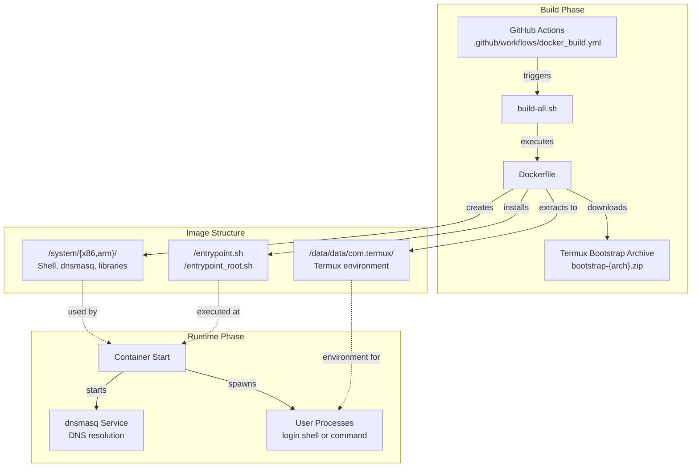
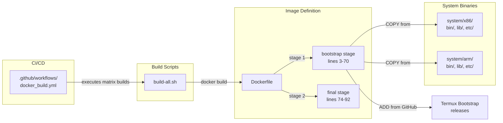
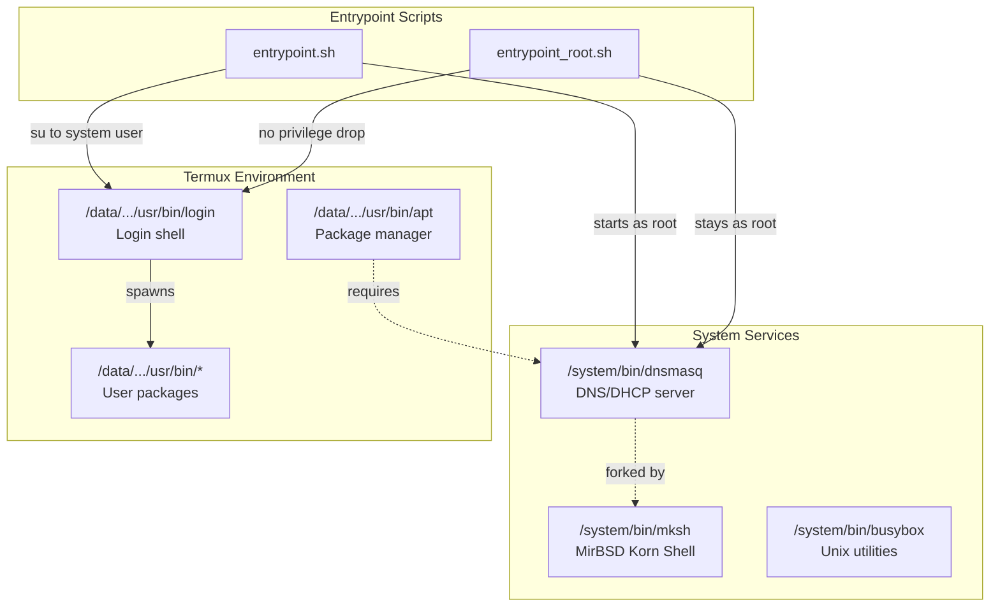
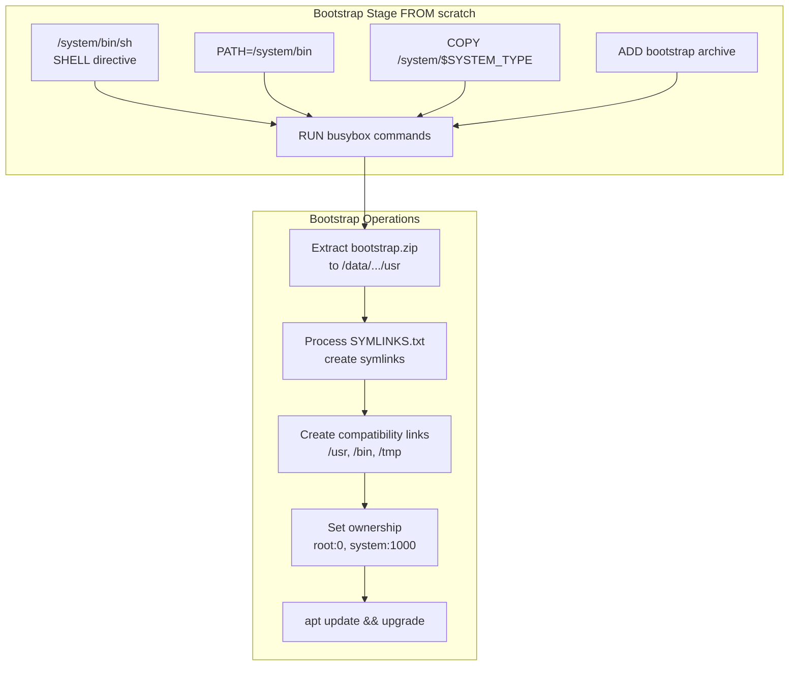
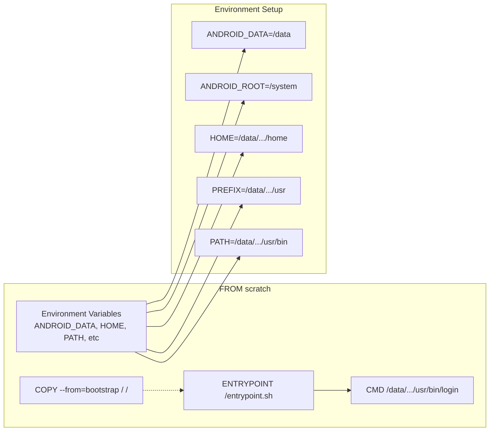
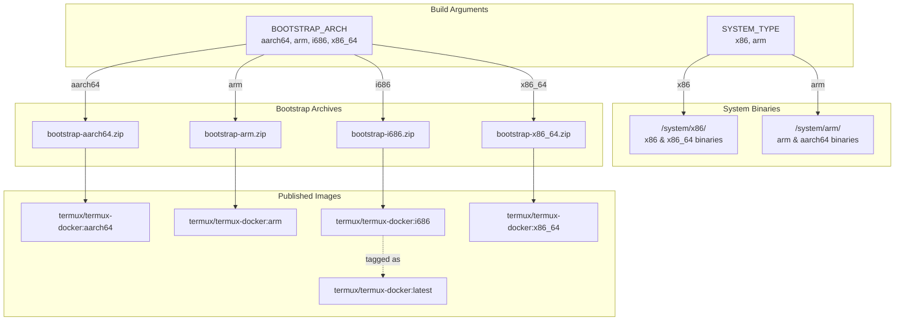
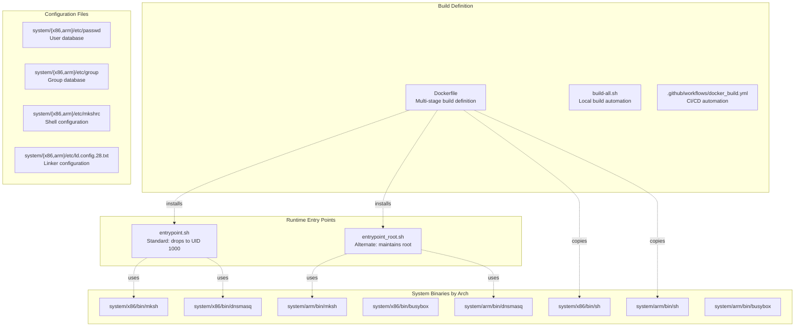
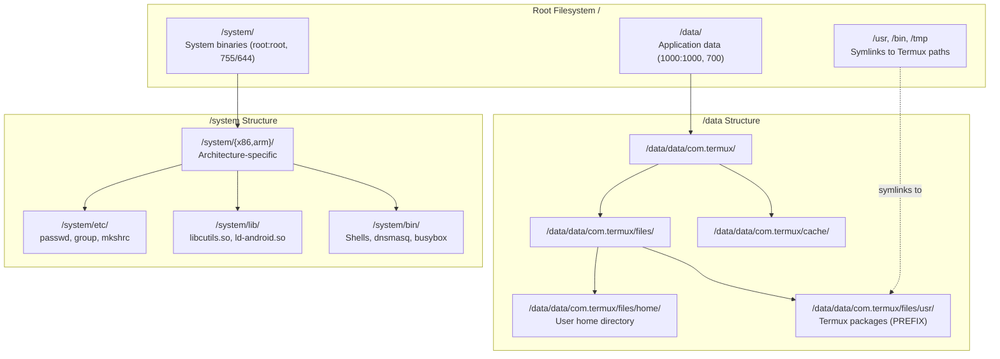

<!-- source: DeepWiki mcp.deepwiki.com · repo termux/termux-docker · page 1 Home · fetched 2026-10-26 -->

# Home

Relevant source files

The following files were used as context for generating this wiki page:

- [Dockerfile](Dockerfile)
- [README.md](README.md)
- [entrypoint_root.sh](entrypoint_root.sh)

## Purpose and Scope

This documentation covers **termux-docker**, a project that packages the [Termux](https://termux.com) Android terminal environment as Docker container images. This page provides an architectural overview of the system, explaining how the build process, multi-architecture support, and runtime initialization work together.

For quick start instructions on running containers, see [Getting Started](#2). For build system details, see [Building Images](#3). For runtime behavior specifics, see [Container Runtime](#4).

## What is Termux Docker?

Termux Docker is a containerized version of Termux, the Android terminal emulator and Linux environment. The project creates Docker images that replicate Termux's filesystem structure, package management system, and user environment without Android runtime components (DalvikVM, OpenSLES).

**Key Characteristics:**
- Multi-architecture support: `aarch64`, `arm`, `i686`, `x86_64`
- Android-style filesystem layout under `/data/data/com.termux/`
- Complete Termux package ecosystem via `apt`/`dpkg`
- Privilege-aware initialization supporting both root and non-root startup modes
- Published to Docker Hub as `termux/termux-docker` with architecture-specific tags

Sources: [README.md:1-6](), [README.md:26-32]()

## System Architecture Overview

The system consists of three major phases: **build-time preparation**, **image construction**, and **runtime initialization**.

**Architecture Phases:**

| Phase | Components | Purpose |
|-------|-----------|---------|
| **Build** | GitHub Actions, `build-all.sh`, `Dockerfile` | Automate multi-arch image creation |
| **Image** | `/system/`, `/data/`, entrypoints | Provide filesystem structure and binaries |
| **Runtime** | Entrypoint scripts, `dnsmasq`, user shell | Initialize services and user environment |

Sources: [Dockerfile:1-92](), [README.md:97-109]()

## Core Components

### Build System Components

The build system has three layers:

1. **CI/CD Layer**: `.github/workflows/docker_build.yml` orchestrates automated builds with matrix strategy for all architectures (see [CI/CD Pipeline](#3.3))
2. **Script Layer**: `build-all.sh` handles local builds with Docker/Podman detection (see [Build Scripts](#3.2))
3. **Dockerfile Layer**: Multi-stage Dockerfile downloads bootstrap archives and assembles the final image (see [The Dockerfile](#3.1))

Sources: [Dockerfile:1-92](), [README.md:97-109]()

### Runtime Components

**Runtime Component Roles:**

| Component | File Path | Role |
|-----------|-----------|------|
| `entrypoint.sh` | `/entrypoint.sh` | Standard entrypoint: starts services, drops to UID 1000 |
| `entrypoint_root.sh` | `/entrypoint_root.sh` | Root entrypoint: starts services, maintains root privileges |
| `mksh` | `/system/bin/mksh` | Shell used for PTY-based dnsmasq startup |
| `dnsmasq` | `/system/bin/dnsmasq` | DNS resolver required for package management |
| `login` | `/data/data/com.termux/files/usr/bin/login` | Default command: interactive login shell |

Sources: [Dockerfile:16-18](), [Dockerfile:90-91](), [entrypoint_root.sh:1-21]()

## Build vs Runtime Architecture

The system uses a **multi-stage Dockerfile** with distinct build-time and runtime environments:

### Build-Time Environment

**Bootstrap Stage Operations** [Dockerfile:3-70]():

1. **Base Setup**: `FROM scratch` with `/system/bin/sh` as shell [Dockerfile:3-11]()
2. **System Files**: Copy architecture-specific binaries from `system/{x86,arm}/` [Dockerfile:14]()
3. **Bootstrap Extraction**: Download and unzip Termux bootstrap archive [Dockerfile:21-26]()
4. **Symlink Creation**: Process `SYMLINKS.txt` for Termux package symlinks [Dockerfile:28-33]()
5. **Compatibility Links**: Create `/usr`, `/bin`, `/tmp` pointing to Termux paths [Dockerfile:34-36]()
6. **Permission Setup**: Set ownership (root:0 for `/system`, 1000:1000 for `/data`) [Dockerfile:49-59]()
7. **Package Updates**: Run `apt update && upgrade` for non-ARM architectures [Dockerfile:63-70]()

Sources: [Dockerfile:3-70]()

### Runtime Environment

**Final Stage** [Dockerfile:74-92]():

**Key Environment Variables** [Dockerfile:76-83]():

| Variable | Value | Purpose |
|----------|-------|---------|
| `ANDROID_DATA` | `/data` | Android data directory root |
| `ANDROID_ROOT` | `/system` | Android system directory root |
| `HOME` | `/data/data/com.termux/files/home` | User home directory |
| `PATH` | `/data/data/com.termux/files/usr/bin` | Default executable search path |
| `PREFIX` | `/data/data/com.termux/files/usr` | Termux installation prefix |
| `TMPDIR` | `/data/data/com.termux/files/usr/tmp` | Temporary directory |

Sources: [Dockerfile:74-92]()

## Multi-Architecture Support

The project supports four CPU architectures through **architecture-specific builds** and **parallel system directories**:

**Architecture Mapping** [Dockerfile:5-7]():

| BOOTSTRAP_ARCH | SYSTEM_TYPE | Published Tag | Notes |
|----------------|-------------|---------------|-------|
| `aarch64` | `arm` | `aarch64` | 64-bit ARM |
| `arm` | `arm` | `arm` | 32-bit ARM |
| `i686` | `x86` | `i686`, `latest` | 32-bit x86 (default) |
| `x86_64` | `x86` | `x86_64` | 64-bit x86 |

The `SYSTEM_TYPE` argument determines which `/system/{x86,arm}` directory is copied, providing the appropriate system binaries for the target architecture. For cross-architecture execution (e.g., ARM on x86 hosts), QEMU emulation must be configured via `binfmt_misc` (see [Cross-Platform Execution](#5.2)).

Sources: [Dockerfile:5-7](), [Dockerfile:14](), [README.md:26-36](), [README.md:42-66]()

## Key Files and Their Roles

### Primary System Files

**File Reference Table:**

| File Path | Purpose | Referenced In |
|-----------|---------|---------------|
| `Dockerfile` | Multi-stage image build definition | [The Dockerfile](#3.1) |
| `build-all.sh` | Local build script with Docker/Podman support | [Build Scripts](#3.2) |
| `.github/workflows/docker_build.yml` | CI/CD automation | [CI/CD Pipeline](#3.3) |
| `entrypoint.sh` | Standard entrypoint with privilege drop | [Entrypoint System](#4.1) |
| `entrypoint_root.sh` | Root-mode entrypoint | [Entrypoint System](#4.1) |
| `system/{x86,arm}/bin/sh` | POSIX shell | [Shell Environment](#6.1) |
| `system/{x86,arm}/bin/mksh` | MirBSD Korn Shell | [Shell Environment](#6.1) |
| `system/{x86,arm}/bin/dnsmasq` | DNS/DHCP server | [Network Services](#6.2) |
| `system/{x86,arm}/bin/busybox` | Unix utilities collection | [Architecture-Specific Binaries](#5.1) |
| `system/{x86,arm}/etc/passwd` | User/group definitions | [User and Group Configuration](#6.4) |
| `system/{x86,arm}/etc/mkshrc` | Shell startup script | [Shell Environment](#6.1) |
| `system/{x86,arm}/etc/ld.config.28.txt` | Dynamic linker configuration | [Linker Configuration](#8.1) |

Sources: [Dockerfile:1-92](), [entrypoint_root.sh:1-21](), [README.md:1-121]()

## Filesystem Layout Overview

The container filesystem follows **Android's directory structure** with compatibility symlinks for standard Linux paths:

**Directory Ownership and Permissions:**

| Path | Owner:Group | Permissions | Purpose |
|------|-------------|-------------|---------|
| `/system/` | `root:root` | 755 (dirs), 755 (executables), 644 (files) | Immutable system binaries |
| `/data/data/com.termux/` | `1000:1000` | 700 | Mutable Termux environment |
| `/data/data/com.termux/files/usr/` | `1000:1000` | 700 | Installed packages (PREFIX) |
| `/data/data/com.termux/files/home/` | `1000:1000` | 700 | User home directory |

For complete filesystem structure details, see [Filesystem Layout](#7).

Sources: [Dockerfile:22-36](), [Dockerfile:49-59]()

## Next Steps

- **Running containers**: See [Getting Started](#2) for usage examples
- **Building locally**: See [Building Images](#3) for build instructions
- **Understanding initialization**: See [Container Runtime](#4) for startup sequence details
- **Troubleshooting**: See [Known Issues and Troubleshooting](#8.3) for common problems

---

