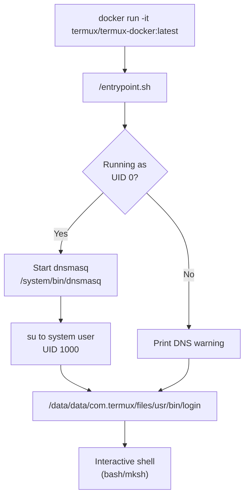
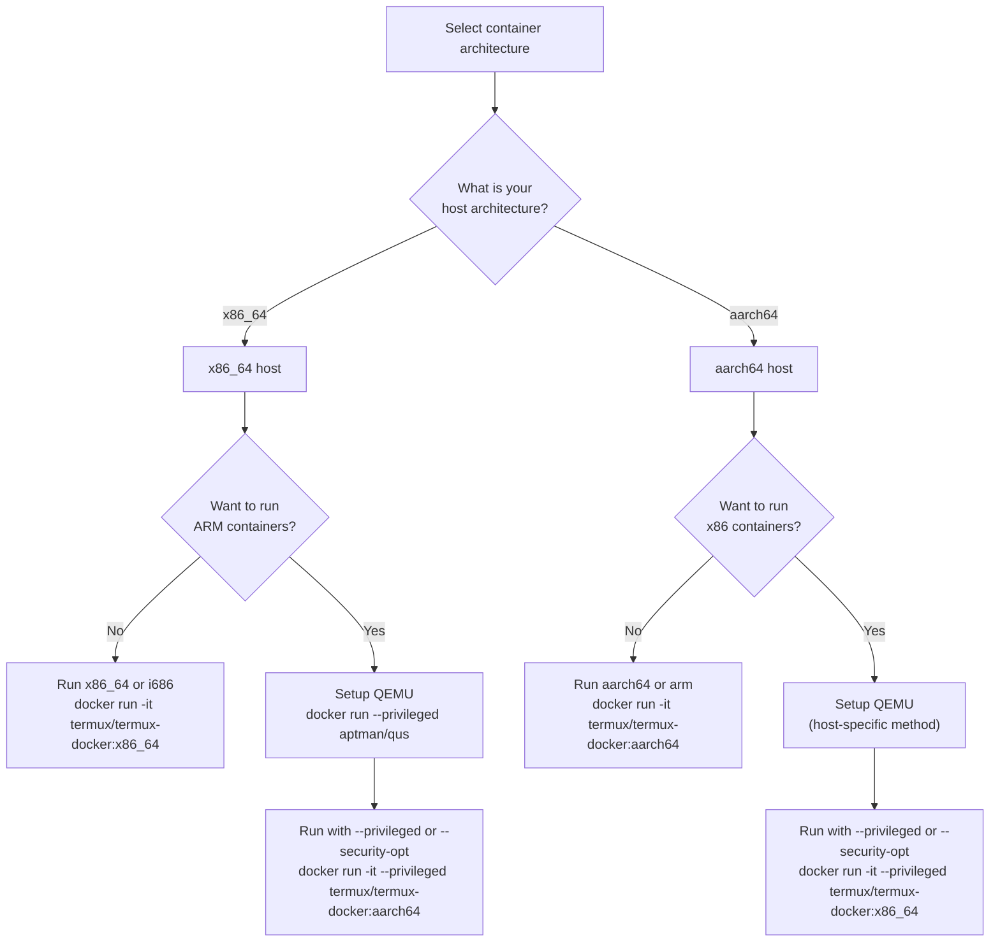
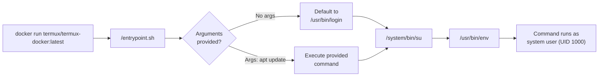

<!-- source: DeepWiki mcp.deepwiki.com · repo termux/termux-docker · page 2 Getting Started · fetched 2026-10-26 -->

# Getting Started

<details>
<summary>Relevant source files</summary>

The following files were used as context for generating this wiki page:

- [README.md](README.md)
- [entrypoint.sh](entrypoint.sh)
- [system/arm/bin/mksh](system/arm/bin/mksh)
- [system/x86/bin/mksh](system/x86/bin/mksh)

</details>


This guide provides instructions for pulling and running pre-built Termux Docker images. It covers basic container usage, architecture selection, cross-platform execution, and common configuration patterns.

For information about building images from source, see [Building Images](#3). For details about what happens inside containers at runtime, see [Container Runtime](#4).

---

## Prerequisites

Before using termux-docker, ensure you have:

| Requirement | Description |
|------------|-------------|
| **Docker or Podman** | A properly configured container runtime (version 19.03+ for Docker, 3.0+ for Podman) |
| **Internet Connection** | Required for pulling images from Docker Hub and package management |
| **Host Architecture** | x86_64 or ARM-based system; cross-architecture execution requires additional setup |

All examples in this guide use Docker commands. Podman users can substitute `podman` for `docker` in all commands.

**Sources:** [README.md:9-13]()

---

## Pulling Images

Termux Docker images are published to Docker Hub under the `termux/termux-docker` repository. Images are available for four CPU architectures:

| Tag | Architecture | Bit Width | Default |
|-----|-------------|-----------|---------|
| `i686` | x86 | 32-bit | ✓ (also tagged as `latest`) |
| `x86_64` | x86-64 | 64-bit | |
| `arm` | ARMv7 | 32-bit | |
| `aarch64` | ARMv8/ARM64 | 64-bit | |

To pull a specific architecture:

```sh
# Pull 32-bit x86 (default)
docker pull termux/termux-docker:latest

# Pull 64-bit ARM
docker pull termux/termux-docker:aarch64

# Pull 64-bit x86
docker pull termux/termux-docker:x86_64
```

Images are automatically updated weekly via GitHub Actions to include the latest Termux bootstrap packages.

**Sources:** [README.md:24-36]()

---

## Basic Interactive Usage

The simplest way to start a Termux container is to run an interactive login shell:

```sh
docker run -it termux/termux-docker:latest
```

This command:
1. Creates a new container from the specified image
2. Allocates a pseudo-TTY (`-t`) for terminal interaction
3. Keeps STDIN open (`-i`) for interactive input
4. Executes `/entrypoint.sh`, which initializes services and starts a login shell

Inside the container, you will have a full Termux environment with:
- The `apt` package manager for installing software
- Standard Unix tools (bash, coreutils, etc.)
- A writable home directory at `/data/data/com.termux/files/home`

### Container Initialization Flow



**Sources:** [README.md:15-23](), [entrypoint.sh:1-35]()

---

## Important: User Privilege Model

**Do not use the `--user` flag when starting containers.**

The container must start as root (UID 0) to initialize system services, specifically `dnsmasq` for DNS resolution. After service initialization, the entrypoint script automatically drops privileges to the `system` user (UID 1000) before executing user commands.

```sh
# ✓ CORRECT: Container starts as root, drops to system user
docker run -it termux/termux-docker:latest

# ✗ INCORRECT: DNS will be unavailable
docker run -it --user 1000:1000 termux/termux-docker:latest
```

The privilege drop mechanism is implemented in [entrypoint.sh:3-18](), which:
1. Checks if the effective UID is 0
2. If root, starts `dnsmasq` and uses `su` to switch to the system user
3. If non-root, prints a warning and continues without DNS

For details on the privilege model, see [Privilege Management](#4.3).

**Sources:** [README.md:38-40](), [entrypoint.sh:3-18]()

---

## Architecture Selection and Compatibility

### Native Architecture Execution

When the container architecture matches the host architecture, containers run natively without emulation:

| Host Architecture | Compatible Container Tags |
|------------------|---------------------------|
| x86_64 (64-bit Intel/AMD) | `x86_64`, `i686` |
| aarch64 (64-bit ARM) | `aarch64`, `arm` |
| x86 (32-bit Intel/AMD) | `i686` |
| armv7l (32-bit ARM) | `arm` |

Example on an x86_64 host:

```sh
# Native execution (64-bit)
docker run -it termux/termux-docker:x86_64

# Native execution (32-bit compatibility)
docker run -it termux/termux-docker:i686
```

### Cross-Architecture Execution

To run containers of incompatible architecture (e.g., ARM on x86), you must configure QEMU emulation through the kernel's `binfmt_misc` system. This requires **one-time setup** as root on the host machine.

#### Setting Up QEMU for ARM Emulation

Run this command once on your x86_64 host to enable ARM emulation:

```sh
docker run --rm --privileged aptman/qus -s -- -p aarch64 arm
```

This configures the kernel to automatically invoke QEMU when executing ARM binaries.

#### Running ARM Containers on x86 Hosts

After QEMU setup, ARM containers can be started, but they require relaxed security constraints:

**Option 1: Privileged mode (simplest)**

```sh
docker run -it --privileged termux/termux-docker:aarch64
```

**Option 2: Unconfined seccomp (more secure)**

```sh
docker run -it --security-opt seccomp=unconfined termux/termux-docker:aarch64
```

The security relaxation is necessary because ARM emulation requires the `personality()` system call, which is blocked by Docker's default seccomp profile. For background on this issue, see [Known Issues and Troubleshooting](#8.3).

### Architecture Selection Decision Tree



**Sources:** [README.md:34-36](), [README.md:42-66]()

---

## Non-Interactive Command Execution

Containers can execute commands non-interactively by appending them to the `docker run` command. This is useful for automation, CI/CD pipelines, or one-off tasks.

### Executing Single Commands

```sh
# Update package lists
docker run --rm termux/termux-docker:latest apt update

# Install a package
docker run --rm termux/termux-docker:latest apt install -y vim

# Run a Python script
docker run --rm -v $(pwd):/work termux/termux-docker:latest python /work/script.py
```

The `--rm` flag automatically removes the container after execution, preventing accumulation of stopped containers.

### Executing Complex Commands with Bash

For multi-step operations, use `bash -c` to execute a command string:

```sh
docker run -it --rm termux/termux-docker:latest bash -c "apt update && apt install -yq clang"
```

### Command Execution Flow



The entrypoint script passes all command-line arguments through the privilege-dropping `su` command, ensuring user commands always run as the `system` user (UID 1000), not root.

**Sources:** [README.md:68-77](), [entrypoint.sh:20-34]()

---

## Persistent Data with Volumes

By default, all changes made inside a container are lost when the container is removed. To persist data across container runs, mount a Docker volume or host directory:

### Using Docker Volumes

```sh
# Create a named volume
docker volume create termux-home

# Run container with persistent home directory
docker run -it \
  -v termux-home:/data/data/com.termux/files/home \
  termux/termux-docker:latest

# Data persists across container restarts
docker run -it \
  -v termux-home:/data/data/com.termux/files/home \
  termux/termux-docker:latest
```

### Using Host Directories

```sh
# Mount current directory as /work inside container
docker run -it \
  -v $(pwd):/work \
  termux/termux-docker:latest

# Inside container: cd /work to access host files
```

### Key Paths to Persist

| Path | Purpose |
|------|---------|
| `/data/data/com.termux/files/home` | User home directory, configuration files |
| `/data/data/com.termux/files/usr` | Installed packages (warning: architecture-specific) |
| `/data/data/com.termux/files/usr/tmp` | Temporary files (mapped to `/tmp`) |

**Note:** The `/data/data/com.termux/files/usr` directory contains architecture-specific binaries. Do not share this volume between containers of different architectures.

**Sources:** Inferred from filesystem structure in [Diagram 4](#diagram-4)

---

## Root Shell Access

The default entrypoint drops privileges for security and package manager compatibility. However, some operations require root access.

### Using the Root Entrypoint

The image provides an alternate entrypoint that does not drop privileges:

```sh
docker run -it --entrypoint /entrypoint_root.sh termux/termux-docker:latest
```

This starts a shell as root (UID 0) but skips the privilege drop to the system user.

### Entrypoint Comparison

| Entrypoint | File | Starts dnsmasq? | Drops to system user? | Use Case |
|-----------|------|-----------------|----------------------|----------|
| Default | `/entrypoint.sh` | Yes | Yes | Normal usage, package management |
| Root | `/entrypoint_root.sh` | Yes | No | System administration, debugging |

### Root vs Non-Root Behavior Mapping

```mermaid
flowchart TD
    subgraph default["Default Entrypoint: /entrypoint.sh"]
        D_START["/entrypoint.sh"]
        D_DNS["Start /system/bin/dnsmasq"]
        D_SU["su to system user"]
        D_CMD["Execute as UID 1000"]
    end
    
    subgraph root["Root Entrypoint: /entrypoint_root.sh"]
        R_START["/entrypoint_root.sh"]
        R_DNS["Start /system/bin/dnsmasq"]
        R_CMD["Execute as UID 0"]
    end
    
    USER["docker run --entrypoint ..."]
    
    USER -->|"--entrypoint /entrypoint.sh"| D_START
    USER -->|"--entrypoint /entrypoint_root.sh"| R_START
    
    D_START --> D_DNS
    D_DNS --> D_SU
    D_SU --> D_CMD
    
    R_START --> R_DNS
    R_DNS --> R_CMD
```

**Warning:** Running the package manager (`apt`, `pkg`) as root is not recommended and may cause permission issues. Use the root entrypoint only when necessary for specific administrative tasks.

**Sources:** [README.md:79-95](), [entrypoint.sh:24-34]()

---

## Common Usage Patterns

### Pattern 1: Development Environment

Create a persistent development container with a mounted project directory:

```sh
docker run -it --name termux-dev \
  -v $(pwd):/project \
  -v termux-dev-home:/data/data/com.termux/files/home \
  termux/termux-docker:latest
```

Inside the container:
```sh
cd /project
apt update && apt install -y git vim clang
```

Stop and restart the container:
```sh
docker stop termux-dev
docker start -ai termux-dev
```

### Pattern 2: CI/CD Build Container

Use containers in automation scripts:

```sh
#!/bin/bash
docker run --rm \
  -v $(pwd):/workspace \
  termux/termux-docker:x86_64 \
  bash -c "cd /workspace && apt install -y clang && make"
```

### Pattern 3: Testing Across Architectures

Test code on multiple architectures using a script:

```sh
for arch in i686 x86_64 aarch64; do
  echo "Testing on $arch..."
  docker run --rm \
    -v $(pwd):/test \
    termux/termux-docker:$arch \
    bash -c "cd /test && ./run-tests.sh"
done
```

**Sources:** [README.md:15-77]()

---

## Quick Reference

### Essential Commands

| Task | Command |
|------|---------|
| **Start interactive shell** | `docker run -it termux/termux-docker:latest` |
| **Start with persistent home** | `docker run -it -v termux-home:/data/data/com.termux/files/home termux/termux-docker:latest` |
| **Execute single command** | `docker run --rm termux/termux-docker:latest apt update` |
| **Start as root** | `docker run -it --entrypoint /entrypoint_root.sh termux/termux-docker:latest` |
| **ARM on x86 (setup)** | `docker run --rm --privileged aptman/qus -s -- -p aarch64 arm` |
| **ARM on x86 (run)** | `docker run -it --privileged termux/termux-docker:aarch64` |

### Image Tags

| Tag | Architecture | Default |
|-----|-------------|---------|
| `latest` | i686 (x86 32-bit) | ✓ |
| `i686` | x86 32-bit | |
| `x86_64` | x86-64 64-bit | |
| `arm` | ARMv7 32-bit | |
| `aarch64` | ARMv8 64-bit | |

### Next Steps

- Learn about the [build process](#3) to create custom images
- Understand the [entrypoint system](#4.1) for advanced initialization
- Explore [multi-architecture support](#5) for cross-platform deployment
- Review [known issues](#8.3) for troubleshooting guidance

**Sources:** [README.md:1-121]()

---

