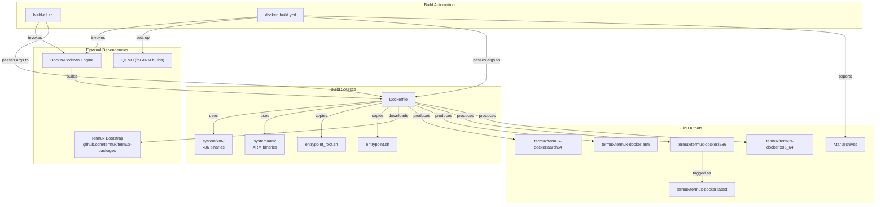
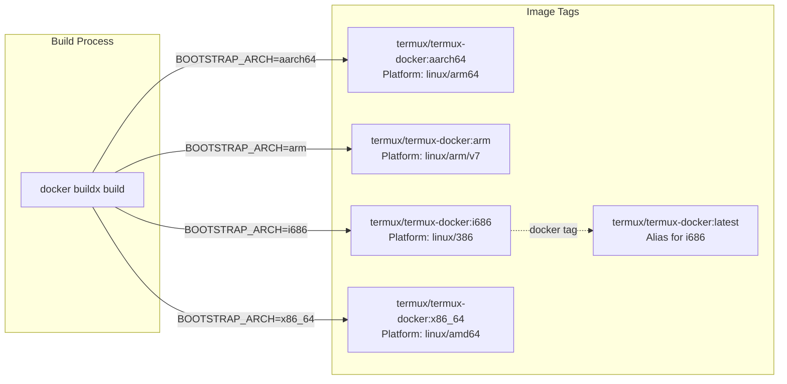
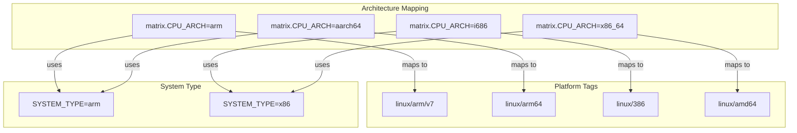
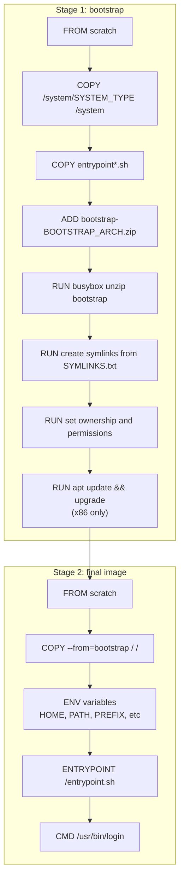

<!-- source: DeepWiki mcp.deepwiki.com · repo termux/termux-docker · page 3 Building Images · fetched 2026-10-26 -->

# Building Images

<details>
<summary>Relevant source files</summary>

The following files were used as context for generating this wiki page:

- [.github/workflows/docker_build.yml](.github/workflows/docker_build.yml)
- [Dockerfile](Dockerfile)
- [build-all.sh](build-all.sh)
- [entrypoint_root.sh](entrypoint_root.sh)

</details>


## Purpose and Scope

This document provides an overview of the image build system for termux-docker, covering the components, architecture support, and build methods used to create Termux container images. For detailed information about specific build components, see:
- [The Dockerfile](#3.1) - Multi-stage build process and filesystem setup
- [Build Scripts](#3.2) - Local build automation with `build-all.sh`
- [CI/CD Pipeline](#3.3) - Automated builds and publishing via GitHub Actions

## Build System Components

The build system consists of three primary components that work together to produce multi-architecture Termux container images:



**Sources:** [Dockerfile:1-92](), [build-all.sh:1-47](), [.github/workflows/docker_build.yml:1-85]()

### Component Roles

| Component | File Path | Primary Function |
|-----------|-----------|------------------|
| **Dockerfile** | `Dockerfile` | Multi-stage build definition; extracts bootstrap, configures filesystem |
| **Build Script** | `build-all.sh` | Local build automation; detects host architecture, builds compatible images |
| **CI Workflow** | `.github/workflows/docker_build.yml` | Automated builds on push/PR/schedule; matrix strategy for all architectures |
| **System Binaries** | `system/x86/`, `system/arm/` | Architecture-specific shell, dnsmasq, libraries for bootstrap phase |
| **Entrypoints** | `entrypoint.sh`, `entrypoint_root.sh` | Container initialization scripts copied into images |

**Sources:** [Dockerfile:1-92](), [build-all.sh:1-47](), [.github/workflows/docker_build.yml:1-85]()

## Build Inputs and Outputs

### Build Arguments

The build process accepts two critical build arguments that determine the image architecture and system type:

| Build Argument | Purpose | Valid Values | Default |
|----------------|---------|--------------|---------|
| `BOOTSTRAP_ARCH` | Specifies Termux bootstrap architecture | `aarch64`, `arm`, `i686`, `x86_64` | `i686` |
| `SYSTEM_TYPE` | Selects system binary directory | `x86`, `arm` | `x86` |

The `SYSTEM_TYPE` maps to bootstrap architectures as follows:
- **`x86`**: Used for `i686` and `x86_64` bootstrap architectures
- **`arm`**: Used for `arm` and `aarch64` bootstrap architectures

**Sources:** [Dockerfile:5-7](), [.github/workflows/docker_build.yml:37-48](), [build-all.sh:17-26]()

### Bootstrap Version

The build downloads a specific Termux bootstrap archive from GitHub releases. The version is defined at build time:

- **Default Version:** `2023.02.19-r1%2Bapt-android-7` [Dockerfile:5]()
- **Download URL Pattern:** `https://github.com/termux/termux-packages/releases/download/bootstrap-$BOOTSTRAP_VERSION/bootstrap-$BOOTSTRAP_ARCH.zip` [Dockerfile:21]()

### Output Images

The build produces architecture-specific images tagged by CPU architecture:



**Sources:** [.github/workflows/docker_build.yml:43-48](), [.github/workflows/docker_build.yml:61-64](), [build-all.sh:28-46]()

## Multi-Architecture Build Strategy

### Architecture Detection and Compatibility

The build system automatically detects the host architecture and builds compatible images:

| Host Architecture (`uname -m`) | SYSTEM_TYPE | Buildable Architectures |
|-------------------------------|-------------|-------------------------|
| `x86_64` | `x86` | `i686`, `x86_64` |
| `i686` | `x86` | `i686` |
| `aarch64` | `arm` | `aarch64`, `arm` |
| `armv7l`, `armv8l` | `arm` | `arm` |

**Sources:** [build-all.sh:17-26]()

### Cross-Architecture Builds

For ARM builds on x86 hosts (or vice versa), the CI workflow configures QEMU emulation:

```bash
# Enable QEMU for ARM architectures
docker run --rm --privileged aptman/qus -s -- -p aarch64 arm
```

This setup is only performed when `matrix.CPU_ARCH` is `aarch64` or `arm` [.github/workflows/docker_build.yml:31-33]().

### Platform Tag Mapping

The CI workflow maps CPU architectures to Docker platform tags:



**Sources:** [.github/workflows/docker_build.yml:37-48]()

## Build Process Overview

The build follows a two-stage process defined in the Dockerfile:



**Sources:** [Dockerfile:1-92]()

### Stage 1: Bootstrap

The first stage builds the complete Termux environment from scratch:

1. **Base Setup** - Copies system binaries for the target `SYSTEM_TYPE` [Dockerfile:14]()
2. **Entrypoint Installation** - Copies initialization scripts [Dockerfile:17-18]()
3. **Bootstrap Download** - Fetches Termux bootstrap archive from GitHub [Dockerfile:21]()
4. **Extraction** - Unpacks bootstrap to `/data/data/com.termux/files/usr` [Dockerfile:22-36]()
5. **Symlink Creation** - Creates symlinks from `SYMLINKS.txt` and standard paths [Dockerfile:28-36]()
6. **Permission Setup** - Sets ownership (root for `/system`, UID 1000 for `/data`) [Dockerfile:49-59]()
7. **Package Updates** - Updates and upgrades packages (x86 only, skipped for ARM) [Dockerfile:63-70]()

### Stage 2: Final Image

The second stage creates a clean image without build artifacts:

1. **Copy Bootstrap** - Copies entire filesystem from Stage 1 [Dockerfile:85]()
2. **Environment Setup** - Defines standard Android/Termux environment variables [Dockerfile:76-83]()
3. **Entrypoint Configuration** - Sets `/entrypoint.sh` as the container entrypoint [Dockerfile:90]()
4. **Default Command** - Sets `/data/data/com.termux/files/usr/bin/login` as default [Dockerfile:91]()

**Sources:** [Dockerfile:72-92]()

## Build Methods

### Local Builds with build-all.sh

The `build-all.sh` script provides a convenient interface for local image builds:

```bash
# Build all compatible architectures for the host
./build-all.sh

# Build with Podman instead of Docker
./build-all.sh --podman

# Build and publish to registry
./build-all.sh publish
```

**Key Features:**
- Auto-detects host architecture [build-all.sh:17-26]()
- Builds only compatible architectures [build-all.sh:28-39]()
- Supports both Docker and Podman [build-all.sh:7-9]()
- Optional `sudo` support via `TERMUX_DOCKER_USE_SUDO` [build-all.sh:11-15]()
- Tags `i686` as `latest` on x86 systems [build-all.sh:41-46]()

**Sources:** [build-all.sh:1-47]()

### CI/CD Builds with GitHub Actions

The GitHub Actions workflow provides automated, multi-architecture builds:

**Trigger Events:**
- Push to `master` branch [.github/workflows/docker_build.yml:4-6]()
- Pull requests [.github/workflows/docker_build.yml:7]()
- Weekly schedule (Sunday 2 AM UTC) [.github/workflows/docker_build.yml:8-9]()
- Manual workflow dispatch [.github/workflows/docker_build.yml:10]()

**Build Matrix:**
The workflow uses a matrix strategy to build all four architectures in parallel:

```yaml
strategy:
  matrix:
    CPU_ARCH:
      - aarch64
      - arm
      - i686
      - x86_64
```

**Sources:** [.github/workflows/docker_build.yml:19-25]()

### Comparison

| Feature | build-all.sh | GitHub Actions |
|---------|--------------|----------------|
| **Architectures** | Host-compatible only | All 4 architectures |
| **Parallelization** | Sequential | Parallel matrix |
| **QEMU Setup** | Manual | Automatic |
| **Registry Push** | Optional (`publish` arg) | Automatic (master only) |
| **Artifacts** | Local images only | Images + .tar exports |
| **Execution** | Local machine | GitHub runners |

**Sources:** [build-all.sh:1-47](), [.github/workflows/docker_build.yml:1-85]()

## Build Artifacts

### Docker Images

Images are tagged with the following naming convention:
- **Repository:** `termux/termux-docker`
- **Tags:** `aarch64`, `arm`, `i686`, `x86_64`, `latest` (alias for `i686`)

Images pushed to Docker Hub are only done from the master branch after successful builds [.github/workflows/docker_build.yml:50-64]().

### TAR Archives

The CI workflow exports each built image as a `.tar` archive for offline use:

```bash
docker export -o termux-docker-${{ matrix.CPU_ARCH }}.tar
```

These archives are uploaded as GitHub Actions artifacts with names like `termux-docker-aarch64-{SHA}` [.github/workflows/docker_build.yml:66-84]().

**Sources:** [.github/workflows/docker_build.yml:66-84]()

## Package Updates During Build

For x86-based images (`i686`, `x86_64`), the build process updates all packages to their latest versions during Stage 1:

```bash
/system/bin/mksh -T /dev/ptmx -c "/system/bin/dnsmasq -u root -g root --pid-file /dnsmasq.pid"
su - system -c "/data/data/com.termux/files/usr/bin/apt update"
su - system -c "/data/data/com.termux/files/usr/bin/apt upgrade -o Dpkg::Options::=--force-confnew -yq"
```

**ARM Builds Skip Updates:** The conditional logic `if [ ${SYSTEM_TYPE} = 'arm' ]; then exit; else ...` skips package updates for ARM architectures due to seccomp profile limitations that prevent `apt` from functioning correctly during Docker builds on ARM [Dockerfile:63-70]().

This means:
- **x86 images** ship with the latest package versions at build time
- **ARM images** ship with the bootstrap archive versions (updates must be performed post-deployment)

**Sources:** [Dockerfile:63-70]()

---

