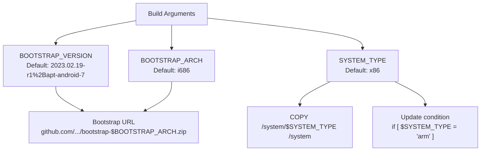
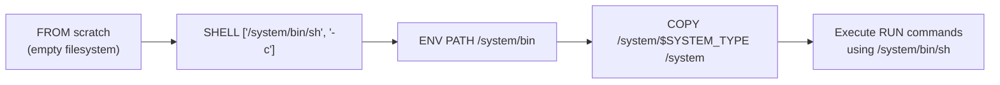
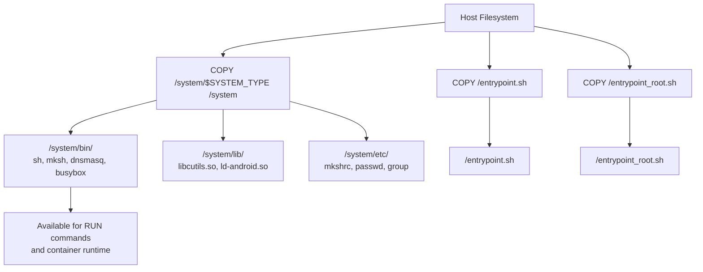
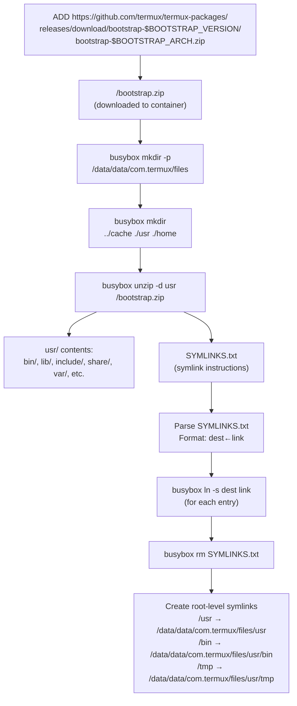
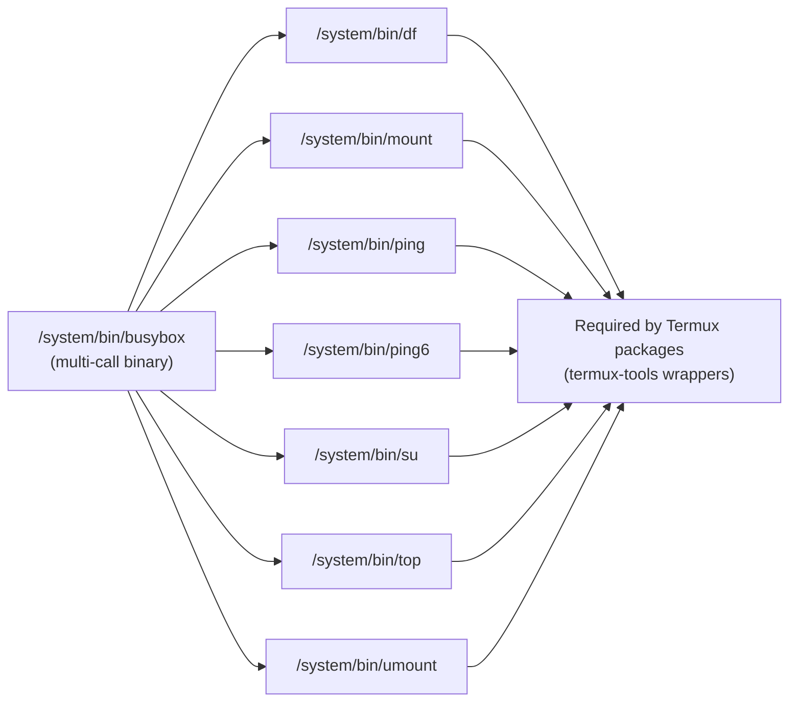
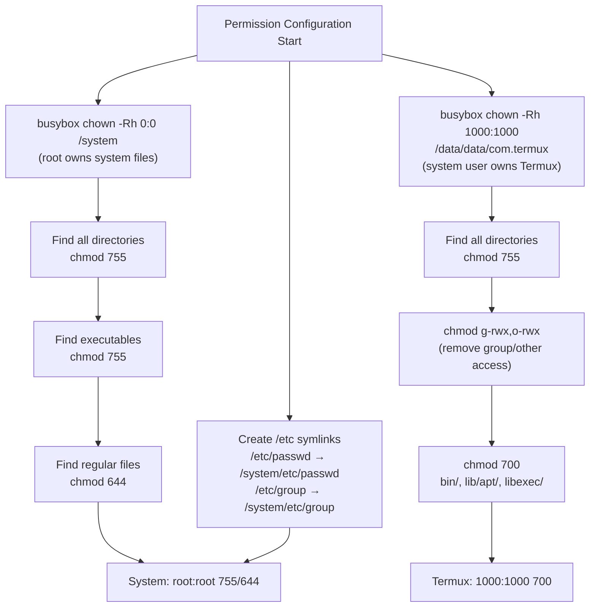
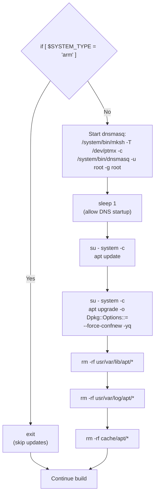
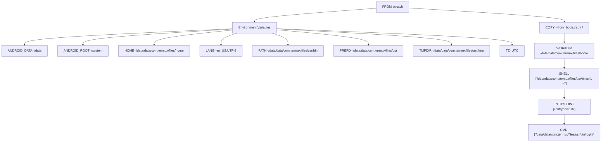
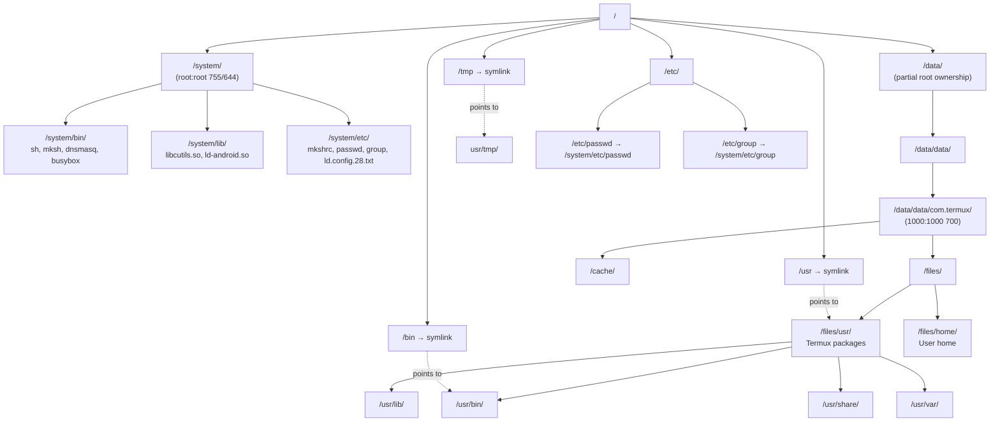

<!-- source: DeepWiki mcp.deepwiki.com · repo termux/termux-docker · page 3.1 The Dockerfile · fetched 2026-10-26 -->

# The Dockerfile

<details>
<summary>Relevant source files</summary>

The following files were used as context for generating this wiki page:

- [Dockerfile](Dockerfile)
- [entrypoint_root.sh](entrypoint_root.sh)

</details>


## Purpose and Scope

This document provides a detailed technical explanation of the `Dockerfile` that constructs Termux Docker images. It covers the multi-stage build process, bootstrap archive extraction, filesystem structure creation, permission configuration, and environment setup. For information about the build scripts that invoke this Dockerfile with specific architecture parameters, see [Build Scripts](#3.2). For the GitHub Actions workflow that orchestrates automated builds, see [CI/CD Pipeline](#3.3).

**Sources:** [Dockerfile:1-92]()

## Multi-Stage Build Overview

The Dockerfile uses a two-stage build pattern to create minimal, efficient images:

```mermaid
graph LR
    subgraph "Stage 1: bootstrap"
        S1["FROM scratch"]
        S1 --> COPY_SYS["COPY /system/$SYSTEM_TYPE"]
        COPY_SYS --> COPY_EP["COPY entrypoint scripts"]
        COPY_EP --> DL_BS["ADD bootstrap archive<br/>from GitHub"]
        DL_BS --> EXTRACT["RUN unzip + symlinks"]
        EXTRACT --> PERMS["RUN set ownership<br/>and permissions"]
        PERMS --> UPDATE["RUN apt update/upgrade<br/>(x86 only)"]
    end
    
    subgraph "Stage 2: final"
        S2["FROM scratch"]
        S2 --> COPY_FROM["COPY --from=bootstrap"]
        COPY_FROM --> ENV["ENV variables"]
        ENV --> EP["ENTRYPOINT + CMD"]
    end
    
    UPDATE --> S2
    
    style S1 fill:#f9f9f9
    style S2 fill:#f9f9f9
```



**Diagram: Multi-stage build flow**

The `bootstrap` stage [Dockerfile:3-70]() performs all heavy operations including downloading the Termux bootstrap archive, extracting it, and configuring the filesystem. The final stage [Dockerfile:74-91]() creates a clean image by copying the entire filesystem from the bootstrap stage without build artifacts.

**Sources:** [Dockerfile:3-92]()

## Build Arguments

Three build arguments control architecture-specific image construction:

| Build Argument | Default Value | Purpose |
|----------------|---------------|---------|
| `BOOTSTRAP_VERSION` | `2023.02.19-r1%2Bapt-android-7` | Specifies which Termux bootstrap release to download |
| `BOOTSTRAP_ARCH` | `i686` | Architecture tag for bootstrap filename (aarch64, arm, i686, x86_64) |
| `SYSTEM_TYPE` | `x86` | Directory name under `/system/` for architecture binaries (x86, arm) |



**Diagram: Build argument flow and usage**

The `SYSTEM_TYPE` argument determines which architecture-specific binaries are copied [Dockerfile:14]() and controls whether package updates run during build [Dockerfile:63](). The mapping between `BOOTSTRAP_ARCH` and `SYSTEM_TYPE` is:
- `aarch64` and `arm` → `SYSTEM_TYPE=arm`
- `i686` and `x86_64` → `SYSTEM_TYPE=x86`

**Sources:** [Dockerfile:5-7](), [Dockerfile:14](), [Dockerfile:21](), [Dockerfile:63]()

## Shell and PATH Configuration

Before any operations execute, the Dockerfile configures the execution environment:



**Diagram: Initial shell configuration sequence**

The `SHELL` directive [Dockerfile:10]() sets `/system/bin/sh` as the shell for `RUN` commands, since Docker's default `/bin/sh` doesn't exist yet. The `PATH` environment variable [Dockerfile:11]() ensures system utilities like `busybox` are discoverable. These settings only apply to the bootstrap stage; the final image resets the shell [Dockerfile:88]().

**Sources:** [Dockerfile:10-11]()

## System Files and Entrypoint Scripts

The bootstrap stage begins by copying essential files into the empty filesystem:



**Diagram: System file copy operations**

The `COPY` commands [Dockerfile:14-18]() populate the image with:
- **System binaries**: Architecture-specific executables including `busybox` (provides Unix utilities), `sh` and `mksh` (shells), and `dnsmasq` (DNS service)
- **System libraries**: Android runtime libraries required by system binaries
- **System configuration**: Shell configuration, user definitions, and linker settings
- **Entrypoint scripts**: Container initialization logic

These files originate from the `system/` directory in the repository, which contains separate subdirectories for x86 and ARM architectures. See [Architecture-Specific Binaries](#5.1) for details on this structure.

**Sources:** [Dockerfile:14-18]()

## Bootstrap Archive Extraction

The Dockerfile downloads and extracts the Termux bootstrap archive, which contains the complete Termux package ecosystem:



**Diagram: Bootstrap extraction and symlink creation process**

The extraction process [Dockerfile:22-36]() follows this sequence:

1. **Download**: The `ADD` instruction downloads the bootstrap ZIP directly from GitHub releases [Dockerfile:21]()
2. **Directory creation**: Creates the Android-style directory structure `/data/data/com.termux/files` and subdirectories [Dockerfile:22-24]()
3. **Extraction**: Unzips the bootstrap archive into `usr/` [Dockerfile:25]()
4. **Symlink processing**: Parses `SYMLINKS.txt` using the format `destination←link` and creates all required symlinks [Dockerfile:28-32]()
5. **Root symlinks**: Creates compatibility symlinks at filesystem root for standard Linux paths [Dockerfile:34-36]()

The bootstrap archive URL format is:
```
https://github.com/termux/termux-packages/releases/download/
  bootstrap-$BOOTSTRAP_VERSION/bootstrap-$BOOTSTRAP_ARCH.zip
```

**Sources:** [Dockerfile:21-36]()

## Busybox Utility Linking

After bootstrap extraction, the Dockerfile creates symlinks for utilities that Termux packages expect from `/system/bin`:



**Diagram: Busybox utility symlink structure**

The `RUN` command [Dockerfile:41-43]() creates symlinks for specific utilities that Termux packages reference as wrappers to system binaries. The comment [Dockerfile:39-40]() notes these correspond to utilities defined in the `termux-tools` package build script. When invoked, `busybox` detects its invocation name and executes the corresponding functionality.

**Sources:** [Dockerfile:38-43]()

## Ownership and Permission Configuration

The Dockerfile implements a strict ownership and permission model:



**Diagram: Ownership and permission configuration flow**

The permission configuration [Dockerfile:49-59]() establishes security boundaries:

| Filesystem Area | Owner | Directory Permissions | File Permissions | Purpose |
|----------------|-------|---------------------|------------------|---------|
| `/system/*` | `0:0` (root) | `755` | `755` (executable) / `644` (regular) | Read-only system binaries and configuration |
| `/data/data/com.termux/*` | `1000:1000` (system user) | `700` | `700` (executables) / `600` (regular) | User-writable Termux environment |

Key operations:
- System files receive standard Unix permissions (`755` for executables/directories, `644` for regular files) [Dockerfile:53-55]()
- Termux files remove all group and other permissions (`g-rwx,o-rwx`) [Dockerfile:57]()
- Critical executables in `bin/`, `lib/apt/`, and `libexec/` receive `700` permissions [Dockerfile:59]()
- Password and group files symlink to system locations [Dockerfile:51-52]()

This model mirrors Android's application isolation where each app runs under its own UID. See [Privilege Management](#4.3) for runtime implications.

**Sources:** [Dockerfile:45-59]()

## Package Updates

For x86-based images, the Dockerfile updates all installed packages during build:



**Diagram: Conditional package update flow**

The update process [Dockerfile:63-70]() only executes for x86-based images due to seccomp profile restrictions on ARM architectures that cause package manager failures. When updates run:

1. **Start DNS service**: Launches `dnsmasq` using `mksh` with PTY support (`-T /dev/ptmx`) to provide DNS resolution [Dockerfile:64]()
2. **Update package lists**: Runs `apt update` as the system user [Dockerfile:65]()
3. **Upgrade packages**: Runs `apt upgrade` with `--force-confnew` to automatically use new configuration files [Dockerfile:66]()
4. **Clean caches**: Removes all apt cache and log files to reduce image size [Dockerfile:67-69]()

The `su - system -c` wrapper ensures package operations run as UID 1000 rather than root. For more on the DNS requirement, see [Network Services](#6.2).

**Sources:** [Dockerfile:61-70]()

## Final Image Configuration

The second stage creates the final image with minimal content:



**Diagram: Final image configuration elements**

The final stage [Dockerfile:74-91]() configures the runtime environment:

### Environment Variables

| Variable | Value | Purpose |
|----------|-------|---------|
| `ANDROID_DATA` | `/data` | Android data directory root |
| `ANDROID_ROOT` | `/system` | Android system directory root |
| `HOME` | `/data/data/com.termux/files/home` | User home directory |
| `LANG` | `en_US.UTF-8` | Default locale |
| `PATH` | `/data/data/com.termux/files/usr/bin` | Termux binary search path |
| `PREFIX` | `/data/data/com.termux/files/usr` | Termux package installation prefix |
| `TMPDIR` | `/data/data/com.termux/files/usr/tmp` | Temporary file directory |
| `TZ` | `UTC` | Default timezone |

These variables [Dockerfile:76-83]() establish Android-compatible paths and configure the Termux environment. The `PREFIX` variable is particularly critical as Termux packages use it to locate binaries and libraries.

### Container Execution Configuration

- **WORKDIR**: Sets working directory to the user home directory [Dockerfile:87]()
- **SHELL**: Configures `/data/data/com.termux/files/usr/bin/sh` as the shell for `RUN` commands in derived images [Dockerfile:88]()
- **ENTRYPOINT**: Sets `/entrypoint.sh` as the container entry point [Dockerfile:90]()
- **CMD**: Defaults to `/data/data/com.termux/files/usr/bin/login` (interactive shell) if no command provided [Dockerfile:91]()

The entrypoint script handles privilege checking and service initialization. See [Entrypoint System](#4.1) for detailed execution flow.

**Sources:** [Dockerfile:74-91]()

## Filesystem Structure Created

The Dockerfile produces the following filesystem layout:



**Diagram: Complete filesystem structure with ownership**

The structure combines:
- **Android system directories** (`/system/`) containing immutable binaries and libraries
- **Android application directory** (`/data/data/com.termux/`) containing the mutable Termux environment
- **Compatibility symlinks** (`/usr`, `/bin`, `/tmp`) providing standard Linux paths
- **Configuration symlinks** (`/etc/passwd`, `/etc/group`) referencing system files

All directories and files under `/data/data/com.termux/` are owned by UID 1000 (system user) with restricted permissions, while `/system/` is owned by root. See [Filesystem Layout](#7) for comprehensive details.

**Sources:** [Dockerfile:14](), [Dockerfile:22-36](), [Dockerfile:49-59]()

---

