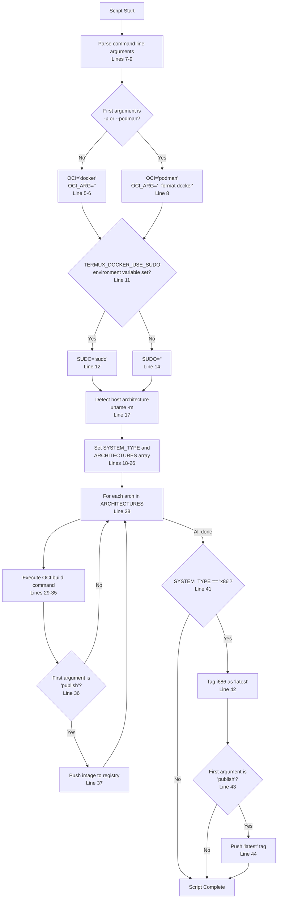
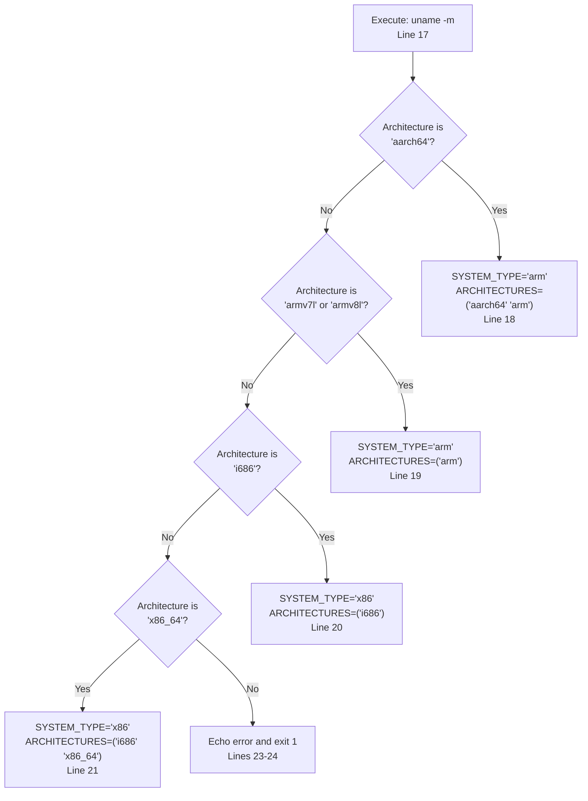
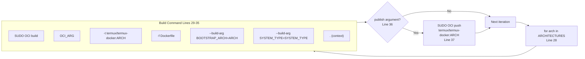
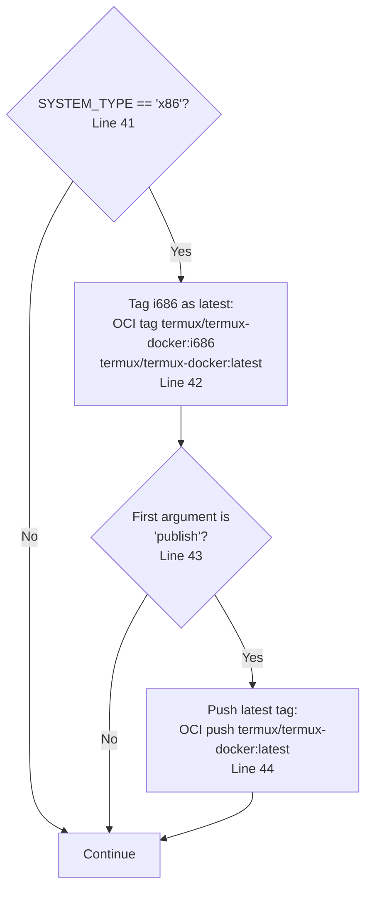

<!-- source: DeepWiki mcp.deepwiki.com · repo termux/termux-docker · page 3.2 Build Scripts · fetched 2026-10-26 -->

# Build Scripts

<details>
<summary>Relevant source files</summary>

The following files were used as context for generating this wiki page:

- [build-all.sh](build-all.sh)

</details>


## Purpose and Scope

This document provides a detailed explanation of the `build-all.sh` script, which serves as the primary local build automation tool for creating Termux Docker images. The script handles OCI runtime selection (Docker vs Podman), architecture detection, multi-architecture image building, and optional publishing to registries.

For information about the Dockerfile that this script invokes, see [The Dockerfile](#3.1). For information about the automated CI/CD pipeline that uses similar logic, see [CI/CD Pipeline](#3.3). For details on multi-architecture execution and QEMU setup, see [Multi-Architecture Support](#5).

**Sources:** [build-all.sh:1-47]()

---

## Overview

The `build-all.sh` script provides a simplified interface for building one or more architecture-specific Termux Docker images on a local development machine. The script automatically detects the host architecture and determines which target architectures can be built natively or via emulation.

The script supports:
- Docker and Podman as OCI runtimes
- Optional privilege escalation via sudo
- Native builds for architectures supported by the host
- Automatic image tagging with architecture-specific tags
- Optional publishing to Docker Hub or other registries

**Sources:** [build-all.sh:1-47]()

---

## Script Execution Flow

The following diagram illustrates the complete execution flow of the build script, showing the sequence of operations from startup to completion:

**Diagram: Build Script Execution Sequence**



**Sources:** [build-all.sh:1-47]()

---

## OCI Runtime Selection

The script supports both Docker and Podman as OCI (Open Container Initiative) runtimes. The runtime is selected via command-line arguments:

| Argument | OCI Tool | OCI_ARG Value | Purpose |
|----------|----------|---------------|---------|
| (none) | `docker` | `""` | Default runtime, standard Docker format |
| `-p` or `--podman` | `podman` | `--format docker` | Use Podman with Docker-compatible output format |

The `OCI_ARG` variable is passed to the build command when using Podman to ensure the output image format is Docker-compatible for maximum portability.

**Key Variables:**
- `OCI`: The command name to execute (`docker` or `podman`)
- `OCI_ARG`: Additional arguments passed to the OCI tool

**Sources:** [build-all.sh:5-9]()

---

## Privilege Escalation

The script supports optional privilege escalation via `sudo`, controlled by the `TERMUX_DOCKER_USE_SUDO` environment variable:

```bash
# Run with sudo
TERMUX_DOCKER_USE_SUDO=1 ./build-all.sh

# Run without sudo (default)
./build-all.sh
```

When `TERMUX_DOCKER_USE_SUDO` is set to any non-empty value, the script prefixes all OCI commands with `sudo`. This is useful when:
- The Docker daemon requires root access
- The user is not in the `docker` group
- System-level Podman operations are needed

**Implementation:**
- If `TERMUX_DOCKER_USE_SUDO` is set: `SUDO="sudo"`
- Otherwise: `SUDO=""`
- The `$SUDO` variable is then prepended to all `$OCI` commands

**Sources:** [build-all.sh:11-15]()

---

## Architecture Detection

The script uses `uname -m` to detect the host system architecture and determines which target architectures can be built. The detection logic maps host architectures to build configurations:

**Diagram: Architecture Detection Logic**



### Architecture Mapping Table

| Host Architecture (`uname -m`) | SYSTEM_TYPE | ARCHITECTURES Array | Notes |
|-------------------------------|-------------|---------------------|-------|
| `aarch64` | `arm` | `["aarch64", "arm"]` | Can build both 64-bit and 32-bit ARM |
| `armv7l`, `armv8l` | `arm` | `["arm"]` | 32-bit ARM host, builds only 32-bit |
| `i686` | `x86` | `["i686"]` | 32-bit x86 host, builds only 32-bit |
| `x86_64` | `x86` | `["i686", "x86_64"]` | Can build both 32-bit and 64-bit x86 |

### Key Variables

- **`SYSTEM_TYPE`**: Determines which system binaries directory to use (`/system/arm/` or `/system/x86/`)
- **`ARCHITECTURES`**: Array of target architectures to build, iterated in the build loop

The script exits with an error if `uname -m` returns an unrecognized architecture.

**Sources:** [build-all.sh:17-26]()

---

## Build Loop

The core build operation iterates over each architecture in the `ARCHITECTURES` array, invoking the OCI build command with appropriate build arguments:

**Diagram: Build Loop and Parameters**



### Build Command Structure

The build command constructed on lines 29-35 has the following structure:

```bash
$SUDO $OCI build \
    ${OCI_ARG} \
    -t 'termux/termux-docker:'"$arch" \
    -f Dockerfile \
    --build-arg BOOTSTRAP_ARCH="$arch" \
    --build-arg SYSTEM_TYPE="$SYSTEM_TYPE" \
    .
```

### Build Arguments

| Argument | Purpose | Example Values |
|----------|---------|----------------|
| `-t` | Image tag | `termux/termux-docker:aarch64`, `termux/termux-docker:i686` |
| `-f` | Dockerfile path | `Dockerfile` (in current directory) |
| `--build-arg BOOTSTRAP_ARCH` | Target architecture for bootstrap download | `aarch64`, `arm`, `i686`, `x86_64` |
| `--build-arg SYSTEM_TYPE` | System binaries directory | `arm`, `x86` |
| `.` | Build context | Current directory |

These build arguments are consumed by the Dockerfile to download the correct Termux bootstrap archive and configure the appropriate system paths.

**Sources:** [build-all.sh:28-39]()

---

## Image Tagging Strategy

After building all architectures, the script applies a special tagging rule for x86-based systems: the `i686` (32-bit) image receives the `latest` tag.

**Diagram: Image Tagging Logic**



### Tagging Rationale

The `i686` architecture is chosen as the `latest` tag because:
1. 32-bit x86 images have broader compatibility with older hardware
2. 32-bit containers can run on 64-bit hosts via multiarch support
3. It provides a sensible default for users who pull without specifying an architecture

### Available Tags

After a successful build on an `x86_64` host, the following image tags are available:

| Tag | Description |
|-----|-------------|
| `termux/termux-docker:i686` | 32-bit x86 image |
| `termux/termux-docker:x86_64` | 64-bit x86 image |
| `termux/termux-docker:latest` | Alias for `i686` |

On an `aarch64` host:

| Tag | Description |
|-----|-------------|
| `termux/termux-docker:aarch64` | 64-bit ARM image |
| `termux/termux-docker:arm` | 32-bit ARM image |

Note that the `latest` tag is only created for x86 systems, not ARM systems.

**Sources:** [build-all.sh:41-46]()

---

## Publishing Images

The script supports optional publishing to container registries (typically Docker Hub) via the `publish` command-line argument:

```bash
# Build and publish all images
./build-all.sh publish

# Build with Podman and publish
./build-all.sh --podman publish
```

### Publishing Behavior

When the first argument is `publish`:
1. Each architecture-specific image is pushed immediately after building (line 37)
2. The `latest` tag is pushed after tagging (line 44, x86 systems only)

### Published Image Names

All images are published under the `termux/termux-docker` repository with architecture-specific tags:
- `termux/termux-docker:aarch64`
- `termux/termux-docker:arm`
- `termux/termux-docker:i686`
- `termux/termux-docker:x86_64`
- `termux/termux-docker:latest` (x86 systems only)

The script assumes the user is already authenticated to the target registry (via `docker login` or `podman login`).

**Sources:** [build-all.sh:36-38](), [build-all.sh:43-45]()

---

## Usage Examples

### Basic Build (Docker)

```bash
# Build all architectures supported by current host
./build-all.sh
```

### Build with Podman

```bash
# Use Podman instead of Docker
./build-all.sh --podman
```

### Build and Publish

```bash
# Build and push to registry
./build-all.sh publish
```

### Build with Sudo

```bash
# Run with sudo for all OCI commands
TERMUX_DOCKER_USE_SUDO=1 ./build-all.sh
```

### Combined Options

```bash
# Use Podman with sudo and publish
TERMUX_DOCKER_USE_SUDO=1 ./build-all.sh --podman publish
```

**Sources:** [build-all.sh:1-47]()

---

## Error Handling

The script uses `set -e` at line 3, which causes immediate exit if any command returns a non-zero exit code. This ensures:
- Build failures are immediately detected
- The script doesn't continue with partial builds
- Exit codes properly propagate to calling processes (e.g., CI/CD systems)

The only explicit error handling is for unrecognized architectures, where the script prints an error message and exits with code 1.

**Sources:** [build-all.sh:3](), [build-all.sh:22-25]()

---

## Relationship to CI/CD Pipeline

The `build-all.sh` script provides the foundation for local development builds. The CI/CD pipeline (see [CI/CD Pipeline](#3.3)) implements similar logic but with additional features:
- Matrix builds across all four architectures in parallel
- QEMU setup for cross-architecture builds
- GitHub artifact uploads
- Automated publishing on master branch merges

The script serves as both:
1. A standalone tool for developers to build images locally
2. A reference implementation that informs the CI/CD workflow design

**Sources:** [build-all.sh:1-47]()

---

