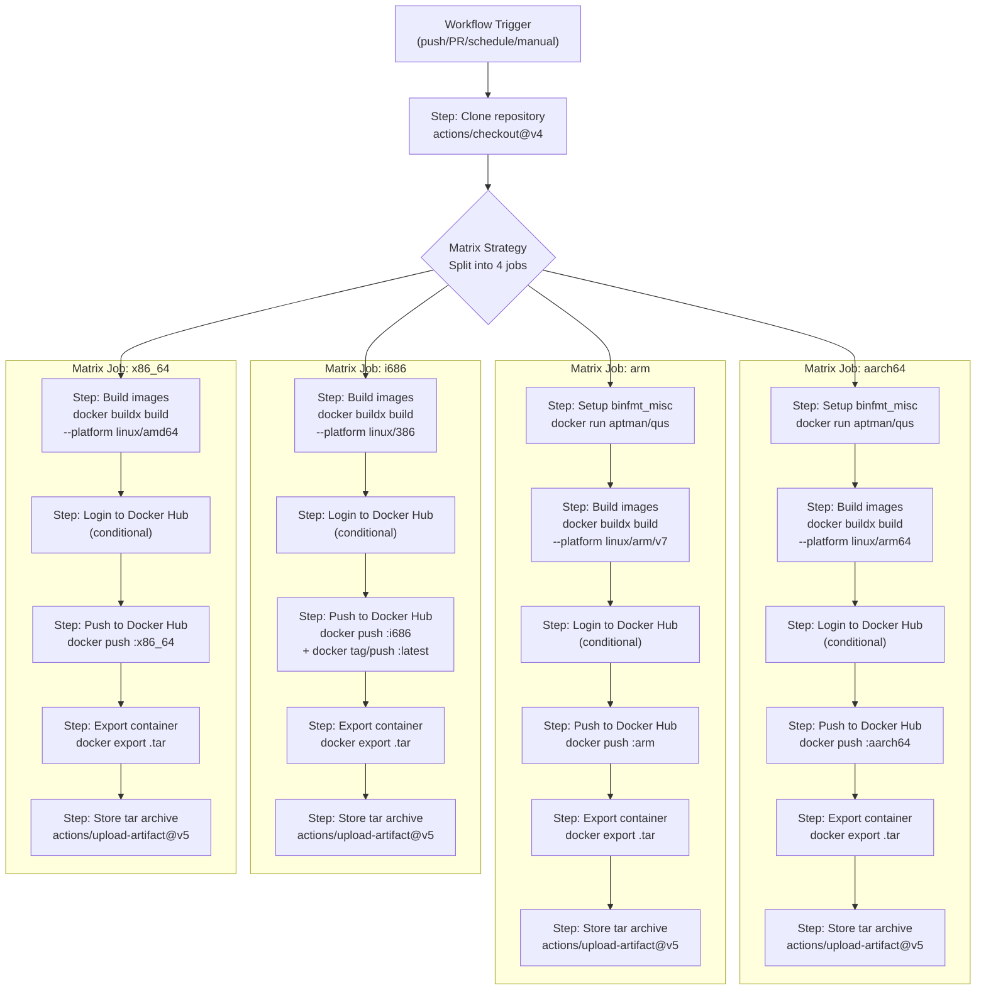
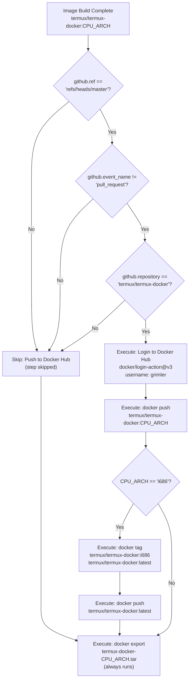

<!-- source: DeepWiki mcp.deepwiki.com · repo termux/termux-docker · page 3.3 CI/CD Pipeline · fetched 2026-10-26 -->

# CI/CD Pipeline

<details>
<summary>Relevant source files</summary>

The following files were used as context for generating this wiki page:

- [.github/dependabot.yml](.github/dependabot.yml)
- [.github/workflows/docker_build.yml](.github/workflows/docker_build.yml)

</details>


## Purpose and Scope

This document describes the automated Continuous Integration and Continuous Deployment (CI/CD) system that builds and publishes termux-docker images. The pipeline is implemented as a GitHub Actions workflow that automatically builds Docker images for four CPU architectures, executes validation tests, and publishes successful builds to Docker Hub.

For details about the Dockerfile structure used by the build process, see [The Dockerfile](#3.1). For information about the manual build script (`build-all.sh`), see [Build Scripts](#3.2). For details about QEMU emulation mechanics, see [Cross-Platform Execution](#5.2).

**Sources:** [.github/workflows/docker_build.yml:1-85]()

---

## Workflow Overview

The CI/CD pipeline is defined in `.github/workflows/docker_build.yml` and is named **"Build and push Docker image"**. The workflow executes on multiple trigger events, providing both automated and manual build capabilities.

### Trigger Events

The workflow responds to four distinct trigger mechanisms:

| Trigger Type | Configuration | Purpose |
|-------------|---------------|---------|
| **Push to master** | `on.push.branches: [master]` | Automatic build and publish when changes are merged |
| **Pull Request** | `on.pull_request` | Validation builds for all PRs without publishing |
| **Weekly Schedule** | `on.schedule: '0 2 * * 0'` | Automated weekly rebuilds every Sunday at 02:00 UTC |
| **Manual Dispatch** | `on.workflow_dispatch` | On-demand builds triggered through GitHub UI |

The schedule trigger ensures images remain up-to-date with the latest Termux bootstrap archives even when no code changes occur. Pull request builds provide validation without publishing to Docker Hub.

**Sources:** [.github/workflows/docker_build.yml:3-10]()

### Global Environment Variables

The workflow sets two global environment variables that affect all jobs:

- `CI=true` - Signals that the build is running in a CI environment
- `DOCKER_BUILDKIT=1` - Enables Docker BuildKit for improved build performance and features

**Sources:** [.github/workflows/docker_build.yml:12-14]()

---

## Build Matrix Strategy

The workflow employs a **matrix build strategy** to generate images for all supported CPU architectures in parallel. This approach significantly reduces total build time compared to sequential builds.

### Matrix Configuration

The `main` job defines a single matrix dimension `CPU_ARCH` with four values:

```yaml
strategy:
  matrix:
    CPU_ARCH:
      - aarch64
      - arm
      - i686
      - x86_64
```

This configuration spawns four parallel job instances, each building for a specific architecture. GitHub Actions executes all matrix jobs concurrently on separate runners, limited only by available runner capacity.

**Sources:** [.github/workflows/docker_build.yml:16-25]()

### Platform Mapping Logic

Each matrix value is mapped to the appropriate Docker platform identifier during the build step:

| `CPU_ARCH` | `SYSTEM_TYPE` | `PLATFORM_TAG` | Architecture Description |
|-----------|---------------|----------------|-------------------------|
| `arm` | `arm` | `linux/arm/v7` | 32-bit ARMv7 |
| `aarch64` | `arm` | `linux/arm64` | 64-bit ARM (ARMv8) |
| `i686` | `x86` | `linux/386` | 32-bit x86 |
| `x86_64` | `x86` | `linux/amd64` | 64-bit x86-64 |

The `SYSTEM_TYPE` variable determines which system binaries are used (from `/system/arm/` or `/system/x86/`), while `PLATFORM_TAG` specifies the target platform for Docker BuildX.

**Sources:** [.github/workflows/docker_build.yml:37-42]()

---

## Workflow Execution Diagram



This diagram shows how the workflow splits into four parallel execution paths after repository cloning. ARM-based builds require QEMU setup, while x86 builds execute natively on the Ubuntu runner.

**Sources:** [.github/workflows/docker_build.yml:1-85]()

---

## Detailed Step Analysis

### Step 1: Clone Repository

```yaml
- name: Clone repository
  uses: actions/checkout@v4
```

Uses GitHub's official checkout action to clone the repository at the triggering commit. This provides the `Dockerfile` and all necessary build context files.

**Sources:** [.github/workflows/docker_build.yml:28-29]()

### Step 2: Setup binfmt_misc (ARM Only)

```yaml
- name: Setup binfmt_misc
  if: (matrix.CPU_ARCH == 'aarch64') || (matrix.CPU_ARCH == 'arm')
  run: docker run --rm --privileged aptman/qus -s -- -p aarch64 arm
```

This step executes conditionally only for ARM architectures (`aarch64` and `arm`). The `aptman/qus` container configures the host's `binfmt_misc` kernel module to recognize ARM binaries and execute them through QEMU user-mode emulation. The `-p aarch64 arm` flags register handlers for both 32-bit and 64-bit ARM executables.

**Why needed:** GitHub Actions runners are x86_64 systems. To build ARM images, the host must be able to execute ARM binaries during the Docker build process (e.g., when running commands inside the container during image construction).

**Sources:** [.github/workflows/docker_build.yml:31-33]()

### Step 3: Build Images

```yaml
- name: Build images
  run: |
    case '${{ matrix.CPU_ARCH }}' in
      arm)     SYSTEM_TYPE=arm; PLATFORM_TAG="linux/arm/v7";;
      aarch64) SYSTEM_TYPE=arm; PLATFORM_TAG="linux/arm64";;
      i686)    SYSTEM_TYPE=x86; PLATFORM_TAG="linux/386";;
      *)       SYSTEM_TYPE=x86; PLATFORM_TAG="linux/amd64";;
    esac
    docker buildx build -t \
      termux/termux-docker:${{ matrix.CPU_ARCH }} \
      --platform "$PLATFORM_TAG" \
      --build-arg BOOTSTRAP_ARCH=${{ matrix.CPU_ARCH }} \
      --build-arg SYSTEM_TYPE="${SYSTEM_TYPE}" \
      .
```

This step performs the actual Docker image build using Docker BuildX. Key components:

- **Shell case statement**: Maps `matrix.CPU_ARCH` to appropriate `SYSTEM_TYPE` and `PLATFORM_TAG` values
- **`docker buildx build`**: Uses BuildX for enhanced multi-platform build capabilities
- **`-t termux/termux-docker:${{ matrix.CPU_ARCH }}`**: Tags the image with the architecture-specific name
- **`--platform "$PLATFORM_TAG"`**: Specifies the target platform for the build
- **`--build-arg BOOTSTRAP_ARCH`**: Passed to Dockerfile to download correct bootstrap archive
- **`--build-arg SYSTEM_TYPE`**: Passed to Dockerfile to select correct system binaries directory
- **`.`**: Build context is the repository root

The build arguments are consumed by the Dockerfile's `ARG` directives to customize the build for each architecture.

**Sources:** [.github/workflows/docker_build.yml:35-48]()

### Step 4: Login to Docker Hub

```yaml
- name: Login to Docker Hub
  if: github.ref == 'refs/heads/master' && github.event_name != 'pull_request' && github.repository == 'termux/termux-docker'
  uses: docker/login-action@v3
  with:
    username: grimler
    password: ${{ secrets.GRIMLER_DOCKER_TOKEN }}
```

Authenticates with Docker Hub using stored credentials. This step only executes when all three conditions are met:

1. `github.ref == 'refs/heads/master'` - Build is from the master branch
2. `github.event_name != 'pull_request'` - Not a pull request build
3. `github.repository == 'termux/termux-docker'` - Running in the official repository (not a fork)

The username `grimler` is hardcoded, while the password is retrieved from GitHub Secrets (`GRIMLER_DOCKER_TOKEN`). This ensures pull request builds and fork builds cannot publish to Docker Hub.

**Sources:** [.github/workflows/docker_build.yml:50-55]()

### Step 5: Push to Docker Hub

```yaml
- name: Push to Docker Hub
  if: github.ref == 'refs/heads/master' && github.event_name != 'pull_request' && github.repository == 'termux/termux-docker'
  run: |
    docker push termux/termux-docker:${{ matrix.CPU_ARCH }}
    if [ ${{ matrix.CPU_ARCH }} = i686 ]; then
      docker tag termux/termux-docker:i686 termux/termux-docker:latest
      docker push termux/termux-docker:latest
    fi
```

Publishes the built image to Docker Hub, using the same conditional logic as the login step. The push logic includes special handling for the `i686` architecture:

1. All architectures push their architecture-specific tag (`:aarch64`, `:arm`, `:i686`, `:x86_64`)
2. The `i686` build additionally tags and pushes as `:latest`

This makes `termux/termux-docker:latest` equivalent to `termux/termux-docker:i686`, providing a sensible default for users who don't specify an architecture.

**Sources:** [.github/workflows/docker_build.yml:57-64]()

### Step 6: Export Container as Tar Archive

```yaml
- name: Export container as tar archive
  if: always()
  run: |
    docker run \
      --privileged \
      --name termux-docker-${{ matrix.CPU_ARCH }} \
      termux/termux-docker:${{ matrix.CPU_ARCH }} \
      uname -a
    docker stop termux-docker-${{ matrix.CPU_ARCH }}
    docker export -o termux-docker-${{ matrix.CPU_ARCH }}.tar \
      termux-docker-${{ matrix.CPU_ARCH }}
    sha256sum termux-docker-${{ matrix.CPU_ARCH }}.tar
```

This step creates a tar archive of the built container, executing unconditionally (`if: always()`) even if previous steps failed. The process:

1. **Run the container**: Executes `uname -a` to verify the container starts successfully and to display architecture information
2. **Stop the container**: Halts the running container
3. **Export to tar**: Uses `docker export` to create a filesystem archive of the stopped container
4. **Generate checksum**: Computes SHA-256 hash for integrity verification

The `--privileged` flag allows the container to start services like dnsmasq that require elevated capabilities.

**Sources:** [.github/workflows/docker_build.yml:66-77]()

### Step 7: Store Tar Archive

```yaml
- name: Store tar archive
  if: always()
  uses: actions/upload-artifact@v5
  with:
    name: termux-docker-${{ matrix.CPU_ARCH }}-${{ github.sha }}
    path: termux-docker-${{ matrix.CPU_ARCH }}.tar
```

Uploads the tar archive as a GitHub Actions artifact, making it available for download from the workflow run page. The artifact name includes both the architecture and the commit SHA for uniqueness. This step also runs unconditionally (`if: always()`), ensuring artifacts are available even if the Docker Hub push failed.

**Sources:** [.github/workflows/docker_build.yml:79-84]()

---

## Publishing Decision Flow



This diagram illustrates the conditional logic that determines whether images are pushed to Docker Hub. The three-condition check ensures that only builds from the official repository's master branch (excluding pull requests) are published. The special `latest` tag assignment to `i686` provides a default architecture for users.

**Sources:** [.github/workflows/docker_build.yml:50-64]()

---

## Build Artifact System

Every workflow run produces four tar archives (one per architecture), regardless of whether the Docker Hub push succeeds. These artifacts serve multiple purposes:

### Artifact Naming Convention

Artifacts follow the naming pattern:
```
termux-docker-{CPU_ARCH}-{COMMIT_SHA}.tar
```

Examples:
- `termux-docker-aarch64-a1b2c3d4e5f6...tar`
- `termux-docker-i686-a1b2c3d4e5f6...tar`

The commit SHA ensures artifacts from different commits don't collide, while the architecture identifier allows users to select the appropriate build.

### Artifact Contents

Each tar archive contains:
- Complete container filesystem (generated by `docker export`)
- All Termux packages and system files
- Configuration files with proper ownership

These archives can be imported directly using `docker import`:
```bash
docker import termux-docker-aarch64-abc123.tar my-termux:aarch64
```

### Artifact Persistence

GitHub Actions stores artifacts for 90 days (default retention period). Users can download artifacts from:
- The "Summary" tab of any workflow run
- The GitHub CLI: `gh run download {run-id}`
- The GitHub REST API

**Sources:** [.github/workflows/docker_build.yml:66-84]()

---

## Execution Environment

### Runner Configuration

All jobs execute on `ubuntu-latest` runners provided by GitHub Actions. As of this writing, these are Ubuntu 22.04 x86_64 systems with Docker pre-installed.

**Sources:** [.github/workflows/docker_build.yml:18]()

### Concurrency and Parallelism

The matrix strategy spawns four concurrent jobs (one per architecture). GitHub's runner allocation determines actual parallelism:
- Free tier: Limited concurrent runners
- Paid plans: Higher concurrency limits
- Public repositories: Enhanced runner availability

All four jobs typically execute in parallel for this repository, completing all builds simultaneously rather than sequentially.

---

## Cross-Architecture Build Summary

| Architecture | Native on x86_64 Runner? | Emulation Required | Emulation Method |
|-------------|-------------------------|-------------------|------------------|
| `x86_64` | Yes | No | Native execution |
| `i686` | Yes (32-bit compatible) | No | Native execution |
| `aarch64` | No | Yes | QEMU via binfmt_misc |
| `arm` | No | Yes | QEMU via binfmt_misc |

The x86 architectures build quickly with native execution, while ARM builds incur performance overhead from QEMU emulation. Despite emulation overhead, the parallel matrix strategy ensures total workflow time is dominated by the slowest single job rather than the sum of all jobs.

**Sources:** [.github/workflows/docker_build.yml:31-33](), [.github/workflows/docker_build.yml:37-42]()

---

## Dependabot Integration

The repository includes Dependabot configuration for automated dependency updates:

```yaml
version: 2
updates:
- package-ecosystem: github-actions
  directory: /
  schedule:
    interval: daily
```

This configuration instructs Dependabot to check for updates to GitHub Actions versions daily (specifically `actions/checkout` and `docker/login-action`). When updates are available, Dependabot automatically creates pull requests to upgrade action versions, ensuring the workflow uses the latest stable versions with security patches.

**Sources:** [.github/dependabot.yml:1-7]()

---

