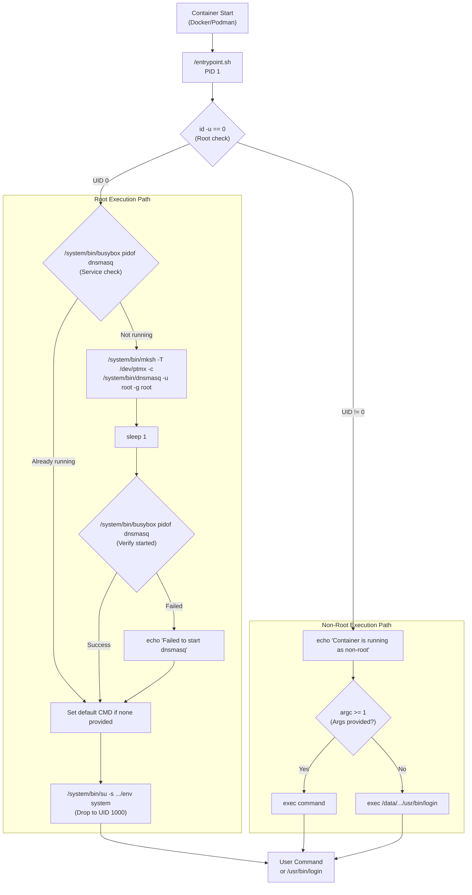
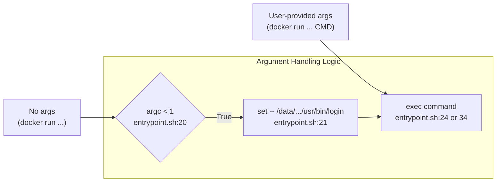
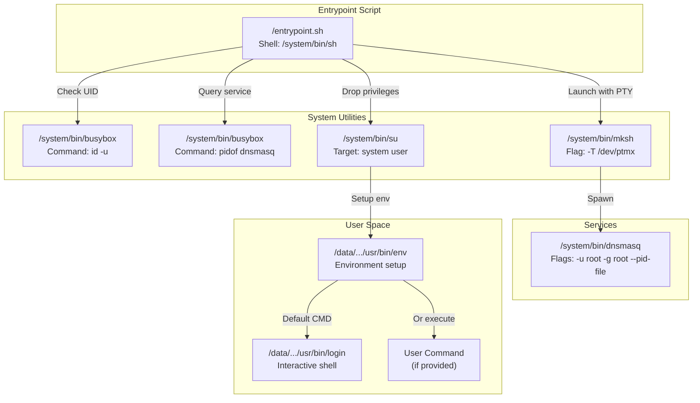
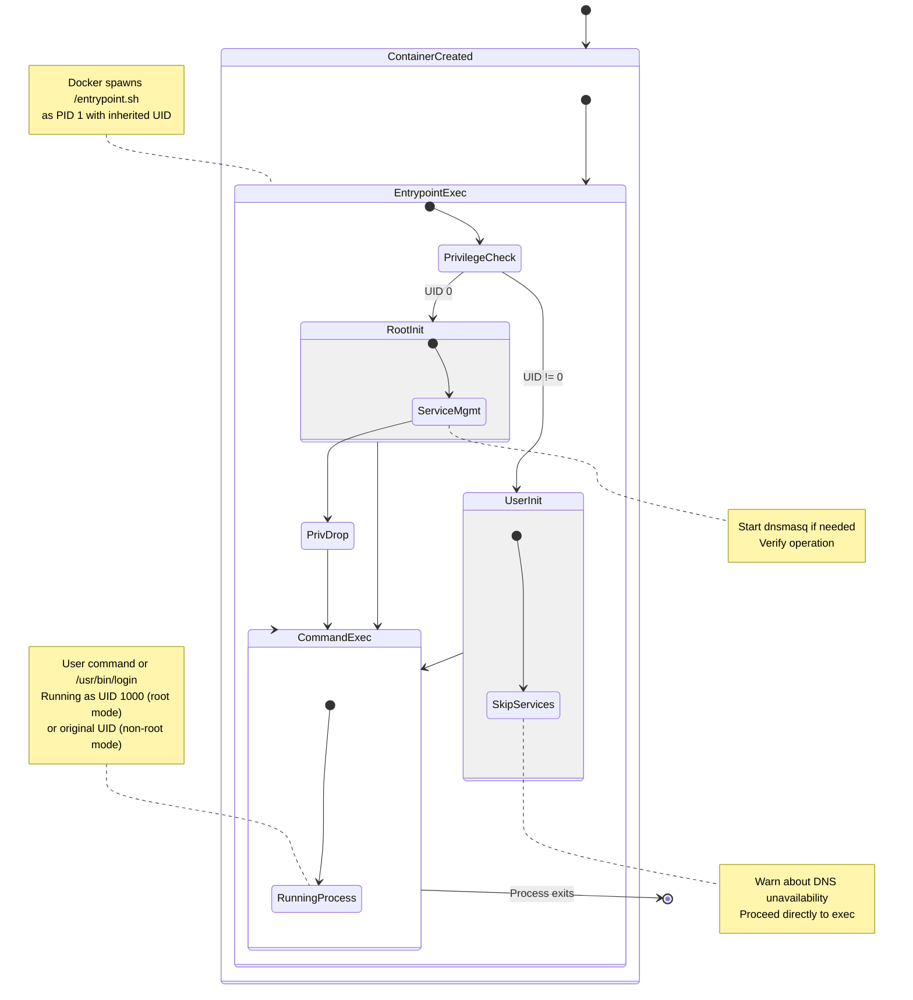

<!-- source: DeepWiki mcp.deepwiki.com · repo termux/termux-docker · page 4 Container Runtime · fetched 2026-10-26 -->

# Container Runtime

<details>
<summary>Relevant source files</summary>

The following files were used as context for generating this wiki page:

- [Dockerfile](Dockerfile)
- [entrypoint.sh](entrypoint.sh)
- [entrypoint_root.sh](entrypoint_root.sh)
- [system/arm/bin/mksh](system/arm/bin/mksh)
- [system/x86/bin/mksh](system/x86/bin/mksh)

</details>


## Purpose and Scope

This document provides an overview of the container runtime behavior in termux-docker: the initialization sequence that occurs when a container starts, how the system determines execution mode, and the path from container creation to an interactive user session. For detailed information about the entrypoint scripts themselves, see [Entrypoint System](#4.1). For specifics on dnsmasq service management, see [Service Initialization](#4.2). For the security model and user switching mechanism, see [Privilege Management](#4.3).

## Container Startup Overview

When a Docker container starts from a termux-docker image, the runtime system follows a deterministic initialization path controlled by the container's entrypoint. The Dockerfile defines two key directives that govern this behavior:

| Directive | Value | Purpose |
|-----------|-------|---------|
| `ENTRYPOINT` | `/entrypoint.sh` | Primary initialization script, always executed |
| `CMD` | `/data/data/com.termux/files/usr/bin/login` | Default command if user provides no arguments |

The entrypoint script acts as PID 1 inside the container and is responsible for system initialization before transferring control to the user's requested command or interactive shell.

Sources: [Dockerfile:90-91]()

## Initialization Sequence

The container initialization follows a privilege-aware path determined by the effective user ID at startup. The following diagram illustrates the complete flow from container start to command execution:



**Initialization Sequence Flow: Code-Level View**

This diagram shows the actual code paths and decision points in `/entrypoint.sh`, mapping system behavior to specific script constructs.

Sources: [entrypoint.sh:3-34](), [Dockerfile:90-91]()

## Execution Modes

The container runtime supports two distinct execution modes based on the effective user ID at startup. The mode determines which initialization path is taken and what system services are available.

### Root Mode (UID 0)

When the container starts as root, the entrypoint performs full system initialization:

1. **Service Check**: Queries `dnsmasq` process status using `/system/bin/busybox pidof dnsmasq`
2. **Service Start**: If not running, launches `dnsmasq` through `mksh` with PTY allocation
3. **Verification**: Waits 1 second and re-checks service status
4. **Privilege Drop**: Uses `/system/bin/su` to switch to the `system` user (UID 1000)
5. **Environment Preservation**: Passes through critical environment variables via `su -s .../env`
6. **Command Execution**: Executes the user's command or default login shell

The privilege drop ensures that user-facing processes do not run with elevated permissions, following the principle of least privilege.

### Non-Root Mode (UID != 0)

When the container starts as a non-root user, the entrypoint takes a simplified path:

1. **DNS Warning**: Emits a warning that `dnsmasq` cannot be started
2. **Direct Execution**: Bypasses all service initialization
3. **Command Execution**: Directly executes the requested command or login shell

This mode sacrifices DNS resolution capability for environments where root access is restricted or not desired.

Sources: [entrypoint.sh:3-18]()

## Default Command Behavior

The Dockerfile specifies `/data/data/com.termux/files/usr/bin/login` as the default `CMD`. This is the Termux login binary, which provides an interactive shell session with proper environment setup. The entrypoint script ensures this default is used when no command is provided:



**Command Resolution Path**

This ensures users get an interactive shell by default while allowing them to override with custom commands like `docker run termux/termux-docker bash` or `docker run termux/termux-docker apt update`.

Sources: [entrypoint.sh:20-22](), [Dockerfile:91]()

## Runtime Environment Variables

The container runtime establishes a comprehensive set of environment variables required by Termux and Android components. These variables are set at image build time and preserved through the privilege drop:

| Variable | Value | Purpose |
|----------|-------|---------|
| `ANDROID_DATA` | `/data` | Android data directory root |
| `ANDROID_ROOT` | `/system` | Android system directory root |
| `HOME` | `/data/data/com.termux/files/home` | User home directory |
| `LANG` | `en_US.UTF-8` | Locale setting |
| `PATH` | `/data/data/com.termux/files/usr/bin` | Executable search path |
| `PREFIX` | `/data/data/com.termux/files/usr` | Termux installation prefix |
| `TMPDIR` | `/data/data/com.termux/files/usr/tmp` | Temporary file directory |
| `TZ` | `UTC` | Timezone setting |

The entrypoint script explicitly passes these variables through the `su` command using the `-i` flag and explicit variable assignments to ensure they survive the privilege transition.

Sources: [Dockerfile:76-83](), [entrypoint.sh:24-34]()

## Component Interaction at Runtime

The following diagram shows how the entrypoint script interacts with system components during container initialization:



**Runtime Component Dependencies**

This diagram maps the actual executables and their invocation patterns, showing how `/entrypoint.sh` orchestrates system initialization using specific binaries from `/system/bin/`.

Sources: [entrypoint.sh:3-34]()

## Alternative Root Entrypoint

The system includes an alternative entrypoint at `/entrypoint_root.sh` designed for scenarios where maintaining root privileges throughout execution is required. Unlike the default entrypoint, this variant:

1. **Enforces Root**: Exits with error if not started as UID 0
2. **Starts Services**: Initializes `dnsmasq` if not running
3. **No Privilege Drop**: Executes commands directly as root

This entrypoint can be selected using Docker's `--entrypoint` flag:

```
docker run --entrypoint /entrypoint_root.sh termux/termux-docker command
```

Sources: [entrypoint_root.sh:1-20]()

## Runtime Lifecycle Summary

The complete container lifecycle from startup to termination follows this pattern:



**Container Lifecycle State Transitions**

The entrypoint script's `exec` call at the end replaces the script process with the user command, making that command PID 1 and allowing clean signal handling and shutdown.

Sources: [entrypoint.sh:14-34](), [entrypoint_root.sh:16-20]()

---

