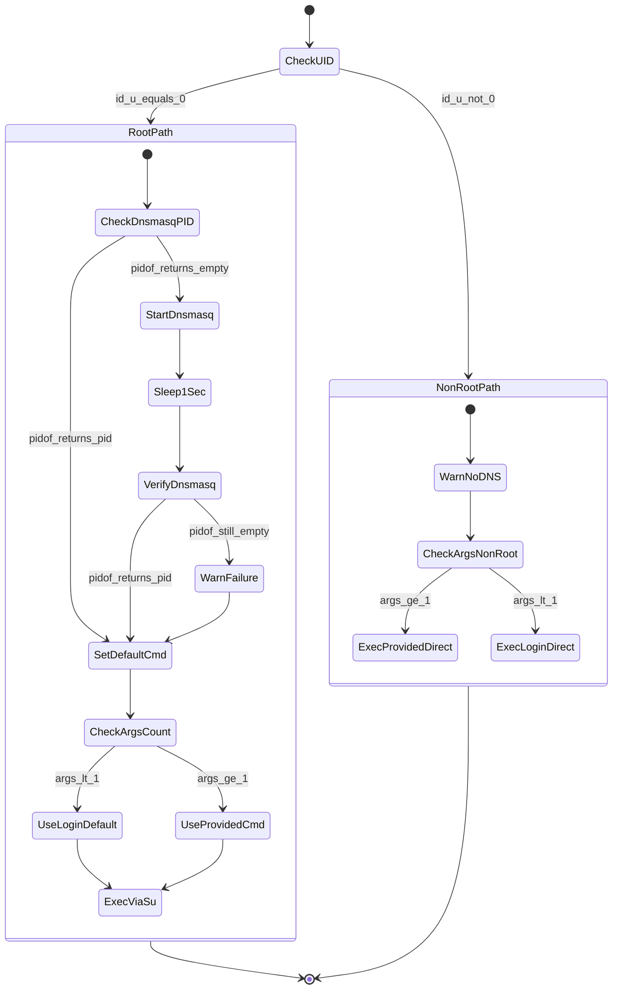
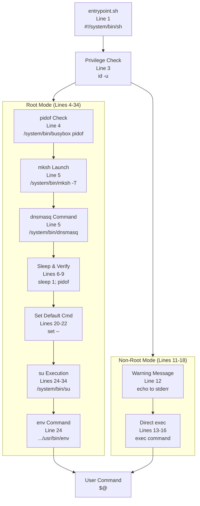

<!-- source: DeepWiki mcp.deepwiki.com · repo termux/termux-docker · page 4.1 Entrypoint System · fetched 2026-10-26 -->

# Entrypoint System

<details>
<summary>Relevant source files</summary>

The following files were used as context for generating this wiki page:

- [entrypoint.sh](entrypoint.sh)
- [system/arm/bin/mksh](system/arm/bin/mksh)
- [system/x86/bin/mksh](system/x86/bin/mksh)

</details>


## Purpose and Scope

This document describes the container entrypoint system, which is the first script executed when a termux-docker container starts. The entrypoint is responsible for detecting the container's privilege level, initializing system services, and launching the user's command or shell with appropriate permissions.

The entrypoint system consists of a single shell script (`entrypoint.sh`) that implements a privilege-aware initialization sequence. For details on specific services started by the entrypoint, see [Service Initialization](#4.2). For an explanation of the privilege model and user configuration, see [Privilege Management](#4.3).

**Sources:** [entrypoint.sh:1-35]()

---

## System Overview

The entrypoint system implements a conditional initialization strategy based on the effective user ID of the container process. It follows this high-level logic:

1. **Privilege Detection**: Check if the container is running as root (UID 0)
2. **Service Initialization**: If root, start system services (dnsmasq)
3. **Privilege Dropping**: If root, drop to the `system` user (UID 1000)
4. **Command Execution**: Execute the user's command or default login shell

The entrypoint ensures that user processes never run as root, even when the container starts with root privileges. This maintains security isolation while allowing privileged service initialization.

**Sources:** [entrypoint.sh:1-35]()

---

## Entrypoint Execution Flow

The following state diagram illustrates the complete execution flow through the entrypoint script:

**Execution Flow State Diagram**



This diagram maps directly to the code structure in `entrypoint.sh`. The root path encompasses lines 3-34, while the non-root path is lines 11-18.

**Sources:** [entrypoint.sh:1-35]()

---

## Code Structure Mapping

The entrypoint script is organized into distinct functional blocks that correspond to the execution flow:

| Line Range | Code Block | Purpose | Key Commands |
|------------|------------|---------|--------------|
| [3]() | Privilege Detection | Check if running as root | `id -u` |
| [4-10]() | Service Startup (Root) | Initialize dnsmasq service | `busybox pidof`, `mksh`, `dnsmasq` |
| [11-18]() | Non-Root Handler | Handle non-privileged execution | `exec` |
| [20-22]() | Default Command Setup | Set login as default if no args | `set --` |
| [24-34]() | Privilege Drop & Exec | Drop to system user and execute | `su`, `env` |

**Sources:** [entrypoint.sh:3-34]()

---

## Privilege Detection

The entrypoint's first action is to determine the container's privilege level by checking the effective user ID:

```
if [ "$(id -u)" = "0" ]; then
```

This single conditional at [entrypoint.sh:3]() branches the entire initialization sequence. The `id -u` command returns the numeric UID of the current process. If the value is `0`, the container is running as root and can perform privileged operations like starting network services.

The result of this check determines two fundamentally different execution paths:
- **Root path**: Full initialization with services, followed by privilege dropping
- **Non-root path**: Direct execution with DNS unavailability warning

**Sources:** [entrypoint.sh:3]()

---

## Root Mode Operation

When the container starts as root, the entrypoint performs a multi-step initialization sequence.

### Service Startup Check

The script first checks whether dnsmasq is already running to avoid duplicate instances:

```
if [ -z "$(/system/bin/busybox pidof dnsmasq)" ]; then
```

[entrypoint.sh:4]() uses BusyBox's `pidof` utility to search for running dnsmasq processes. The `-z` test checks if the output is empty (no PIDs found). If dnsmasq is not running, the service startup sequence begins.

### DNS Service Launch

The dnsmasq service is started with specific parameters to ensure proper operation:

```
/system/bin/mksh -T /dev/ptmx -c "/system/bin/dnsmasq -u root -g root --pid-file /dnsmasq.pid" >/dev/null 2>&1
```

At [entrypoint.sh:5](), this command demonstrates several important techniques:

| Component | Purpose |
|-----------|---------|
| `/system/bin/mksh` | MirBSD Korn Shell interpreter |
| `-T /dev/ptmx` | Allocate pseudo-terminal for proper signal handling |
| `-c "..."` | Execute command string |
| `-u root -g root` | Run dnsmasq as root user/group (required for privileged port 53) |
| `--pid-file /dnsmasq.pid` | Store process ID for management |
| `>/dev/null 2>&1` | Suppress all output |

The use of `mksh -T /dev/ptmx` is critical - it ensures dnsmasq receives proper signal handling through a PTY, which is necessary for clean shutdown and prevents orphaned processes.

### Service Verification

After attempting to start dnsmasq, the script waits and verifies the service actually started:

```
sleep 1
if [ -z "$(/system/bin/busybox pidof dnsmasq)" ]; then
    echo "[!] Failed to start dnsmasq, host name resolution may fail." >&2
fi
```

[entrypoint.sh:6-9]() implements a simple verification loop:
1. Wait 1 second for dnsmasq to initialize
2. Re-check for the dnsmasq process
3. If still not running, emit a warning to stderr

This graceful degradation approach allows the container to continue operating even if DNS service initialization fails. The warning is written to stderr (`>&2`) to ensure it appears in container logs without interfering with stdout.

**Sources:** [entrypoint.sh:4-10]()

---

## Non-Root Mode Operation

When the container starts without root privileges, the entrypoint follows a simplified path that skips service initialization entirely:

```
else
    echo "[!] Container is running as non-root, unable to start dnsmasq. DNS will be unavailable." >&2
    if [ $# -ge 1 ]; then
        exec "$@"
    else
        exec /data/data/com.termux/files/usr/bin/login
    fi
fi
```

The non-root handler at [entrypoint.sh:11-18]() implements immediate command execution:

### Warning Emission

[entrypoint.sh:12]() emits a warning about DNS unavailability. This is critical user feedback because without dnsmasq, the container cannot resolve hostnames, which will cause package manager operations (`apt update`, `pkg install`) to fail with connection errors.

### Direct Execution

Unlike the root path, non-root mode uses `exec` directly without privilege dropping:

- **With arguments** [entrypoint.sh:13-14](): Execute the provided command using `exec "$@"`, which replaces the shell process with the specified command
- **Without arguments** [entrypoint.sh:15-16](): Launch the Termux login shell at `/data/data/com.termux/files/usr/bin/login`

The `exec` builtin is used to replace the shell process rather than spawning a subprocess. This ensures the executed command becomes PID 1 in the container, which is important for proper signal handling and clean shutdown.

**Sources:** [entrypoint.sh:11-18]()

---

## Command Execution in Root Mode

After service initialization completes (or is skipped), root mode continues to command execution with privilege dropping.

### Default Command Setup

If no command was provided to the container, the login shell is set as the default:

```
if [ $# -lt 1 ]; then
    set -- /data/data/com.termux/files/usr/bin/login
fi
```

[entrypoint.sh:20-22]() uses the `set --` builtin to manipulate the positional parameters (`$@`). If the argument count (`$#`) is less than 1, it replaces the empty argument list with the path to the Termux login program.

### Privilege Dropping with Environment Preservation

The core of the root mode execution is the privilege drop via `su`:

```
exec /system/bin/su -s /data/data/com.termux/files/usr/bin/env system -- \
    -i \
    ANDROID_DATA="$ANDROID_DATA" \
    ANDROID_ROOT="$ANDROID_ROOT" \
    HOME="$HOME" \
    LANG="$LANG" \
    PATH="$PATH" \
    PREFIX="$PREFIX" \
    TMPDIR="$TMPDIR" \
    TZ=UTC \
    "$@"
```

[entrypoint.sh:24-34]() performs several critical operations in a single command:

| Component | Purpose |
|-----------|---------|
| `exec` | Replace entrypoint process (becomes PID 1) |
| `/system/bin/su` | Switch user utility |
| `-s /data/.../usr/bin/env` | Use `env` as the shell (to set environment) |
| `system` | Target user (UID 1000, GID 1000) |
| `--` | End of su options, begin environment specification |
| `-i` | Ignore inherited environment (clean slate) |
| `ANDROID_DATA="..."` | Explicitly pass required variables |
| `"$@"` | The actual command to execute |

### Environment Variable Preservation

The entrypoint explicitly preserves specific environment variables during the privilege drop:

| Variable | Purpose | Typical Value |
|----------|---------|---------------|
| `ANDROID_DATA` | Android data directory | `/data` |
| `ANDROID_ROOT` | Android system directory | `/system` |
| `HOME` | User home directory | `/data/data/com.termux/files/home` |
| `LANG` | Locale setting | `en_US.UTF-8` |
| `PATH` | Executable search path | `/data/data/com.termux/files/usr/bin:...` |
| `PREFIX` | Termux installation prefix | `/data/data/com.termux/files/usr` |
| `TMPDIR` | Temporary directory | `/data/data/com.termux/files/usr/tmp` |
| `TZ` | Timezone | `UTC` (hardcoded) |

These variables are set at the Dockerfile level and must be passed through the `su` command because the `-i` flag clears the environment. This ensures the Termux environment functions correctly even after privilege dropping.

**Sources:** [entrypoint.sh:20-34]()

---

## Entrypoint Components Diagram

The following diagram maps the entrypoint script components to their code locations and interactions:

**Component Interaction and Code Mapping**



This diagram shows how the script's linear structure implements branching logic through shell conditionals. Each component is labeled with its specific line numbers for easy code navigation.

**Sources:** [entrypoint.sh:1-35]()

---

## Key Design Decisions

The entrypoint system implements several important design patterns:

### 1. Privilege-Aware Initialization

The dual-path design allows the same container image to run securely in both privileged and unprivileged contexts. This flexibility is essential for supporting diverse deployment scenarios.

### 2. Graceful Degradation

Service startup failures do not prevent container execution. The warning-and-continue approach at [entrypoint.sh:8-9]() ensures the container remains functional even when services fail to initialize.

### 3. Process Replacement via exec

Both execution paths use the `exec` builtin ([entrypoint.sh:14](), [entrypoint.sh:16](), [entrypoint.sh:24]()) to replace the shell process rather than forking. This ensures:
- The user's command becomes PID 1
- Proper signal propagation (SIGTERM, SIGKILL)
- No orphaned shell process consuming resources

### 4. Environment Isolation

The `-i` flag at [entrypoint.sh:25]() combined with explicit variable passing (lines 26-33) creates a clean environment boundary. This prevents environment pollution while ensuring required variables are available.

### 5. PTY Allocation for dnsmasq

The `mksh -T /dev/ptmx` invocation at [entrypoint.sh:5]() allocates a pseudo-terminal for the dnsmasq process. This is necessary because dnsmasq requires proper signal handling, which PTYs provide even when stdin/stdout are not attached to a terminal.

**Sources:** [entrypoint.sh:5](), [entrypoint.sh:8-9](), [entrypoint.sh:14](), [entrypoint.sh:16](), [entrypoint.sh:24-25]()

---

## Summary

The entrypoint system provides a robust, privilege-aware initialization sequence for termux-docker containers. It successfully balances security (unprivileged user processes), functionality (DNS service for package management), and flexibility (supporting both root and non-root execution modes) through a single, well-structured shell script.

Key characteristics:
- **Single responsibility**: Initialize services and launch user command
- **Defensive programming**: Checks, verifications, and warnings at every step
- **Security-first**: Privilege dropping ensures user processes never run as root
- **Graceful degradation**: Services failures don't prevent container operation

**Sources:** [entrypoint.sh:1-35]()

---

