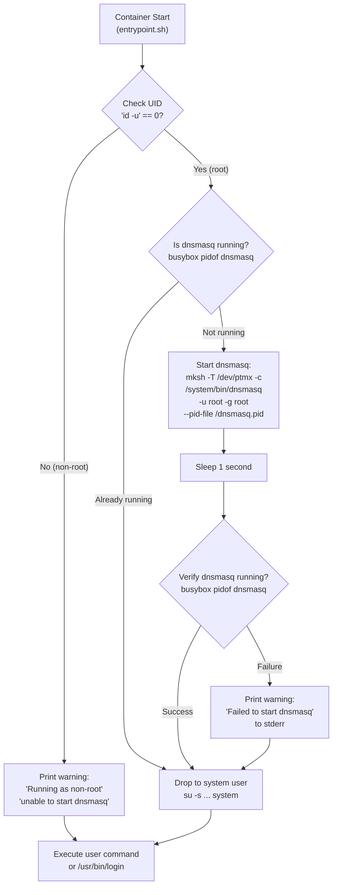
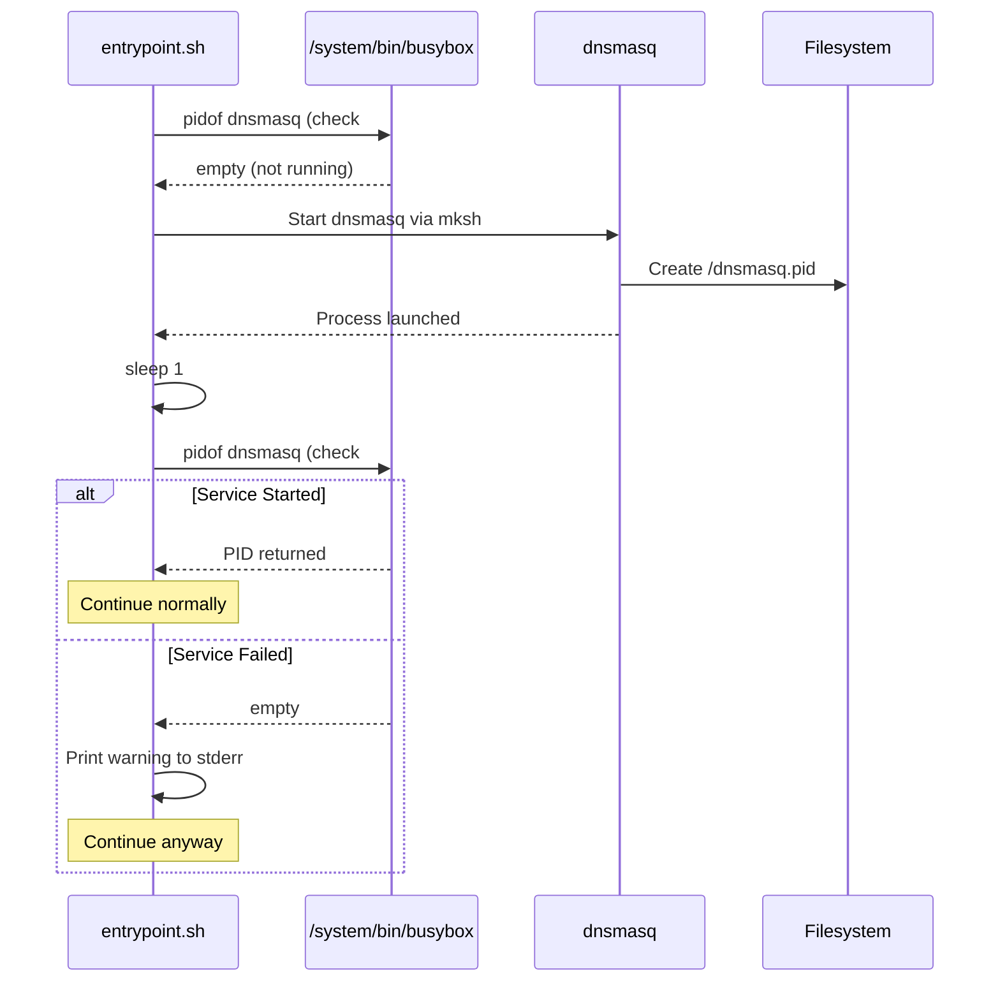
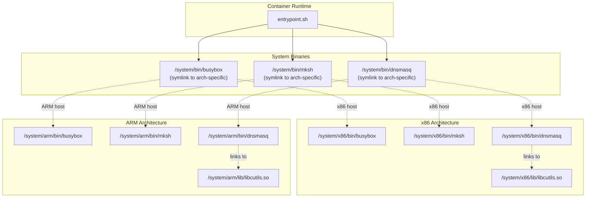
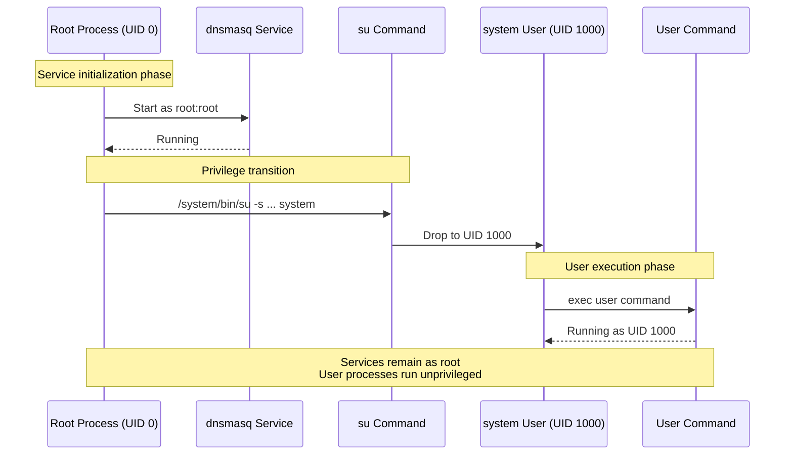
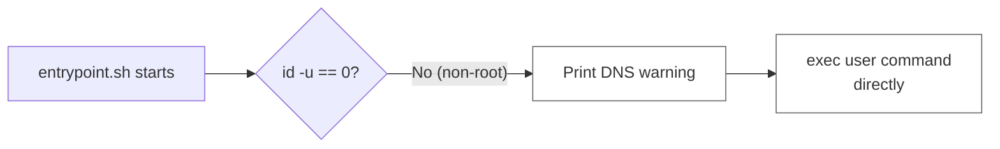

<!-- source: DeepWiki mcp.deepwiki.com · repo termux/termux-docker · page 4.2 Service Initialization · fetched 2026-10-26 -->

# Service Initialization

<details>
<summary>Relevant source files</summary>

The following files were used as context for generating this wiki page:

- [entrypoint.sh](entrypoint.sh)
- [system/arm/bin/dnsmasq](system/arm/bin/dnsmasq)
- [system/arm/bin/mksh](system/arm/bin/mksh)
- [system/arm/lib/libcutils.so](system/arm/lib/libcutils.so)
- [system/x86/bin/dnsmasq](system/x86/bin/dnsmasq)
- [system/x86/bin/mksh](system/x86/bin/mksh)
- [system/x86/lib/libcutils.so](system/x86/lib/libcutils.so)

</details>


## Purpose and Scope

This page documents how system services are initialized during container startup in termux-docker. The primary service managed is `dnsmasq`, which provides DNS resolution capabilities essential for package management operations. 

For the broader container startup sequence, see [Entrypoint System](#4.1). For details on how privileges are managed during this process, see [Privilege Management](#4.3). For in-depth information about the dnsmasq service itself, see [Network Services](#6.2).

## Overview

Service initialization occurs during the container's entrypoint execution and is **conditional on the container running with root privileges**. The system follows a fail-safe approach where service startup failures result in warnings rather than fatal errors, allowing the container to continue operating with reduced functionality.

Sources: [entrypoint.sh:1-35]()

## Service Initialization Flow

The following diagram illustrates the decision tree and execution flow during service initialization:



Sources: [entrypoint.sh:3-34]()

## Root vs Non-Root Initialization

The initialization behavior differs significantly based on the container's privilege level:

| Aspect | Root Container | Non-Root Container |
|--------|---------------|-------------------|
| Service Startup | Attempts to start `dnsmasq` | Skips service initialization entirely |
| Privilege Operations | Can bind to privileged ports | Cannot perform privileged operations |
| DNS Resolution | Available (if startup succeeds) | Unavailable - warning printed |
| User Execution | Drops to UID 1000 (`system`) | Executes directly as current user |
| Package Management | Fully functional with `apt` | Degraded - network operations may fail |

Sources: [entrypoint.sh:3-18]()

## The dnsmasq Service

### Why dnsmasq is Required

The `dnsmasq` service is critical for the Termux environment because:

1. **Package Management**: The `apt` package manager requires DNS resolution to download packages from repositories
2. **Network Connectivity**: User applications need DNS to resolve hostnames
3. **Container Isolation**: Docker's default DNS may not be accessible from within the container's Android-style filesystem hierarchy

### dnsmasq Startup Command

The service is started with a specific command structure:

```bash
/system/bin/mksh -T /dev/ptmx -c "/system/bin/dnsmasq -u root -g root --pid-file /dnsmasq.pid"
```

**Command Breakdown:**

| Component | Purpose |
|-----------|---------|
| `/system/bin/mksh` | MirBSD Korn shell executable |
| `-T /dev/ptmx` | Allocate a pseudo-terminal (PTY) for the service |
| `-c "..."` | Execute the following command string |
| `/system/bin/dnsmasq` | The DNS/DHCP daemon binary |
| `-u root -g root` | Run as root user and root group |
| `--pid-file /dnsmasq.pid` | Write process ID to file for management |

The use of `mksh` with a PTY allocation (`-T /dev/ptmx`) ensures proper signal handling and process management for the backgrounded daemon.

Sources: [entrypoint.sh:5]()

## Service Verification

After attempting to start `dnsmasq`, the system performs verification:



**Verification Steps:**

1. **Pre-check** [entrypoint.sh:4](): Uses `busybox pidof dnsmasq` to check if already running
2. **Post-start delay** [entrypoint.sh:6](): Sleeps 1 second to allow service initialization
3. **Post-check** [entrypoint.sh:7](): Re-checks using `busybox pidof dnsmasq`
4. **Warning on failure** [entrypoint.sh:8](): Prints error message if verification fails

The system **does not exit** on service startup failure, allowing the container to operate in a degraded state.

Sources: [entrypoint.sh:4-9]()

## Architecture-Specific Binaries

The service initialization uses architecture-specific binaries selected at runtime:



**Key Points:**

- Binaries are stored under `/system/x86/` and `/system/arm/` directories
- The Dockerfile creates symlinks from `/system/bin/` to the appropriate architecture
- All service binaries link against architecture-specific libraries like `libcutils.so`

Sources: [system/x86/bin/dnsmasq:1](), [system/arm/bin/dnsmasq:1](), [system/x86/lib/libcutils.so:1](), [system/arm/lib/libcutils.so:1]()

## Error Handling and Graceful Degradation

The service initialization implements a fail-safe design:

### Warning Messages

**Root container, dnsmasq fails:**
```
[!] Failed to start dnsmasq, host name resolution may fail.
```

**Non-root container:**
```
[!] Container is running as non-root, unable to start dnsmasq. DNS will be unavailable.
```

Both warnings are written to stderr (`>&2`) to ensure visibility even when stdout is redirected.

Sources: [entrypoint.sh:8](), [entrypoint.sh:12]()

### Degradation Behavior

When service initialization fails or is skipped:

1. **Container continues to run** - No fatal error
2. **User command executes normally** - Shell access remains functional
3. **Package manager fails gracefully** - `apt` will report network errors
4. **Manual recovery possible** - User can attempt to fix DNS issues from within the container

This design philosophy prioritizes **container availability** over **service availability**, ensuring that containers can be debugged even when services fail.

## Integration with Privilege Dropping

After service initialization completes (or is skipped), the entrypoint transitions to user command execution:



**Important:** The `dnsmasq` service continues running as root (UID 0, GID 0) even after the entrypoint drops privileges to execute user commands. This separation ensures:

- **Service Stability**: Services maintain necessary permissions
- **User Isolation**: User processes cannot interfere with system services  
- **Security**: User code runs with minimal privileges

The privilege drop is performed using [entrypoint.sh:24-34](), which uses `/system/bin/su` to switch to the `system` user while preserving necessary environment variables.

Sources: [entrypoint.sh:20-34]()

## Code-Level Implementation Details

### Key Files and Functions

| File | Purpose | Key Operations |
|------|---------|----------------|
| `entrypoint.sh` | Main initialization logic | Process orchestration, verification |
| `/system/bin/busybox` | Service process detection | `pidof dnsmasq` command |
| `/system/bin/mksh` | Shell for service launch | PTY allocation, command execution |
| `/system/bin/dnsmasq` | DNS/DHCP daemon | Network service implementation |
| `/system/bin/su` | Privilege dropping | User switching after init |

Sources: [entrypoint.sh:1-35]()

### Dependencies

The dnsmasq binary links against several system libraries:

**From dnsmasq ELF headers:**
- `libc.so` - Standard C library functions
- `libcutils.so` - Android utility library for system functions
- `liblog.so` - Android logging infrastructure  
- `libc++.so` - C++ standard library
- `libdl.so` - Dynamic linker functions

These libraries must be present in the architecture-specific library directories (`/system/x86/lib/` or `/system/arm/lib/`) for dnsmasq to execute.

Sources: [system/x86/bin/dnsmasq:1-100](), [system/arm/bin/dnsmasq:1-100]()

## Non-Root Container Behavior

When the container starts as a non-root user, service initialization is completely bypassed:



This early exit path:
- **Skips all service checks** - No `pidof` calls
- **Skips privilege operations** - No `su` invocation needed
- **Executes commands immediately** - Minimal startup overhead
- **Prints single warning** - Informs user of DNS limitation

Users must be aware that non-root containers will have limited functionality, particularly for operations requiring network access.

Sources: [entrypoint.sh:11-17]()

## Summary

The service initialization system in termux-docker provides:

1. **Conditional Service Management**: Only when running as root
2. **Critical Service Focus**: Primarily manages `dnsmasq` for DNS resolution
3. **Robust Verification**: Multi-stage checks with failure detection
4. **Graceful Degradation**: Warnings rather than fatal errors
5. **Architecture Awareness**: Correct binaries selected per platform
6. **Security Model**: Services run as root, user processes don't

This design balances functionality, security, and reliability to ensure the container environment is usable even when system services encounter issues.

---

