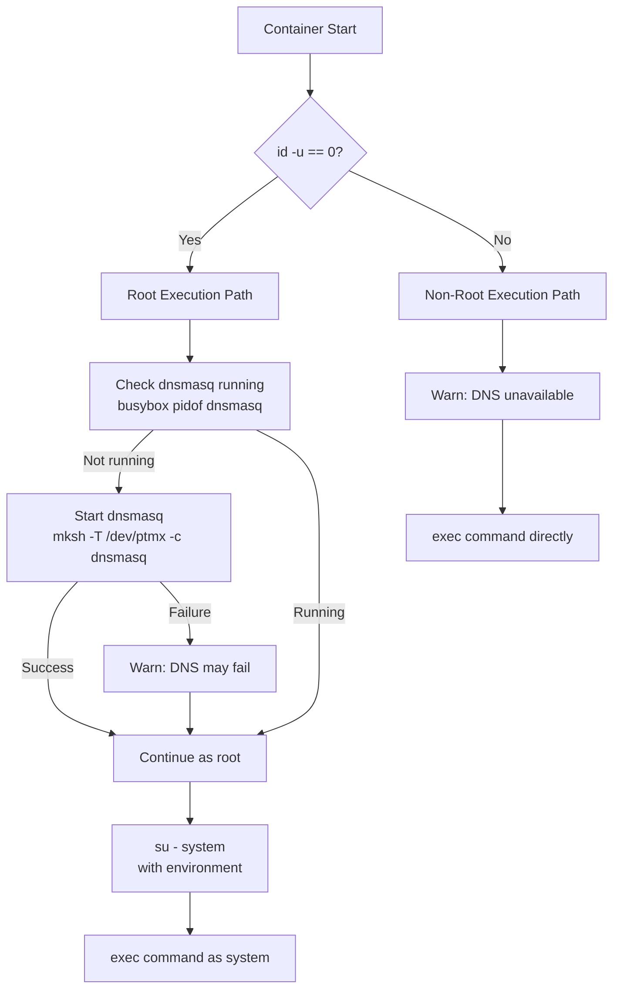
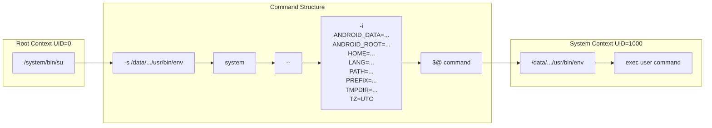
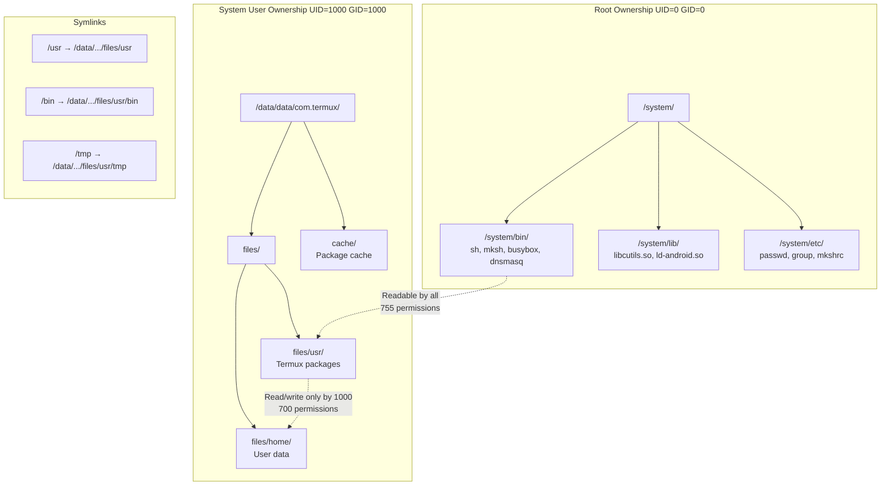
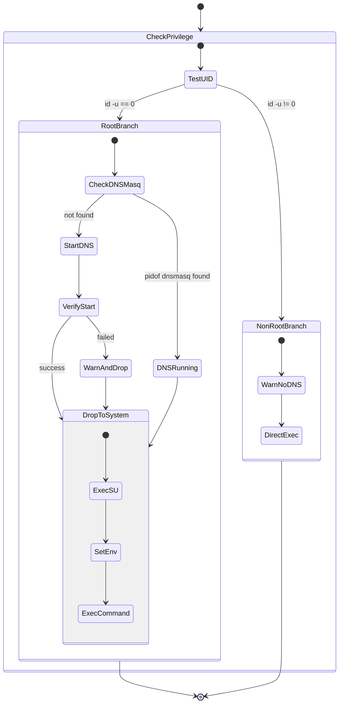
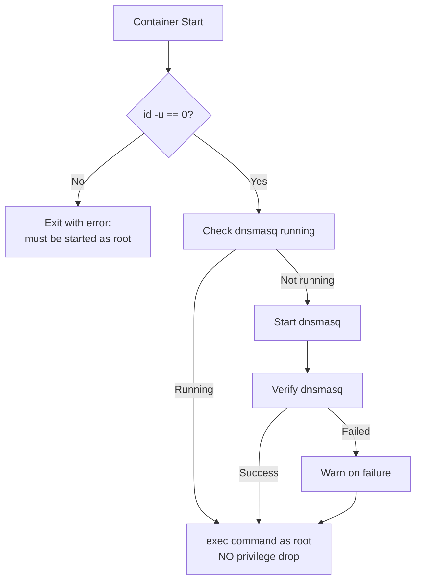
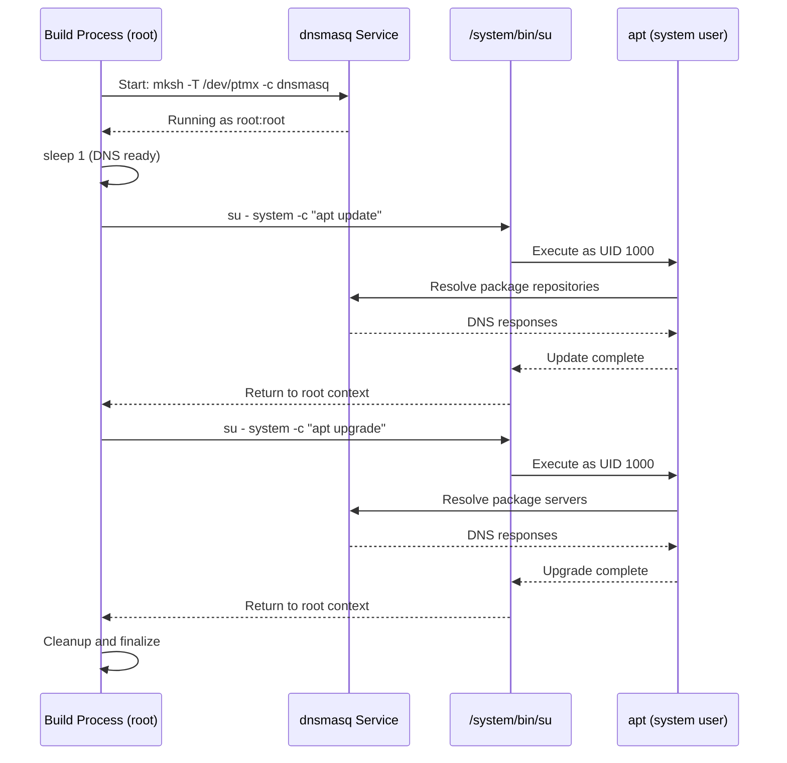

<!-- source: DeepWiki mcp.deepwiki.com · repo termux/termux-docker · page 4.3 Privilege Management · fetched 2026-10-26 -->

# Privilege Management

<details>
<summary>Relevant source files</summary>

The following files were used as context for generating this wiki page:

- [Dockerfile](Dockerfile)
- [entrypoint.sh](entrypoint.sh)
- [entrypoint_root.sh](entrypoint_root.sh)
- [system/arm/bin/mksh](system/arm/bin/mksh)
- [system/arm/etc/group](system/arm/etc/group)
- [system/arm/etc/passwd](system/arm/etc/passwd)
- [system/x86/bin/mksh](system/x86/bin/mksh)
- [system/x86/etc/group](system/x86/etc/group)
- [system/x86/etc/passwd](system/x86/etc/passwd)

</details>


## Purpose and Scope

This document explains the privilege management system in termux-docker, which implements a dual-mode security model supporting both root and non-root container execution. It covers the privilege dropping mechanism, the `system` user model, filesystem ownership partitioning, and how the entrypoint scripts enforce security boundaries.

For details on how the entrypoint scripts orchestrate initialization, see [Entrypoint System](#4.1). For information about service startup that requires privileges, see [Service Initialization](#4.2).

---

## User and Group Definitions

The system defines two principal users through `/etc/passwd` and `/etc/group` files, which are symlinked from `/system/etc/` to `/etc/`.

**User Definitions**

| Username | UID | GID | Home Directory | Shell/Login |
|----------|-----|-----|----------------|-------------|
| `root` | 0 | 0 | `/` | `/system/bin/sh` |
| `system` | 1000 | 1000 | `/data/data/com.termux/files/home` | `/data/data/com.termux/files/usr/bin/login` |

**Group Definitions**

| Groupname | GID | Members |
|-----------|-----|---------|
| `root` | 0 | (none) |
| `system` | 1000 | `system` |

The `system` user (UID 1000) is the primary unprivileged user under which all Termux packages and user processes execute. The `root` user (UID 0) is reserved exclusively for system service initialization.

**Sources:**
- [system/x86/etc/passwd:1-2]()
- [system/x86/etc/group:1-2]()
- [system/arm/etc/passwd:1-2]()
- [system/arm/etc/group:1-2]()
- [Dockerfile:51-52]() - symlink creation

---

## Privilege Execution Modes

The container supports two distinct execution modes based on the effective user ID at startup:

### Root Mode (UID 0)

When the container starts as root, the system follows this sequence:

1. **Service Initialization**: Start privileged services (dnsmasq for DNS)
2. **Privilege Drop**: Use `/system/bin/su` to switch to the `system` user
3. **Command Execution**: Run user command or login shell as `system`

### Non-Root Mode (UID ≠ 0)

When the container starts as a non-root user:

1. **Warning**: Log message about DNS unavailability
2. **Direct Execution**: Execute command immediately without privilege operations
3. **No Services**: Skip all service initialization

**Privilege Mode Detection Flow**



**Sources:**
- [entrypoint.sh:3-34]()
- [entrypoint_root.sh:3-20]()

---

## The Privilege Dropping Mechanism

Root containers drop privileges using the `/system/bin/su` command to transition from UID 0 to UID 1000 before executing user code.

### The `su` Command Structure



### Complete `su` Invocation

The exact command executed in [entrypoint.sh:24-34]():

```
exec /system/bin/su -s /data/data/com.termux/files/usr/bin/env system -- \
    -i \
    ANDROID_DATA="$ANDROID_DATA" \
    ANDROID_ROOT="$ANDROID_ROOT" \
    HOME="$HOME" \
    LANG="$LANG" \
    PATH="$PATH" \
    PREFIX="$PREFIX" \
    TMPDIR="$TMPDIR" \
    TZ=UTC \
    "$@"
```

**Parameter Breakdown:**

| Parameter | Purpose |
|-----------|---------|
| `-s /data/.../usr/bin/env` | Use `env` as the shell to set up environment |
| `system` | Target user to switch to (UID 1000) |
| `--` | End of `su` options, start of command |
| `-i` | Ignore inherited environment (clean slate) |
| `ANDROID_DATA=...` | Explicitly set Android-specific variables |
| `"$@"` | User's command arguments |

This approach ensures:
- Clean environment (no leaked root environment variables)
- Proper Android paths set
- Execution context fully transitions to UID 1000

**Sources:**
- [entrypoint.sh:24-34]()

---

## Filesystem Ownership Model

The container filesystem is strictly partitioned by ownership to enforce security boundaries.

### Ownership Structure



### Permission Assignment

The Dockerfile establishes ownership during image build:

**Root-Owned System Files:**
```bash
# Line 49: System files owned by root
busybox chown -Rh 0:0 /system

# Lines 53-55: Directory and executable permissions
busybox find /system -type d -exec busybox chmod 755 "{}" \;
busybox find /system -type f -executable -exec busybox chmod 755 "{}" \;
busybox find /system -type f ! -executable -exec busybox chmod 644 "{}" \;
```

**System User-Owned Data:**
```bash
# Line 50: Termux data owned by system user
busybox chown -Rh 1000:1000 /data/data/com.termux

# Lines 56-59: Restricted permissions for security
busybox find /data -type d -exec busybox chmod 755 "{}" \;
busybox find /data/data/com.termux/files -type f -o -type d -exec busybox chmod g-rwx,o-rwx "{}" \;
cd /data/data/com.termux/files/usr
busybox find ./bin ./lib/apt ./libexec -type f -exec busybox chmod 700 "{}" \;
```

### Permission Table

| Path | Owner | Group | Permissions | Purpose |
|------|-------|-------|-------------|---------|
| `/system/` | 0 | 0 | 755 (dirs), 755/644 (files) | Read-only system binaries and libraries |
| `/data/data/com.termux/` | 1000 | 1000 | 700 | User's private workspace |
| `/data/data/com.termux/files/usr/bin/` | 1000 | 1000 | 700 | Executable packages |
| `/data/data/com.termux/files/home/` | 1000 | 1000 | 700 | User home directory |

**Rationale:**
- **Root ownership of `/system/`**: Prevents user processes from modifying critical system components
- **User ownership of `/data/`**: Isolates user data, matches Android security model
- **700 permissions**: Complete isolation—only UID 1000 can access Termux data
- **755/644 on system**: Readable by all users but modifiable only by root

**Sources:**
- [Dockerfile:45-59]()

---

## Entrypoint Behavior by Privilege Mode

### entrypoint.sh (Default Entry Point)

This is the primary entrypoint that implements the privilege-aware execution model.



**Key Code Sections:**

**Root Detection** [entrypoint.sh:3]():
```bash
if [ "$(id -u)" = "0" ]; then
```

**Service Startup** [entrypoint.sh:4-10]():
```bash
if [ -z "$(/system/bin/busybox pidof dnsmasq)" ]; then
    /system/bin/mksh -T /dev/ptmx -c "/system/bin/dnsmasq -u root -g root --pid-file /dnsmasq.pid" >/dev/null 2>&1
    sleep 1
    if [ -z "$(/system/bin/busybox pidof dnsmasq)" ]; then
        echo "[!] Failed to start dnsmasq, host name resolution may fail." >&2
    fi
fi
```

**Non-Root Warning** [entrypoint.sh:12]():
```bash
echo "[!] Container is running as non-root, unable to start dnsmasq. DNS will be unavailable." >&2
```

**Privilege Drop and Execution** [entrypoint.sh:24-34]():
```bash
exec /system/bin/su -s /data/data/com.termux/files/usr/bin/env system -- \
    -i \
    ANDROID_DATA="$ANDROID_DATA" \
    ...
    "$@"
```

**Sources:**
- [entrypoint.sh:3-34]()

### entrypoint_root.sh (Root-Only Entry Point)

This alternative entrypoint **requires** root and does not drop privileges.



**Root Enforcement** [entrypoint_root.sh:3-6]():
```bash
if [ "$(id -u)" != "0" ]; then
    echo "Failure: /entrypoint_root.sh must be started as root." >&2
    exit 1
fi
```

**Direct Execution (No Privilege Drop)** [entrypoint_root.sh:16-20]():
```bash
if [ $# -ge 1 ]; then
    exec "$@"
else
    exec /data/data/com.termux/files/usr/bin/login
fi
```

**Use Case:** This entrypoint is for scenarios where privileged operations are needed throughout the container's lifetime, not just during initialization.

**Sources:**
- [entrypoint_root.sh:3-20]()

---

## Build-Time Privilege Usage

During image construction, the Dockerfile uses privilege dropping to safely execute package updates.

### Package Update Sequence



**Build Commands** [Dockerfile:64-70]():
```bash
RUN if [ ${SYSTEM_TYPE} = 'arm' ]; then exit; else \
    /system/bin/mksh -T /dev/ptmx -c "/system/bin/dnsmasq -u root -g root --pid-file /dnsmasq.pid" && sleep 1 && \
    su - system -c "/data/data/com.termux/files/usr/bin/apt update" && \
    su - system -c "/data/data/com.termux/files/usr/bin/apt upgrade -o Dpkg::Options::=--force-confnew -yq" && \
    rm -rf /data/data/com.termux/files/usr/var/lib/apt/* && \
    rm -rf /data/data/com.termux/files/usr/var/log/apt/* && \
    rm -rf /data/data/com.termux/cache/apt/* ;\
    fi
```

**Why this matters:**
- `apt` must run as the `system` user (UID 1000) to maintain correct file ownership
- `dnsmasq` must run as root to bind to privileged network ports
- The build process starts as root but delegates package management to the unprivileged user

**Sources:**
- [Dockerfile:64-70]()

---

## Security Considerations

### Privilege Separation Benefits

The privilege management system implements defense-in-depth security:

1. **Least Privilege**: User processes never execute with root privileges
2. **Process Isolation**: UID 1000 cannot access other users' files (700 permissions)
3. **System Integrity**: Read-only `/system/` prevents tampering with core binaries
4. **Attack Surface Reduction**: Only service initialization requires root; user sessions are unprivileged

### Threat Model

**Mitigated Threats:**

| Threat | Mitigation |
|--------|------------|
| Package manager vulnerability | Runs as UID 1000, cannot modify `/system/` |
| Malicious user script | Confined to `/data/data/com.termux/`, cannot elevate privileges |
| Service exploitation | Only dnsmasq runs privileged; user sessions isolated |

**Limitations:**

| Limitation | Impact |
|------------|--------|
| No capability-based security | System relies on DAC (UID/GID), not Linux capabilities |
| Root in Docker has host access | Container escape would grant host privileges (standard Docker risk) |
| No SELinux enforcement | No mandatory access control layer |

### Comparison to Android Security Model

This design mirrors Android's application security model:

- Each application (Termux) runs under a unique UID (1000)
- Application data directories are private (700 permissions)
- System files are owned by root and read-only to applications
- Services requiring privileges run in separate contexts

**Sources:**
- [Dockerfile:45-59]() - ownership model
- [entrypoint.sh:3-34]() - privilege dropping
- [system/x86/etc/passwd:1-2]() - user definitions

---

## Default Behavior Summary

**When no custom entrypoint is specified:**

1. **Container starts** with [Dockerfile:90](): `ENTRYPOINT ["/entrypoint.sh"]`
2. **Default command** from [Dockerfile:91](): `CMD ["/data/data/com.termux/files/usr/bin/login"]`
3. **Privilege detection** determines execution path
4. **Result**: Interactive Termux shell as the `system` user (UID 1000)

**To run as root explicitly:**
```bash
docker run --entrypoint /entrypoint_root.sh termux/termux-docker
```

**To run as non-root from start:**
```bash
docker run --user 1000:1000 termux/termux-docker
```

**Sources:**
- [Dockerfile:90-91]()

---

