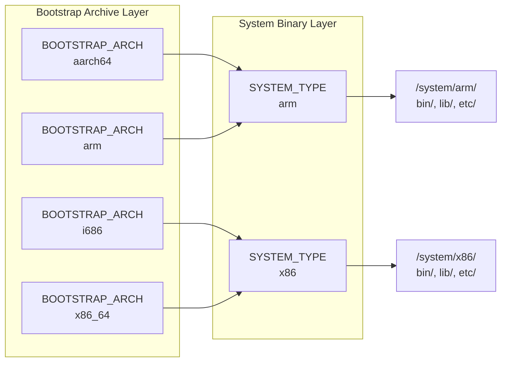
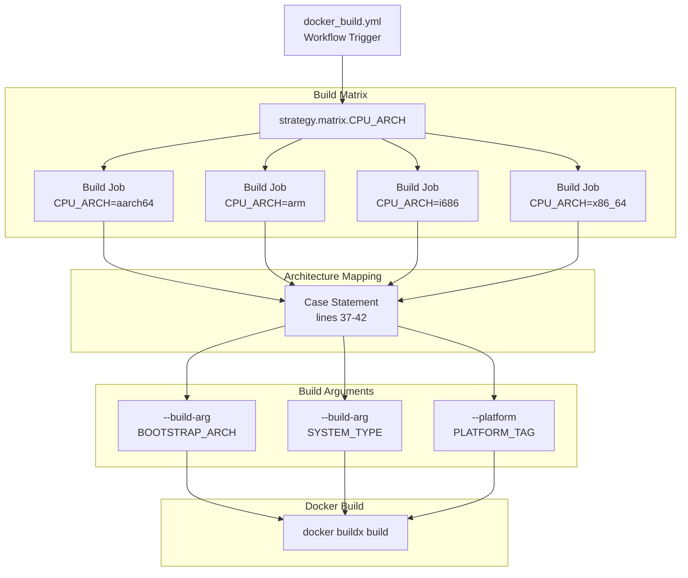
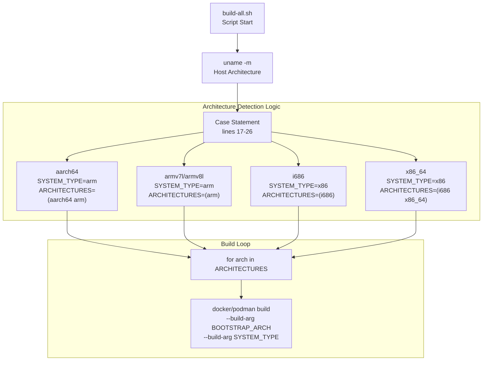
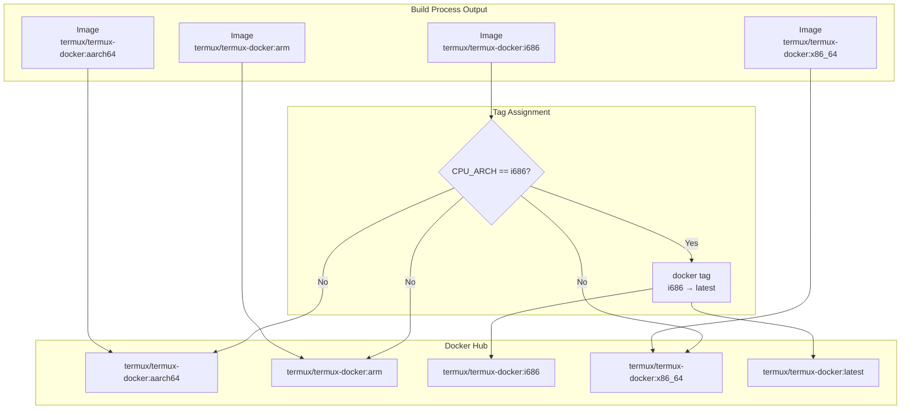
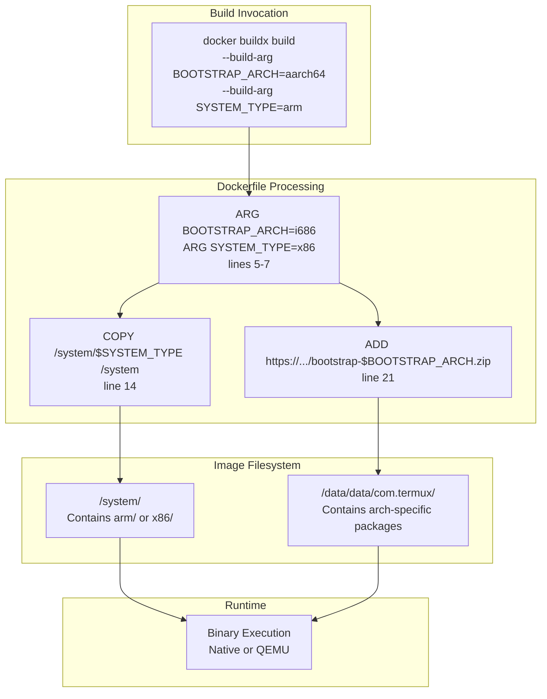

<!-- source: DeepWiki mcp.deepwiki.com · repo termux/termux-docker · page 5 Multi-Architecture Support · fetched 2026-10-26 -->

# Multi-Architecture Support

<details>
<summary>Relevant source files</summary>

The following files were used as context for generating this wiki page:

- [.github/workflows/docker_build.yml](.github/workflows/docker_build.yml)
- [Dockerfile](Dockerfile)
- [build-all.sh](build-all.sh)
- [entrypoint_root.sh](entrypoint_root.sh)

</details>


## Purpose and Scope

This document provides an overview of how termux-docker supports multiple CPU architectures (aarch64, arm, i686, x86_64) through a dual-classification system and matrix-based build strategy. It covers the architecture selection logic, bootstrap archive selection, and image tagging conventions used throughout the build process.

For details on the internal organization of architecture-specific binaries within the container image, see [Architecture-Specific Binaries](#5.1). For information about cross-platform execution using QEMU emulation, see [Cross-Platform Execution](#5.2).

---

## Supported Architectures

The project supports four CPU architectures, each requiring a specific Termux bootstrap archive and Docker platform tag:

| Architecture | Description | Bits | System Type | Docker Platform |
|-------------|-------------|------|-------------|-----------------|
| `aarch64` | ARM 64-bit | 64 | `arm` | `linux/arm64` |
| `arm` | ARM 32-bit (ARMv7) | 32 | `arm` | `linux/arm/v7` |
| `i686` | Intel/AMD 32-bit | 32 | `x86` | `linux/386` |
| `x86_64` | Intel/AMD 64-bit | 64 | `x86` | `linux/amd64` |

The `i686` architecture receives the special `latest` tag, making it the default image when users do not specify an architecture.

**Sources:** [.github/workflows/docker_build.yml:21-25](), [.github/workflows/docker_build.yml:37-42](), [.github/workflows/docker_build.yml:61-64]()

---

## Architecture Classification System

### Dual-Layer Architecture Model

The system uses two distinct architecture identifiers that serve different purposes:



**BOOTSTRAP_ARCH** determines which Termux package bootstrap archive is downloaded from GitHub releases. This must match exactly with the target CPU architecture because these archives contain compiled binaries specific to that instruction set.

**SYSTEM_TYPE** determines which `/system/` directory tree is copied into the image. Only two variants exist because the system-level utilities (shell, dnsmasq, libraries) can be shared between 32-bit and 64-bit variants of the same instruction set family.

**Sources:** [Dockerfile:5-7](), [Dockerfile:14](), [.github/workflows/docker_build.yml:37-42]()

---

## Build-Time Architecture Selection

### CI/CD Matrix Build Strategy

The GitHub Actions workflow uses a matrix strategy to build all four architectures in parallel:



Each matrix job executes independently with its CPU_ARCH value, then determines the corresponding SYSTEM_TYPE and PLATFORM_TAG through a case statement at [.github/workflows/docker_build.yml:37-42]().

**Sources:** [.github/workflows/docker_build.yml:19-25](), [.github/workflows/docker_build.yml:35-48]()

---

## Architecture Detection in Build Script

The `build-all.sh` script provides local build capability with automatic architecture detection:



The script automatically builds compatible architectures for the host system:
- **x86_64 hosts** can build both i686 and x86_64 images natively
- **aarch64 hosts** can build both arm and aarch64 images natively  
- **i686 hosts** can only build i686 images
- **ARM 32-bit hosts** can only build arm images

**Sources:** [build-all.sh:17-26](), [build-all.sh:28-35]()

---

## Architecture-to-Platform Mapping Table

The complete mapping between architecture identifiers used throughout the system:

| CPU_ARCH | BOOTSTRAP_ARCH | SYSTEM_TYPE | PLATFORM_TAG | Bootstrap URL Pattern |
|----------|----------------|-------------|--------------|----------------------|
| aarch64 | aarch64 | arm | linux/arm64 | `bootstrap-aarch64.zip` |
| arm | arm | arm | linux/arm/v7 | `bootstrap-arm.zip` |
| i686 | i686 | x86 | linux/386 | `bootstrap-i686.zip` |
| x86_64 | x86_64 | x86 | linux/amd64 | `bootstrap-x86_64.zip` |

The `PLATFORM_TAG` is passed to Docker's `--platform` flag to ensure the image metadata correctly identifies its target architecture. This enables Docker to pull the correct image variant on multi-architecture systems.

**Sources:** [.github/workflows/docker_build.yml:37-48](), [Dockerfile:5-7]()

---

## Bootstrap Archive Selection

### Download Process

The Dockerfile uses the BOOTSTRAP_ARCH build argument to construct the download URL:

```dockerfile
ARG BOOTSTRAP_ARCH=i686
ADD https://github.com/termux/termux-packages/releases/download/bootstrap-$BOOTSTRAP_VERSION/bootstrap-$BOOTSTRAP_ARCH.zip /bootstrap.zip
```

This downloads architecture-specific compiled packages from the termux-packages repository. Each bootstrap archive contains:
- Package manager binaries (apt, dpkg) compiled for the target architecture
- Core system utilities compiled for the target architecture
- Architecture-specific shared libraries
- Package database and configuration files

**Sources:** [Dockerfile:5-6](), [Dockerfile:21]()

---

## Image Tagging Strategy

### Tag Assignment Logic



The `i686` architecture receives the `latest` tag because:
1. It provides the widest compatibility across systems
2. x86_64 hosts can run i686 containers natively with minimal overhead
3. It serves as a sensible default for users not specifying an architecture

**Sources:** [.github/workflows/docker_build.yml:61-64](), [build-all.sh:41-46]()

---

## Build Argument Flow Through System

The following diagram traces how architecture parameters flow from build invocation through to the final image:



**Sources:** [Dockerfile:5-7](), [Dockerfile:14](), [Dockerfile:21]()

---

## Architecture Compatibility Matrix

This table shows which architectures can run on which hosts natively versus requiring emulation:

| Host Architecture | aarch64 Image | arm Image | i686 Image | x86_64 Image |
|-------------------|---------------|-----------|------------|--------------|
| **x86_64** | QEMU | QEMU | Native | Native |
| **i686** | QEMU | QEMU | Native | ❌ |
| **aarch64** | Native | Native | QEMU | QEMU |
| **armv7l** | ❌ | Native | QEMU | QEMU |

- **Native**: Binary execution using host CPU directly
- **QEMU**: Requires QEMU user-mode emulation via binfmt_misc
- **❌**: Not supported (32-bit host cannot run 64-bit binaries)

For details on QEMU setup and emulation mechanics, see [Cross-Platform Execution](#5.2).

**Sources:** [.github/workflows/docker_build.yml:31-33]()

---

